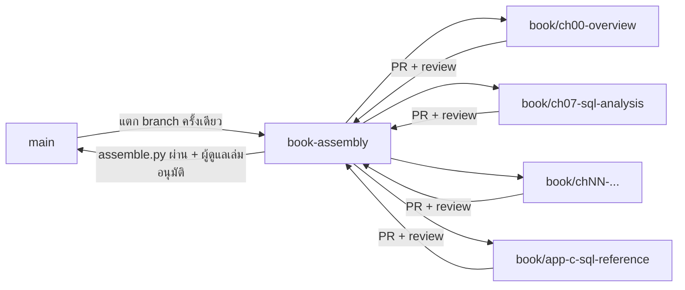

# คู่มือการเขียนหนังสือ *ชุดเครื่องมือสำหรับวิทยาการข้อมูล*

คู่มือนี้ใช้กับ **ผู้เขียนทุกคน ทั้งคนและ AI agent** เป้าหมายคือให้แต่ละบทซึ่งเขียนแยกกันอ่านแล้วเหมือนเขียนโดยคนเดียว ใช้ศัพท์ ข้อมูล โครงสร้าง และรูปแบบเดียวกัน และรวมเล่มได้โดยไม่ต้องแก้ตาม

> **กฎข้อแรก:** ถ้าคู่มือนี้ไม่ได้กำหนดเรื่องใดไว้ ให้ดูบทที่เขียนเสร็จแล้ว (สถานะ `done` ใน [STATUS.md](STATUS.md)) แล้วทำตาม ถ้ายังไม่แน่ใจ ให้เปิด issue ถาม แต่ห้ามคิดรูปแบบใหม่เอง

## สารบัญคู่มือ

1. [ไฟล์อ้างอิงที่ต้องอ่านก่อนเขียน](#ไฟล์อ้างอิงที่ต้องอ่านก่อนเขียน)
2. [โครงสร้างไฟล์ของเล่ม](#โครงสร้างไฟล์ของเล่ม)
3. [ขั้นตอนการทำงาน: จองบท → เขียน → review → รวม](#ขั้นตอนการทำงาน)
4. [โครงสร้างบังคับของแต่ละบท](#โครงสร้างบังคับของแต่ละบท)
5. [แบบการเขียน (style)](#แบบการเขียน)
6. [ข้อมูลกลางที่ทุกบทต้องใช้ตรงกัน](#ข้อมูลกลางที่ทุกบทต้องใช้ตรงกัน)
7. [โค้ด รูป ตาราง และการอ้างอิงข้ามบท](#โค้ด-รูป-ตาราง-และการอ้างอิงข้ามบท)
8. [อภิธานศัพท์ บรรณานุกรม และดัชนี](#อภิธานศัพท์-บรรณานุกรม-และดัชนี)
9. [ความถูกต้องและการตรวจสอบข้อเท็จจริง](#ความถูกต้องและการตรวจสอบข้อเท็จจริง)
10. [กฎเฉพาะสำหรับ AI agent](#กฎเฉพาะสำหรับ-ai-agent)
11. [Checklist ก่อนส่ง review (Definition of Done)](#checklist-ก่อนส่ง-review)

---

## ไฟล์อ้างอิงที่ต้องอ่านก่อนเขียน

| ไฟล์ | ใช้ทำอะไร | สถานะ |
|---|---|---|
| [toc.md](toc.md) | สารบัญและหัวข้อย่อยของทุกบท **ห้ามเพิ่มหรือลบหัวข้อเอง** | บังคับ |
| [AUTHORING.md](AUTHORING.md) | คู่มือนี้ | บังคับ |
| [terms.md](terms.md) | ศัพท์มาตรฐานไทย–อังกฤษที่ต้องใช้ให้ตรงกัน | บังคับ |
| [STATUS.md](STATUS.md) | ใครเขียนบทไหน สถานะเป็นอย่างไร | บังคับ |
| [_templates/chapter.qmd](_templates/chapter.qmd) | แม่แบบไฟล์บท ให้คัดลอกไปเริ่มเขียน | บังคับ |
| `../weeks/weekNN/index.md`, `lab.md` | เอกสารรายสัปดาห์ที่บทนั้นขยายความ (ดูตารางท้าย toc.md) | บังคับสำหรับบทที่ผูกกับสัปดาห์ |
| `../syllabus.md` | CLO นโยบายการใช้ AI และเครื่องมือของรายวิชา | อ่านครั้งเดียว |

**หนังสือต้องไม่ขัดแย้งกับเอกสารรายสัปดาห์** หนังสือเพิ่มความลึกได้ แต่ชื่อไฟล์ ชื่อตาราง ค่ามาตรฐาน และขั้นตอนต้องตรงกัน ถ้าพบว่าเอกสารรายสัปดาห์ผิด ให้เปิด issue แยก ห้ามแก้ใน PR ของบท

---

## โครงสร้างไฟล์ของเล่ม

```text
book/
├── AUTHORING.md            ← คู่มือนี้
├── STATUS.md               ← กระดานสถานะ (ไฟล์เดียวที่ทุกคนแก้ได้ แก้เฉพาะแถวของตน)
├── toc.md                  ← สารบัญ
├── terms.md                ← ศัพท์มาตรฐาน
├── _quarto.yml             ← ตั้งค่า Quarto book (ผู้ดูแลเล่มแก้เท่านั้น)
├── _templates/chapter.qmd  ← แม่แบบบท
├── index.qmd               ← คำนำ (ส่วนหน้า)
├── chapters/
│   ├── 00-overview.qmd     ← มีไฟล์ตั้งต้น (stub) ของทุกบทแล้ว ให้เขียนทับ
│   ├── ...
│   └── 22-ethics-ai.qmd
├── appendices/
│   ├── a-python.qmd        ← ภาคผนวก ก
│   ├── ...
│   ├── h-toolbox-reference.qmd  ← ภาคผนวก ซ
│   ├── g-answers.qmd       ← ภาคผนวก ช (ดึงทุกไฟล์ใน answers/ มารวม ห้ามแก้)
│   └── answers/NN.qmd      ← แนวคำตอบของบท NN (มีไฟล์ตั้งต้นพร้อม label แล้ว)
├── glossary/NN.yml         ← รายการศัพท์ที่บท NN นิยาม (ผู้ดูแลเล่มรวมเป็น glossary.qmd)
├── glossary.qmd            ← อภิธานศัพท์ (สร้างโดย scripts/assemble.py ห้ามแก้)
├── book-index.qmd          ← ดัชนี (สร้างโดย scripts/assemble.py ห้ามแก้)
├── scripts/assemble.py     ← script ตรวจและประกอบเล่ม
├── refs/NN.bib             ← บรรณานุกรมของบท NN (มีไฟล์ว่างของทุกบทแล้ว และ _quarto.yml อ่านทุกไฟล์)
├── refs/appendix.bib       ← บรรณานุกรมของภาคผนวก
├── references.qmd          ← บรรณานุกรม (Quarto สร้างจากทุก refs/*.bib)
├── images/NN/              ← รูปของบท NN
└── _book/                  ← ผลการ render (ไม่ commit)
```

**หลักการแบ่งไฟล์: หนึ่งบทเป็นเจ้าของไฟล์ของตัวเองทั้งหมด** ได้แก่ `chapters/NN-*.qmd`, `appendices/answers/NN.qmd`, `glossary/NN.yml`, `refs/NN.bib` และ `images/NN/` ผู้เขียนแก้ได้เฉพาะไฟล์ที่มีเลขบทของตน วิธีนี้ทำให้ผู้เขียนหลายคนทำงานพร้อมกันโดยไม่มี merge conflict

**เลขบทมาจากลำดับไฟล์ใน `_quarto.yml`** (ตรวจแล้วว่าบท 1–22 ได้เลขตรงกับ toc.md) และเลขหัวข้อ (เช่น 7.5) Quarto ใส่ให้อัตโนมัติ ห้ามพิมพ์เลขในหัวข้อเอง

**ข้อยกเว้นเรื่องเลข:** บทที่ 0 และภาคผนวก ก–ซ ไม่ให้ Quarto ใส่เลข หัวข้อ H1 ของไฟล์เหล่านี้เขียนเต็มพร้อม `{.unnumbered}` อยู่แล้วในไฟล์ตั้งต้น (เช่น `# ภาคผนวก ค SQL ฉบับอ้างอิงย่อ (DuckDB) {.unnumbered}`) หัวข้อย่อยในไฟล์เหล่านี้ให้**พิมพ์เลขเอง**ตาม toc.md และใส่ `{.unnumbered}` ทุกหัวข้อ เช่น `## 0.3 ศาสตร์ที่หลอมรวมอยู่ในเล่ม {.unnumbered}` หรือ `## ค.4 Window function ทั้งหมดพร้อมตัวอย่าง {.unnumbered}`

ชื่อไฟล์บท: `NN-slug.qmd` โดย `NN` เป็นเลขสองหลัก และ slug เป็นภาษาอังกฤษตัวพิมพ์เล็กคั่นด้วย `-` ให้ตรงกับตารางใน [STATUS.md](STATUS.md)

---

## ขั้นตอนการทำงาน

### หลักการ: เขียนแยกบท แล้วค่อยประกอบเล่ม

แต่ละบทเขียนใน **branch ของตัวเอง** และไม่แตะไฟล์ของบทอื่น เมื่อบทผ่าน review แล้วจึงนำมา **ประกอบ (assemble)** ใน branch กลางของเล่ม แล้วตรวจทั้งเล่มด้วย script ก่อนรวมเข้า `main`



| branch | ใช้ทำอะไร | ใครแก้ได้ |
|---|---|---|
| `main` | เวอร์ชันที่เผยแพร่ (เว็บไซต์รายวิชาและหนังสือฉบับที่ประกอบแล้ว) | ผู้ดูแลเล่มเท่านั้น |
| `book-assembly` | branch ประกอบเล่ม รวมบทที่ผ่าน review แล้ว | ผู้ดูแลเล่ม merge PR เข้ามาเท่านั้น ห้าม commit ตรง |
| `book/chNN-slug` | เขียนบทที่ NN (มี branch ของทุกบทเตรียมไว้แล้ว ชื่อตามคอลัมน์ branch ใน [STATUS.md](STATUS.md)) | ผู้เขียนบทนั้น |
| `book/app-X-slug` | เขียนภาคผนวก X | ผู้เขียนภาคผนวกนั้น |

### 1. จองบท
- แก้แถวของบทใน [STATUS.md](STATUS.md) **ใน branch ของบทตน**: ใส่ชื่อผู้เขียน (หรือ `agent:<ชื่อ>`) เปลี่ยนสถานะเป็น `drafting` ใส่วันที่ แล้ว commit และ push ทันที
- เปิด **draft pull request** จาก `book/chNN-slug` ไปที่ `book-assembly` ตั้งแต่ commit แรก เพื่อให้ทุกคนเห็นว่าบทนั้นมีเจ้าของแล้ว (draft PR คือ "การจอง")
- **คนเดียวถือได้ครั้งละไม่เกิน 2 บทที่อยู่ในสถานะ `drafting`**

### 2. เริ่มเขียนใน branch ของบท

```bash
git fetch origin
git switch book/ch07-sql-analysis          # branch ของบทที่จอง (มีอยู่แล้ว)
git merge origin/book-assembly             # รับไฟล์กลางล่าสุด (terms, toc, คู่มือ)
# ... เขียน chapters/07-sql-analysis.qmd และไฟล์ที่มีเลข 07 ...
git add chapters/07-sql-analysis.qmd glossary/07.yml refs/07.bib appendices/answers/07.qmd images/07/ STATUS.md
git commit -m "ch07: เขียนหัวข้อ 7.5 window function"
git push
```

- commit message ขึ้นต้นด้วยรหัสบท (`ch07:`) หรือรหัสภาคผนวก (`appc:`)
- commit ทีละหัวข้อย่อย ไม่ commit ทั้งบทครั้งเดียว
- **`git add` เฉพาะไฟล์ของบทตน** (ใส่ชื่อไฟล์ตรง ๆ ห้ามใช้ `git add .`) ถ้า `git status` แสดงไฟล์ของบทอื่นหรือไฟล์กลาง แปลว่าแก้ผิดที่
- ระหว่างเขียน ให้ `git merge origin/book-assembly` เป็นระยะ เพื่อรับศัพท์และ label ใหม่ที่บทอื่นเพิ่มเข้ามา

### 3. สถานะ

| สถานะ | ความหมาย |
|---|---|
| `todo` | ยังไม่มีผู้เขียน |
| `drafting` | กำลังเขียน (มี draft PR แล้ว) |
| `review` | เปลี่ยน PR จาก draft เป็น ready for review แล้ว |
| `revising` | แก้ตามความเห็นของผู้ตรวจ |
| `done` | merge เข้า `book-assembly` แล้ว |
| `published` | อยู่ใน `main` และเผยแพร่แล้ว |

### 4. Review และรวมเข้า `book-assembly`
- ก่อนเปลี่ยน PR เป็น ready for review ให้รัน `python scripts/assemble.py --chapter 07` แล้วแก้จนไม่มี error
- ผู้ตรวจ 1 คนต้องไม่ใช่ผู้เขียนบทนั้น และบทที่ agent เขียน **ต้องตรวจโดยคน**
- ผู้ตรวจใช้ [checklist ท้ายคู่มือ](#checklist-ก่อนส่ง-review) และเขียนความเห็นใน PR
- ผู้ดูแลเล่ม merge PR เข้า `book-assembly` และเปลี่ยนสถานะเป็น `done`

### 5. ประกอบเล่ม (ผู้ดูแลเล่ม)
เมื่อมีบท `done` เพิ่มเข้ามาใน `book-assembly`

```bash
git switch book-assembly && git pull
python scripts/assemble.py           # ตรวจทุกบท + สร้างอภิธานศัพท์ + สร้างดัชนี
quarto render                        # ใน book/ ต้องไม่มี error
git add glossary.qmd book-index.qmd && git commit -m "assemble: ประกอบเล่มรอบที่ N"
```

script `scripts/assemble.py` ทำ 4 อย่าง

1. **ตรวจโครงสร้าง** ทุกบทที่ไม่ใช่ `todo`: หัวข้อตรงกับ toc.md ทั้งชื่อและลำดับ มีหัวข้อประจำบทครบ ไม่มี `VERIFY` ค้าง ไม่มีเลขหัวข้อที่พิมพ์เอง และไม่มี code chunk ที่รันได้
2. **ตรวจไฟล์ร่วม:** BibTeX key ซ้ำข้ามบท ศัพท์ซ้ำข้ามบทใน `glossary/*.yml` และ label (`#sec-`/`#fig-`/`#tbl-`) ซ้ำข้ามบท
3. **สร้างอภิธานศัพท์** `glossary.qmd` จาก `glossary/*.yml`
4. **สร้างดัชนี** `book-index.qmd` จากเครื่องหมาย `.idx`, `.idx-tool`, `.idx-data` ในทุกบท

เมื่อพร้อมเผยแพร่ ผู้ดูแลเล่มเปิด PR จาก `book-assembly` ไปที่ `main`

### 6. เมื่อต้องแก้นอกบทของตน
- พบศัพท์ที่ยังไม่มีใน [terms.md](terms.md): เสนอในส่วน "ศัพท์ที่รอพิจารณา" ใน PR ของบท (เป็นไฟล์กลางไฟล์เดียวที่ผู้เขียนเพิ่มได้ และเพิ่มได้เฉพาะแถวในส่วนนั้น) ผู้ดูแลเล่มรับรองตอน merge
- อยากเพิ่มหรือเปลี่ยนหัวข้อใน toc.md, เห็นว่าบทอื่นหรือเอกสารรายสัปดาห์ผิด หรืออยากแก้ `_quarto.yml`: **เปิด issue** ห้ามแก้ใน PR ของบท
- ถ้าเกิด merge conflict ในไฟล์กลาง (STATUS.md, terms.md) ให้เก็บทั้งสองฝั่ง เพราะแต่ละบทแก้คนละแถว

---

## โครงสร้างบังคับของแต่ละบท

ทุกบทใช้หัวข้อระดับ 2 (`##`) ตามลำดับนี้ทุกครั้ง หัวข้อย่อยในส่วน "เนื้อหา" มาจาก toc.md ตรงตัว

หัวข้อประจำบท (วัตถุประสงค์ กรณีศึกษา ข้อผิดพลาดที่พบบ่อย สรุป แบบฝึกหัด อ่านเพิ่มเติม) **ต้องใส่ `{.unnumbered}`** เพื่อไม่ให้ Quarto นับเป็นหัวข้อ NN.x ทำให้เลขหัวข้อเนื้อหาตรงกับ toc.md เช่น `## สรุป {.unnumbered}` หรือ `## กรณีศึกษา: ... {#sec-ch07-case .unnumbered}`

| ลำดับ | หัวข้อ | ข้อกำหนด |
|---|---|---|
| — | front matter | ตามแม่แบบ ครบทุกฟิลด์ |
| — | บทนำสั้น | 1–2 ย่อหน้าก่อนหัวข้อแรก เล่าว่าบทนี้แก้ปัญหาอะไร และเชื่อมกับบทก่อนหน้าอย่างไร |
| 1 | `## วัตถุประสงค์การเรียนรู้` | 4–7 ข้อ ขึ้นต้นด้วยคำกริยาที่วัดได้ (อธิบาย เปรียบเทียบ ใช้ ออกแบบ ประเมิน) |
| 2 | `## <หัวข้อย่อย>` ทีละหัวข้อ | หัวข้อย่อยตาม toc.md **ชื่อตรงและลำดับตรง** แต่ไม่ต้องพิมพ์เลข (Quarto ใส่เลข NN.x ให้อัตโนมัติ) |
| 3 | `## กรณีศึกษา: ...` | นำเนื้อหาของบทไปใช้กับข้อมูล PM2.5 ตั้งแต่คำถามถึงข้อสรุป |
| 4 | `## ข้อผิดพลาดที่พบบ่อย` | ตาราง 3 คอลัมน์: ข้อผิดพลาด · ทำไมผิด · ทำอย่างไรแทน (5–10 แถว) |
| 5 | `## สรุป` | bullet 5–8 ข้อ |
| 6 | `## แบบฝึกหัด` | 3 ระดับ (ดูด้านล่าง) |
| 7 | `## อ่านเพิ่มเติม` | 3–8 รายการ อ้างด้วย `@key` จาก `refs/NN.bib` พร้อมคำอธิบายสั้นว่าทำไมควรอ่าน |

### ความยาว
- บทปกติประมาณ 6,000–10,000 คำ (ราว 25–40 หน้า A4) บทที่ 0, 18 และ 22 สั้นกว่าได้
- หัวข้อย่อยหนึ่งหัวข้อประมาณ 600–1,500 คำ ถ้าเกิน 2,000 คำให้แบ่งเป็นหัวข้อระดับ 3 (`###`)

### เนื้อหาเชิงลึก (★)
- หัวข้อที่มี ★ ใน toc.md ให้ใส่ ★ ไว้ท้ายชื่อหัวข้อ และเปิดหัวข้อด้วย callout นี้

```markdown
## Query plan, `EXPLAIN ANALYZE` และการปรับประสิทธิภาพ ★ {#sec-ch07-query-plan}

::: {.callout-note title="★ เนื้อหาเชิงลึก"}
หัวข้อนี้ไม่ได้สอนในชั้นเรียน อ่านข้ามได้โดยไม่กระทบความเข้าใจบทถัดไป
:::
```

- หัวข้อ ★ ต้องอ่านข้ามได้: **บทอื่นที่ไม่ใช่ ★ ห้ามพึ่งเนื้อหาในหัวข้อ ★**

### แบบฝึกหัด

```markdown
### ระดับพื้นฐาน
1. ...  (ทบทวนแนวคิด ตอบได้จากเนื้อหาในบทโดยตรง)

### ระดับประยุกต์
4. ...  (ลงมือกับข้อมูล PM2.5 หรือข้อมูลโดเมนอื่น)

### ระดับท้าทาย
8. ...  (ปลายเปิด ต้องค้นคว้าหรือออกแบบเอง)
```

- รวม 10–15 ข้อ เลขข้อเรียงต่อกันทั้งบท (ไม่เริ่มนับใหม่ในแต่ละระดับ) และอ้างถึงว่า "แบบฝึกหัด 7.4"
- แนวคำตอบของระดับพื้นฐานและประยุกต์ทุกข้อเขียนไว้ใน `appendices/answers/NN.qmd` ส่วนระดับท้าทายไม่มีเฉลย

---

## แบบการเขียน

### ภาษาและน้ำเสียง
- เขียนภาษาไทยวิชาการที่อ่านง่าย พูดกับผู้อ่านโดยตรงได้ ("ลองสังเกตว่า...") แต่ไม่ใช้ภาษาพูดหรือคำสแลง
- ประโยคหนึ่งมีความคิดเดียว ย่อหน้าหนึ่งไม่เกิน 6–7 บรรทัด
- อธิบาย **ทำไม** ก่อน **ทำอย่างไร** ทุกครั้ง
- ไม่ใช้ emoji ไม่ขึ้นต้นบทด้วยคำถามเชิงวาทศิลป์ และไม่เขียนคำเชื่อมฟุ่มเฟือย เช่น "อย่างไรก็ตาม" ทุกย่อหน้า

### ศัพท์เทคนิค
- ใช้ศัพท์ตาม [terms.md](terms.md) เท่านั้น
- **ครั้งแรกที่ใช้ในบท** ให้เขียนไทยแล้ววงเล็บอังกฤษ เช่น ข้อมูลสูญหาย (missing data) ครั้งต่อไปในบทเดียวกันใช้คำไทยอย่างเดียว
- คำที่ terms.md ระบุว่า "ใช้ทับศัพท์" เช่น commit, pull request, DataFrame ให้เขียนเป็นภาษาอังกฤษตลอด ไม่แปล
- ชื่อเฉพาะ (ไลบรารี ฟังก์ชัน คำสั่ง ชื่อไฟล์) ใส่ใน `backtick` เสมอ เช่น `pandas.melt`, `data/pm25.duckdb`

### ตัวเลข หน่วย และวันเวลา
- ใช้เลขอารบิกเสมอ ตัวเลขตั้งแต่ 4 หลักใส่จุลภาค (12,345) และทศนิยมใช้จุด
- หน่วย: µg/m³ (ไม่ใช้ ug/m3 ในเนื้อหา แต่ในโค้ดใช้ได้) เว้นวรรคระหว่างตัวเลขกับหน่วย: `37.5 µg/m³`
- ปี: ในเนื้อหาใช้ **พ.ศ.** และวงเล็บ ค.ศ. เมื่อจำเป็น เช่น พ.ศ. 2566 (ค.ศ. 2023) ส่วนในโค้ดและข้อมูลใช้ **ค.ศ.** เสมอ
- เวลา: ข้อมูลทั้งเล่มใช้เขตเวลา `Asia/Bangkok` (UTC+07:00) และรูปแบบ ISO 8601 `2026-01-15 08:00`

### Callout ที่อนุญาต
ใช้ได้ 4 แบบนี้เท่านั้น และไม่เกิน 1 กล่องต่อหน้าจอโดยเฉลี่ย

| callout | ใช้เมื่อ |
|---|---|
| `.callout-note` | ข้อมูลเสริมหรือที่มา (รวมกล่อง ★ เนื้อหาเชิงลึก) |
| `.callout-tip` | เคล็ดลับเชิงปฏิบัติ |
| `.callout-warning` | ข้อผิดพลาดที่ทำให้ผลผิดหรือข้อมูลเสียหาย |
| `.callout-important` | ข้อกฎหมาย จริยธรรม ความปลอดภัย (PDPA, ความลับ) |

---

## ข้อมูลกลางที่ทุกบทต้องใช้ตรงกัน

### กรณีศึกษาหลัก
ระบบสำรวจคุณภาพอากาศ PM2.5 ของประเทศไทยจาก Air4Thai (กรมควบคุมมลพิษ) มีสถาปัตยกรรมดังนี้

```text
แหล่งข้อมูล (API) → data/raw/*.json → DuckDB (data/pm25.duckdb) → pandas → Plotly → Streamlit
```

### ฐานข้อมูล `data/pm25.duckdb`

| ตาราง/view | คอลัมน์ | สร้างในบท/สัปดาห์ |
|---|---|---|
| `stations` | `station_id, name_th, name_en, province, region, lat, lon, station_type` | บท 6–7 / สัปดาห์ 4 |
| `measurements` | `station_id, ts, pm25, pm10, o3, co, no2, so2` (`ts` = TIMESTAMP, Asia/Bangkok, รายชั่วโมง, PK = `station_id, ts`) | บท 6–7 / สัปดาห์ 4 |
| `daily_pm25` | `station_id, date, pm25_mean, pm25_max, n_hours` | บท 8 / สัปดาห์ 5 |
| `measurements_clean` | คอลัมน์ของ `measurements` + `status`, `pm25_filled`, `is_filled` | บท 10 / สัปดาห์ 7 |
| `daily_pm25_clean` | `station_id, date, pm25_mean, pm25_max, n_hours, n_hours_observed, is_complete` | บท 10 / สัปดาห์ 7 |
| `station_clusters`, `daily_outlier_flags` | ตามบท 15 | บท 15 / สัปดาห์ 12 |

**ตั้งแต่บทที่ 11 เป็นต้นไป การวิเคราะห์ใช้ `daily_pm25_clean` เสมอ**

### โครงสร้าง repository โครงการ
`src/` (โค้ดที่รันซ้ำได้) · `notebooks/` · `app/` · `report/` · `reports/figures/` · `data/` (ไม่ commit) · `questions.md` · `AI_USAGE.md` · `data_dictionary.md`
script หลัก: `src/fetch_air4thai.py` → `src/load_duckdb.py` → `src/validate.py` → `src/clean.py` (รวมใน `src/run_pipeline.py`)

### ค่าคงที่และข้อเท็จจริง
| รายการ | ค่า | หมายเหตุ |
|---|---|---|
| มาตรฐาน PM2.5 เฉลี่ย 24 ชม. ของไทย | 37.5 µg/m³ | มีผลตั้งแต่ พ.ศ. 2566 |
| แนวทาง WHO (2021) PM2.5 เฉลี่ย 24 ชม. | 15 µg/m³ | |
| เกณฑ์ความครบถ้วนรายวัน | ≥ 18 จาก 24 ชั่วโมง | เป็น **ข้อกำหนดของโครงการ** ไม่ใช่มาตรฐานทางการ |
| ค่าแทนข้อมูลหายของ Air4Thai | `"-1"` (เป็นสตริง) | ตรวจสอบกับข้อมูลจริงเมื่อ ต.ค. 2569 |
| ช่วงข้อมูลสำรวจ / ข้อมูลยืนยัน | ปีเก่า = สำรวจ, ปีล่าสุด = ทดสอบ | ตามบทที่ 4 |

### เวอร์ชันซอฟต์แวร์อ้างอิง
Python 3.12 · DuckDB 1.x (ห้ามใช้ API ที่มีเฉพาะ 2.x) · pandas 2.x · Polars 1.x · Plotly 5–6 · Streamlit 1.x · Quarto ≥ 1.4 ดูรายการเต็มใน `../environment.yml`

---

## โค้ด รูป ตาราง และการอ้างอิงข้ามบท

### โค้ด
- ใช้ code block แบบไม่รัน (` ```python `, ` ```sql `, ` ```bash `) **ห้ามใช้ chunk ที่รันได้ (` ```{python} `)** ในไฟล์บท เพื่อให้เล่ม render ได้โดยไม่ต้องมีข้อมูล
- โค้ดทุกชิ้นต้อง **ทดสอบรันจริง** ในสภาพแวดล้อมของรายวิชาก่อนส่ง review แล้วระบุใน PR ว่าทดสอบกับข้อมูลจริงหรือไฟล์ตัวอย่าง
- ผลลัพธ์ที่แสดงให้วางในบล็อก ` ```text ` ต่อจากโค้ด และขึ้นต้นด้วยบรรทัด `# ผลลัพธ์ (ตัวอย่าง)`
- ไม่เกิน 30 บรรทัดต่อบล็อก ถ้ายาวกว่านั้นให้แบ่งพร้อมคำอธิบายคั่น
- comment ในโค้ดเขียนเป็นภาษาไทยได้ แต่ชื่อตัวแปรและฟังก์ชันใช้ภาษาอังกฤษ แบบ `snake_case`
- import ไลบรารีด้วยชื่อย่อมาตรฐาน: `import pandas as pd`, `import polars as pl`, `import plotly.express as px`, `import seaborn as sns`, `import numpy as np`, `import geopandas as gpd`, `import streamlit as st`
- เปิด DuckDB สำหรับการวิเคราะห์ด้วย `duckdb.connect("data/pm25.duckdb", read_only=True)` และใช้ `con.execute(...).fetchone()` แทน `con.sql(...).fetchone()`

### รูป
- แผนภาพแนวคิดใช้ ` ```{mermaid} ` ห้ามวาดด้วย ASCII art
- กราฟจากข้อมูลให้บันทึกเป็น PNG (กว้าง 1600 px) หรือ SVG ไว้ใน `images/NN/` และส่ง script ที่สร้างรูปไว้ใน `images/NN/make_figures.py`
- ทุกรูปต้องมี caption, label และ alt text ภาษาไทย

```markdown
{#fig-ch11-exceed-region fig-alt="กราฟแท่งแนวนอน ภาคเหนือมีสัดส่วนสูงสุด"}
```

- รูปจากแหล่งภายนอกใช้ได้เฉพาะเมื่อสัญญาอนุญาตเปิดให้ใช้ และต้องระบุที่มาใน caption

### ตาราง
- ตาราง markdown ที่มี caption และ label: `: คำอธิบายตาราง {#tbl-ch07-join-types}`
- ไม่เกิน 6 คอลัมน์ ถ้ามากกว่านั้นให้แบ่งตาราง

### Label และการอ้างอิงข้ามบท
| ชนิด | รูปแบบ label | ตัวอย่าง |
|---|---|---|
| หัวข้อ | `{#sec-chNN-slug}` | `{#sec-ch10-mice}` |
| รูป | `{#fig-chNN-slug}` | `{#fig-ch14-stl}` |
| ตาราง | `{#tbl-chNN-slug}` | `{#tbl-ch07-join-types}` |
| สมการ | `{#eq-chNN-slug}` | `{#eq-ch15-pca}` |

- อ้างถึงด้วย `@sec-ch10-mice` (Quarto ใส่เลขให้เอง) **ห้ามพิมพ์เลขหัวข้อหรือเลขหน้าเอง**
- ภาคผนวกใช้ `app` + อักษรละติน แทน `chNN` เช่น `{#sec-appc-window}` โดยเทียบอักษรไทยดังนี้ ก=a · ข=b · ค=c · ง=d · จ=e · ฉ=f · ช=g · ซ=h (ชื่อไฟล์ใน `appendices/` ใช้อักษรเดียวกัน) แนวคำตอบของบท NN ใช้ `{#sec-appg-chNN}`
- อ้างไปยังบทที่ยังไม่ได้เขียนได้ โดยใช้ label ตามรูปแบบนี้และตามหัวข้อใน toc.md ผู้ดูแลเล่มจะตรวจ label ที่ยังไม่มีอยู่ตอนรวมเล่ม

### สมการ
- ใช้ LaTeX ผ่าน `$...$` และ `$$...$$` พร้อม label ถ้าจะอ้างถึง
- ทุกสมการต้องมีคำอธิบายสัญลักษณ์เป็นภาษาไทยตามมา และมีตัวอย่างตัวเลขจากข้อมูล PM2.5 อย่างน้อย 1 ครั้งในหัวข้อนั้น

---

## อภิธานศัพท์ บรรณานุกรม และดัชนี

### อภิธานศัพท์ — `glossary/NN.yml`
บทที่ **นิยามศัพท์ครั้งแรกอย่างละเอียด** เป็นเจ้าของศัพท์นั้น ถ้าศัพท์มีอยู่แล้วในไฟล์ของบทอื่น ให้ใส่ `see_also` แทนการนิยามซ้ำ

```yaml
- term: Window function
  th: ฟังก์ชันหน้าต่าง
  definition: >
    ฟังก์ชัน SQL ที่คำนวณค่าจากกลุ่มแถวที่สัมพันธ์กับแถวปัจจุบัน
    โดยไม่ยุบแถวเหมือน GROUP BY เช่น ค่าเฉลี่ยเคลื่อนที่ 7 วัน
  section: sec-ch07-window
  see_also: [Aggregation, CTE]
```

- คำนิยาม 1–3 บรรทัด อ่านเข้าใจโดยไม่ต้องเปิดบท
- `term` ต้องตรงกับ terms.md

### บรรณานุกรม — `refs/NN.bib`
- เพิ่มรายการใน `refs/NN.bib` ของบทตนเท่านั้น ไม่ต้องใส่ `bibliography:` ใน front matter เพราะ `_quarto.yml` อ่านทุกไฟล์แล้ว
- รูปแบบ BibTeX ใช้ key แบบ `ผู้แต่งปีคำแรก` ตัวพิมพ์เล็ก เช่น `tukey1977exploratory`, `wickham2014tidy`
- ก่อนเพิ่ม key ให้ค้นในไฟล์ `refs/*.bib` ของบทอื่นก่อน ถ้ามีแล้วให้ใช้ key เดิม **ห้ามสร้าง key ซ้ำ**
- อ้างในเนื้อหาด้วย `[@tukey1977exploratory]` หรือ `@tukey1977exploratory`
- เอกสารทางการของเครื่องมือใช้ `@misc` ที่มี `url` และ `urldate`

### ดัชนี — ทำเครื่องหมายในเนื้อหา
ทำเครื่องหมายคำที่ควรอยู่ในดัชนี **ณ ตำแหน่งที่อธิบายคำนั้นจริง** (ไม่ใช่ทุกครั้งที่คำนั้นปรากฏ)

```markdown
การเติมค่าแบบหลายชุด ([multiple imputation]{.idx}) ช่วยให้...
ฟังก์ชัน [`st.cache_data`]{.idx-tool} เก็บผลลัพธ์ของ query...
ตาราง [`daily_pm25_clean`]{.idx-data} สร้างจาก...
```

| class | ดัชนี |
|---|---|
| `.idx` | ดัชนีหัวเรื่อง (แนวคิด/ศัพท์) |
| `.idx-tool` | ดัชนีเครื่องมือและฟังก์ชัน |
| `.idx-data` | ดัชนีชุดข้อมูลและกรณีศึกษา |

- ทำเครื่องหมาย 15–40 คำต่อบท `scripts/assemble.py` จะสร้างดัชนีจากเครื่องหมายเหล่านี้ (ใช้ label `#sec-` ของหัวข้อที่อยู่เหนือคำนั้นเป็นจุดอ้างอิง หัวข้อจึงต้องมี label)

---

## ความถูกต้องและการตรวจสอบข้อเท็จจริง

1. **ข้อเท็จจริง ตัวเลข กฎหมาย และประวัติศาสตร์ต้องมีแหล่งอ้างอิง** ถ้าหาแหล่งที่เชื่อถือได้ไม่พบ ให้ตัดข้อความนั้นออก
2. **ชื่อฟังก์ชัน พารามิเตอร์ และ endpoint ต้องตรวจกับเอกสารทางการหรือรันจริง** ห้ามเขียนจากความจำ
3. ข้อมูลที่เปลี่ยนตามเวลา เช่น endpoint ของ API หรือจำนวนสถานี ให้ระบุเดือนและปีที่ตรวจสอบ เช่น "(ตรวจสอบเมื่อ ต.ค. 2569)"
4. ตัวเลขที่ได้จากข้อมูล PM2.5 ต้องคำนวณจากโค้ดในบทได้จริง ห้ามแต่งตัวเลขประกอบตัวอย่าง ถ้าต้องการข้อมูลสมมุติให้ระบุว่า "ข้อมูลสมมุติ"
5. กฎหมาย (PDPA) ให้อ้างมาตราและแหล่งทางการ และใส่ callout `.callout-important` ว่าเนื้อหาไม่ใช่คำปรึกษาทางกฎหมาย
6. สิ่งที่ยังไม่แน่ใจให้ใส่ comment `<!-- VERIFY: ... -->` และระบุไว้ใน PR ห้าม merge บทที่ยังมี `VERIFY` ค้างอยู่

---

## กฎเฉพาะสำหรับ AI agent

กฎในส่วนนี้ใช้เพิ่มเติมจากกฎทุกข้อข้างต้น

### ก่อนเริ่ม
- อ่านไฟล์ในตาราง "ไฟล์อ้างอิงที่ต้องอ่านก่อนเขียน" ให้ครบ และอ่านบทที่สถานะ `done` อย่างน้อย 1 บทเพื่อเทียบรูปแบบ
- ทำงานเฉพาะบทหรือภาคผนวกที่ได้รับมอบหมาย และแก้ได้เฉพาะไฟล์ที่มีเลขบทของตน (ดู[โครงสร้างไฟล์](#โครงสร้างไฟล์ของเล่ม))

### ระหว่างเขียน
- ห้ามแก้ `toc.md`, `terms.md`, `AUTHORING.md`, `_quarto.yml`, ไฟล์ของบทอื่น และเอกสารรายสัปดาห์ ถ้าเห็นว่าควรแก้ ให้ใส่ไว้ในรายงาน
- ทำงานใน branch `book/chNN-slug` ของบทที่ได้รับมอบหมายเท่านั้น ห้าม commit ลง `book-assembly` หรือ `main` และห้าม merge PR เอง
- `git push` ได้เฉพาะ branch ของบทตน และเฉพาะเมื่อผู้มอบหมายอนุญาต ถ้าไม่ได้รับอนุญาต ให้ commit ไว้ในเครื่องแล้วรายงาน
- ห้ามสร้างไฟล์ข้อมูลจริงหรือข้อมูลส่วนบุคคล ถ้าต้องใช้ข้อมูลสมมุติ ให้สร้างด้วยโค้ดที่แสดงในบท
- ถ้ารันโค้ดทดสอบได้ ให้ใช้สภาพแวดล้อมแยก (เช่น venv ใน scratchpad) และห้ามติดตั้งแพ็กเกจลงระบบ

### รายงานเมื่อเขียนเสร็จ (ส่งให้ผู้มอบหมาย)

```text
บท: NN ชื่อบท
ไฟล์ที่เขียน: chapters/NN-*.qmd, glossary/NN.yml, refs/NN.bib, appendices/answers/NN.qmd, images/NN/...
จำนวนคำโดยประมาณ:
โค้ดที่ทดสอบแล้ว: (หัวข้อไหน ทดสอบกับอะไร เวอร์ชันใด)
โค้ดที่ยังไม่ได้ทดสอบ:
รายการ VERIFY ที่ค้างอยู่:
ศัพท์ที่เสนอเพิ่มใน terms.md:
ข้อขัดแย้งกับเอกสารรายสัปดาห์หรือบทอื่นที่พบ:
```

### แม่แบบคำสั่งมอบหมายงานให้ agent (สำหรับผู้มอบหมาย)

```text
เขียนบทที่ NN "<ชื่อบท>" ของหนังสือในโฟลเดอร์ book/ ของ repo <path>
1. อ่าน book/AUTHORING.md และทำตามทุกข้อ รวมถึงส่วน "กฎเฉพาะสำหรับ AI agent"
2. หัวข้อย่อยต้องตรงกับบทที่ NN ใน book/toc.md ทั้งชื่อและลำดับ (ไม่ต้องพิมพ์เลขหัวข้อ)
3. บทนี้ขยายความจากเอกสารสัปดาห์ที่ <W> (weeks/weekWW/index.md และ lab.md)
4. คัดลอก book/_templates/chapter.qmd ไปเป็น book/chapters/NN-<slug>.qmd แล้วเขียน
5. ทำงานใน branch book/chNN-<slug> (git switch book/chNN-<slug> แล้ว git merge origin/book-assembly)
6. ก่อนรายงาน รัน python scripts/assemble.py --chapter NN ให้ผ่าน
7. เมื่อเสร็จ ส่งรายงานตามรูปแบบใน AUTHORING.md
```

---

## Checklist ก่อนส่ง review

ผู้เขียนตรวจก่อนเปิด PR และผู้ตรวจใช้ชุดเดียวกัน

**โครงสร้าง**
- [ ] front matter ครบตามแม่แบบ และสถานะใน STATUS.md เป็น `review`
- [ ] หัวข้อย่อยตรงกับ toc.md ทั้งชื่อและลำดับ ไม่ขาดและไม่เกิน และไม่ได้พิมพ์เลขหัวข้อเอง
- [ ] มีครบทุกส่วนบังคับตามลำดับ (วัตถุประสงค์ → เนื้อหา → กรณีศึกษา → ข้อผิดพลาดที่พบบ่อย → สรุป → แบบฝึกหัด → อ่านเพิ่มเติม)
- [ ] หัวข้อ ★ มี callout และบทอื่นไม่ต้องพึ่งเนื้อหาในหัวข้อนั้น

**ความสอดคล้อง**
- [ ] ศัพท์ตรงกับ terms.md และครั้งแรกในบทมีวงเล็บภาษาอังกฤษ
- [ ] ชื่อตาราง ไฟล์ ค่าคงที่ และเวอร์ชันตรงกับ[ข้อมูลกลาง](#ข้อมูลกลางที่ทุกบทต้องใช้ตรงกัน)
- [ ] ไม่ขัดแย้งกับเอกสารรายสัปดาห์ที่เกี่ยวข้อง

**ความถูกต้อง**
- [ ] โค้ดทุกชิ้นทดสอบแล้ว และระบุใน PR ว่าทดสอบกับอะไร
- [ ] ข้อเท็จจริงและตัวเลขมีแหล่งอ้างอิง ไม่มี `VERIFY` ค้าง
- [ ] ไม่มีตัวเลขที่แต่งขึ้นโดยไม่ระบุว่าเป็นข้อมูลสมมุติ

**ส่วนประกอบ**
- [ ] รูปทุกรูปมี caption, label และ alt text และ script สร้างรูปอยู่ใน `images/NN/`
- [ ] การอ้างอิงข้ามบทใช้ `@sec-`/`@fig-`/`@tbl-` ไม่พิมพ์เลขเอง
- [ ] `glossary/NN.yml`, `refs/NN.bib` และ `appendices/answers/NN.qmd` ครบ และ key ไม่ซ้ำกับบทอื่น
- [ ] ทำเครื่องหมายดัชนี 15–40 คำ
- [ ] `python scripts/assemble.py --chapter NN` ไม่มี error
- [ ] รัน `quarto render` ในโฟลเดอร์ `book/` ผ่านโดยไม่มี warning ใหม่จากบทของตน (ดูตัวอย่างระหว่างเขียนด้วย `quarto preview chapters/NN-*.qmd`)
- [ ] `git status` แสดงเฉพาะไฟล์ของบทตน (และแถวของตนใน STATUS.md / terms.md)
