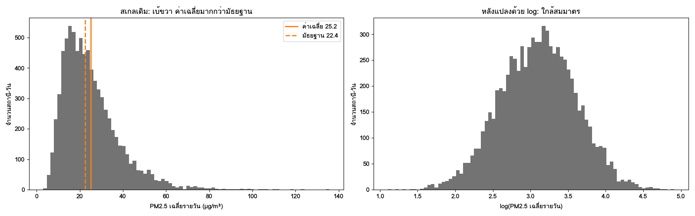
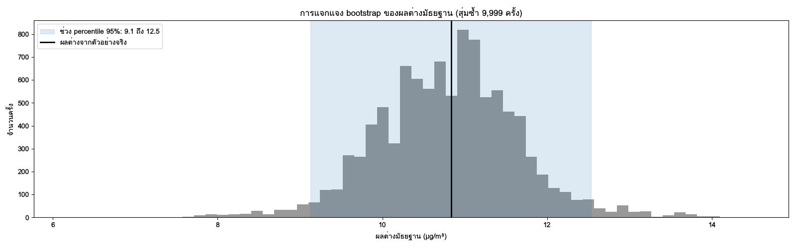

บทที่ 11 และ 12 ให้ *เบาะแส* จากภาพ เช่น "สถานีภาคเหนือดูสูงกว่าสถานีในกรุงเทพมหานครในฤดูแล้ง" บทนี้ถามต่ออีกสองข้อ ความต่างนั้น **ใหญ่แค่ไหน** และ **เชื่อได้แค่ไหน** John Tukey เปรียบการสำรวจข้อมูลว่าเป็นงานนักสืบ และการวิเคราะห์เชิงยืนยันว่าเป็นงานศาล [@tukey1977exploratory] นักสืบต้องเก็บร่องรอยให้ครบและไม่ด่วนสรุป ศาลต้องชั่งน้ำหนักหลักฐานตามกติกาที่ตั้งไว้ก่อนการพิจารณา บทนี้อยู่ตรงรอยต่อของสองงานนั้น

เนื้อหาเริ่มจากการบรรยายรูปร่างของข้อมูล ซึ่งสำหรับ PM2.5 มีลักษณะเฉพาะคือเบ้ขวา มีค่าเป็นบวกเสมอ และมีฤดูกาลชัด ต่อด้วยสถิติแบบทนทานและการแปลงข้อมูลที่เหมาะกับลักษณะนี้ จากนั้นจึงเข้าสู่การอนุมาน ได้แก่ ช่วงความเชื่อมั่น การทดสอบสมมติฐาน ขนาดอิทธิพล การทดสอบหลายครั้ง และกับดักของสหสัมพันธ์ ตลอดทั้งบทจะย้ำประเด็นเดียวกันซ้ำ ๆ คือ **ข้อมูลอนุกรมเวลาจากเครือข่ายสถานีไม่ใช่ตัวอย่างสุ่มที่เป็นอิสระต่อกัน** เครื่องมือสถิติทุกตัวจึงต้องใช้อย่างรู้ข้อจำกัด

## วัตถุประสงค์การเรียนรู้ {.unnumbered}

เมื่อจบบทนี้ ผู้อ่านสามารถ

1. อธิบายรูปร่างการแจกแจงของ PM2.5 ด้วยภาพและตัวเลข และเลือกสถิติแบบทนทานที่เหมาะกับข้อมูลเบ้
2. ใช้การแปลง log และ Box-Cox อย่างมีเหตุผล และแปลผลกลับเป็นหน่วยเดิมหรืออัตราส่วนได้ถูกต้อง
3. คำนวณและตีความช่วงความเชื่อมั่น โดยคำนึงถึงผลของ autocorrelation ต่อขนาดตัวอย่างที่มีผล
4. เลือกการทดสอบแบบ parametric หรือ non-parametric ตามคำถาม หน่วยการวิเคราะห์ และลักษณะของข้อมูล
5. รายงานขนาดอิทธิพลคู่กับ p-value และเขียนข้อสรุปที่ตรงกับความหนักแน่นของหลักฐาน
6. ใช้ bootstrap และ permutation test เมื่อสูตรสำเร็จรูปไม่เหมาะ
7. ปรับผลการเปรียบเทียบหลายครั้ง และระบุ Simpson's paradox กับ ecological fallacy ในข้อมูลจริงได้

## การแจกแจงและรูปร่างของข้อมูล {#sec-ch13-distribution}

### การแจกแจงเชิงประจักษ์

เมื่อพูดว่า "การแจกแจงของ PM2.5" เราหมายถึงคำตอบของคำถามว่า *ค่าแต่ละระดับเกิดบ่อยแค่ไหน* ข้อมูลที่มีอยู่ในมือให้ **การแจกแจงเชิงประจักษ์** (empirical distribution) ซึ่งดูได้สามแบบหลัก

| เครื่องมือ | แสดงอะไร | จุดแข็ง | จุดอ่อน |
|---|---|---|---|
| histogram | จำนวนค่าในแต่ละช่วง | อ่านง่าย คนทั่วไปคุ้น | รูปร่างขึ้นกับความกว้างของช่วง |
| KDE (kernel density) | ความหนาแน่นแบบเรียบ | เทียบหลายกลุ่มซ้อนกันได้ | bandwidth เปลี่ยนรูปร่าง และอาจลากเส้นไปต่ำกว่า 0 |
| ECDF | สัดส่วนของค่าที่ไม่เกินแต่ละระดับ | ไม่ต้องเลือกพารามิเตอร์ อ่านเปอร์เซ็นไทล์ได้ตรง | คนทั่วไปไม่คุ้น |

: เครื่องมือดูการแจกแจงเชิงประจักษ์ {#tbl-ch13-distribution-tools}

**ECDF** ([empirical cumulative distribution function]{.idx}) มีประโยชน์เป็นพิเศษกับคำถามเรื่องมาตรฐาน เพราะค่าบนแกน y ที่ตำแหน่ง x = 37.5 คือสัดส่วนของวันที่ *ไม่เกิน* มาตรฐานโดยตรง หนึ่งลบค่านั้นคือสัดส่วนวันที่เกินมาตรฐาน

```python
import duckdb
import numpy as np
import pandas as pd
import seaborn as sns
import matplotlib.pyplot as plt

con = duckdb.connect("data/pm25.duckdb", read_only=True)
daily = con.execute("""
    SELECT d.station_id, s.region, d.date, d.pm25_mean
    FROM daily_pm25_clean AS d JOIN stations AS s USING (station_id)
    WHERE d.is_complete AND d.date < DATE '2024-01-01'     -- ช่วงสำรวจ (บทที่ 4)
""").df()

fig, axes = plt.subplots(1, 2, figsize=(11, 4))
sns.histplot(daily, x="pm25_mean", bins=60, ax=axes[0])
sns.ecdfplot(daily, x="pm25_mean", hue="region", ax=axes[1])
for ax in axes:
    ax.axvline(37.5, color="black", linestyle="--", linewidth=1)
```

### ลักษณะเฉพาะของ PM2.5

ข้อมูลความเข้มข้นของมลพิษอากาศมีลักษณะที่พบซ้ำในงานวิจัยจำนวนมาก และควรตรวจกับข้อมูลของตนทุกครั้ง

1. **มีค่าเป็นบวกและมีขอบล่างที่ศูนย์** ค่าติดลบหรือศูนย์มักเป็นค่าแทนหรือความผิดพลาดของเครื่อง (บทที่ 9)
2. **เบ้ขวา** ค่าส่วนใหญ่อยู่ในช่วงต่ำถึงปานกลาง และมีหางยาวไปทางค่าสูง
3. **ใกล้การแจกแจงแบบ lognormal** Ott [@ott1990physical] อธิบายว่าความเข้มข้นเกิดจากการเจือจางหลายขั้นที่ *คูณ* กัน เช่น อัตราการปล่อย คูณการผสมของอากาศ คูณการพัดพา ผลคูณของปัจจัยสุ่มหลายตัวมีแนวโน้มเป็น lognormal ตามทฤษฎีบทขีดจำกัดกลางที่ใช้กับลอการิทึม
4. **เป็นส่วนผสมของหลายฤดู** การแจกแจงทั้งปีคือการรวมการแจกแจงของฤดูฝน (ค่าต่ำ แคบ) กับฤดูแล้ง (ค่าสูง กว้าง) จึงอาจมีสองยอด (bimodal) หรือมีไหล่ที่ผิดรูป

ข้อ 4 มีผลต่อการวิเคราะห์ทุกขั้นตอน สถิติสรุปของทั้งปีเป็นการเฉลี่ยข้ามกระบวนการที่ต่างกัน การ **แบ่งชั้นตามฤดู** ก่อนสรุปจึงมักให้ภาพที่ตรงกว่า

@fig-ch13-skew-log แสดงลักษณะข้อ 2 และ 3 กับข้อมูลสังเคราะห์ ในสเกลเดิมค่าเฉลี่ยถูกหางดึงไปทางขวาของมัธยฐาน หลังแปลงด้วย log รูปร่างใกล้สมมาตร

{#fig-ch13-skew-log fig-alt="ภาพซ้าย histogram มียอดอยู่ทางซ้ายและหางยาวไปทางขวา เส้นค่าเฉลี่ยอยู่ทางขวาของเส้นมัธยฐาน ภาพขวา histogram หลังแปลง log มีรูปร่างใกล้ระฆังคว่ำสมมาตร"}

### บรรยายรูปร่างด้วยตัวเลข

รูปร่างของการแจกแจงบรรยายได้ด้วยสี่ด้าน ได้แก่ ตำแหน่ง (location) การกระจาย (spread) [ความเบ้]{.idx} (skewness) และความหนาของหาง (kurtosis) ความเบ้ที่ใช้บ่อยคือสัมประสิทธิ์ความเบ้ของตัวอย่าง

$$
g_1 = \frac{\frac{1}{n}\sum_{i=1}^{n}(x_i - \bar{x})^3}{\left(\frac{1}{n}\sum_{i=1}^{n}(x_i - \bar{x})^2\right)^{3/2}}
$$ {#eq-ch13-skewness}

โดย $x_i$ คือค่าที่ $i$ ในตัวอย่าง $\bar{x}$ คือค่าเฉลี่ย และ $n$ คือจำนวนค่า ตัวเศษยกกำลังสามจึงคงเครื่องหมายไว้ ค่าที่อยู่ไกลทางขวามีส่วนทำให้ $g_1$ เป็นบวกมาก ตัวส่วนทำให้ค่าไม่มีหน่วย ค่า $g_1$ ใกล้ 0 แปลว่าเกือบสมมาตร และค่ามากกว่า 1 ถือว่าเบ้มากตามเกณฑ์คร่าว ๆ ที่ใช้ทั่วไป

**ตัวอย่าง (ข้อมูลสมมุติ)** ค่าเฉลี่ยรายวันเจ็ดวันของสถานีหนึ่งคือ 18, 22, 25, 31, 40, 52 และ 120 µg/m³ ค่าเฉลี่ยคือ 44.0 µg/m³ และ $g_1 \approx 1.62$ ค่าบวกมากเกิดจากวันที่มีค่า 120 เพียงวันเดียว ข้อมูลชุดนี้จะใช้ต่อในหัวข้อถัดไป

`scipy.stats.skew(x)` คำนวณ $g_1$ ตามสมการนี้เป็นค่าเริ่มต้น ส่วน `pandas.Series.skew()` ใช้สูตรที่ปรับความเอนเอียงสำหรับตัวอย่างเล็ก ค่าสองค่านี้จึงต่างกันเล็กน้อยเมื่อ $n$ น้อย ให้ระบุว่าใช้สูตรใดเมื่อรายงาน

### เทียบกับการแจกแจงทางทฤษฎีด้วย Q–Q plot

[Q–Q plot]{.idx} วางควอนไทล์ของข้อมูลเทียบกับควอนไทล์ของการแจกแจงทางทฤษฎี ถ้าจุดเรียงบนเส้นตรง แปลว่าข้อมูลมีรูปร่างตามการแจกแจงนั้น การวาด Q–Q plot ของ `log(pm25_mean)` เทียบกับการแจกแจงปกติคือการตรวจว่าข้อมูลใกล้ lognormal หรือไม่

```python
from scipy import stats

x = daily.loc[daily["pm25_mean"] > 0, "pm25_mean"]
fig, axes = plt.subplots(1, 2, figsize=(10, 4))
stats.probplot(x, dist="norm", plot=axes[0])
stats.probplot(np.log(x), dist="norm", plot=axes[1])
axes[0].set_title("ค่าเดิม เทียบการแจกแจงปกติ")
axes[1].set_title("log เทียบการแจกแจงปกติ")
```

ภาพซ้ายของข้อมูลเบ้ขวามักโค้งขึ้นที่ปลายขวา ภาพขวามักตรงกว่ามาก แต่อาจยังโค้งที่ปลายทั้งสองข้าง ซึ่งเกิดจากส่วนผสมของฤดูกาลหรือจากค่าต่ำที่ใกล้ขีดจำกัดการตรวจวัดของเครื่อง การอ่าน Q–Q plot ดีกว่าการทดสอบความเป็นปกติ เช่น Shapiro–Wilk เมื่อข้อมูลมีหลายพันค่า เพราะการทดสอบจะปฏิเสธความเป็นปกติเสมอด้วยความเบี่ยงเบนเล็กน้อยที่ไม่มีผลในทางปฏิบัติ

## robust statistics: median, IQR, MAD, trimmed mean {#sec-ch13-robust}

### ทำไมค่าเฉลี่ยจึงเปราะ

ใช้ข้อมูลสมมุติเจ็ดวันจากหัวข้อก่อน ค่าเฉลี่ยคือ 44.0 µg/m³ ซึ่งสูงกว่าค่าของหกในเจ็ดวัน ถ้าตัดวันที่มีค่า 120 ออก ค่าเฉลี่ยลดลงเหลือ 31.3 µg/m³ ทันที ขณะที่มัธยฐานเปลี่ยนจาก 31 เป็น 28 µg/m³ เท่านั้น ค่าเพียงค่าเดียวเปลี่ยนค่าเฉลี่ยไปเกือบ 13 µg/m³

แนวคิดที่ใช้วัดความเปราะนี้คือ **[breakdown point]{.idx}** คือสัดส่วนของข้อมูลที่ต้องเปลี่ยนเป็นค่าเลวร้ายเท่าใดจึงทำให้สถิตินั้นมีค่าเท่าใดก็ได้ ค่าเฉลี่ยมี breakdown point เป็น 0 เพราะเปลี่ยนค่าเดียวให้ใหญ่พอ ค่าเฉลี่ยก็ใหญ่ตามได้ไม่จำกัด มัธยฐานมี breakdown point 50% เพราะต้องเปลี่ยนข้อมูลเกินครึ่งจึงจะลากมัธยฐานไปได้ [@huber2009robust] **สถิติแบบทนทาน** ([robust statistics]{.idx}) คือสถิติที่มี breakdown point สูงและไม่ไวต่อค่าสุดขั้วจำนวนน้อย

### สถิติแบบทนทานที่ใช้บ่อย

| สถิติ | นิยาม | breakdown point | ค่าจากข้อมูลสมมุติ |
|---|---|---|---|
| ค่าเฉลี่ย | ผลรวมหารจำนวน | 0% | 44.0 |
| มัธยฐาน | ค่ากลางเมื่อเรียงลำดับ | 50% | 31.0 |
| [trimmed mean]{.idx} 20% | ตัดค่าต่ำสุดและสูงสุดข้างละ 20% แล้วเฉลี่ย | 20% | 34.0 |
| ส่วนเบี่ยงเบนมาตรฐาน | รากที่สองของความแปรปรวน | 0% | 35.5 |
| IQR | ควอร์ไทล์ที่ 3 ลบควอร์ไทล์ที่ 1 | 25% | 22.5 |
| MAD | มัธยฐานของ \|x − มัธยฐาน\| | 50% | 9.0 |

: สถิติตำแหน่งและการกระจายจากข้อมูลสมมุติเจ็ดวัน (µg/m³) {#tbl-ch13-robust-example}

ค่าในตารางคำนวณจากข้อมูลสมมุติ 18, 22, 25, 31, 40, 52, 120 ควอร์ไทล์ใช้การประมาณค่าในช่วงเชิงเส้นแบบเดียวกับ `quantile_cont` ของ DuckDB และค่าเริ่มต้นของ NumPy (Q1 = 23.5, Q3 = 46.0) trimmed mean 20% ของข้อมูลเจ็ดค่าตัดข้างละหนึ่งค่าตามวิธีของ `scipy.stats.trim_mean` ซึ่งปัดจำนวนที่ตัดลง

**MAD** ([median absolute deviation]{.idx}) คำนวณจากระยะห่างระหว่างแต่ละค่ากับมัธยฐาน แล้วหามัธยฐานของระยะเหล่านั้น สำหรับข้อมูลสมมุติ ระยะห่างจากมัธยฐาน 31 คือ 13, 9, 6, 0, 9, 21 และ 89 มัธยฐานของระยะคือ 9 µg/m³ เมื่อต้องการให้ MAD เทียบได้กับส่วนเบี่ยงเบนมาตรฐานของข้อมูลที่แจกแจงปกติ ให้คูณด้วยค่าคงที่ 1.4826

$$
\text{MAD}_{s} = 1.4826 \times \operatorname{median}_i \left| x_i - \operatorname{median}(x) \right|
$$ {#eq-ch13-mad}

โดย $\text{MAD}_s$ คือ MAD ที่ปรับสเกลแล้ว $x_i$ คือค่าแต่ละค่า และ 1.4826 คือส่วนกลับของควอนไทล์ที่ 0.75 ของการแจกแจงปกติมาตรฐาน ข้อมูลสมมุติได้ $\text{MAD}_s = 1.4826 \times 9 \approx 13.3$ µg/m³ ซึ่งต่ำกว่าส่วนเบี่ยงเบนมาตรฐาน 35.5 µg/m³ มาก เพราะไม่ถูกค่า 120 ดึง ค่า MAD ที่ปรับสเกลจะใช้ต่อในการตรวจค่าผิดปกติแบบทนทานในบทที่ 14 และ 15

### คำนวณใน DuckDB และ Python

DuckDB มีฟังก์ชันรวมกลุ่มที่ต้องใช้ครบ ทำให้สรุปทุกสถานีได้ใน query เดียว

```python
robust = con.execute("""
    SELECT s.region,
           count(*)                                    AS n_station_days,
           avg(d.pm25_mean)                            AS mean,
           median(d.pm25_mean)                         AS median,
           quantile_cont(d.pm25_mean, 0.75)
             - quantile_cont(d.pm25_mean, 0.25)        AS iqr,
           1.4826 * mad(d.pm25_mean)                   AS mad_scaled,
           quantile_cont(d.pm25_mean, 0.95)            AS p95,
           avg(CAST(d.pm25_mean > 37.5 AS DOUBLE))     AS share_over_std
    FROM daily_pm25_clean AS d JOIN stations AS s USING (station_id)
    WHERE d.is_complete AND d.date < DATE '2024-01-01'
    GROUP BY s.region ORDER BY median DESC
""").df()
```

ฝั่ง Python ใช้ `scipy.stats` ตรวจทานได้

```python
x = daily["pm25_mean"].to_numpy()
summary = {
    "median": np.median(x),
    "iqr": stats.iqr(x),
    "mad_scaled": stats.median_abs_deviation(x, scale="normal"),
    "trim_mean_10": stats.trim_mean(x, proportiontocut=0.10),
}
```

`scale="normal"` คูณด้วย 1.4826 ให้อัตโนมัติ ค่าที่ได้ควรตรงกับผลจาก DuckDB ถ้าไม่ตรง ให้ตรวจว่ากรองข้อมูลเหมือนกันหรือไม่ เช่น ลืมใส่ `is_complete`

### เมื่อใดยังควรใช้ค่าเฉลี่ย

สถิติแบบทนทานไม่ได้ดีกว่าในทุกงาน ค่าเฉลี่ยยังเป็นค่าที่ถูกต้องในสามกรณี

1. **เมื่อนิยามบังคับ** มาตรฐาน PM2.5 ของไทยนิยามบนค่าเฉลี่ย 24 ชั่วโมง การเทียบมาตรฐานจึงต้องใช้ค่าเฉลี่ยรายวัน ไม่ใช่มัธยฐานรายชั่วโมง
2. **เมื่อต้องการปริมาณรวม** การได้รับสัมผัสสะสม (exposure) ของคนที่อยู่ในพื้นที่ตลอดปีสัมพันธ์กับผลรวม ซึ่งค่าเฉลี่ยสะท้อนได้ ส่วนมัธยฐานไม่รับรู้วันที่แย่มากเลย
3. **เมื่อค่าสุดขั้วคือสิ่งที่สนใจ** ถ้าคำถามคือผลกระทบต่อสุขภาพในวันที่ฝุ่นหนัก การตัดหางทิ้งด้วย trimmed mean คือการทิ้งคำตอบ

ข้อแนะนำคือรายงาน **ทั้งค่าที่บอกระดับทั่วไปและค่าที่บอกหาง** เช่น มัธยฐานคู่กับเปอร์เซ็นไทล์ที่ 95 และสัดส่วนวันที่เกินมาตรฐาน แทนการเลือกค่าเดียว

## การแปลงข้อมูล: log, Box-Cox {#sec-ch13-transform}

### เหตุผลของการแปลง

การแปลงข้อมูลไม่ใช่การ "ทำให้ข้อมูลสวย" แต่มีเหตุผลเฉพาะสี่ข้อ

1. **ทำให้สมมาตรขึ้น** วิธีที่สมมติความเป็นปกติ เช่น t-test ทำงานดีขึ้น และค่าเฉลี่ยกับมัธยฐานใกล้กัน
2. **ทำให้ความแปรปรวนคงที่** ข้อมูลความเข้มข้นมักแปรผันมากขึ้นเมื่อระดับสูงขึ้น การแปลงที่เหมาะทำให้ความแปรผันใกล้เคียงกันทุกระดับ
3. **เปลี่ยนผลคูณเป็นผลบวก** ถ้ากระบวนการเป็นแบบคูณ (หัวข้อ @sec-ch13-distribution) log ทำให้แบบจำลองเชิงเส้นและการแยกองค์ประกอบในบทที่ 14 ใช้ได้
4. **ทำให้ผลอ่านเป็นอัตราส่วน** ความต่างบน log คือ log ของอัตราส่วน ข้อสรุปแบบ "สูงกว่าประมาณ 1.6 เท่า" เข้ากับธรรมชาติของมลพิษมากกว่า "สูงกว่า 15 µg/m³" ซึ่งมีความหมายต่างกันมากถ้าระดับฐานต่างกัน

### log และปัญหาของค่าศูนย์

log ธรรมชาติของค่า 0 ไม่มีนิยาม ข้อมูล PM2.5 ที่ผ่านการทำความสะอาดในบทที่ 9 และ 10 ไม่ควรมีค่าศูนย์หรือติดลบ แต่ถ้ามี ต้องถามก่อนว่าค่าเหล่านั้นคืออะไร

| สถานการณ์ | วิธีที่เหมาะ |
|---|---|
| ค่าศูนย์เป็นค่าแทนของข้อมูลหาย | แปลงเป็น NULL ตามกฎในพจนานุกรมข้อมูล (data dictionary) ไม่ใช่เติมค่า |
| ค่าต่ำกว่าขีดจำกัดการตรวจวัดของเครื่อง | แทนด้วยครึ่งหนึ่งของขีดจำกัด หรือใช้วิธีสำหรับข้อมูลถูกตัด และบันทึกไว้ |
| ค่าศูนย์จริงในข้อมูลที่ไม่ใช่ความเข้มข้น เช่น จำนวนวันที่เกินมาตรฐาน | ใช้ $\log(x + c)$ พร้อมทดสอบว่าผลไวต่อ $c$ แค่ไหน หรือใช้ Yeo-Johnson |

: การจัดการค่าศูนย์ก่อนแปลง log {#tbl-ch13-log-zero}

`np.log1p(x)` คือ $\log(1 + x)$ ซึ่งสะดวกแต่เปลี่ยนความหมาย สำหรับ PM2.5 ระดับ 5 µg/m³ การบวก 1 คือการเพิ่มค่า 20% ส่วนที่ระดับ 100 µg/m³ เพิ่มเพียง 1% ผลจึงไม่ใช่อัตราส่วนบริสุทธิ์อีกต่อไป ควรใช้เมื่อจำเป็นและเขียนกำกับไว้

### Box-Cox

Box และ Cox [@box1964analysis] เสนอตระกูลของการแปลงกำลังที่มี log เป็นกรณีพิเศษ

$$
y^{(\lambda)} =
\begin{cases}
\dfrac{y^{\lambda} - 1}{\lambda}, & \lambda \neq 0 \\[6pt]
\log y, & \lambda = 0
\end{cases}
$$ {#eq-ch13-boxcox}

โดย $y$ คือค่าที่เป็นบวก และ $\lambda$ คือพารามิเตอร์ที่กำหนดความแรงของการแปลง $\lambda = 1$ แทบไม่เปลี่ยนรูปร่าง (เลื่อนค่าลงหนึ่ง) $\lambda = 0.5$ ใกล้กับรากที่สอง และ $\lambda = 0$ คือ log การหาร $\lambda$ และลบหนึ่งทำให้สูตรต่อเนื่องที่ $\lambda = 0$ ตัวอย่างเช่น PM2.5 เท่ากับ 36 µg/m³ เมื่อ $\lambda = 0.5$ ได้ $(36^{0.5} - 1)/0.5 = (6 - 1)/0.5 = 10$ และเมื่อ $\lambda = 0$ ได้ $\log 36 \approx 3.58$

`scipy.stats.boxcox` หาค่า $\lambda$ ที่ทำให้ข้อมูลใกล้การแจกแจงปกติที่สุดด้วยวิธีภาวะน่าจะเป็นสูงสุด

```python
x = daily.loc[daily["pm25_mean"] > 0, "pm25_mean"].to_numpy()
y_bc, lam_hat, (lam_lo, lam_hi) = stats.boxcox(x, alpha=0.05)   # alpha ทำให้คืนช่วงความเชื่อมั่นของ lambda ด้วย
print(f"lambda = {lam_hat:.2f}  (95% CI {lam_lo:.2f} ถึง {lam_hi:.2f})")
```

ถ้าค่า $\lambda$ ที่ได้ใกล้ 0 การใช้ log ธรรมดาดีกว่า เพราะตีความเป็นอัตราส่วนได้ ส่วน $\lambda$ เช่น 0.13 ไม่มีความหมายเชิงโดเมน ผู้อ่านเข้าใจยาก หลักทั่วไปคือ **ใช้ [Box-Cox]{.idx} เพื่อตรวจว่าการแปลงแบบใดเหมาะ แล้วเลือกการแปลงที่ตีความได้ใกล้ที่สุด** ถ้าข้อมูลมีค่าศูนย์หรือติดลบที่เป็นค่าจริง ให้ใช้ Yeo-Johnson (`stats.yeojohnson`) ซึ่งขยายแนวคิดเดียวกันไปยังทุกค่าจริง

### แปลผลกลับ

เมื่อวิเคราะห์บน log แล้ว ต้องแปลผลกลับให้ถูก กฎที่ต้องจำมีสามข้อ

1. **มัธยฐานและเปอร์เซ็นไทล์แปลงกลับได้ตรง** เพราะ log เป็นฟังก์ชันเพิ่มทางเดียว มัธยฐานของ log คือ log ของมัธยฐาน
2. **ค่าเฉลี่ยของ log ไม่ใช่ log ของค่าเฉลี่ย** $\exp(\overline{\log x})$ คือ **[ค่าเฉลี่ยเรขาคณิต]{.idx}** (geometric mean) ซึ่งต่ำกว่าค่าเฉลี่ยเลขคณิตเสมอเมื่อข้อมูลไม่คงที่ (อสมการของ Jensen) ข้อมูลสมมุติเจ็ดวันมีค่าเฉลี่ยเรขาคณิต 35.9 µg/m³ เทียบกับค่าเฉลี่ยเลขคณิต 44.0 µg/m³
3. **ความต่างบน log คืออัตราส่วนบนหน่วยเดิม** ถ้าค่าเฉลี่ยของ log ต่างกัน 0.47 อัตราส่วนของค่าเฉลี่ยเรขาคณิตคือ $e^{0.47} \approx 1.6$ เท่า

ในรายงานให้เขียนกำกับเสมอว่าค่าที่แสดงเป็นค่าเฉลี่ยเรขาคณิต และห้ามนำค่าเฉลี่ยเรขาคณิตไปเทียบกับมาตรฐาน 37.5 µg/m³ ซึ่งนิยามบนค่าเฉลี่ยเลขคณิตรายวัน

## ประชากร ตัวอย่าง และช่วงความเชื่อมั่น {#sec-ch13-ci}

### ประชากรของข้อมูล PM2.5 คืออะไร

สถิติอนุมานตั้งอยู่บนแนวคิดว่าข้อมูลที่มีเป็น *ตัวอย่าง* จาก *ประชากร* ที่ใหญ่กว่า แล้วถามว่าสิ่งที่เห็นในตัวอย่างบอกอะไรเกี่ยวกับประชากรได้บ้าง คำถามแรกที่ต้องตอบให้ได้ก่อนคำนวณอะไรคือ **ประชากรคืออะไร**

สำหรับข้อมูล PM2.5 คำตอบไม่ชัดเท่าการสำรวจความคิดเห็นที่สุ่มคนจากทะเบียน

- **สถานีไม่ได้ถูกสุ่ม** เครือข่ายของกรมควบคุมมลพิษตั้งสถานีตามวัตถุประสงค์การเฝ้าระวัง สถานีจำนวนมากอยู่ในเมืองหรือริมถนน ค่าเฉลี่ยของสถานีจึงไม่ใช่ค่าเฉลี่ยของพื้นที่หรือของประชากรคน
- **วันเวลาไม่ได้ถูกสุ่ม** ข้อมูลหลายปีเป็นลำดับต่อเนื่อง ค่าวันนี้สัมพันธ์กับเมื่อวาน (บทที่ 14)
- **ประชากรที่สนใจมักเป็นกระบวนการ** คำถามแบบ "ฤดูแล้งของภาคเหนือมี PM2.5 สูงกว่าฤดูฝนหรือไม่" หมายถึงกระบวนการที่สร้างข้อมูลในสภาพปัจจุบัน ซึ่งปีที่สังเกตได้เป็นเพียงบางส่วน

ข้อสรุปเชิงปฏิบัติคือ [ช่วงความเชื่อมั่น]{.idx}และ p-value จากข้อมูลชุดนี้บอก **ความไม่แน่นอนจากความผันแปรตามธรรมชาติภายใต้สมมติฐานของแบบจำลอง** ไม่ได้บอกความไม่แน่นอนจากการเลือกที่ตั้งสถานี ต้องเขียนข้อจำกัดนี้ไว้ในรายงานเสมอ

### การแจกแจงของตัวอย่างและความคลาดเคลื่อนมาตรฐาน

ถ้าเก็บตัวอย่างขนาด $n$ ซ้ำหลายครั้ง ค่าเฉลี่ยของแต่ละครั้งจะต่างกันไป การแจกแจงของค่าเฉลี่ยเหล่านั้นเรียกว่า **การแจกแจงของตัวอย่าง** (sampling distribution) ส่วนเบี่ยงเบนมาตรฐานของการแจกแจงนี้คือ **[ความคลาดเคลื่อนมาตรฐาน]{.idx}** (standard error) ซึ่งสำหรับค่าเฉลี่ยของค่าที่เป็นอิสระต่อกันประมาณได้ด้วย $s/\sqrt{n}$ ทฤษฎีบทขีดจำกัดกลางบอกว่าเมื่อ $n$ ใหญ่พอ การแจกแจงของค่าเฉลี่ยจะใกล้การแจกแจงปกติไม่ว่าข้อมูลเดิมจะมีรูปร่างอย่างไร (ภาคผนวก จ) แต่ "ใหญ่พอ" สำหรับข้อมูลเบ้มากอย่าง PM2.5 อาจต้องใช้หลายสิบถึงหลายร้อยค่า

### ช่วงความเชื่อมั่นของค่าเฉลี่ยเรขาคณิต

วิธีที่เหมาะกับ PM2.5 คือคำนวณช่วงความเชื่อมั่นบน log แล้วแปลงกลับ ได้ช่วงความเชื่อมั่นของค่าเฉลี่ยเรขาคณิต

$$
\exp\left(\bar{\ell} \pm t_{n-1,\,0.975}\,\frac{s_\ell}{\sqrt{n}}\right)
$$ {#eq-ch13-ci-gm}

โดย $\bar{\ell}$ และ $s_\ell$ คือค่าเฉลี่ยและส่วนเบี่ยงเบนมาตรฐานของ $\log x$ $n$ คือจำนวนค่า และ $t_{n-1,\,0.975}$ คือควอนไทล์ของการแจกแจง t ที่มีองศาอิสระ $n-1$ สำหรับช่วงความเชื่อมั่น 95% ข้อมูลสมมุติเจ็ดวันมี $\bar{\ell} = 3.580$, $s_\ell = 0.642$ และ $t_{6,\,0.975} = 2.447$ ได้ช่วงความเชื่อมั่น 95% ของค่าเฉลี่ยเรขาคณิตประมาณ 19.8 ถึง 65.0 µg/m³ ช่วงนี้ไม่สมมาตรรอบ 35.9 µg/m³ ซึ่งตรงกับธรรมชาติของข้อมูลที่เบ้ขวา ส่วนช่วงที่กว้างมากสะท้อนว่าข้อมูลเจ็ดวันบอกได้น้อย

```python
def gm_ci(x, level=0.95):
    """ช่วงความเชื่อมั่นของค่าเฉลี่ยเรขาคณิต (สมมติว่าค่าเป็นอิสระต่อกัน)"""
    lx = np.log(np.asarray(x, float))
    n, m, s = len(lx), lx.mean(), lx.std(ddof=1)
    t = stats.t.ppf(0.5 + level / 2, df=n - 1)
    return np.exp(m), np.exp(m - t * s / np.sqrt(n)), np.exp(m + t * s / np.sqrt(n))

gm_ci([18, 22, 25, 31, 40, 52, 120])      # ข้อมูลสมมุติ
```

```text
# ผลลัพธ์ (ตัวอย่าง)
(35.88..., 19.81..., 64.98...)
```

### ความหมายที่ถูกของช่วงความเชื่อมั่น

ช่วงความเชื่อมั่น 95% **ไม่ได้** แปลว่า "ความน่าจะเป็นที่ค่าจริงอยู่ในช่วงนี้คือ 95%" ในมุมมองแบบความถี่ (frequentist) ค่าจริงเป็นค่าคงที่ที่ไม่รู้ และช่วงที่คำนวณได้ครั้งนี้ครอบหรือไม่ครอบค่าจริงก็ได้ สิ่งที่ 95% หมายถึงคือ **ถ้าทำซ้ำกระบวนการเก็บตัวอย่างและคำนวณช่วงหลายครั้ง ช่วงประมาณ 95% ของทั้งหมดจะครอบค่าจริง** [@greenland2016statistical] ในการสื่อสารทั่วไป การเขียนว่า "ค่าที่สอดคล้องกับข้อมูลอยู่ระหว่าง 19.8 ถึง 65.0 µg/m³" ใกล้ความหมายจริงกว่าและเข้าใจง่ายกว่า

### ช่วงความเชื่อมั่นของสัดส่วน

สัดส่วนวันที่เกินมาตรฐานเป็นตัวชี้วัดที่ใช้สื่อสารบ่อยที่สุด ช่วงความเชื่อมั่นแบบตำราเรียน $\hat{p} \pm 1.96\sqrt{\hat{p}(1-\hat{p})/n}$ (Wald) ทำงานแย่เมื่อสัดส่วนใกล้ 0 หรือ 1 หรือ $n$ เล็ก และอาจให้ขอบล่างติดลบ วิธี Wilson [@brown2001interval] เหมาะกว่า

```python
from statsmodels.stats.proportion import proportion_confint

exceed_days, n_days = 23, 90            # ข้อมูลสมมุติ: เกิน 23 จาก 90 วัน
lo, hi = proportion_confint(exceed_days, n_days, alpha=0.05, method="wilson")
```

### autocorrelation ทำให้ขนาดตัวอย่างที่มีผลเล็กลง

สูตรทุกสูตรข้างต้นสมมติว่าค่าเป็นอิสระต่อกัน ข้อมูล PM2.5 รายวันของสถานีเดียวกันละเมิดสมมติฐานนี้อย่างรุนแรง ถ้าค่าวันนี้สัมพันธ์กับเมื่อวานด้วยสหสัมพันธ์ในตัว (autocorrelation) $\rho$ ตามแบบจำลอง AR(1) **[ขนาดตัวอย่างที่มีผล]{.idx}** (effective sample size) ประมาณได้ด้วย

$$
n_{\text{eff}} \approx n\,\frac{1-\rho}{1+\rho}
$$ {#eq-ch13-neff}

โดย $n$ คือจำนวนค่าจริง และ $\rho$ คือ autocorrelation ที่ lag 1 สูตรนี้ใช้กับค่าเฉลี่ยของอนุกรมที่ stationary และมีโครงสร้างแบบ AR(1) [@wilks2011statistical] ตัวอย่างเช่น ข้อมูลฤดูแล้ง 120 วันที่มี $\rho = 0.8$ ได้ $n_{\text{eff}} \approx 120 \times 0.2 / 1.8 \approx 13$ ข้อมูล 120 วันจึงมีข้อมูลอิสระเทียบเท่าเพียงราว 13 วัน ความคลาดเคลื่อนมาตรฐานที่คำนวณด้วย $n = 120$ จะแคบเกินจริงประมาณสามเท่า ($\sqrt{120/13} \approx 3$)

ทางแก้ที่ใช้ในเล่มมีสามระดับ

1. **สรุปเป็นหน่วยที่ใกล้อิสระ** เช่น หนึ่งค่าต่อสถานีต่อฤดู แล้วเทียบระหว่างสถานี (หัวข้อถัดไป)
2. **ใช้ bootstrap แบบบล็อก** ที่สุ่มเป็นช่วงต่อเนื่องเพื่อรักษาโครงสร้างตามเวลา (@sec-ch13-resampling)
3. **ใช้แบบจำลองอนุกรมเวลา** ที่รวม autocorrelation ไว้ในแบบจำลองโดยตรง ซึ่งอยู่นอกขอบเขตของเล่มนี้

## การทดสอบสมมติฐาน: parametric และ non-parametric {#sec-ch13-tests}

### ตรรกะของการทดสอบ

การทดสอบสมมติฐานเชิงสถิติมีโครงสร้างเดียวกันทุกวิธี

1. ตั้ง **[สมมติฐานว่าง]{.idx}** ($H_0$) เช่น "สถานีภาคเหนือและสถานีกรุงเทพมหานครมีระดับ PM2.5 ฤดูแล้งเท่ากัน" และ **สมมติฐานทางเลือก** ($H_1$) เช่น "ไม่เท่ากัน"
2. เลือก **สถิติทดสอบ** ที่วัดความห่างของข้อมูลจาก $H_0$ เช่น ความต่างของค่าเฉลี่ยหารด้วยความคลาดเคลื่อนมาตรฐาน
3. หา **การแจกแจงของสถิติทดสอบเมื่อ $H_0$ เป็นจริง** จากทฤษฎีหรือจากการจำลอง
4. **[p-value]{.idx}** คือความน่าจะเป็นที่จะได้สถิติทดสอบที่สุดขั้วเท่ากับหรือมากกว่าที่สังเกตได้ *ถ้า $H_0$ เป็นจริงและสมมติฐานทุกข้อของแบบจำลองเป็นจริง*

ส่วนท้ายของข้อ 4 สำคัญมากและมักถูกลืม p-value เล็กอาจเกิดจาก $H_0$ ผิด หรือเกิดจากสมมติฐานอื่นของแบบจำลองผิด เช่น ความเป็นอิสระของข้อมูล ก็ได้ สมาคมสถิติอเมริกันออกแถลงการณ์เรื่อง p-value [@wasserstein2016asa] ที่สรุปหลักไว้หกข้อ ซึ่งควรรู้ก่อนรายงานผลทุกครั้ง

| หลักจากแถลงการณ์ ASA | ความหมายต่องานของเรา |
|---|---|
| p-value บอกว่าข้อมูลเข้ากับแบบจำลองที่ระบุได้ไม่ดีแค่ไหน | เป็นการวัดความไม่เข้ากัน ไม่ใช่การพิสูจน์ |
| p-value ไม่ใช่ความน่าจะเป็นที่สมมติฐานเป็นจริง | ห้ามเขียนว่า "มีโอกาส 95% ที่ภาคเหนือสูงกว่า" |
| ข้อสรุปไม่ควรขึ้นกับว่า p ข้ามเกณฑ์หรือไม่เท่านั้น | p = 0.049 กับ p = 0.051 ให้หลักฐานแทบเท่ากัน |
| การอนุมานที่ถูกต้องต้องรายงานอย่างโปร่งใส | รายงานทุกการทดสอบที่ทำ ไม่ใช่เฉพาะที่ "มีนัยสำคัญ" |
| p-value ไม่ได้วัดขนาดของผลหรือความสำคัญ | ต้องรายงานขนาดอิทธิพลคู่กัน (@sec-ch13-effect-size) |
| p-value อย่างเดียวไม่ใช่หลักฐานที่ดี | ใช้คู่กับภาพ ช่วงความเชื่อมั่น และความรู้เชิงโดเมน |

: หลักหกข้อของแถลงการณ์ ASA เรื่อง p-value {#tbl-ch13-asa}

### ความผิดพลาดสองชนิดและ power

| | $H_0$ จริง | $H_0$ ไม่จริง |
|---|---|---|
| ปฏิเสธ $H_0$ | ความผิดพลาดชนิดที่ 1 (ความน่าจะเป็น $\alpha$) | ถูกต้อง (power = $1 - \beta$) |
| ไม่ปฏิเสธ $H_0$ | ถูกต้อง | ความผิดพลาดชนิดที่ 2 (ความน่าจะเป็น $\beta$) |

: ความผิดพลาดสองชนิดของการทดสอบ {#tbl-ch13-errors}

**[power]{.idx}** คือความน่าจะเป็นที่การทดสอบจะตรวจพบผลเมื่อผลมีอยู่จริง ขึ้นกับขนาดของผล ขนาดตัวอย่าง และความแปรผัน การเปรียบเทียบระหว่างสถานีมักมีหน่วยการวิเคราะห์ไม่กี่สิบหน่วย power จึงอาจต่ำ ผลที่ "ไม่มีนัยสำคัญ" จึงแปลว่า "ข้อมูลไม่พอที่จะสรุป" ไม่ใช่ "ไม่มีความต่าง" statsmodels คำนวณ power ล่วงหน้าได้

```python
from statsmodels.stats.power import TTestIndPower

n_needed = TTestIndPower().solve_power(effect_size=0.8, alpha=0.05, power=0.8, ratio=1.0)
print(f"ต้องการประมาณ {np.ceil(n_needed):.0f} สถานีต่อกลุ่ม")
```

การคำนวณนี้บอกว่าถ้าต้องการตรวจผลขนาด $d = 0.8$ ด้วย power 80% ต้องใช้กี่สถานีต่อกลุ่ม ถ้าเครือข่ายมีสถานีน้อยกว่านั้น ควรเขียนข้อจำกัดไว้ก่อนเห็นผล

### หน่วยการวิเคราะห์มาก่อนการเลือกวิธี

ก่อนเลือกว่าจะใช้ t-test หรือ Mann–Whitney ต้องตัดสินใจก่อนว่า **อะไรคือหนึ่งหน่วยการวิเคราะห์** ถ้านำค่ารายวันทุกวันของทุกสถานีเข้าการทดสอบ จะได้ $n$ หลายหมื่น และ p-value เล็กมากเสมอ แต่ค่าเหล่านั้นไม่เป็นอิสระทั้งตามเวลา (วันติดกัน) และตามพื้นที่ (สถานีใกล้กันได้รับฝุ่นก้อนเดียวกัน) วิธีที่ซื่อตรงกว่าคือ **สรุปเป็นหนึ่งค่าต่อสถานีต่อช่วงเวลา** แล้วเทียบระหว่างสถานี

```python
def station_units(con, years, months, min_days=30):
    """หนึ่งแถวต่อสถานี: มัธยฐานของค่าเฉลี่ยรายวันในช่วงปีและเดือนที่กำหนด"""
    return con.execute("""
        SELECT d.station_id, s.region, s.province,
               median(d.pm25_mean) AS pm25, count(*) AS n_days
        FROM daily_pm25_clean AS d JOIN stations AS s USING (station_id)
        WHERE d.is_complete
          AND year(d.date) BETWEEN ? AND ?
          AND month(d.date) BETWEEN ? AND ?
        GROUP BY ALL
        HAVING count(*) >= ?
    """, [*years, *months, min_days]).df()

EXPLORE, CONFIRM = (2020, 2023), (2024, 2025)    # ช่วงสำรวจและช่วงยืนยันตามบทที่ 4
DRY, WET = (1, 4), (6, 9)
dry = station_units(con, EXPLORE, DRY)
```

ช่วงสำรวจและช่วงยืนยันต้องตรงกับที่ commit ไว้ใน `questions.md` ก่อนรันการทดสอบ ตามหลักการแยกข้อมูลสำรวจกับข้อมูลยืนยันในบทที่ 4 การเปลี่ยนปีหลังเห็นผลคือการเดินใน garden of forking paths

### เลือกวิธีทดสอบ

| คำถาม | ข้อมูล | parametric | non-parametric |
|---|---|---|---|
| สองกลุ่มอิสระต่างกันหรือไม่ | สถานีภาคเหนือ กับ สถานีกรุงเทพฯ | Welch t-test บน log | Mann–Whitney U |
| สองการวัดของหน่วยเดียวกันต่างกันหรือไม่ | สถานีเดียวกัน ฤดูแล้ง กับ ฤดูฝน | paired t-test บน log | Wilcoxon signed-rank |
| มากกว่าสองกลุ่มอิสระต่างกันหรือไม่ | ทุกภาค | Welch ANOVA บน log | Kruskal–Wallis |
| สัดส่วนต่างกันหรือไม่ | วันเกินมาตรฐาน สองภาค | z-test ของสัดส่วน | Fisher's exact test |

: การเลือกวิธีทดสอบตามคำถาม {#tbl-ch13-test-choice}

**[Welch t-test]{.idx}** ทดสอบความต่างของค่าเฉลี่ยโดยไม่สมมติว่าความแปรปรวนสองกลุ่มเท่ากัน ควรใช้แทน Student's t-test เป็นค่าเริ่มต้น [@delacre2017why] เมื่อใช้กับ log จะเป็นการทดสอบความต่างของค่าเฉลี่ยเรขาคณิต

**[Mann–Whitney U]{.idx}** [@mann1947test] ไม่สมมติรูปร่างการแจกแจง ทดสอบว่าค่าจากกลุ่มหนึ่งมีแนวโน้มสูงกว่าอีกกลุ่มหรือไม่ ในทางเทคนิคคือทดสอบ $P(X > Y) = 0.5$ ซึ่งจะตีความเป็นการเทียบมัธยฐานได้ก็ต่อเมื่อสองกลุ่มมีรูปร่างเหมือนกันและต่างกันแค่ตำแหน่ง ผลจาก Mann–Whitney ไม่เปลี่ยนเมื่อแปลงข้อมูลด้วยฟังก์ชันเพิ่มทางเดียว เช่น log เพราะใช้แค่ลำดับ

```python
def compare(a, b):
    """เปรียบเทียบสองกลุ่มอิสระ คืน p-value และขนาดอิทธิพล"""
    a, b = np.asarray(a, float), np.asarray(b, float)
    u = stats.mannwhitneyu(a, b, alternative="two-sided")
    t = stats.ttest_ind(np.log(a), np.log(b), equal_var=False)
    return {"n_a": len(a), "n_b": len(b),
            "median_a": round(float(np.median(a)), 1),
            "median_b": round(float(np.median(b)), 1),
            "ratio_gm": round(float(np.exp(np.log(a).mean() - np.log(b).mean())), 2),
            "cles": round(u.statistic / (len(a) * len(b)), 2),
            "p_mwu": u.pvalue, "p_welch_log": t.pvalue}

north = dry.loc[dry["region"] == "เหนือ", "pm25"]       # ตรวจค่าด้วย SELECT DISTINCT region, province
bkk = dry.loc[dry["province"] == "กรุงเทพฯ", "pm25"]
h1 = compare(north, bkk)
```

### ข้อมูลจับคู่

เมื่อเทียบฤดูแล้งกับฤดูฝนของสถานีเดียวกัน ข้อมูลสองชุดไม่เป็นอิสระต่อกัน สถานีที่ฤดูแล้งสูงมักมีฤดูฝนสูงด้วย การทดสอบแบบจับคู่ใช้ประโยชน์จากข้อนี้ด้วยการทดสอบ *ความต่างภายในแต่ละสถานี* ทำให้ตัดความต่างระหว่างสถานีออกไปและมี power สูงกว่ามาก

```python
wet = station_units(con, EXPLORE, WET)
paired = (dry.loc[dry["region"] == "เหนือ", ["station_id", "pm25"]]
          .merge(wet[["station_id", "pm25"]], on="station_id", suffixes=("_dry", "_wet")))
w = stats.wilcoxon(paired["pm25_dry"], paired["pm25_wet"])
ratio = (paired["pm25_dry"] / paired["pm25_wet"]).median()
```

`merge` แบบ inner ทำให้เหลือเฉพาะสถานีที่มีข้อมูลทั้งสองฤดู ต้องรายงานว่าสถานีที่ตกไปมีกี่สถานี เพราะถ้าสถานีที่มีข้อมูลฤดูฝนไม่พอเป็นสถานีที่ต่างจากสถานีอื่นอย่างเป็นระบบ ผลจะเอนเอียง

### ด้านเดียวหรือสองด้าน

การทดสอบด้านเดียว (`alternative="greater"`) มี power สูงกว่าเมื่อทิศทางถูก แต่ต้องกำหนดทิศทางไว้ก่อนเห็นข้อมูลด้วยเหตุผลเชิงโดเมนที่ชัด ถ้าเลือกด้านหลังเห็นทิศของผล p-value จะเล็กลงครึ่งหนึ่งอย่างไม่ซื่อตรง ค่าเริ่มต้นของเล่มนี้จึงเป็นการทดสอบสองด้าน

## effect size: ทำไม p-value อย่างเดียวไม่พอ {#sec-ch13-effect-size}

### ใหญ่ไม่เท่ากับสำคัญ และสำคัญไม่เท่ากับใหญ่

p-value ขึ้นกับทั้ง **ขนาดของผล** และ **ขนาดตัวอย่าง** เมื่อตัวอย่างใหญ่ ความต่างเล็กน้อยที่ไม่มีความหมายในทางปฏิบัติก็ให้ p-value เล็กได้ ตัวอย่างเช่น ถ้าสองกลุ่มมีขนาดกลุ่มละ 10,000 ค่าและต่างกันเพียง 0.05 ส่วนเบี่ยงเบนมาตรฐาน สถิติ t ประมาณ $0.05 \times \sqrt{10{,}000/2} \approx 3.5$ ซึ่งให้ p-value ประมาณ 0.0004 ทั้งที่ความต่างเล็กจนไม่มีผลต่อการตัดสินใจใด ๆ ในทางกลับกัน ความต่างใหญ่ที่วัดจากสถานีไม่กี่แห่งอาจได้ p-value ใหญ่เพราะข้อมูลน้อย

**ขนาดอิทธิพล** ([effect size]{.idx}) ตอบคำถามที่ p-value ไม่ได้ตอบ คือ *ต่างกันเท่าไร* และควรรายงานพร้อมช่วงความเชื่อมั่นเสมอ [@cumming2014new]

### ขนาดอิทธิพลที่ใช้กับ PM2.5

| ขนาดอิทธิพล | นิยาม | อ่านว่า | เหมาะกับ |
|---|---|---|---|
| ความต่างในหน่วยเดิม | มัธยฐาน A − มัธยฐาน B | ต่างกันกี่ µg/m³ | ผู้อ่านทั่วไป เทียบกับมาตรฐาน |
| อัตราส่วนค่าเฉลี่ยเรขาคณิต | $\exp(\bar{\ell}_A - \bar{\ell}_B)$ | สูงกว่ากี่เท่า | ข้อมูลเบ้ กระบวนการแบบคูณ |
| Cohen's d บน log | ความต่างของค่าเฉลี่ย log หารด้วย SD รวม | ต่างกันกี่ SD | เทียบข้ามการศึกษา |
| CLES | $P(X_A > X_B)$ | ความน่าจะเป็นที่ A สูงกว่า B เมื่อสุ่มอย่างละหนึ่ง | สื่อสารกับคนทั่วไป |
| rank-biserial $r$ | $2 \times \text{CLES} - 1$ | อยู่ระหว่าง −1 ถึง 1 | คู่กับ Mann–Whitney |
| ความต่างของสัดส่วน | $p_A - p_B$ | สัดส่วนวันเกินมาตรฐานต่างกันกี่จุด | ตัวชี้วัดเชิงนโยบาย |

: ขนาดอิทธิพลที่ใช้กับข้อมูล PM2.5 {#tbl-ch13-effect-sizes}

Cohen's d บน log นิยามดังนี้

$$
d = \frac{\bar{\ell}_A - \bar{\ell}_B}{\sqrt{\left(s_{\ell,A}^2 + s_{\ell,B}^2\right)/2}}
$$ {#eq-ch13-cohen-d}

โดย $\bar{\ell}_A$ และ $\bar{\ell}_B$ คือค่าเฉลี่ยของ log ของสองกลุ่ม และ $s_{\ell,A}$, $s_{\ell,B}$ คือส่วนเบี่ยงเบนมาตรฐานของ log ตัวส่วนในรูปนี้เป็นค่าเฉลี่ยของความแปรปรวนซึ่งเหมาะเมื่อขนาดกลุ่มใกล้กัน ถ้าขนาดกลุ่มต่างกันมาก ให้ถ่วงน้ำหนักด้วยองศาอิสระ ตัวอย่าง (ข้อมูลสมมุติ) ถ้าค่าเฉลี่ย log ของสถานีภาคเหนือคือ 4.0 ของกรุงเทพฯ คือ 3.5 และ SD ของ log ทั้งสองกลุ่มคือ 0.5 จะได้ $d = 0.5/0.5 = 1.0$ และอัตราส่วนค่าเฉลี่ยเรขาคณิต $e^{0.5} \approx 1.65$ เท่า

เกณฑ์ของ Cohen (0.2 เล็ก 0.5 กลาง 0.8 ใหญ่) [@cohen1988statistical] เป็นเพียงหลักคร่าว ๆ จากงานด้านพฤติกรรมศาสตร์ ไม่ควรใช้แทนการตีความเชิงโดเมน สำหรับ PM2.5 คำถามที่มีความหมายกว่าคือ "ความต่างนี้ทำให้ฝั่งหนึ่งเกินมาตรฐานและอีกฝั่งไม่เกินหรือไม่"

**[CLES]{.idx}** (common-language effect size) [@mcgraw1992common] คำนวณจากสถิติ U ของ Mann–Whitney ได้ตรง ๆ ใน SciPy เวอร์ชันปัจจุบัน `mannwhitneyu(a, b).statistic` คือ $U$ ของกลุ่มแรก ซึ่งนับจำนวนคู่ที่ค่าจาก `a` สูงกว่า `b` (นับคู่ที่เท่ากันเป็นครึ่ง) CLES จึงเท่ากับ $U / (n_A n_B)$ ค่า 0.5 แปลว่าไม่ต่าง ค่า 0.8 แปลว่าเมื่อสุ่มสถานีจากแต่ละกลุ่มมาเทียบกัน สถานีกลุ่ม A สูงกว่าใน 80% ของคู่

### ช่วงความเชื่อมั่นของขนาดอิทธิพล

ขนาดอิทธิพลที่ไม่มีช่วงความเชื่อมั่นบอกได้ครึ่งเดียว อัตราส่วน 1.6 เท่าที่มีช่วง 1.4 ถึง 1.8 กับที่มีช่วง 0.9 ถึง 2.9 ให้ข้อสรุปต่างกันมาก วิธีที่ใช้ได้กับขนาดอิทธิพลทุกแบบโดยไม่ต้องจำสูตรคือ bootstrap ในหัวข้อถัดไป pingouin [@vallat2018pingouin] คำนวณขนาดอิทธิพลและช่วงความเชื่อมั่นให้พร้อมในตารางเดียว ใช้ตรวจทานตัวเลขที่คำนวณเองได้

```python
import pingouin as pg

pg.mwu(north, bkk, alternative="two-sided")          # มี RBC และ CLES
pg.ttest(np.log(north), np.log(bkk), correction=True) # Welch: มี CI95, cohen-d, power
```

ชื่อคอลัมน์ในผลของ pingouin เปลี่ยนไปตามเวอร์ชัน ให้พิมพ์ทั้งตารางดูก่อนเลือกคอลัมน์

## resampling: bootstrap และ permutation test ★ {#sec-ch13-resampling}

::: {.callout-note title="★ เนื้อหาเชิงลึก"}
หัวข้อนี้ไม่ได้สอนในชั้นเรียน อ่านข้ามได้โดยไม่กระทบความเข้าใจบทถัดไป
:::

### ความคิดของ bootstrap

สูตรช่วงความเชื่อมั่นในหัวข้อก่อนมีเฉพาะสถิติบางตัวที่มีทฤษฎีรองรับ เช่น ค่าเฉลี่ย แต่ถ้าต้องการช่วงความเชื่อมั่นของมัธยฐาน ของอัตราส่วนค่าเฉลี่ยเรขาคณิต หรือของ CLES ไม่มีสูตรง่าย ๆ ให้ใช้ Bradley Efron [@efron1979bootstrap] เสนอแนวคิดที่แก้ปัญหานี้ได้ทั่วไป

> ถ้าตัวอย่างเป็นตัวแทนของประชากร การสุ่มซ้ำจากตัวอย่างก็ใกล้เคียงการสุ่มซ้ำจากประชากร

ขั้นตอนคือ สุ่มแบบใส่คืน (with replacement) จากตัวอย่างให้ได้ตัวอย่างใหม่ขนาดเท่าเดิม คำนวณสถิติที่สนใจ ทำซ้ำหลายพันครั้ง แล้วใช้การแจกแจงของสถิติที่ได้แทนการแจกแจงของตัวอย่าง ช่วงความเชื่อมั่นแบบง่ายที่สุดคือเปอร์เซ็นไทล์ที่ 2.5 และ 97.5 ของค่าที่ได้ (percentile interval) [@efron1993introduction]

```python
rng = np.random.default_rng(42)

def ratio_gm(a, b):
    return np.exp(np.log(a).mean() - np.log(b).mean())

a, b = north.to_numpy(), bkk.to_numpy()
boot = np.array([
    ratio_gm(rng.choice(a, size=len(a), replace=True),
             rng.choice(b, size=len(b), replace=True))
    for _ in range(5000)
])
lo, hi = np.percentile(boot, [2.5, 97.5])
```

การสุ่มแยกในแต่ละกลุ่มรักษาขนาดกลุ่มไว้ ซึ่งตรงกับการออกแบบที่สองกลุ่มอิสระต่อกัน seed `42` ทำให้ผลทำซ้ำได้ จำนวนรอบ 5,000 ครั้งเพียงพอสำหรับช่วงความเชื่อมั่น 95% ในงานส่วนใหญ่ ถ้าขอบช่วงเปลี่ยนเมื่อเปลี่ยน seed ให้เพิ่มจำนวนรอบ

@fig-ch13-bootstrap แสดงหน้าตาของการแจกแจง [bootstrap]{.idx} จากตัวอย่างขนาดเล็ก (ข้อมูลสังเคราะห์) สถิติอย่างมัธยฐานให้การแจกแจงที่ขรุขระ เพราะการสุ่มซ้ำจากตัวอย่างเล็กได้ค่ามัธยฐานที่เป็นไปได้ไม่กี่ค่า ช่วง percentile คือแถบที่ครอบคลุม 95% ตรงกลาง

{#fig-ch13-bootstrap fig-alt="histogram ของผลต่างมัธยฐานจากการสุ่มซ้ำ 9,999 ครั้ง มีรูปร่างขรุขระไม่เรียบ เส้นผลต่างจากตัวอย่างจริงอยู่ใกล้กลาง แถบช่วงความเชื่อมั่นครอบคลุมส่วนกลางของการแจกแจง"}

SciPy มี `stats.bootstrap` ที่ใช้ช่วงแบบ BCa (bias-corrected and accelerated) เป็นค่าเริ่มต้น ซึ่งแม่นกว่าแบบเปอร์เซ็นไทล์เมื่อสถิติมีความเอนเอียงหรือการแจกแจงเบ้

```python
res = stats.bootstrap((a, b), ratio_gm, n_resamples=5000, vectorized=False,
                      paired=False, rng=np.random.default_rng(42))   # SciPy < 1.15 ใช้ random_state=42
res.confidence_interval
```

### bootstrap ใช้ไม่ได้เมื่อใด

bootstrap ไม่ใช่เวทมนตร์ มีเงื่อนไขที่ต้องรู้

- **ตัวอย่างต้องเป็นตัวแทน** ถ้าสถานีในกลุ่มหนึ่งมีเพียงสามแห่ง การสุ่มซ้ำจากสามแห่งไม่สามารถสร้างความหลากหลายที่ไม่มีในข้อมูลได้
- **หน่วยที่สุ่มต้องเป็นอิสระต่อกัน** ถ้าสุ่มวันทีละวันจากอนุกรมเวลา จะทำลายโครงสร้าง autocorrelation และได้ช่วงที่แคบเกินจริงแบบเดียวกับสูตร
- **สถิติบางตัวไม่เหมาะ** เช่น ค่าสูงสุด ซึ่ง bootstrap ประมาณการแจกแจงได้ไม่ดี

### block bootstrap สำหรับอนุกรมเวลา

เมื่อจำเป็นต้องทำงานกับอนุกรมรายวันของสถานีเดียว **[moving block bootstrap]{.idx}** [@kunsch1989jackknife] สุ่มเป็น *บล็อกของวันติดกัน* แทนการสุ่มทีละวัน ความสัมพันธ์ภายในบล็อกจึงคงอยู่ ความยาวบล็อกควรยาวกว่าช่วงที่ autocorrelation ลดลงจนใกล้ศูนย์ ซึ่งดูได้จาก ACF ในบทที่ 14

```python
def block_bootstrap_mean(y, block=14, n_boot=5000, seed=42):
    """ช่วงความเชื่อมั่น 95% ของค่าเฉลี่ยด้วย moving block bootstrap"""
    y = np.asarray(y, float)
    rng = np.random.default_rng(seed)
    n, n_blocks = len(y), int(np.ceil(len(y) / block))
    starts = np.arange(n - block + 1)
    means = np.empty(n_boot)
    for i in range(n_boot):
        idx = (rng.choice(starts, n_blocks)[:, None] + np.arange(block)).ravel()[:n]
        means[i] = y[idx].mean()
    return np.percentile(means, [2.5, 97.5])
```

ฟังก์ชันนี้สมมติว่า `y` ไม่มีค่าหายและเรียงตามวัน ถ้าอนุกรมมีฤดูกาลชัด การ bootstrap ข้ามฤดูจะผสมฤดูต่าง ๆ เข้าด้วยกัน ควรทำทีละฤดูหรือตัดฤดูกาลออกก่อนด้วยวิธีในบทที่ 14

### permutation test

[permutation test]{.idx} [@good2005permutation] ตอบคำถามเดียวกับการทดสอบสมมติฐาน แต่สร้างการแจกแจงของสถิติทดสอบภายใต้ $H_0$ ด้วยการจำลองแทนสูตร ตรรกะคือ ถ้า $H_0$ เป็นจริงว่าป้ายกลุ่ม (ภาคเหนือหรือกรุงเทพฯ) ไม่เกี่ยวกับค่า PM2.5 การสลับป้ายแบบสุ่มก็ไม่ควรทำให้สถิติทดสอบเปลี่ยนอย่างเป็นระบบ p-value คือสัดส่วนของการสลับที่ให้สถิติสุดขั้วเท่ากับหรือมากกว่าที่สังเกตได้

```python
def diff_log_mean(x, y, axis=-1):
    return np.log(x).mean(axis=axis) - np.log(y).mean(axis=axis)

perm = stats.permutation_test((a, b), diff_log_mean, permutation_type="independent",
                              n_resamples=10000, alternative="two-sided",
                              vectorized=True, rng=np.random.default_rng(42))
perm.statistic, perm.pvalue
```

เงื่อนไขสำคัญของ permutation test คือ **ความแลกเปลี่ยนกันได้** (exchangeability) ภายใต้ $H_0$ หน่วยที่สลับป้ายต้องเป็นหน่วยที่ใกล้อิสระ เช่น สถานี ไม่ใช่วัน ถ้าสลับป้ายของค่ารายวัน ปัญหาเรื่อง autocorrelation จะกลับมาเหมือนเดิม

ข้อดีของ permutation test คือเลือกสถิติทดสอบได้อิสระ เช่น ความต่างของเปอร์เซ็นไทล์ที่ 90 ซึ่งไม่มีการทดสอบสำเร็จรูป และเมื่อข้อมูลน้อย p-value ที่ได้ถูกต้องกว่าการประมาณด้วยการแจกแจงปกติ

## การเปรียบเทียบหลายครั้ง: Bonferroni, Holm, ★ Benjamini–Hochberg (FDR) {#sec-ch13-multiple}

### ทำไมการทดสอบหลายครั้งจึงเป็นปัญหา

ถ้าทดสอบที่ $\alpha = 0.05$ และ $H_0$ เป็นจริงทุกข้อ แต่ละการทดสอบมีโอกาส 5% ที่จะให้ผล "มีนัยสำคัญ" โดยบังเอิญ เมื่อทดสอบ 20 ข้อที่เป็นอิสระต่อกัน ความน่าจะเป็นที่จะได้ผลบังเอิญอย่างน้อยหนึ่งข้อคือ $1 - 0.95^{20} \approx 0.64$ ถ้าทดสอบ 80 สถานี คาดว่าจะได้ผลบังเอิญประมาณ $80 \times 0.05 = 4$ สถานี

ปัญหานี้ซ่อนตัวได้หลายแบบในงานสำรวจข้อมูล

- ทดสอบทุกภาคเทียบกับกรุงเทพฯ แล้วรายงานเฉพาะภาคที่มีนัยสำคัญ
- ทดสอบหลายตัวแปร (PM2.5, PM10, O3, CO, NO2, SO2) กับคำถามเดียวกัน
- ลองหลายช่วงฤดู หลายเกณฑ์ความครบถ้วน หรือหลายวิธีทดสอบ แล้วเลือกที่ "ได้ผล" ซึ่งเป็นการทดสอบหลายครั้งที่ไม่ได้นับ (บทที่ 4)

แบบสุดท้ายแก้ด้วยการปรับ p-value ไม่ได้ เพราะไม่รู้ว่าทดสอบไปกี่ครั้ง ทางแก้คือเขียนแผนการวิเคราะห์ไว้ก่อนและยืนยันกับข้อมูลช่วงยืนยัน

### คุมอะไร: FWER หรือ FDR

| แนวคิด | นิยาม | ใช้เมื่อ |
|---|---|---|
| [FWER]{.idx} (family-wise error rate) | ความน่าจะเป็นที่จะมีผลบวกลวงอย่างน้อยหนึ่งข้อในทุกการทดสอบ | ผลบวกลวงแม้ข้อเดียวมีต้นทุนสูง เช่น ข้อสรุปเชิงนโยบาย |
| [FDR]{.idx} (false discovery rate) | สัดส่วนที่คาดหวังของผลบวกลวงในบรรดาผลที่ปฏิเสธ $H_0$ | การคัดกรองจำนวนมาก เช่น หาสถานีที่น่าตรวจสอบต่อ |

: FWER กับ FDR {#tbl-ch13-fwer-fdr}

### Bonferroni และ Holm

**[Bonferroni]{.idx}** ปฏิเสธ $H_0$ ข้อที่ $i$ เมื่อ $p_i \le \alpha / m$ โดย $m$ คือจำนวนการทดสอบ วิธีนี้คุม FWER ได้เสมอแต่เข้มเกินไปเมื่อ $m$ ใหญ่ **[Holm]{.idx}** [@holm1979simple] ปรับปรุงด้วยการทดสอบแบบลำดับขั้น เรียง p-value จากน้อยไปมาก $p_{(1)} \le p_{(2)} \le \dots \le p_{(m)}$ แล้วเทียบ $p_{(k)}$ กับ $\alpha/(m - k + 1)$ ทีละข้อ ปฏิเสธไปเรื่อย ๆ จนพบข้อแรกที่ไม่ผ่านแล้วหยุด Holm คุม FWER ได้เท่า Bonferroni แต่มี power สูงกว่าเสมอ จึงควรใช้ Holm แทน Bonferroni เป็นค่าเริ่มต้น

### Benjamini–Hochberg ★

::: {.callout-note title="★ เนื้อหาเชิงลึก"}
ส่วนย่อยนี้ ([Benjamini–Hochberg]{.idx}) ไม่ได้สอนในชั้นเรียน อ่านข้ามได้โดยไม่กระทบความเข้าใจบทถัดไป
:::

Benjamini และ Hochberg [@benjamini1995controlling] เสนอวิธีคุม FDR ที่ใช้ลำดับเดียวกัน แต่เทียบ $p_{(k)}$ กับ $\frac{k}{m}\alpha$ แล้วหา $k$ ที่ใหญ่ที่สุดที่ผ่าน จากนั้นปฏิเสธทุกข้อตั้งแต่ $p_{(1)}$ ถึง $p_{(k)}$ วิธีนี้ปฏิเสธได้มากกว่า Holm เพราะยอมให้มีผลบวกลวงปนบ้างในสัดส่วนที่คุมได้

### ตัวอย่างเทียบสามวิธี

สมมุติว่าทดสอบห้าภาคเทียบกับกรุงเทพฯ ได้ p-value (ข้อมูลสมมุติ) เรียงแล้วคือ 0.001, 0.008, 0.020, 0.030 และ 0.400 ที่ $\alpha = 0.05$

| ลำดับ $k$ | $p_{(k)}$ | Bonferroni ($0.05/5$) | Holm ($0.05/(6-k)$) | BH ($0.05k/5$) |
|---|---|---|---|---|
| 1 | 0.001 | 0.010 ปฏิเสธ | 0.0100 ปฏิเสธ | 0.01 ปฏิเสธ |
| 2 | 0.008 | 0.010 ปฏิเสธ | 0.0125 ปฏิเสธ | 0.02 ปฏิเสธ |
| 3 | 0.020 | 0.010 ไม่ปฏิเสธ | 0.0167 ไม่ปฏิเสธ (หยุด) | 0.03 ปฏิเสธ |
| 4 | 0.030 | 0.010 ไม่ปฏิเสธ | — ไม่ปฏิเสธ | 0.04 ปฏิเสธ |
| 5 | 0.400 | 0.010 ไม่ปฏิเสธ | — ไม่ปฏิเสธ | 0.05 ไม่ปฏิเสธ |

: เกณฑ์และผลของสามวิธีกับ p-value สมมุติห้าค่า {#tbl-ch13-multiple-example}

Bonferroni และ Holm ปฏิเสธสองข้อ BH ปฏิเสธสี่ข้อ ถ้าใช้เกณฑ์ 0.05 โดยไม่ปรับจะปฏิเสธสี่ข้อเช่นกัน แต่ด้วยเหตุผลต่างกัน BH บอกว่าในสี่ข้อที่ปฏิเสธ คาดว่าสัดส่วนผลบวกลวงไม่เกิน 5% ส่วนการไม่ปรับไม่ได้รับประกันอะไรเลย

statsmodels คำนวณ p-value ที่ปรับแล้ว (adjusted p-value) ให้ ซึ่งเทียบกับ $\alpha$ เดิมได้ตรง ๆ

```python
from statsmodels.stats.multitest import multipletests

pvals = [0.001, 0.008, 0.020, 0.030, 0.400]          # ข้อมูลสมมุติ
for method in ["bonferroni", "holm", "fdr_bh"]:
    reject, p_adj, _, _ = multipletests(pvals, alpha=0.05, method=method)
    print(f"{method:10s}", np.round(p_adj, 4), reject)
```

```text
# ผลลัพธ์ (ตัวอย่าง)
bonferroni [0.005 0.04  0.1   0.15  1.   ] [ True  True False False False]
holm       [0.005 0.032 0.06  0.06  0.4  ] [ True  True False False False]
fdr_bh     [0.005  0.02   0.0333 0.0375 0.4   ] [ True  True  True  True False]
```

ตัวเลขในผลลัพธ์คำนวณได้ด้วยมือจากนิยามของแต่ละวิธี เช่น Holm ของข้อที่สองคือ $\max(5 \times 0.001,\ 4 \times 0.008) = 0.032$ และ BH ของข้อที่สามคือ $\min(0.020 \times 5/3,\ 0.030 \times 5/4,\ 0.400) \approx 0.0333$ ในรายงานให้แสดงทั้ง p-value เดิมและที่ปรับแล้ว และระบุวิธีที่ใช้

## สหสัมพันธ์และกับดัก: Simpson's paradox, ecological fallacy {#sec-ch13-correlation}

### Pearson, Spearman และ Kendall

**สัมประสิทธิ์สหสัมพันธ์ของ Pearson** วัดความสัมพันธ์เชิงเส้นระหว่างสองตัวแปร

$$
r = \frac{\sum_{i}(x_i - \bar{x})(y_i - \bar{y})}{\sqrt{\sum_{i}(x_i - \bar{x})^2}\,\sqrt{\sum_{i}(y_i - \bar{y})^2}}
$$ {#eq-ch13-pearson}

โดย $x_i$ และ $y_i$ คือค่าคู่ที่ $i$ และ $\bar{x}$, $\bar{y}$ คือค่าเฉลี่ย ตัวเศษคือผลรวมของผลคูณของส่วนเบี่ยงเบน ซึ่งเป็นบวกเมื่อสองตัวแปรสูงหรือต่ำพร้อมกัน ตัวส่วนทำให้ $r$ อยู่ระหว่าง −1 ถึง 1 ตัวอย่าง (ข้อมูลสมมุติ) สามชั่วโมงที่ PM10 เป็น 40, 60, 80 และ PM2.5 เป็น 25, 35, 51 µg/m³ มีส่วนเบี่ยงเบนของ PM10 เป็น −20, 0, 20 และของ PM2.5 เป็น −12, −2, 14 ได้ $r = 520 / (\sqrt{800}\sqrt{344}) \approx 0.99$

**Spearman** คือ Pearson ที่คำนวณบนลำดับแทนค่า จึงวัดความสัมพันธ์แบบทางเดียว (monotonic) และทนต่อค่าสุดขั้ว **Kendall's tau** วัดสัดส่วนของคู่ที่เรียงลำดับตรงกันลบคู่ที่สลับกัน ตีความง่ายและทนต่อค่าซ้ำ

| | Pearson | Spearman | Kendall |
|---|---|---|---|
| วัดอะไร | เชิงเส้น | ทางเดียว | ทางเดียว อิงคู่ |
| ไวต่อค่าสุดขั้ว | มาก | น้อย | น้อย |
| เมื่อแปลง log | ค่าเปลี่ยน | ค่าไม่เปลี่ยน | ค่าไม่เปลี่ยน |
| SciPy | `stats.pearsonr` | `stats.spearmanr` | `stats.kendalltau` |

: เปรียบเทียบสัมประสิทธิ์สหสัมพันธ์สามแบบ {#tbl-ch13-correlation-types}

ค่าสหสัมพันธ์ตัวเดียวไม่พอที่จะบรรยายความสัมพันธ์ Anscombe's quartet (บทที่ 1) แสดงว่าข้อมูลสี่ชุดที่มี $r$ เท่ากันมีรูปร่างความสัมพันธ์ต่างกันโดยสิ้นเชิง ต้องดู scatter plot หรือ histogram สองมิติ (บทที่ 12) ทุกครั้ง

### สหสัมพันธ์ปลอมจากเวลา

สองอนุกรมที่มีแนวโน้มหรือฤดูกาลเหมือนกันจะมีสหสัมพันธ์สูงแม้ไม่เกี่ยวข้องกันโดยตรง เช่น PM2.5 ของเชียงใหม่กับจำนวนนักท่องเที่ยวต่างชาติรายเดือน อาจสัมพันธ์กันเพียงเพราะทั้งคู่มีรูปแบบรายปี ปรากฏการณ์นี้เรียกว่า spurious correlation และ autocorrelation ทำให้ p-value ของการทดสอบสหสัมพันธ์เล็กเกินจริงอีกชั้นหนึ่ง วิธีตรวจคือหาสหสัมพันธ์ของ *ส่วนเหลือ* (remainder) หลังตัดแนวโน้มและฤดูกาลออก (บทที่ 14)

### Simpson's paradox

**[Simpson's paradox]{.idx}** [@simpson1951interpretation] คือสถานการณ์ที่ความสัมพันธ์ในทุกกลุ่มย่อยมีทิศทางหนึ่ง แต่เมื่อรวมกลุ่มแล้วทิศทางกลับกัน สาเหตุมักเป็นตัวแปรที่สามที่กำหนดทั้งการเป็นสมาชิกกลุ่มและค่าผลลัพธ์

ตัวอย่างที่เกิดได้จริงกับเครือข่ายสถานีคือ **การเปลี่ยนองค์ประกอบของเครือข่าย** (ข้อมูลสมมุติ)

| | ปี ก: จำนวนสถานี | ปี ก: ค่าเฉลี่ย | ปี ข: จำนวนสถานี | ปี ข: ค่าเฉลี่ย |
|---|---|---|---|---|
| สถานีภาคเหนือ | 10 | 50.0 | 10 | 52.0 |
| สถานีภาคอื่น | 10 | 25.0 | 30 | 26.0 |
| ค่าเฉลี่ยรวมทุกสถานี | 20 | 37.5 | 40 | 32.5 |

: Simpson's paradox จากการเพิ่มสถานีในภาคที่ฝุ่นน้อย (ข้อมูลสมมุติ, µg/m³) {#tbl-ch13-simpson}

ทั้งสองกลุ่มมีค่าเพิ่มขึ้นจากปี ก ถึงปี ข แต่ค่าเฉลี่ยรวมลดลงจาก 37.5 เป็น 32.5 µg/m³ เพราะปี ข เพิ่มสถานีในภาคที่ฝุ่นน้อยถึง 20 สถานี ค่าเฉลี่ยรวมจึงถูกถ่วงลง หากรายงานว่า "PM2.5 ของประเทศดีขึ้น" จะผิดทั้งที่ตัวเลขคำนวณถูก

ทางแก้มีสองแบบ แบบแรกคือ **เปรียบเทียบเฉพาะสถานีที่มีข้อมูลทั้งสองช่วง** (balanced panel) แบบที่สองคือ **ถ่วงน้ำหนักให้คงที่** เช่น เฉลี่ยในแต่ละภาคก่อนแล้วเฉลี่ยข้ามภาคด้วยน้ำหนักเท่าเดิม ทั้งสองแบบต้องอธิบายในรายงาน และการตรวจจำนวนสถานีที่มีข้อมูลในแต่ละปีควรเป็นขั้นตอนมาตรฐานก่อนเทียบแนวโน้มระยะยาว

```python
coverage = con.execute("""
    SELECT year(d.date) AS year, s.region, count(DISTINCT d.station_id) AS n_stations
    FROM daily_pm25_clean AS d JOIN stations AS s USING (station_id)
    WHERE d.is_complete
    GROUP BY ALL ORDER BY year, s.region
""").df()
coverage.pivot(index="year", columns="region", values="n_stations")
```

### ecological fallacy

**[ecological fallacy]{.idx}** [@robinson1950ecological] คือการนำความสัมพันธ์ที่พบในระดับกลุ่มไปสรุปเป็นความสัมพันธ์ในระดับบุคคล Robinson แสดงใน พ.ศ. 2493 (ค.ศ. 1950) ว่าสหสัมพันธ์ระดับรัฐระหว่างสัดส่วนผู้อพยพกับอัตราการรู้หนังสือมีทิศทางตรงข้ามกับสหสัมพันธ์ระดับบุคคล

ตัวอย่างที่เกี่ยวกับงานของเราคือ ถ้าพบว่าจังหวัดที่มีค่าเฉลี่ย PM2.5 รายปีสูงมีอัตราผู้ป่วยโรคทางเดินหายใจสูง ข้อสังเกตนี้ **ไม่ได้** แปลว่าคนที่ได้รับฝุ่นมากในจังหวัดนั้นเป็นคนที่ป่วย อาจเป็นไปได้ว่าจังหวัดเหล่านั้นมีประชากรสูงอายุมาก มีการเข้าถึงโรงพยาบาลต่างกัน หรือมีปัจจัยอื่นที่สัมพันธ์กับทั้งสองค่า การสรุประดับบุคคลต้องใช้ข้อมูลระดับบุคคล ปัญหาที่ใกล้เคียงกันในข้อมูลเชิงพื้นที่คือ MAUP ซึ่งผลขึ้นกับการแบ่งเขตที่ใช้รวมข้อมูล (บทที่ 17)

### สหสัมพันธ์ไม่ใช่สาเหตุ

ข้อนี้ทุกคนรู้ แต่การเขียนผลมักหลุดคำที่สื่อความเป็นเหตุผลโดยไม่ตั้งใจ เช่น "PM10 ที่สูงขึ้นทำให้ PM2.5 สูงขึ้น" ทั้งที่ PM2.5 เป็นส่วนหนึ่งของ PM10 ตามนิยาม (อนุภาคที่เล็กกว่า 10 ไมครอนรวมอนุภาคที่เล็กกว่า 2.5 ไมครอน) สหสัมพันธ์สูงจึงเป็นผลของนิยามมากกว่าการค้นพบ การคิดเรื่องตัวแปรกวน (confounder) ด้วยแผนภาพเชิงสาเหตุ (บทที่ 4) ช่วยให้เห็นว่าความสัมพันธ์ที่พบอาจมาจากเส้นทางใดบ้าง

## กรณีศึกษา: ฤดูแล้งภาคเหนือสูงกว่ากรุงเทพฯ หรือไม่ และมากแค่ไหน {#sec-ch13-case .unnumbered}

### คำถามและแผนที่เขียนไว้ก่อน

กรณีศึกษานี้ทดสอบสมมติฐานที่ได้จากภาพในบทที่ 11 และ 12 ตามขั้นตอนของการวิเคราะห์เชิงยืนยัน ก่อนเปิด notebook ผู้วิเคราะห์ commit แผนต่อไปนี้ใน `questions.md`

```markdown
## H1 (เขียนก่อนทดสอบ)
ช่วงสำรวจ: 2563–2566 (2020–2023) · ช่วงยืนยัน: 2567–2568 (2024–2025)
ฤดูแล้ง = ม.ค.–เม.ย. · หน่วยการวิเคราะห์ = มัธยฐานรายสถานี (วันที่ is_complete, อย่างน้อย 30 วัน)
H1: ในฤดูแล้ง สถานีภาคเหนือมี PM2.5 สูงกว่าสถานีในกรุงเทพมหานคร
วิธีหลัก: Mann-Whitney U สองด้าน · วิธีประกอบ: Welch t-test บน log
ขนาดอิทธิพล: อัตราส่วนค่าเฉลี่ยเรขาคณิต (bootstrap 95% CI) และ CLES
การทดสอบเสริม: ทุกภาคเทียบกรุงเทพฯ ปรับด้วย Holm
```

### ข้อมูลและขั้นตอน

1. **บรรยายก่อนทดสอบ** สรุปมัธยฐาน IQR เปอร์เซ็นไทล์ที่ 95 และสัดส่วนวันเกินมาตรฐานของแต่ละภาคในช่วงสำรวจ (@sec-ch13-robust) แล้ววาด ECDF ของค่ารายสถานี
2. **ตรวจจำนวนหน่วย** นับสถานีในแต่ละกลุ่ม ถ้ากลุ่มใดมีน้อยกว่า 5 สถานี บันทึกเป็นข้อจำกัดเรื่อง power
3. **ทดสอบ H1 ในช่วงสำรวจ** ด้วยฟังก์ชัน `compare()` ในหัวข้อ @sec-ch13-tests
4. **คำนวณช่วงความเชื่อมั่นของอัตราส่วน** ด้วย bootstrap (@sec-ch13-resampling)
5. **ทดสอบเสริม** ทุกภาคเทียบกรุงเทพฯ แล้วปรับด้วย Holm (@sec-ch13-multiple)
6. **ยืนยันด้วยข้อมูลช่วงยืนยัน** รันขั้นตอนที่ 3–4 ซ้ำโดยไม่เปลี่ยนอะไร

```python
rows = []
for region, g in dry[dry["province"] != "กรุงเทพฯ"].groupby("region"):
    if len(g) >= 3:
        rows.append({"region": region, **compare(g["pm25"], bkk)})
multi = pd.DataFrame(rows)
multi["reject_holm"], multi["p_holm"], _, _ = multipletests(multi["p_mwu"], method="holm")

dry_confirm = station_units(con, CONFIRM, DRY)
h1_confirm = compare(dry_confirm.loc[dry_confirm["region"] == "เหนือ", "pm25"],
                     dry_confirm.loc[dry_confirm["province"] == "กรุงเทพฯ", "pm25"])
```

### การตีความและการเขียนผล

ข้อสรุปขึ้นกับผลจริงของข้อมูล ตารางต่อไปนี้แสดงถ้อยคำที่เหมาะกับแต่ละสถานการณ์ ตัวเลขในวงเล็บเป็นตำแหน่งที่ต้องเติมจากผลการคำนวณ

| สถานการณ์ | ถ้อยคำที่เหมาะ |
|---|---|
| ช่วงสำรวจมีนัยสำคัญ ขนาดอิทธิพลใหญ่ และยืนยันในช่วงยืนยัน | "ในฤดูแล้งปี 2563–2566 สถานีภาคเหนือมีมัธยฐาน PM2.5 สูงกว่าสถานีในกรุงเทพมหานครประมาณ … เท่า (95% CI … ถึง …; Mann–Whitney p = …; CLES = …; n = … และ … สถานี) และพบผลทิศทางเดียวกันในปี 2567–2568 ที่ไม่ได้ใช้ตั้งสมมติฐาน" |
| ช่วงสำรวจมีนัยสำคัญ แต่ช่วงยืนยันไม่มี | "ข้อมูลปี 2563–2566 ชี้ว่า… แต่ผลไม่ปรากฏชัดในปี 2567–2568 ซึ่ง…" ต้องรายงานทั้งสองผล |
| ไม่มีนัยสำคัญ | "ข้อมูลไม่เพียงพอที่จะสรุปว่าต่างกัน (อัตราส่วน … เท่า, 95% CI … ถึง …)" ไม่ใช่ "ไม่มีความแตกต่าง" |

: ถ้อยคำสรุปผลตามสถานการณ์ {#tbl-ch13-case-wording}

การรายงานผลที่ดีมีองค์ประกอบครบเจ็ดอย่าง คือ **ขนาดของผลพร้อมหน่วย ช่วงความเชื่อมั่น ช่วงเวลาและประชากร วิธีที่ใช้ p-value จำนวนหน่วย และข้อจำกัด**

### ข้อจำกัด

- สถานีไม่ได้ถูกสุ่ม ผลจึงเป็นข้อสรุปเกี่ยวกับ *สถานีในเครือข่าย* ไม่ใช่ประชากรในภาค
- มัธยฐานรายสถานีลดปัญหา autocorrelation ตามเวลา แต่สถานีใกล้กันยังสัมพันธ์กันตามพื้นที่ (บทที่ 17) $n$ ที่มีผลจึงอาจน้อยกว่าจำนวนสถานี
- การใช้เฉพาะวันที่ครบถ้วนอาจตัดวันที่ฝุ่นหนักที่สุดทิ้ง ถ้าการสูญหายเป็นแบบ MNAR (บทที่ 10) ควรทดสอบซ้ำด้วยเกณฑ์ความครบถ้วนอื่น
- ความต่างของระดับฝุ่นไม่ได้บอกสาเหตุ ภาคเหนือมีทั้งการเผาในที่โล่ง ภูมิประเทศแอ่ง และสภาพอากาศฤดูหนาวที่ต่างจากกรุงเทพฯ

## ข้อผิดพลาดที่พบบ่อย {#sec-ch13-pitfalls .unnumbered}

| ข้อผิดพลาด | ทำไมผิด | ทำอย่างไรแทน |
|---|---|---|
| ทดสอบด้วยค่ารายวันทุกแถว | ค่าไม่เป็นอิสระ p-value เล็กเกินจริงมาก | สรุปเป็นหน่วยที่ใกล้อิสระ เช่น ค่าต่อสถานีต่อฤดู |
| รายงานเฉพาะ p-value | ไม่บอกว่าต่างกันมากน้อยแค่ไหน | รายงานขนาดอิทธิพลพร้อมช่วงความเชื่อมั่น |
| เขียนว่า "ไม่มีความแตกต่าง" เมื่อ p ≥ 0.05 | การไม่ปฏิเสธ $H_0$ ไม่ใช่หลักฐานว่า $H_0$ จริง | เขียนว่า "ข้อมูลไม่เพียงพอที่จะสรุป" และแสดงช่วงความเชื่อมั่น |
| เทียบค่าเฉลี่ยเรขาคณิตกับมาตรฐาน 37.5 | มาตรฐานนิยามบนค่าเฉลี่ยเลขคณิตรายวัน | เทียบด้วยค่าเฉลี่ยรายวันตามนิยาม และเขียนกำกับชนิดของค่าเฉลี่ย |
| ใช้ `log1p` โดยไม่คิด | เปลี่ยนความหมายของอัตราส่วนที่ระดับต่ำ | ใช้ log ตรง ๆ กับค่าบวก และจัดการค่าศูนย์ตามที่มา |
| bootstrap ค่ารายวันทีละวัน | ทำลายโครงสร้าง autocorrelation ได้ช่วงแคบเกินจริง | bootstrap ระดับสถานี หรือใช้ block bootstrap |
| ทดสอบหลายภาคแล้วรายงานเฉพาะที่มีนัยสำคัญ | ผลบวกลวงสะสม | รายงานทุกการทดสอบและปรับด้วย Holm หรือ BH |
| เปลี่ยนช่วงสำรวจหรือช่วงยืนยันหลังเห็นผล | กลายเป็น HARKing ข้อมูลยืนยันหมดความหมาย | commit แผนก่อนทดสอบ และไม่แก้ย้อนหลัง |
| เทียบค่าเฉลี่ยรวมข้ามปีโดยไม่ดูองค์ประกอบของเครือข่าย | Simpson's paradox จากการเพิ่มหรือลดสถานี | ใช้เฉพาะสถานีที่มีข้อมูลทุกช่วง หรือถ่วงน้ำหนักคงที่ |
| สรุปความสัมพันธ์ระดับจังหวัดเป็นระดับบุคคล | ecological fallacy | จำกัดข้อสรุปไว้ที่ระดับที่วิเคราะห์ |

: ข้อผิดพลาดที่พบบ่อยในบทที่ 13 {#tbl-ch13-pitfalls}

## สรุป {.unnumbered}

- PM2.5 มีค่าเป็นบวก เบ้ขวา ใกล้ lognormal และเป็นส่วนผสมของหลายฤดู ควรดูด้วย ECDF และ Q–Q plot และแบ่งชั้นตามฤดูก่อนสรุป
- สถิติแบบทนทาน (มัธยฐาน IQR MAD trimmed mean) ไม่ไวต่อค่าสุดขั้ว แต่ค่าเฉลี่ยยังจำเป็นเมื่อนิยามบังคับหรือเมื่อสนใจปริมาณรวม รายงานทั้งระดับทั่วไปและหาง
- log ทำให้ข้อมูลสมมาตรและผลอ่านเป็นอัตราส่วน ค่าเฉลี่ยของ log แปลงกลับได้ค่าเฉลี่ยเรขาคณิต ซึ่งห้ามนำไปเทียบกับมาตรฐาน
- ช่วงความเชื่อมั่นและ p-value บอกความไม่แน่นอนภายใต้สมมติฐานของแบบจำลอง autocorrelation ลดขนาดตัวอย่างที่มีผลลงมาก จึงต้องเลือกหน่วยการวิเคราะห์ก่อนเลือกวิธี
- เลือกการทดสอบตามคำถามและโครงสร้างข้อมูล (อิสระหรือจับคู่) และรายงานขนาดอิทธิพลพร้อมช่วงความเชื่อมั่นทุกครั้ง
- bootstrap และ permutation test ใช้ได้กับสถิติแทบทุกตัว แต่ต้องสุ่มที่ระดับหน่วยที่เป็นอิสระ
- การทดสอบหลายครั้งต้องปรับด้วย Holm (คุม FWER) หรือ BH (คุม FDR) และการทดสอบที่ไม่ได้นับแก้ได้ด้วยแผนที่เขียนไว้ก่อนและข้อมูลช่วงยืนยันเท่านั้น
- ตรวจ Simpson's paradox จากองค์ประกอบของเครือข่าย และไม่สรุปความสัมพันธ์ระดับกลุ่มเป็นระดับบุคคล

## แบบฝึกหัด {#sec-ch13-exercises .unnumbered}

### ระดับพื้นฐาน

1. จากข้อมูลสมมุติ 12, 15, 15, 20, 26, 33, 41, 95 µg/m³ จงคำนวณค่าเฉลี่ย มัธยฐาน IQR (แบบการประมาณค่าในช่วงเชิงเส้น) MAD ที่ปรับสเกลแล้ว และค่าเฉลี่ยเรขาคณิต แล้วอธิบายว่าค่าใดเหมาะเป็นค่ากลางของข้อมูลชุดนี้
2. อธิบายด้วยคำพูดของตนเองว่า p-value = 0.03 หมายความว่าอะไร และเขียนประโยคตีความผิดที่พบบ่อยสองประโยค
3. ข้อมูลรายวัน 200 วันมี autocorrelation ที่ lag 1 เท่ากับ 0.7 จงประมาณขนาดตัวอย่างที่มีผลด้วย @eq-ch13-neff และอธิบายผลต่อความกว้างของช่วงความเชื่อมั่น
4. ระบุวิธีทดสอบที่เหมาะ (parametric และ non-parametric) สำหรับคำถาม (ก) สถานีริมถนนกับสถานีในเขตชุมชนต่างกันหรือไม่ (ข) สถานีเดียวกันในปี 2566 กับ 2567 ต่างกันหรือไม่ (ค) ทุกภาคต่างกันหรือไม่
5. จาก p-value สมมุติ 0.004, 0.010, 0.012, 0.045, 0.060, 0.300 จงหาว่าวิธี Bonferroni, Holm และ BH ที่ $\alpha = 0.05$ ปฏิเสธข้อใดบ้าง

### ระดับประยุกต์

6. สร้างตารางสถิติเชิงพรรณนาแยกตามภาคและฤดู (แล้ง ฝน) ด้วย query เดียวใน DuckDB ที่มี n, ค่าเฉลี่ย, มัธยฐาน, IQR, MAD ที่ปรับสเกล, เปอร์เซ็นไทล์ที่ 95 และสัดส่วนวันเกินมาตรฐาน แล้วอธิบายว่าค่าเฉลี่ยกับมัธยฐานต่างกันมากที่สุดในภาคและฤดูใด
7. ใช้ `stats.boxcox` กับค่าเฉลี่ยรายวันของแต่ละฤดูแยกกัน ค่า $\lambda$ ที่ได้ต่างกันหรือไม่ และสรุปว่า log เหมาะกับทั้งสองฤดูหรือไม่
8. ทดสอบ H2 (ฤดูแล้งสูงกว่าฤดูฝนในสถานีภาคเหนือ แบบจับคู่) ด้วย Wilcoxon signed-rank พร้อมรายงานมัธยฐานของอัตราส่วนแล้งต่อฝนและช่วงความเชื่อมั่นด้วย bootstrap ระดับสถานี
9. เขียน permutation test ด้วยมือ (ไม่ใช้ `stats.permutation_test`) ที่ใช้ความต่างของเปอร์เซ็นไทล์ที่ 90 ระหว่างสถานีภาคเหนือกับกรุงเทพฯ เป็นสถิติทดสอบ แล้วเทียบผลกับ Mann–Whitney
10. ตรวจจำนวนสถานีที่มีข้อมูลครบในแต่ละปีและภาค แล้วคำนวณแนวโน้มค่าเฉลี่ยรายปีสองแบบ คือแบบใช้ทุกสถานี และแบบใช้เฉพาะสถานีที่มีข้อมูลทุกปี ผลต่างกันหรือไม่ และเกี่ยวกับ Simpson's paradox อย่างไร
11. คำนวณสหสัมพันธ์ Pearson และ Spearman ระหว่าง PM2.5 กับ PM10 รายวันของสถานีหนึ่ง ทั้งบนค่าเดิมและบน log แล้วอธิบายว่าทำไม Spearman จึงไม่เปลี่ยน แต่ Pearson เปลี่ยน

### ระดับท้าทาย

12. ออกแบบการจำลอง (simulation) ที่แสดงว่าการใช้ t-test กับค่ารายวันที่มี autocorrelation แบบ AR(1) $\rho = 0.8$ ให้อัตราความผิดพลาดชนิดที่ 1 สูงกว่า 5% เท่าใด เมื่อ $H_0$ เป็นจริง
13. ค้นคว้า Generalized Additive Model หรือ mixed-effects model ที่รวมผลของสถานีและฤดูไว้ในแบบจำลองเดียว แล้วอภิปรายว่าแนวทางนี้แก้ปัญหาหน่วยการวิเคราะห์ในบทนี้ได้ดีกว่าการสรุปเป็นค่าต่อสถานีอย่างไร และมีต้นทุนอะไร
14. เลือกงานวิจัยที่ตีพิมพ์เกี่ยวกับ PM2.5 ในประเทศไทยหนึ่งเรื่อง วิเคราะห์ว่างานนั้นรายงานขนาดอิทธิพล ช่วงความเชื่อมั่น การปรับการทดสอบหลายครั้ง และข้อจำกัดเรื่องการไม่สุ่มสถานีหรือไม่ แล้วเสนอวิธีปรับปรุง

แนวคำตอบระดับพื้นฐานและประยุกต์อยู่ใน[ภาคผนวก ช](../appendices/g-answers.qmd#sec-appg-ch13)

## อ่านเพิ่มเติม {.unnumbered}

- @wasserstein2016asa — แถลงการณ์สั้นที่ควรอ่านก่อนรายงาน p-value ทุกครั้ง พร้อมความเห็นจากนักสถิติหลายสำนัก
- @greenland2016statistical — รวบรวมการตีความผิด 25 แบบของ p-value ช่วงความเชื่อมั่น และ power พร้อมคำอธิบายว่าผิดอย่างไร
- @huber2009robust — ตำรามาตรฐานของ robust statistics สำหรับผู้ที่ต้องการเข้าใจ breakdown point และ M-estimator อย่างลึก
- @efron1993introduction — ตำราที่อธิบาย bootstrap ตั้งแต่ความคิดพื้นฐานจนถึงช่วงความเชื่อมั่นแบบ BCa อ่านเข้าใจได้โดยไม่ต้องมีพื้นทฤษฎีมาก
- @cumming2014new — เสนอให้เปลี่ยนจากการรายงานแบบ "มีหรือไม่มีนัยสำคัญ" เป็นการประมาณขนาดอิทธิพลและช่วงความเชื่อมั่น
- @wilks2011statistical — ตำราสถิติสำหรับวิทยาศาสตร์บรรยากาศ มีบทเรื่อง autocorrelation และขนาดตัวอย่างที่มีผลซึ่งตรงกับข้อมูลคุณภาพอากาศ
- @ott1990physical — อธิบายเหตุผลเชิงฟิสิกส์ที่ความเข้มข้นของมลพิษมีการแจกแจงใกล้ lognormal
