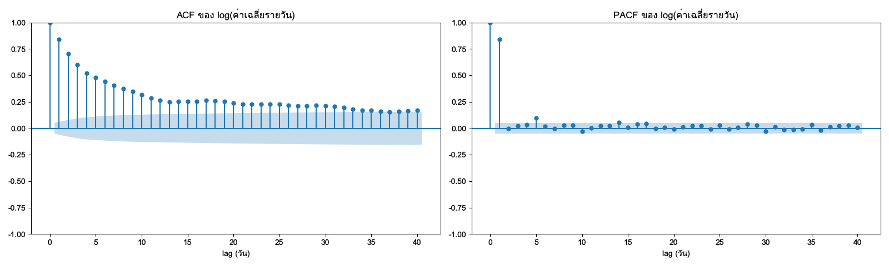
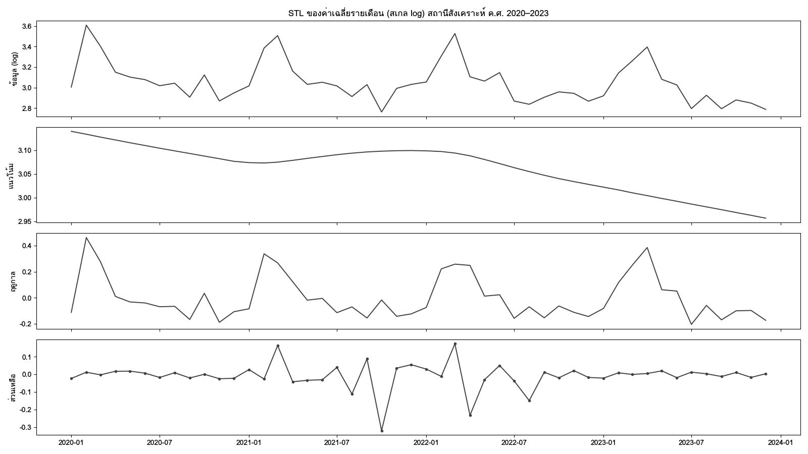
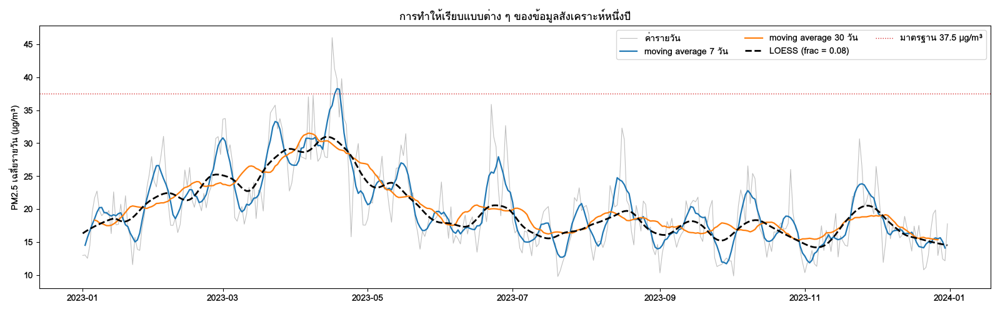

ข้อมูล PM2.5 เป็นอนุกรมเวลาก่อนอย่างอื่น ทุกค่ามีเวลากำกับ และค่าที่เวลาหนึ่งเกี่ยวข้องกับค่าก่อนหน้าและหลังจากนั้น บทที่ 13 จึงต้องระวังเรื่อง autocorrelation ตลอดทั้งบท เพราะสถิติแบบดั้งเดิมสมมติว่าแต่ละค่าเป็นอิสระต่อกัน บทนี้กลับมุมมอง แทนที่จะมองความสัมพันธ์ตามเวลาเป็นอุปสรรค เราจะใช้มันเป็น *สิ่งที่ต้องการเข้าใจ* ฝุ่นสูงขึ้นทุกฤดูแล้งหรือไม่ ปีหลัง ๆ ดีขึ้นหรือแย่ลง ช่วงเช้าหรือเย็นแย่กว่ากัน และค่าที่ดูผิดปกติเป็นเหตุการณ์จริงหรือเป็นความผิดพลาดของเครื่อง

บทนี้เน้นการวิเคราะห์ *เชิงสำรวจ* คือการแยกและบรรยายโครงสร้างของอนุกรม ไม่ใช่การพยากรณ์ เครื่องมือหลักคือการแยกองค์ประกอบด้วย STL ฟังก์ชันสหสัมพันธ์ในตัว (autocorrelation) และการปรับให้เรียบ ส่วนเนื้อหาเชิงลึกครอบคลุมการทดสอบ stationarity การตรวจหาจุดเปลี่ยน และการตรวจหาความผิดปกติ หัวข้อสุดท้ายกลับไปที่ปัญหาเชิงวิศวกรรมที่พบเสมอเมื่อรวมข้อมูลจากหลายแหล่ง คือเวลาของแต่ละแหล่งไม่ตรงกัน

## วัตถุประสงค์การเรียนรู้ {.unnumbered}

เมื่อจบบทนี้ ผู้อ่านสามารถ

1. อธิบายองค์ประกอบ trend, seasonality และ residual ของอนุกรม PM2.5 และเลือกแบบจำลองแบบบวกหรือแบบคูณได้
2. อ่าน ACF และ PACF เพื่อบรรยายความคงอยู่ของฝุ่นและวัฏจักรรายวัน และอธิบายผลของ autocorrelation ต่อการอนุมาน
3. ใช้ STL และ MSTL แยกองค์ประกอบ หลังจัดการช่องว่างของข้อมูลอย่างมีเหตุผล และวัดความแรงของแต่ละองค์ประกอบ
4. เลือกวิธีปรับให้เรียบที่เหมาะกับคำถาม และอธิบายการแลกเปลี่ยนระหว่างความเรียบกับความเอนเอียง
5. ประเมินจุดเปลี่ยนและค่าผิดปกติในอนุกรมเวลา โดยแยกความผิดพลาดของเครื่องออกจากเหตุการณ์จริง
6. จัดแนวข้อมูลที่มีความถี่และเวลาไม่ตรงกันด้วยการรวมเป็นช่วงเวลา ASOF join และ full grid

## องค์ประกอบของอนุกรมเวลา: trend, seasonality, residual {#sec-ch14-components}

### สามองค์ประกอบ

**อนุกรมเวลา** ([time series]{.idx}) คือลำดับของค่าที่เรียงตามเวลา แนวคิดพื้นฐานของการสำรวจอนุกรมเวลาคือมองค่าที่สังเกตได้ว่าเป็นผลรวมของส่วนที่มีความหมายต่างกัน

| องค์ประกอบ | ความหมาย | ตัวอย่างกับ PM2.5 |
|---|---|---|
| [แนวโน้ม]{.idx} (trend) | การเปลี่ยนระดับระยะยาวที่ช้า | ระดับฝุ่นเฉลี่ยของสถานีที่ค่อย ๆ ลดลงหรือเพิ่มขึ้นในหลายปี |
| [ฤดูกาล]{.idx} (seasonality) | รูปแบบที่ซ้ำด้วยคาบคงที่ที่รู้ล่วงหน้า | สูงทุกฤดูแล้ง สูงในช่วงเช้ามืดและค่ำ |
| วัฏจักร (cycle) | การขึ้นลงที่ไม่มีคาบคงที่ | ปีที่แล้งกว่าปกติตามปรากฏการณ์ทางภูมิอากาศ |
| [ส่วนเหลือ]{.idx} (residual) | ส่วนที่เหลือหลังหักส่วนอื่น | วันที่มีไฟป่าใกล้สถานี ความคลาดเคลื่อนของเครื่องวัด |

: องค์ประกอบของอนุกรมเวลา {#tbl-ch14-components}

ความต่างระหว่างฤดูกาลกับวัฏจักรสำคัญในทางปฏิบัติ ฤดูกาลมีคาบที่รู้แน่นอน เช่น 24 ชั่วโมง 7 วัน หรือ 1 ปี จึงแยกออกด้วยวิธีที่ระบุคาบได้ วัฏจักรไม่มีคาบคงที่ จึงมักถูกรวมอยู่ในแนวโน้มหรือส่วนเหลือ ขึ้นกับความยาวของมัน

### ฤดูกาลหลายระดับของ PM2.5

ข้อมูล PM2.5 รายชั่วโมงมีฤดูกาลซ้อนกันอย่างน้อยสามระดับ ซึ่งมีกลไกทางกายภาพต่างกัน

1. **รายวัน (24 ชั่วโมง)** ความสูงของชั้นอากาศผสม (mixing layer) ต่ำในเวลากลางคืนและเช้ามืด ฝุ่นที่ปล่อยออกมาจึงถูกกักไว้ใกล้พื้น และสูงขึ้นในช่วงบ่ายที่แดดทำให้อากาศผสมตัวในแนวดิ่งได้ดี [@seinfeld2016atmospheric] ร่วมกับรูปแบบการจราจรในเมือง
2. **รายสัปดาห์ (7 วัน)** กิจกรรมของมนุษย์ เช่น การจราจรวันทำงานกับวันหยุด อาจทำให้สถานีในเมืองมีรูปแบบรายสัปดาห์ ซึ่งมักอ่อนกว่ารูปแบบรายวันมาก
3. **รายปี (ประมาณ 365 วัน)** ฤดูแล้งที่มีฝนน้อย การผกผันของอุณหภูมิ (temperature inversion) ในฤดูหนาว และการเผาในที่โล่ง ทำให้หลายพื้นที่ของประเทศไทยมีฝุ่นสูงในช่วงต้นปี ส่วนฤดูฝนมีการชะล้างฝุ่นออกจากอากาศ

กลไกในข้อ 3 เป็นคำอธิบายทั่วไปที่ต้องตรวจกับข้อมูลของแต่ละภาค ภาคใต้มีฤดูฝนต่างจากภาคอื่น และอาจได้รับผลจากหมอกควันข้ามแดนในช่วงเวลาที่ต่างกัน การสำรวจด้วยข้อมูลจึงต้องทำแยกภาค

### แบบจำลองแบบบวกและแบบคูณ

การรวมองค์ประกอบทำได้สองแบบ

$$
y_t = T_t + S_t + R_t \qquad \text{หรือ} \qquad y_t = T_t \times S_t \times R_t
$$ {#eq-ch14-additive}

โดย $y_t$ คือค่าที่เวลา $t$ และ $T_t$, $S_t$, $R_t$ คือแนวโน้ม ฤดูกาล และส่วนเหลือ แบบบวกเหมาะเมื่อขนาดของฤดูกาลคงที่ไม่ว่าระดับจะเป็นเท่าใด แบบคูณเหมาะเมื่อขนาดของฤดูกาลแปรตามระดับ เช่น ปีที่ฝุ่นโดยรวมสูง ยอดฤดูแล้งก็สูงเป็นสัดส่วนเดียวกัน ข้อมูลความเข้มข้นของมลพิษมักเข้ากับแบบคูณมากกว่า (บทที่ 13) วิธีที่ใช้ในทางปฏิบัติคือแปลง log แล้วใช้แบบบวก เพราะ $\log y_t = \log T_t + \log S_t + \log R_t$

ตัวอย่าง (ข้อมูลสมมุติ) ถ้าแนวโน้มของเดือนมีนาคมคือ 30 µg/m³ และผลของฤดูกาลแบบคูณในเดือนมีนาคมคือ 1.8 เท่า ค่าที่คาดหวังคือ 54 µg/m³ บน log คือ $\log 30 + \log 1.8 \approx 3.40 + 0.59 = 3.99$ และ $e^{3.99} \approx 54$ ถ้าแนวโน้มลดลงเป็น 20 µg/m³ แบบคูณคาดว่าเดือนมีนาคมจะเป็น 36 µg/m³ ส่วนแบบบวกที่ผลฤดูกาลคงที่ +24 µg/m³ จะคาดว่าเป็น 44 µg/m³

### ภาพแรกของอนุกรม

ก่อนแยกองค์ประกอบด้วยวิธีใด ให้ดูข้อมูลด้วยภาพสามแบบ ภาพแรกคือเส้นเวลาของทั้งช่วง ภาพที่สองคือ **[seasonal subseries plot]{.idx}** ที่แยกค่าของแต่ละเดือนออกเป็นช่องย่อย แล้ววางค่าของแต่ละปีเรียงกันในช่องนั้น ภาพนี้ตอบได้พร้อมกันว่าฤดูกาลเป็นอย่างไร และแต่ละเดือนเปลี่ยนไปตามปีอย่างไร ภาพที่สามคือ heatmap ชั่วโมง × เดือน (บทที่ 12) สำหรับฤดูกาลรายวัน

```python
import duckdb
import numpy as np
import pandas as pd
import matplotlib.pyplot as plt
from statsmodels.graphics.tsaplots import month_plot

con = duckdb.connect("data/pm25.duckdb", read_only=True)
SID = "35t"                                   # เปลี่ยนเป็นสถานีที่สนใจ

monthly = con.execute("""
    SELECT date_trunc('month', date) AS month,
           avg(pm25_mean) AS pm25, count(*) AS n_days
    FROM daily_pm25_clean
    WHERE station_id = ? AND is_complete AND date < DATE '2024-01-01'   -- ช่วงสำรวจ (บทที่ 4)
    GROUP BY ALL ORDER BY month
""", [SID]).df()
s = monthly.set_index(pd.to_datetime(monthly["month"])).asfreq("MS")

z = np.log(s["pm25"]).dropna()
fig, ax = plt.subplots(figsize=(10, 4))
month_plot(z.to_numpy(), dates=z.index, ax=ax)     # ส่ง dates เอง เพราะ dropna ทำให้ index เสีย freq
ax.set_ylabel("log PM2.5")
```

ตัวอย่างในบทนี้ใช้ข้อมูลช่วงสำรวจ (พ.ศ. 2563–2566) เท่านั้น รูปแบบที่พบจึงเป็นข้อสันนิษฐานที่ต้องยืนยันด้วยข้อมูลช่วงยืนยันตามบทที่ 4 `asfreq("MS")` ทำให้มีหนึ่งแถวต่อเดือน (MS = month start) แม้เดือนนั้นไม่มีข้อมูล เดือนที่หายจะเป็น NaN ให้เห็นชัดแทนที่จะหายไปเงียบ ๆ จากแกนเวลา เส้นแนวนอนในแต่ละช่องของ `month_plot` คือค่าเฉลี่ยของเดือนนั้นข้ามทุกปี

## stationarity และ ★ การทดสอบ (ADF, KPSS) {#sec-ch14-stationarity}

### ความหมายของ stationarity

อนุกรมเวลาที่เป็น **[stationary]{.idx}** อย่างอ่อน (weakly stationary) มีสมบัติสามข้อ ค่าเฉลี่ยคงที่ตลอดเวลา ความแปรปรวนคงที่ และ autocovariance ระหว่างสองเวลาขึ้นกับระยะห่าง (lag) เท่านั้น ไม่ขึ้นกับว่าเป็นเวลาใด [@shumway2017time] พูดง่าย ๆ คือ ถ้าตัดอนุกรมเป็นช่วง ๆ ทุกช่วงมีสมบัติทางสถิติเหมือนกัน

ข้อมูล PM2.5 ดิบไม่ stationary แทบทุกกรณี ค่าเฉลี่ยของฤดูแล้งสูงกว่าฤดูฝน ความแปรปรวนของฤดูแล้งก็สูงกว่า และถ้ามีแนวโน้ม ค่าเฉลี่ยก็เปลี่ยนตามปี

### ทำไม stationarity จึงสำคัญต่อการสำรวจ

1. **ACF ตีความได้เฉพาะกับอนุกรมที่ stationary** ACF ของอนุกรมที่มีแนวโน้มจะลดลงช้ามาก ซึ่งสะท้อนแนวโน้มมากกว่าความคงอยู่ของฝุ่นวันต่อวัน
2. **ค่าสรุปของทั้งช่วงไม่มีความหมายชัด** ค่าเฉลี่ยของอนุกรมที่ไม่ stationary ขึ้นกับว่าเลือกช่วงใด
3. **สหสัมพันธ์ระหว่างสองอนุกรมที่ไม่ stationary มักเป็นสหสัมพันธ์ปลอม** (บทที่ 13)

### ทำให้ใกล้ stationary

| ปัญหา | วิธีแก้ | กับ PM2.5 |
|---|---|---|
| ความแปรปรวนเพิ่มตามระดับ | แปลง log | เกือบทุกกรณี |
| ฤดูกาล | หักองค์ประกอบฤดูกาลด้วย STL หรือหาผลต่างตามฤดู ($y_t - y_{t-12}$ ของข้อมูลรายเดือน) | ฤดูกาลรายปีและรายวัน |
| แนวโน้ม | หักแนวโน้มด้วย STL หรือหาผลต่างลำดับแรก ($y_t - y_{t-1}$) | ถ้ามีแนวโน้มหลายปี |

: วิธีทำให้อนุกรมใกล้ stationary {#tbl-ch14-make-stationary}

ในการสำรวจ วิธีที่ตีความได้ง่ายกว่าคือ **หักองค์ประกอบด้วย STL แล้ววิเคราะห์ส่วนเหลือ** (@sec-ch14-decomposition) เพราะส่วนเหลือยังมีหน่วยเดิม (หรือ log ของหน่วยเดิม) และบอกได้ว่าวันนั้นสูงหรือต่ำกว่าที่ควรเป็นตามฤดูและแนวโน้มเท่าใด ส่วนการหาผลต่างนิยมในงานพยากรณ์มากกว่า

### การทดสอบ ADF และ KPSS ★

::: {.callout-note title="★ เนื้อหาเชิงลึก"}
ส่วนย่อยนี้ (การทดสอบ [ADF]{.idx} และ [KPSS]{.idx}) ไม่ได้สอนในชั้นเรียน อ่านข้ามได้โดยไม่กระทบความเข้าใจบทถัดไป
:::

การทดสอบ stationarity ที่ใช้บ่อยมีสองแบบซึ่งตั้งสมมติฐานว่างกลับกัน

| | ADF (Augmented Dickey–Fuller) | KPSS |
|---|---|---|
| สมมติฐานว่าง | มี unit root (ไม่ stationary) | stationary (รอบระดับหรือรอบแนวโน้ม) |
| p เล็กแปลว่า | มีหลักฐานว่า stationary | มีหลักฐานว่าไม่ stationary |
| ที่มา | @dickey1979distribution | @kwiatkowski1992testing |
| statsmodels | `adfuller(y)` | `kpss(y, regression="c")` |

: เปรียบเทียบ ADF และ KPSS {#tbl-ch14-adf-kpss}

เพราะสมมติฐานว่างกลับกัน การใช้ทั้งสองแบบคู่กันจึงให้ข้อมูลมากกว่าการใช้แบบเดียว

| ADF ปฏิเสธ | KPSS ปฏิเสธ | ข้อสรุป |
|---|---|---|
| ใช่ | ไม่ | stationary |
| ไม่ | ใช่ | ไม่ stationary |
| ใช่ | ใช่ | มีลักษณะทั้งสองแบบ เช่น stationary รอบแนวโน้มหรือมีจุดเปลี่ยน ให้ดูภาพประกอบ |
| ไม่ | ไม่ | ข้อมูลไม่พอที่จะตัดสิน |

: การอ่านผล ADF คู่กับ KPSS {#tbl-ch14-adf-kpss-read}

```python
from statsmodels.tsa.stattools import adfuller, kpss

y = np.log(s["pm25"]).interpolate(limit=2, limit_area="inside")
y = y.loc[y.first_valid_index():y.last_valid_index()]
assert y.notna().all(), "ยังมีเดือนที่หายกลางอนุกรม ให้เลือกช่วงที่ต่อเนื่อง"
adf_stat, adf_p, *_ = adfuller(y, autolag="AIC")
kpss_stat, kpss_p, *_ = kpss(y, regression="c", nlags="auto")
print(f"ADF p = {adf_p:.3f} · KPSS p = {kpss_p:.3f}")
```

`kpss` ของ statsmodels คืน p-value จากตารางค่าวิกฤตที่มีขอบเขต 0.01 ถึง 0.1 ถ้าค่าจริงอยู่นอกช่วงจะได้คำเตือนและได้ค่าที่ขอบ ต้องอ่านว่า "น้อยกว่า 0.01" หรือ "มากกว่า 0.1" ไม่ใช่ค่าแม่นยำ ข้อควรระวังของทั้งสองการทดสอบคือ ฤดูกาลที่ยังไม่ได้หักออกจะทำให้ผลเข้าใจผิดได้ จึงควรทดสอบกับส่วนเหลือหลังหักฤดูกาล และเมื่ออนุกรมสั้น เช่น ข้อมูลรายเดือนไม่กี่ปี power ของการทดสอบจะต่ำมาก การดูภาพจึงยังสำคัญกว่าตัวเลข

## autocorrelation: ACF และ ★ PACF {#sec-ch14-acf}

### นิยาม

**สหสัมพันธ์ในตัว** ([autocorrelation]{.idx}) ที่ lag $k$ คือสหสัมพันธ์ระหว่างอนุกรมกับตัวเองที่เลื่อนไป $k$ ช่วงเวลา ค่าประมาณจากตัวอย่างคือ

$$
r_k = \frac{\sum_{t=1}^{n-k}(y_t - \bar{y})(y_{t+k} - \bar{y})}{\sum_{t=1}^{n}(y_t - \bar{y})^2}
$$ {#eq-ch14-acf}

โดย $y_t$ คือค่าที่เวลา $t$, $\bar{y}$ คือค่าเฉลี่ยของทั้งอนุกรม และ $n$ คือจำนวนค่า ตัวเศษคือผลรวมของผลคูณของส่วนเบี่ยงเบนของคู่ค่าที่ห่างกัน $k$ ช่วง ตัวส่วนคือผลรวมกำลังสองของทั้งอนุกรม ตัวอย่าง (ข้อมูลสมมุติ) อนุกรมห้าวัน 20, 25, 35, 45, 40 µg/m³ มีค่าเฉลี่ย 33 ส่วนเบี่ยงเบนคือ −13, −8, 2, 12, 7 ตัวส่วนคือ 430 ตัวเศษที่ lag 1 คือ $(-13)(-8) + (-8)(2) + (2)(12) + (12)(7) = 196$ จึงได้ $r_1 = 196/430 \approx 0.46$ ค่าบวกบอกว่าวันที่สูงกว่าค่าเฉลี่ยมักตามด้วยวันที่สูงกว่าค่าเฉลี่ย

**ACF** ([autocorrelation function]{.idx}) คือกราฟของ $r_k$ เทียบกับ $k$ แถบความเชื่อมั่นที่ statsmodels วาดให้ประมาณ $\pm 1.96/\sqrt{n}$ สำหรับ lag แรก คือขอบเขตที่คาดว่าค่าจะตกอยู่ถ้าอนุกรมเป็นสัญญาณรบกวนอิสระ (white noise) ข้อมูลรายวันหนึ่งปี ($n = 365$) มีแถบประมาณ $\pm 0.10$

### อ่าน ACF ของ PM2.5

```python
from statsmodels.graphics.tsaplots import plot_acf

daily_one = con.execute("""
    SELECT date, pm25_mean FROM daily_pm25_clean
    WHERE station_id = ? ORDER BY date
""", [SID]).df()
y = daily_one.set_index(pd.to_datetime(daily_one["date"]))["pm25_mean"].asfreq("D")

fig, axes = plt.subplots(1, 2, figsize=(11, 3.5))
plot_acf(np.log(y), lags=60, missing="conservative", ax=axes[0], title="ACF ของ log PM2.5 รายวัน")
plot_acf(np.log(y), lags=400, missing="conservative", ax=axes[1], title="ACF ถึง lag 400 วัน")
```

`missing="conservative"` ให้ statsmodels ข้ามคู่ที่มีค่าหายในการคำนวณแต่ละ lag แทนที่จะตัดทั้งอนุกรมหรือเติมค่า ACF ของ PM2.5 รายวันมักมีลักษณะสองแบบ

| รูปแบบใน ACF | ความหมาย |
|---|---|
| ค่าสูงที่ lag แรกและลดลงช้า | ความคงอยู่ (persistence) ฝุ่นวันนี้กับพรุ่งนี้ใกล้กันเพราะอากาศเปลี่ยนช้า |
| ค่ากลับเป็นลบรอบ lag 180 และกลับเป็นบวกรอบ lag 365 | ฤดูกาลรายปี ครึ่งปีห่างกันคือคนละฤดู |
| ยอดซ้ำทุก 24 lag (ข้อมูลรายชั่วโมง) | ฤดูกาลรายวัน |
| ยอดที่ lag 7 (ข้อมูลรายวัน) | ฤดูกาลรายสัปดาห์ ซึ่งอาจอ่อนมาก |

: การอ่าน ACF ของ PM2.5 {#tbl-ch14-acf-read}

ACF ของอนุกรมดิบผสมผลของฤดูกาลกับความคงอยู่ระยะสั้นเข้าด้วยกัน คำถามที่ตอบได้ดีกว่าคือ "*หลังหักฤดูกาลแล้ว* ฝุ่นยังคงอยู่นานแค่ไหน" ซึ่งดูได้จาก ACF ของส่วนเหลือจาก STL ส่วนเหลือที่ยังมี autocorrelation สูงที่ lag 1–7 บอกว่าเหตุการณ์ฝุ่นหนักกินเวลาหลายวัน ซึ่งเป็นข้อมูลสำคัญทั้งต่อการสื่อสารความเสี่ยงและต่อการเลือกความยาวบล็อกของ block bootstrap (บทที่ 13)

### PACF ★

::: {.callout-note title="★ เนื้อหาเชิงลึก"}
ส่วนย่อยนี้ (PACF) ไม่ได้สอนในชั้นเรียน อ่านข้ามได้โดยไม่กระทบความเข้าใจบทถัดไป
:::

ถ้า $y_t$ สัมพันธ์กับ $y_{t-1}$ และ $y_{t-1}$ สัมพันธ์กับ $y_{t-2}$ ก็จะเห็น $y_t$ สัมพันธ์กับ $y_{t-2}$ ด้วย แม้ไม่มีความสัมพันธ์โดยตรง **[PACF]{.idx}** (partial autocorrelation function) วัดความสัมพันธ์ที่ lag $k$ หลังขจัดผลของ lag 1 ถึง $k-1$ ออกแล้ว เหมือน "สหสัมพันธ์บางส่วน" ในการถดถอย

```python
from statsmodels.graphics.tsaplots import plot_pacf

resid = np.log(y).interpolate(limit=3).dropna()
plot_pacf(resid - resid.rolling(31, center=True, min_periods=15).mean(),
          lags=30, method="ywm")
```

ตัวอย่างนี้หักค่าเฉลี่ยเคลื่อนที่ 31 วันออกก่อน เพื่อตัดฤดูกาลรายปีอย่างคร่าว ๆ (วิธีที่ดีกว่าคือใช้ส่วนเหลือจาก STL) ถ้า PACF มีค่าเด่นที่ lag 1 แล้วตกลงในแถบทันที แปลว่าโครงสร้างระยะสั้นใกล้แบบจำลอง AR(1) คือค่าวันนี้ขึ้นกับเมื่อวานโดยตรง ส่วนความสัมพันธ์กับวันก่อนหน้านั้นส่งผ่านเมื่อวานมา ความรู้นี้ใช้เลือกลำดับของแบบจำลอง ARIMA [@box2015time] และใช้ตรวจสมมติฐาน AR(1) ของสูตรขนาดตัวอย่างที่มีผลในบทที่ 13

@fig-ch14-acf แสดงรูปแบบนี้กับสถานีสังเคราะห์ ACF ลดลงช้า ๆ และยังอยู่นอกแถบที่ lag 40 ขณะที่ PACF เด่นเพียงที่ lag 1 ซึ่งเป็นลายเซ็นของโครงสร้างแบบ AR(1)

{#fig-ch14-acf fig-alt="ภาพซ้าย ACF ลดลงช้า ๆ จากประมาณ 0.85 ที่ lag 1 และยังสูงกว่าแถบความเชื่อมั่นจนถึง lag 40 ภาพขวา PACF มีแท่งสูงเพียงที่ lag 1 ประมาณ 0.85 และ lag อื่นอยู่ในแถบใกล้ศูนย์"}

### สหสัมพันธ์ไขว้ระหว่างสถานี

**สหสัมพันธ์ไขว้** (cross-correlation) ระหว่างสองอนุกรมที่ lag ต่าง ๆ ช่วยสำรวจคำถามแบบ "ฝุ่นที่สถานี A นำหน้าสถานี B กี่ชั่วโมง" ซึ่งอาจสะท้อนการพัดพาของมวลอากาศ แต่ต้องระวังอย่างยิ่ง สองอนุกรมที่มีฤดูกาลเดียวกันจะมีสหสัมพันธ์ไขว้สูงในทุก lag ใกล้ ๆ กัน จึงต้องหักฤดูกาลของทั้งคู่ออกก่อน และการที่ A นำหน้า B ทางสถิติไม่ได้พิสูจน์ว่าฝุ่นเคลื่อนจาก A ไป B ต้องใช้ข้อมูลทิศทางลมยืนยัน

## การแยกองค์ประกอบ: classical decomposition และ STL {#sec-ch14-decomposition}

### classical decomposition

วิธีแยกองค์ประกอบแบบดั้งเดิม ([classical decomposition]{.idx}) ทำสามขั้น ขั้นแรก ประมาณแนวโน้มด้วยค่าเฉลี่ยเคลื่อนที่ที่มีความกว้างเท่าคาบของฤดูกาล ขั้นที่สอง หักแนวโน้มออกแล้วเฉลี่ยค่าของแต่ละตำแหน่งในฤดู (เช่น ทุกเดือนมีนาคม) เป็นองค์ประกอบฤดูกาล ขั้นที่สาม ส่วนที่เหลือคือส่วนเหลือ statsmodels มีวิธีนี้ใน `seasonal_decompose`

```python
from statsmodels.tsa.seasonal import seasonal_decompose

y_m = np.log(s["pm25"]).interpolate(limit=2, limit_area="inside")
y_m = y_m.loc[y_m.first_valid_index():y_m.last_valid_index()]   # ตัด NaN ที่หัวและท้าย
classic = seasonal_decompose(y_m, model="additive", period=12)  # error ถ้ายังมี NaN กลางอนุกรม
classic.plot()
```

classical decomposition เข้าใจง่ายแต่มีข้อจำกัดสามข้อ ข้อแรก ค่าเฉลี่ยเคลื่อนที่ไม่มีค่าที่หัวและท้ายอนุกรมครึ่งคาบ ข้อมูลรายเดือนจึงเสียแนวโน้มหกเดือนแรกและหกเดือนสุดท้าย ซึ่งมักเป็นช่วงที่สนใจที่สุด ข้อสอง ฤดูกาลถูกบังคับให้เหมือนกันทุกปี ข้อสาม ค่าผิดปกติเพียงไม่กี่ค่าดึงทั้งแนวโน้มและฤดูกาลได้

### STL

**STL** ([Seasonal-Trend decomposition using LOESS]{.idx}) [@cleveland1990stl] แก้ข้อจำกัดทั้งสามด้วยการใช้ LOESS (@sec-ch14-smoothing) ปรับให้เรียบซ้ำหลายรอบ STL มีสองวงรอบ วงใน (inner loop) สลับกันประมาณฤดูกาลและแนวโน้ม โดยปรับให้เรียบค่าของแต่ละตำแหน่งในฤดูข้ามปี (เช่น ค่าเดือนมีนาคมของทุกปี) ทำให้ฤดูกาลเปลี่ยนช้า ๆ ตามปีได้ วงนอก (outer loop) ที่เปิดด้วย `robust=True` คำนวณน้ำหนักจากขนาดของส่วนเหลือ ค่าที่ส่วนเหลือใหญ่มากได้น้ำหนักน้อยในรอบถัดไป ค่าผิดปกติจึงไปอยู่ในส่วนเหลือแทนที่จะดึงแนวโน้มและฤดูกาล

| พารามิเตอร์ใน statsmodels | ความหมาย | ค่าที่แนะนำเริ่มต้น |
|---|---|---|
| `period` | ความยาวของคาบฤดูกาล | 12 สำหรับข้อมูลรายเดือน |
| `seasonal` | ความกว้างหน้าต่างปรับเรียบของฤดูกาล (จำนวนคาบ ต้องเป็นเลขคี่) | 7 (ค่าเริ่มต้น) ค่าใหญ่ทำให้ฤดูกาลคงที่ขึ้น |
| `trend` | ความกว้างหน้าต่างของแนวโน้ม | ปล่อยให้ statsmodels คำนวณ |
| `robust` | ใช้น้ำหนักแบบทนทานหรือไม่ | `True` เสมอสำหรับ PM2.5 |

: พารามิเตอร์ของ STL {#tbl-ch14-stl-params}

### เตรียมข้อมูลก่อน STL

STL ใน statsmodels ต้องการอนุกรมที่ **ระยะห่างเท่ากันและไม่มีค่าหาย** ข้อมูล PM2.5 มีช่องว่างจากเครื่องขัดข้อง (บทที่ 10) จึงต้องตัดสินใจอย่างโปร่งใสก่อนเข้า STL

1. **เลือกความละเอียด** รายเดือนเหมาะกับแนวโน้มหลายปีและฤดูกาลรายปี รายวันเห็นรายละเอียดมากกว่าแต่มีช่องว่างมากกว่า
2. **ทำให้ระยะห่างเท่ากัน** ด้วย `asfreq` เพื่อให้ช่วงที่หายเป็น NaN อย่างชัดเจน
3. **กำหนดเกณฑ์ความครบถ้วน** เช่น เดือนที่มีวันครบถ้วนน้อยกว่า 20 วันถือเป็น NaN เพราะค่าเฉลี่ยของเดือนนั้นอาจมาจากเฉพาะช่วงที่ฝุ่นน้อย
4. **เติมเฉพาะช่องว่างสั้น** เช่น `interpolate(limit=2)` สำหรับข้อมูลรายเดือน ถ้ายังมีช่องว่างยาว ให้เลือกช่วงเวลาที่ต่อเนื่องแทนการเติม
5. **บันทึก** ว่าเติมกี่ค่าและเพราะอะไร

```python
from statsmodels.tsa.seasonal import STL

s.loc[s["n_days"] < 20, "pm25"] = np.nan
y_m = np.log(s["pm25"])
n_missing = int(y_m.isna().sum())
y_m = y_m.interpolate(limit=2, limit_area="inside")
y_m = y_m.loc[y_m.first_valid_index():y_m.last_valid_index()]
print(f"เดือนที่หาย {n_missing} เดือน · หลังเติมเหลือ {int(y_m.isna().sum())} เดือน")
assert y_m.notna().all(), "ยังมีช่องว่างยาว ให้เลือกช่วงเวลาที่ต่อเนื่อง"

res = STL(y_m, period=12, robust=True).fit()
fig = res.plot()
```

`limit_area="inside"` ไม่เติมช่องว่างที่หัวหรือท้ายอนุกรมซึ่งไม่มีค่าอ้างอิงทั้งสองฝั่ง การตัดเฉพาะ NaN ที่หัวและท้ายด้วย `first_valid_index()` และ `last_valid_index()` ไม่ทำให้ระยะห่างเสีย แต่ถ้าใช้ `dropna()` กับ NaN ที่อยู่กลางอนุกรม เดือนที่อยู่สองข้างช่องว่างจะถูกนำมาต่อกันเหมือนเป็นเดือนติดกัน ฤดูกาลจะเลื่อนตำแหน่งและ STL ให้ผลผิดโดยไม่เตือน `assert` จึงหยุดการทำงานทันทีถ้ายังมีช่องว่างเหลือ

`res.plot()` วาดสี่แผงเรียงจากบนลงล่างดังใน @fig-ch14-stl (ข้อมูลสังเคราะห์) แผงฤดูกาลที่สูงไม่เท่ากันในแต่ละปีคือผลของการให้ฤดูกาลเปลี่ยนได้ตามปี และค่าที่ห่างศูนย์ในแผงส่วนเหลือคือเดือนที่ควรตรวจต่อ

{#fig-ch14-stl fig-alt="สี่แผงเรียงจากบนลงล่าง ข้อมูลมียอดทุกต้นปี แนวโน้มเปลี่ยนเพียงเล็กน้อยและลดลงในปีท้าย ฤดูกาลมียอดทุกต้นปีที่สูงไม่เท่ากัน ส่วนเหลือส่วนใหญ่ใกล้ศูนย์แต่มีบางเดือนที่ห่างออกไป"}

### วัดความแรงขององค์ประกอบ

ภาพ STL บอกรูปร่าง แต่การเทียบหลายสถานีต้องมีตัวเลข Wang และคณะ [@wang2006characteristic] เสนอการวัด **ความแรงของฤดูกาล** และ **ความแรงของแนวโน้ม** ซึ่ง Hyndman และ Athanasopoulos [@hyndman2021forecasting] ใช้เป็นมาตรฐาน

$$
F_S = \max\left(0,\ 1 - \frac{\operatorname{Var}(R_t)}{\operatorname{Var}(S_t + R_t)}\right) \qquad
F_T = \max\left(0,\ 1 - \frac{\operatorname{Var}(R_t)}{\operatorname{Var}(T_t + R_t)}\right)
$$ {#eq-ch14-strength}

โดย $S_t$, $T_t$ และ $R_t$ คือองค์ประกอบฤดูกาล แนวโน้ม และส่วนเหลือจาก STL ค่าใกล้ 1 แปลว่าองค์ประกอบนั้นอธิบายความผันแปรได้มากเมื่อเทียบกับส่วนเหลือ ตัวอย่าง (ข้อมูลสมมุติ) ถ้าความแปรปรวนของส่วนเหลือคือ 0.02 และของฤดูกาลรวมส่วนเหลือคือ 0.20 ได้ $F_S = 1 - 0.02/0.20 = 0.90$ ซึ่งแปลว่าฤดูกาลเด่นมาก

```python
f_s = max(0.0, 1 - res.resid.var() / (res.seasonal + res.resid).var())
f_t = max(0.0, 1 - res.resid.var() / (res.trend + res.resid).var())
amplitude = np.exp(res.seasonal.max() - res.seasonal.min())   # อัตราส่วนเดือนสูงสุดต่อต่ำสุด
print(f"F_S = {f_s:.2f} · F_T = {f_t:.2f} · ฤดูกาลกว้าง {amplitude:.1f} เท่า")
```

เพราะ STL ทำบน log ผลต่างของฤดูกาลระหว่างเดือนสูงสุดกับต่ำสุดเมื่อยกกำลัง $e$ คืออัตราส่วน ซึ่งสื่อสารได้ง่าย เช่น "เดือนที่ฝุ่นสูงที่สุดสูงกว่าเดือนที่ต่ำที่สุดราว … เท่า"

แนวโน้มจาก STL ของข้อมูลไม่กี่ปีเป็น **คำบรรยาย** ไม่ใช่หลักฐานว่าคุณภาพอากาศดีขึ้นหรือแย่ลงอย่างถาวร ปีที่ฝนมากหรือน้อยผิดปกติเพียงปีเดียวทำให้แนวโน้มโค้งได้ และการเปลี่ยนเครื่องวัดก็ทำให้เกิดขั้นบันไดในแนวโน้มได้ (@sec-ch14-change-point)

### ฤดูกาลหลายระดับด้วย MSTL

ข้อมูลรายชั่วโมงมีทั้งฤดูกาลรายวัน (24) และรายสัปดาห์ (168) [MSTL]{.idx} [@bandara2021mstl] ขยาย STL ให้แยกฤดูกาลหลายคาบได้ โดยวนแยกทีละคาบจากสั้นไปยาว statsmodels มี `MSTL` ตั้งแต่เวอร์ชัน 0.14

```python
from statsmodels.tsa.seasonal import MSTL

hourly = con.execute("""
    SELECT ts, pm25_filled FROM measurements_clean
    WHERE station_id = ? AND ts >= TIMESTAMP '2023-01-01' AND ts < TIMESTAMP '2023-04-01'
    ORDER BY ts
""", [SID]).df()
h = np.log(hourly.set_index("ts")["pm25_filled"].asfreq("h"))
assert h.notna().all(), f"ยังหาย {int(h.isna().sum())} ชั่วโมง ให้เลือกช่วงอื่น"

res_h = MSTL(h, periods=(24, 24 * 7), stl_kwargs={"robust": True}).fit()
res_h.plot()
```

ตัวอย่างเลือกช่วงสามเดือนของฤดูแล้ง เพราะฤดูกาลรายวันของฤดูแล้งกับฤดูฝนอาจต่างกันมาก การใส่ทั้งปีจะเฉลี่ยรูปแบบสองฤดูเข้าด้วยกัน `pm25_filled` คือค่าที่เติมช่องว่างสั้นไม่เกินสามชั่วโมงแล้วในบทที่ 10 ถ้ายังมีชั่วโมงที่หาย ให้เลือกช่วงอื่นหรือเติมเพิ่มพร้อมบันทึก ฤดูกาลรายปีไม่ควรใส่ในข้อมูลรายชั่วโมงสามเดือน เพราะต้องมีข้อมูลอย่างน้อยสองคาบจึงจะแยกได้

## smoothing: moving average และ ★ LOESS {#sec-ch14-smoothing}

### ทำไมต้องปรับให้เรียบ

การปรับให้เรียบ (smoothing) ลดความผันผวนระยะสั้นเพื่อให้เห็นรูปแบบที่ช้ากว่า ทุกวิธีมีการแลกเปลี่ยนเดียวกัน คือ **ยิ่งเรียบมากยิ่งเห็นรูปแบบชัด แต่ยิ่งเอนเอียงจากค่าจริงมาก** โดยเฉพาะที่ยอดและที่หุบ การเลือกความกว้างของหน้าต่างจึงเป็นการตัดสินใจเชิงวิเคราะห์ที่ต้องบอกผู้อ่าน

### ค่าเฉลี่ยเคลื่อนที่

[ค่าเฉลี่ยเคลื่อนที่]{.idx}แบบกึ่งกลาง (centered moving average) ความกว้าง $2m+1$ คือ

$$
\hat{y}_t = \frac{1}{2m+1}\sum_{j=-m}^{m} y_{t+j}
$$ {#eq-ch14-moving-average}

โดย $y_{t+j}$ คือค่าที่เวลาห่างจาก $t$ ไป $j$ ช่วง และ $m$ คือจำนวนช่วงที่นับไปแต่ละข้าง ตัวอย่าง (ข้อมูลสมมุติ) ค่าสามวันติดกัน 30, 36 และ 42 µg/m³ ให้ค่าเฉลี่ยเคลื่อนที่สามวันของวันกลางเป็น 36 µg/m³

| แบบ | หน้าต่าง | ใช้เมื่อ | ข้อควรระวัง |
|---|---|---|---|
| กึ่งกลาง | ค่าก่อนและหลังเท่ากัน | สำรวจย้อนหลัง | ใช้แบบเรียลไทม์ไม่ได้เพราะต้องรู้อนาคต |
| ย้อนหลัง (trailing) | เฉพาะค่าก่อนหน้า | ตัวชี้วัดที่คำนวณทันที เช่น ค่าเฉลี่ย 24 ชั่วโมงล่าสุด | เส้นเลื่อนช้ากว่าข้อมูลจริงครึ่งหน้าต่าง |
| ถ่วงน้ำหนักแบบเอ็กซ์โพเนนเชียล (EWMA) | ทุกค่าก่อนหน้า น้ำหนักลดลงเรื่อย ๆ | ติดตามระดับที่เปลี่ยนเร็ว | ต้องเลือกค่าครึ่งชีวิตของน้ำหนัก |

: แบบของค่าเฉลี่ยเคลื่อนที่ {#tbl-ch14-moving-average}

ค่าเฉลี่ยย้อนหลัง 24 ชั่วโมงสอดคล้องกับนิยามของมาตรฐาน PM2.5 ที่เป็นค่าเฉลี่ย 24 ชั่วโมง คำนวณใน DuckDB ด้วย window function (บทที่ 7) โดยใช้ช่วงเวลาแทนจำนวนแถว เพื่อไม่ให้ชั่วโมงที่หายทำให้หน้าต่างยาวเกิน 24 ชั่วโมง

```python
rolling = con.execute("""
    SELECT station_id, ts, pm25,
           avg(pm25) OVER w   AS pm25_24h,
           count(pm25) OVER w AS n_hours_24h
    FROM measurements_clean
    WHERE station_id = ?
    WINDOW w AS (PARTITION BY station_id ORDER BY ts
                 RANGE BETWEEN INTERVAL 23 HOURS PRECEDING AND CURRENT ROW)
    ORDER BY ts
""", [SID]).df()
rolling.loc[rolling["n_hours_24h"] < 18, "pm25_24h"] = np.nan   # เกณฑ์ความครบถ้วนของโครงการ
```

หน้าต่าง `RANGE BETWEEN INTERVAL 23 HOURS PRECEDING AND CURRENT ROW` รวม 24 ชั่วโมงนับรวมชั่วโมงปัจจุบัน `count(pm25)` นับเฉพาะค่าที่ไม่เป็น NULL จึงใช้เกณฑ์ความครบถ้วนอย่างน้อย 18 ชั่วโมงแบบเดียวกับค่ารายวันได้ ฝั่ง pandas ทำได้ด้วย `series.rolling("24h", min_periods=18).mean()` บน index ที่เป็นเวลา

### LOESS ★

::: {.callout-note title="★ เนื้อหาเชิงลึก"}
ส่วนย่อยนี้ (LOESS) ไม่ได้สอนในชั้นเรียน อ่านข้ามได้โดยไม่กระทบความเข้าใจบทถัดไป
:::

**[LOESS]{.idx}** หรือ LOWESS (locally weighted scatterplot smoothing) [@cleveland1979robust] ปรับให้เรียบด้วยการถดถอยเฉพาะที่ ที่แต่ละจุด LOESS เลือกข้อมูลใกล้เคียงตามสัดส่วนที่กำหนด (`frac`) ถ่วงน้ำหนักให้จุดที่ใกล้มีน้ำหนักมากด้วยฟังก์ชัน tricube แล้วลากเส้นตรงหรือเส้นโค้งกำลังสองผ่านข้อมูลเหล่านั้น ค่าของเส้นที่จุดนั้นคือค่าที่ปรับเรียบแล้ว เมื่อทำซ้ำแบบ robust ค่าที่ห่างจากเส้นมากจะได้น้ำหนักน้อยลงในรอบถัดไป LOESS จึงทนต่อค่าผิดปกติ และไม่เสียค่าที่หัวท้ายอนุกรมแบบค่าเฉลี่ยเคลื่อนที่

```python
from statsmodels.nonparametric.smoothers_lowess import lowess

d = daily_one.dropna()
x_num = pd.to_datetime(d["date"]).map(pd.Timestamp.toordinal)
for frac in [0.02, 0.1, 0.3]:
    fitted = lowess(np.log(d["pm25_mean"]), x_num, frac=frac, it=3, return_sorted=False)
    plt.plot(pd.to_datetime(d["date"]), np.exp(fitted), label=f"frac = {frac}")
plt.legend(); plt.ylabel("PM2.5 (µg/m³)")
```

การวาดสามค่าของ `frac` ซ้อนกันเป็นวิธีที่ดีในการแสดงว่าข้อสรุปขึ้นกับความเรียบที่เลือกหรือไม่ `frac` เล็กตามรายละเอียดเกือบทุกยอด `frac` ใหญ่แสดงเพียงแนวโน้มหลายปี การปรับเรียบบน log แล้วแปลงกลับทำให้เส้นอยู่ใกล้มัธยฐานมากกว่าค่าเฉลี่ย ซึ่งเหมาะกับข้อมูลเบ้ขวา

### อย่าปรับให้เรียบก่อนนับ

ข้อผิดพลาดที่ส่งผลต่อข้อสรุปเชิงนโยบายโดยตรงคือ **การนับวันที่เกินมาตรฐานจากเส้นที่ปรับเรียบแล้ว** การปรับเรียบตัดยอดลง จำนวนวันที่เกิน 37.5 µg/m³ จึงต่ำกว่าความจริง และการปรับเรียบแบบกึ่งกลางยังดึงวันที่ไม่เกินข้างยอดขึ้นมาให้เกินได้ด้วย ใช้เส้นที่ปรับเรียบเพื่อ *แสดงรูปแบบ* และนับวันเกินมาตรฐานจากค่ารายวันตามนิยามเสมอ

ใน @fig-ch14-smoothing (ข้อมูลสังเคราะห์) ค่ารายวันเกินเส้นมาตรฐานในบางวันของเดือนเมษายน แต่เส้น 30 วันและ LOESS ไม่แตะเส้นเลย ถ้านับจากสองเส้นนี้จะได้ศูนย์วัน

{#fig-ch14-smoothing fig-alt="ค่ารายวันสีเทาผันผวนมาก เส้น moving average 7 วันยังขึ้นลงตามเหตุการณ์ระดับสัปดาห์ เส้น 30 วันและ LOESS เรียบและแสดงยอดในเดือนเมษายน มีเพียงค่ารายวันและเส้น 7 วันที่แตะเส้นมาตรฐาน"}

## change point detection ★ {#sec-ch14-change-point}

::: {.callout-note title="★ เนื้อหาเชิงลึก"}
หัวข้อนี้ไม่ได้สอนในชั้นเรียน อ่านข้ามได้โดยไม่กระทบความเข้าใจบทถัดไป
:::

### จุดเปลี่ยนคืออะไร

**จุดเปลี่ยน** ([change point]{.idx}) คือเวลาที่สมบัติทางสถิติของอนุกรมเปลี่ยนอย่างฉับพลัน เช่น ระดับเฉลี่ยกระโดด ความแปรปรวนเปลี่ยน หรือความชันของแนวโน้มเปลี่ยน ในข้อมูลเครือข่ายสถานี จุดเปลี่ยนเกิดได้จากสองกลุ่มสาเหตุที่ต้องแยกให้ออก

| กลุ่มสาเหตุ | ตัวอย่าง | สิ่งที่ควรทำ |
|---|---|---|
| การเปลี่ยนแปลงของเครื่องมือ | เปลี่ยนรุ่นเครื่องวัด สอบเทียบใหม่ ย้ายตำแหน่งสถานี เปลี่ยนวิธีรายงาน | ตรวจกับประวัติของสถานี ถ้ายืนยันได้ ให้แยกวิเคราะห์ก่อนและหลัง หรือปรับระดับ |
| การเปลี่ยนแปลงจริงของสิ่งแวดล้อม | มาตรการควบคุมการเผา ถนนสายใหม่ใกล้สถานี การปิดโรงงาน | บันทึกเป็นข้อค้นพบที่ต้องตรวจสอบต่อด้วยข้อมูลอื่น |

: สาเหตุของจุดเปลี่ยนในข้อมูลสถานี {#tbl-ch14-change-causes}

การหาจุดเปลี่ยนจึงเป็นเครื่องมือตรวจ **คุณภาพข้อมูล** ไม่แพ้เครื่องมือหาข้อค้นพบ แนวโน้มระยะยาวที่คำนวณข้ามจุดเปลี่ยนจากเครื่องมือเป็นแนวโน้มที่ผิด

### เตรียมสัญญาณก่อนหา

ฤดูกาลรายปีของ PM2.5 คือการเปลี่ยนระดับที่เกิดซ้ำทุกปี ถ้าหาจุดเปลี่ยนจากข้อมูลดิบ อัลกอริทึมจะพบต้นและปลายฤดูแล้งทุกปี ซึ่งไม่ใช่สิ่งที่ต้องการ ต้อง **หักฤดูกาลออกก่อน** แล้วหาจุดเปลี่ยนจากแนวโน้มรวมส่วนเหลือของ STL (ข้อมูลรายเดือน) หรือจากส่วนเหลือของค่ารายวัน

### CUSUM: วิธีที่เข้าใจง่ายที่สุด

[CUSUM]{.idx} (cumulative sum) [@page1954continuous] สะสมผลรวมของส่วนเบี่ยงเบนจากค่าเฉลี่ยทั้งช่วง ถ้าไม่มีจุดเปลี่ยน ผลรวมสะสมจะแกว่งรอบศูนย์ ถ้าระดับเปลี่ยนจากต่ำไปสูงที่เวลาหนึ่ง ผลรวมสะสมจะลดลงเรื่อย ๆ จนถึงจุดนั้นแล้วเพิ่มขึ้น จุดต่ำสุดของเส้น CUSUM จึงเป็นตำแหน่งที่น่าสงสัย

```python
signal = (res.trend + res.resid).dropna()            # log PM2.5 รายเดือนหลังหักฤดูกาล
cusum = (signal - signal.mean()).cumsum()
candidate = cusum.abs().idxmax()

fig, axes = plt.subplots(2, 1, figsize=(10, 5), sharex=True)
axes[0].plot(signal.index, signal); axes[0].set_ylabel("หักฤดูกาลแล้ว")
axes[1].plot(cusum.index, cusum); axes[1].axvline(candidate, color="red", linestyle=":")
axes[1].set_ylabel("CUSUM")
```

CUSUM แบบนี้หาจุดเปลี่ยนได้ทีละจุด และไม่ได้บอกว่าจุดนั้นมีนัยสำคัญหรือไม่ ใช้เป็นภาพสำรวจเบื้องต้นได้ดี

### PELT และไลบรารี ruptures

วิธีที่หาจุดเปลี่ยนหลายจุดพร้อมกันตั้งปัญหาเป็นการหาการแบ่งช่วงที่ทำให้ "ต้นทุน" รวมต่ำที่สุด ต้นทุนของแต่ละช่วงคือความไม่เข้ากันของข้อมูลกับแบบจำลองของช่วงนั้น เช่น ผลรวมกำลังสองของส่วนเบี่ยงเบนจากค่าเฉลี่ยของช่วง บวกด้วยค่าปรับ (penalty) ต่อหนึ่งจุดเปลี่ยนเพื่อกันไม่ให้แบ่งละเอียดเกินไป อัลกอริทึม [PELT]{.idx} [@killick2012optimal] หาคำตอบที่ดีที่สุดได้ในเวลาเชิงเส้นตามความยาวอนุกรม ไลบรารี ruptures [@truong2020selective] รวมวิธีเหล่านี้ไว้ (ไม่อยู่ใน `environment.yml` ต้องติดตั้งเพิ่มด้วย `pip install ruptures`)

```python
import ruptures as rpt

x = signal.to_numpy().reshape(-1, 1)
algo = rpt.Pelt(model="l2", min_size=6).fit(x)
for pen in [1, 3, 10]:
    bkps = algo.predict(pen=pen)                  # index ที่สิ้นสุดของแต่ละช่วง
    print(pen, [signal.index[i - 1].strftime("%Y-%m") for i in bkps[:-1]])
```

`model="l2"` ตรวจการเปลี่ยนของค่าเฉลี่ย `min_size=6` บังคับให้แต่ละช่วงยาวอย่างน้อยหกเดือน การลองหลายค่าของ `pen` สำคัญเพราะค่าปรับกำหนดจำนวนจุดเปลี่ยนโดยตรง ถ้าจุดเปลี่ยนจุดหนึ่งปรากฏในทุกค่าของ `pen` จุดนั้นน่าสนใจกว่าจุดที่ปรากฏเฉพาะค่าปรับต่ำ

### ยืนยันจุดเปลี่ยน

จุดเปลี่ยนทางสถิติเป็นเพียง *ผู้ต้องสงสัย* ขั้นตอนยืนยันมีสามข้อ ข้อแรก ตรวจว่าสถานีใกล้เคียงมีจุดเปลี่ยนเวลาเดียวกันหรือไม่ ถ้ามีหลายสถานีพร้อมกัน น่าจะเป็นการเปลี่ยนแปลงจริงของสภาพแวดล้อมหรือของวิธีรายงานทั้งเครือข่าย ถ้ามีสถานีเดียว น่าจะเป็นเรื่องของเครื่องมือ ข้อสอง ตรวจตัวแปรอื่นของสถานีเดียวกัน เช่น PM10 ถ้าเปลี่ยนพร้อมกัน อาจเป็นการย้ายสถานี ข้อสาม ค้นหาข้อมูลเมตาของสถานีจากผู้ให้ข้อมูล ซึ่งเป็นหลักฐานที่ดีที่สุด

## การตรวจหาความผิดปกติในอนุกรมเวลา ★ {#sec-ch14-anomaly}

::: {.callout-note title="★ เนื้อหาเชิงลึก"}
หัวข้อนี้ไม่ได้สอนในชั้นเรียน อ่านข้ามได้โดยไม่กระทบความเข้าใจบทถัดไป
:::

### ความผิดปกติสามแบบ

Chandola และคณะ [@chandola2009anomaly] จำแนกความผิดปกติไว้สามแบบซึ่งพบได้ทั้งหมดในข้อมูล PM2.5

| แบบ | นิยาม | ตัวอย่าง |
|---|---|---|
| ค่าเดี่ยว (point) | ค่าเดียวผิดจากข้อมูลทั้งหมด | ค่า 900 µg/m³ หนึ่งชั่วโมงในสถานีที่ปกติไม่เกิน 150 |
| ตามบริบท (contextual) | ค่าปกติในบริบทหนึ่งแต่ผิดในอีกบริบท | 60 µg/m³ เป็นเรื่องปกติในเดือนมีนาคมของภาคเหนือ แต่ผิดปกติในเดือนสิงหาคม |
| เป็นกลุ่ม (collective) | แต่ละค่าดูปกติ แต่ลำดับของค่าผิดปกติ | ค่าเท่ากันทุกชั่วโมงติดกัน 12 ชั่วโมง (เซนเซอร์ค้าง) |

: ความผิดปกติสามแบบในอนุกรมเวลา {#tbl-ch14-anomaly-types}

เกณฑ์คงที่ เช่น "เกิน 3 ส่วนเบี่ยงเบนมาตรฐานจากค่าเฉลี่ยทั้งปี" จับได้เฉพาะแบบแรก และจะติดธงวันฝุ่นหนักในฤดูแล้งเกือบทั้งหมด ซึ่งเป็นเหตุการณ์จริงไม่ใช่ความผิดพลาด การตรวจความผิดปกติในอนุกรมเวลาจึงต้อง **คำนึงถึงบริบทของเวลา**

### ส่วนเหลือจาก STL ร่วมกับเกณฑ์แบบทนทาน

วิธีที่ตรงไปตรงมาที่สุดสำหรับความผิดปกติตามบริบทคือ ใช้ STL แบบ robust หักแนวโน้มและฤดูกาลออก แล้วตรวจส่วนเหลือด้วยคะแนน z แบบทนทานที่ใช้มัธยฐานและ MAD (บทที่ 13) แทนค่าเฉลี่ยและส่วนเบี่ยงเบนมาตรฐาน

$$
z^{\text{robust}}_t = \frac{R_t - \operatorname{median}(R)}{\text{MAD}_s(R)}
$$ {#eq-ch14-robust-z}

โดย $R_t$ คือส่วนเหลือที่เวลา $t$ และ $\text{MAD}_s(R)$ คือ MAD ที่ปรับสเกลแล้วของส่วนเหลือทั้งหมด ค่าสัมบูรณ์ที่เกิน 3.5 มักใช้เป็นเกณฑ์ติดธง [@iglewicz1993detect] ตัวอย่าง (ข้อมูลสมมุติ) ถ้าส่วนเหลือบน log ของวันหนึ่งคือ 0.95 มัธยฐานของส่วนเหลือคือ 0.01 และ $\text{MAD}_s = 0.25$ จะได้ $z = (0.95 - 0.01)/0.25 = 3.76$ ซึ่งเกินเกณฑ์ บน log ส่วนเหลือ 0.95 หมายความว่าค่าวันนั้นสูงกว่าที่คาดจากฤดูและแนวโน้มประมาณ $e^{0.95} \approx 2.6$ เท่า

```python
from scipy import stats

yd = np.log(y).interpolate(limit=3, limit_area="inside")
seg = yd["2022-01-01":"2023-12-31"]                   # เลือกช่วงที่ต่อเนื่องสองปีในช่วงสำรวจ
assert seg.notna().all(), "ช่วงที่เลือกยังมีวันที่หาย"
res_d = STL(seg, period=365, robust=True).fit()
r = res_d.resid
z = (r - r.median()) / stats.median_abs_deviation(r, scale="normal")
flags = pd.DataFrame({"pm25": np.exp(seg), "resid": r, "z": z})
flags[flags["z"].abs() > 3.5].sort_values("z")
```

STL รายวันที่มีคาบ 365 ต้องการข้อมูลอย่างน้อยสองปีที่ต่อเนื่อง ถ้าข้อมูลไม่พอ ให้ใช้ค่าเฉลี่ยเคลื่อนที่ 31 วันแทนองค์ประกอบช้าอย่างคร่าว ๆ

### Hampel filter

**[Hampel filter]{.idx}** ใช้หลักเดียวกันแต่เป็นแบบเฉพาะที่ ที่แต่ละเวลาคำนวณมัธยฐานและ MAD ของหน้าต่างรอบ ๆ แล้วติดธงค่าที่ห่างจากมัธยฐานเฉพาะที่เกิน $k$ เท่าของ MAD วิธีนี้มาจากแนวคิด Hampel identifier [@hampel1974influence] เหมาะกับยอดแหลมช่วงสั้นในข้อมูลรายชั่วโมงโดยไม่ต้องแยกองค์ประกอบก่อน

```python
def hampel_flags(series, window="25h", k=3.5):
    """ติดธงค่าที่ห่างจากมัธยฐานเฉพาะที่เกิน k × MAD ที่ปรับสเกล (index ต้องเป็นเวลา)"""
    med = series.rolling(window, center=True, min_periods=12).median()
    mad = (series - med).abs().rolling(window, center=True, min_periods=12).median() * 1.4826
    return (series - med).abs() > k * mad

hh = hourly.set_index("ts")["pm25_filled"]
hourly["hampel"] = hampel_flags(np.log(hh)).to_numpy()
```

`rolling` แบบช่วงเวลาที่มี `center=True` ต้องใช้ pandas 1.3 ขึ้นไป หน้าต่าง 25 ชั่วโมงครอบคลุมวัฏจักรรายวันหนึ่งรอบ จึงไม่ติดธงยอดปกติของช่วงเช้ามืด

### เซนเซอร์ค้าง

ความผิดปกติแบบกลุ่มที่พบบ่อยที่สุดคือค่าที่เท่ากันติดต่อกันหลายชั่วโมง (บทที่ 9) ตรวจได้ด้วยการนับความยาวของช่วงที่ค่าไม่เปลี่ยน

```python
stuck = con.execute("""
    WITH runs AS (
        SELECT station_id, ts, pm25,
               ts - to_hours(row_number() OVER (PARTITION BY station_id, pm25 ORDER BY ts)) AS grp
        FROM measurements WHERE pm25 IS NOT NULL
    )
    SELECT station_id, pm25, min(ts) AS start_ts, count(*) AS n_hours
    FROM runs GROUP BY station_id, pm25, grp
    HAVING count(*) >= 6 ORDER BY n_hours DESC
""").df()
```

เทคนิค gaps-and-islands นี้ใช้ความจริงที่ว่าถ้าแถวที่มีค่าเดียวกันอยู่ติดกันทุกชั่วโมง เวลาลบด้วยลำดับที่ของแถว (แปลงเป็นจำนวนชั่วโมงด้วย `to_hours`) จะได้ค่าคงที่ แถวที่อยู่ในช่วงเดียวกันจึงมี `grp` เท่ากัน query นี้ใช้ตาราง `measurements` ต้นฉบับ เพราะต้องการตรวจค่าที่เครื่องส่งมาจริง

### ติดธง ไม่ใช่ลบ

ผลของการตรวจทุกวิธีในหัวข้อนี้ควรเป็น **คอลัมน์ธง** ไม่ใช่การลบค่า การตัดสินว่าค่าใดเป็นความผิดพลาดและค่าใดเป็นเหตุการณ์จริงต้องใช้หลักฐานเพิ่ม เช่น สถานีใกล้เคียง ข้อมูลจุดความร้อนจากดาวเทียม หรือข่าว ซึ่งเป็นเรื่องของบทที่ 15 (การตีความค่าผิดปกติ) วันฝุ่นหนักที่สุดของปีเป็นทั้งค่าที่ "ผิดปกติ" ทางสถิติและข้อมูลที่สำคัญที่สุดต่อสุขภาพของประชาชน การลบทิ้งคือการทำลายคำตอบ

## การจัดแนวข้อมูลเซนเซอร์ที่เวลาไม่สม่ำเสมอ {#sec-ch14-alignment}

### ปัญหาที่เกิดเมื่อรวมหลายแหล่ง

ข้อมูลจาก Air4Thai เป็นรายชั่วโมงที่ค่อนข้างสม่ำเสมอ แต่ทันทีที่นำข้อมูลอื่นมารวม เช่น ข้อมูลอุตุนิยมวิทยา ข้อมูลเซนเซอร์ราคาประหยัด หรือข้อมูลจุดความร้อน ปัญหาเรื่องเวลาจะปรากฏหลายแบบ

| ปัญหา | ตัวอย่าง | ผลถ้าไม่จัดการ |
|---|---|---|
| ความถี่ต่างกัน | PM2.5 รายชั่วโมง ข้อมูลลมทุก 3 ชั่วโมง เซนเซอร์ราคาประหยัดทุก 2 นาที | join ตรงเวลาแล้วได้ค่าว่างเกือบทั้งหมด |
| เวลาไม่ตรงนาที | เซนเซอร์รายงานเวลา 08:01:37, 08:03:42 | ไม่มีแถวใดตรงกับ 08:00:00 |
| นิยามของเวลาต่างกัน | ค่า "08:00" หมายถึงชั่วโมง 07:00–08:00 (hour-ending) หรือ 08:00–09:00 (hour-beginning) | ข้อมูลเลื่อนกันหนึ่งชั่วโมง ความสัมพันธ์ตามเวลาผิด |
| เขตเวลาต่างกัน | ข้อมูลดาวเทียมเป็น UTC ข้อมูลสถานีเป็นเวลาท้องถิ่น | เลื่อนกันเจ็ดชั่วโมง |
| แถวหายกับค่าหาย | ชั่วโมงที่ไม่มีแถวเลย กับชั่วโมงที่มีแถวแต่ค่าเป็น NULL | การนับความครบถ้วนผิด (บทที่ 10) |
| นาฬิกาเครื่องเพี้ยน | เวลาของเครื่องค่อย ๆ เลื่อนไปทีละไม่กี่วินาทีต่อวัน | ข้อมูลระยะยาวเลื่อนสะสม |

: ปัญหาเรื่องเวลาเมื่อรวมข้อมูลหลายแหล่ง {#tbl-ch14-alignment-problems}

ก่อนจัดแนว ต้องอ่านเอกสารของแต่ละแหล่งว่าเวลาหมายถึงอะไร และเขียนข้อตกลงไว้ในพจนานุกรมข้อมูล หนังสือเล่มนี้ตกลงให้ `ts` ทั้งเล่มเป็นเวลาท้องถิ่น `Asia/Bangkok` (บทที่ 8) ข้อมูลใดที่มาเป็น UTC ต้องแปลงก่อนรวม

### หลักการเลือกวิธี

```{mermaid}
flowchart TD
  A{"ข้อมูลใหม่ถี่กว่า<br/>หรือห่างกว่าตารางหลัก"} -->|"ถี่กว่า เช่น ทุก 2 นาที"| B["รวมลงเป็นช่วงเวลาของตารางหลัก<br/>พร้อมนับจำนวนค่า"]
  A -->|"ห่างกว่า เช่น ทุก 3 ชั่วโมง"| C{"ตัวแปรเปลี่ยนช้าหรือเร็ว"}
  C -->|"ช้า เช่น อุณหภูมิ"| D["ASOF join ค่าล่าสุด<br/>ภายในขอบเขตที่กำหนด"]
  C -->|"เร็ว หรือต้องการค่าเฉลี่ย"| E["รวมตารางหลักขึ้นเป็นความถี่ของข้อมูลใหม่"]
  B --> F["ติดธงช่วงที่จำนวนค่าไม่พอ"]
  D --> F
  E --> F
```

หลักสำคัญคือ **รวมข้อมูลที่ถี่กว่าลงให้หยาบขึ้นได้เสมอ แต่การสร้างข้อมูลที่ละเอียดกว่าที่มีจริงต้องทำอย่างระวังและติดธงไว้** การ interpolate ข้อมูลลมทุก 3 ชั่วโมงให้เป็นรายชั่วโมงคือการสร้างข้อมูลที่ไม่ได้วัด

### รวมข้อมูลที่ถี่กว่าเป็นช่วงเวลา

ตัวอย่างนี้สมมติว่ามีตาราง `lowcost_raw` ของเซนเซอร์ราคาประหยัดที่รายงานทุกประมาณสองนาที ตารางนี้ไม่ได้อยู่ในฐานข้อมูลมาตรฐานของเล่ม แต่เป็นสถานการณ์ที่พบบ่อยในโครงงาน

```python
lowcost_hourly = con.execute("""
    SELECT sensor_id,
           time_bucket(INTERVAL 1 HOUR, ts) AS ts_hour,
           avg(pm25)  AS pm25,
           count(*)   AS n_readings
    FROM lowcost_raw
    GROUP BY ALL
    HAVING count(*) >= 20             -- อย่างน้อยราว 2 ใน 3 ของ 30 ค่าที่ควรมีต่อชั่วโมง
""").df()
```

[`time_bucket`]{.idx-tool} ตัดเวลาลงเป็นต้นชั่วโมง ค่า `ts_hour = 08:00` จึงหมายถึงช่วง 08:00–08:59 (hour-beginning) ถ้าข้อมูล Air4Thai ใช้นิยาม hour-ending ต้องเลื่อนหนึ่งชั่วโมงก่อน join ให้ตรวจนิยามนี้กับข้อมูลจริงและเอกสารของผู้ให้ข้อมูล (ภาคผนวก ง) เกณฑ์ `n_readings` ทำหน้าที่เดียวกับ `n_hours >= 18` ของค่ารายวัน

### ASOF join

เมื่อข้อมูลใหม่ห่างกว่าตารางหลักและเป็นตัวแปรที่เปลี่ยนช้า **[ASOF join]{.idx}** จับคู่แต่ละแถวของตารางหลักกับแถวล่าสุดของอีกตารางที่เวลาไม่เกินเวลาของแถวหลัก DuckDB รองรับไวยากรณ์นี้โดยตรง (บทที่ 7)

```python
aligned = con.execute("""
    SELECT m.station_id, m.ts, m.pm25,
           w.ts AS weather_ts,
           CASE WHEN m.ts - w.ts <= INTERVAL 3 HOUR THEN w.wind_speed END AS wind_speed,
           CASE WHEN m.ts - w.ts <= INTERVAL 3 HOUR THEN w.rh END         AS rh
    FROM measurements_clean AS m
    ASOF LEFT JOIN weather AS w
      ON m.station_id = w.station_id AND m.ts >= w.ts
    WHERE m.station_id = ?
    ORDER BY m.ts
""", [SID]).df()
```

ตาราง `weather` ในตัวอย่างเป็นตารางสมมุติที่ผู้อ่านอาจนำเข้าจากข้อมูลอุตุนิยมวิทยา และจับคู่กับสถานี PM2.5 ที่ใกล้ที่สุดไว้แล้ว (บทที่ 17) เงื่อนไข `m.ts >= w.ts` ทำให้ใช้เฉพาะค่าในอดีต ไม่ดึงข้อมูลอนาคตมาใช้ `CASE WHEN ... <= INTERVAL 3 HOUR` ทำหน้าที่เป็นขอบเขต (tolerance) ถ้าค่าล่าสุดเก่ากว่าสามชั่วโมงจะได้ NULL แทนการใช้ค่าเก่าเกินไปอย่างเงียบ ๆ การใส่เงื่อนไขนี้ใน `CASE` แทน `WHERE` รักษาแถวของตารางหลักไว้ครบตามความหมายของ `LEFT JOIN`

ฝั่ง pandas ใช้ `merge_asof` ซึ่งรับขอบเขตได้โดยตรง

```python
aligned_pd = pd.merge_asof(
    pm.sort_values("ts"), weather.sort_values("ts"),
    on="ts", by="station_id", direction="backward", tolerance=pd.Timedelta("3h"),
)
```

ทั้งสองตารางต้องเรียงตามคอลัมน์เวลาก่อน และคอลัมน์เวลาต้องเป็นชนิดเดียวกัน ถ้าตารางหนึ่งมีเขตเวลากำกับและอีกตารางไม่มี pandas จะแจ้ง error ซึ่งเป็นสิ่งดี เพราะบังคับให้ตัดสินใจเรื่องเขตเวลาก่อน

### full grid: ทำให้เวลาที่ไม่มีแถวปรากฏ

การนับความครบถ้วนและการวิเคราะห์อนุกรมเวลาต้องการตารางที่มี **ทุกช่วงเวลา** แม้ช่วงที่ไม่มีข้อมูล บทที่ 10 สร้าง [full grid]{.idx} รายชั่วโมงไว้ใน `measurements_clean` แล้ว ถ้าต้องทำเองกับข้อมูลใหม่ ใช้ `generate_series` สร้างกริดของเวลาแล้ว left join

```python
grid = con.execute("""
    WITH g AS (
        SELECT s.station_id, t.ts
        FROM stations AS s,
             generate_series(TIMESTAMP '2023-01-01 00:00', TIMESTAMP '2023-12-31 23:00',
                             INTERVAL 1 HOUR) AS t(ts)
    )
    SELECT g.station_id, g.ts, m.pm25, m.pm25 IS NULL AS is_missing
    FROM g LEFT JOIN measurements AS m USING (station_id, ts)
""").df()
```

หลัง join ชั่วโมงที่ไม่มีแถวในตารางต้นฉบับจะปรากฏเป็นแถวที่ `pm25` เป็น NULL ซึ่งทำให้การนับความครบถ้วน การวาดช่องว่างบนกราฟ และการเติมค่าทำงานถูกต้อง สองชนิดของการหาย คือ "ไม่มีแถว" กับ "มีแถวแต่ค่าว่าง" อาจมีความหมายต่างกัน เช่น สถานีส่งข้อมูลไม่ได้เลย กับเครื่องวัดบางสารขัดข้อง ถ้าต้องแยกสองกรณีนี้ ให้เก็บคอลัมน์ที่บอกว่าแถวมาจากตารางต้นฉบับหรือไม่

## กรณีศึกษา: ฤดูกาล แนวโน้ม และวันผิดปกติของสถานีภาคเหนือ {#sec-ch14-case .unnumbered}

### คำถาม

1. ฤดูกาลรายปีของสถานีนี้แรงแค่ไหน และเดือนที่สูงสุดสูงกว่าเดือนที่ต่ำสุดกี่เท่า
2. หลังหักฤดูกาลแล้ว มีแนวโน้มหรือจุดเปลี่ยนระดับที่ต้องอธิบายหรือไม่
3. เหตุการณ์ฝุ่นหนักกินเวลากี่วันโดยทั่วไป และมีวันใดที่สูงผิดปกติแม้เทียบกับฤดูกาลเดียวกัน
4. ฤดูกาลรายวันในฤดูแล้งเป็นอย่างไร ช่วงเวลาใดของวันที่ประชาชนควรหลีกเลี่ยงกิจกรรมกลางแจ้ง

### ข้อมูลและขั้นตอน

เลือกสถานีหนึ่งในภาคเหนือที่มีข้อมูลต่อเนื่องตลอดช่วงสำรวจ (พ.ศ. 2563–2566) ตรวจความต่อเนื่องก่อนด้วย query ความครบถ้วนรายเดือน แล้วดำเนินการดังนี้

| ขั้น | วิธี | หัวข้อ |
|---|---|---|
| ภาพแรก | เส้นเวลาและ seasonal subseries plot ของ log | @sec-ch14-components |
| ฤดูกาลรายปี | STL รายเดือนแบบ robust, คำนวณ $F_S$, $F_T$ และอัตราส่วนเดือนสูงสุดต่อต่ำสุด | @sec-ch14-decomposition |
| แนวโน้มและจุดเปลี่ยน | CUSUM และ PELT บนแนวโน้มรวมส่วนเหลือ | @sec-ch14-change-point |
| ความคงอยู่ | ACF และ PACF ของส่วนเหลือรายวัน | @sec-ch14-acf |
| วันผิดปกติ | robust z ของส่วนเหลือรายวันเกิน 3.5 | @sec-ch14-anomaly |
| ฤดูกาลรายวัน | MSTL รายชั่วโมงช่วงมกราคมถึงมีนาคม หรือ heatmap ชั่วโมง × เดือน | @sec-ch14-decomposition |

: ขั้นตอนของกรณีศึกษา {#tbl-ch14-case-steps}

### การตีความ

ข้อสรุปของคำถามที่ 1 เขียนเป็นตัวเลขได้ตรง เช่น "ความแรงของฤดูกาล $F_S$ = … และเดือนที่ฝุ่นสูงที่สุดสูงกว่าเดือนที่ต่ำที่สุดประมาณ … เท่า" โดยเติมจากผลการคำนวณ ข้อสรุปของคำถามที่ 2 ต้องระวังที่สุด ถ้า PELT พบจุดเปลี่ยน ต้องตรวจสถานีใกล้เคียงและประวัติของสถานีก่อนอธิบายว่าเป็นการเปลี่ยนแปลงจริง และต้องเขียนว่าแนวโน้มจากข้อมูลไม่กี่ปีเป็นการบรรยายเท่านั้น

คำถามที่ 3 ตอบด้วย ACF ของส่วนเหลือ ถ้าส่วนเหลือยังมี autocorrelation สูงถึง lag 5–7 แปลว่าเหตุการณ์ที่สูงกว่าฤดูกาลปกติมักต่อเนื่องหลายวัน ซึ่งมีนัยต่อการเตือนภัย เพราะเมื่อวันหนึ่งสูงผิดปกติ วันถัดไปก็มีแนวโน้มสูงด้วย วันที่ติดธงจากคำถามที่ 3 ควรนำไปตรวจกับสถานีใกล้เคียงในบทที่ 15 ก่อนสรุปว่าเป็นเหตุการณ์จริง

คำถามที่ 4 ตอบด้วยองค์ประกอบฤดูกาลรายวันจาก MSTL ซึ่งบอกว่าชั่วโมงใดสูงหรือต่ำกว่าระดับของวันนั้นกี่เท่า ข้อสรุปเป็นรูปแบบเฉลี่ยของฤดูแล้งปีที่เลือก ไม่ได้รับประกันว่าทุกวันจะเป็นแบบนั้น

### ข้อจำกัด

- ผลเป็นของสถานีเดียว ไม่ใช่ของภาคทั้งภาค การขยายผลต้องทำซ้ำกับหลายสถานีและเทียบกัน
- การเติมเดือนหรือวันที่หาย แม้เพียงช่วงสั้น มีผลต่อองค์ประกอบฤดูกาล ต้องรายงานจำนวนที่เติม
- STL บน log อธิบายแบบจำลองแบบคูณ ถ้าผู้อ่านต้องการความต่างเป็น µg/m³ ต้องคำนวณจากข้อมูลเดิมแยกต่างหาก
- การจับคู่กับข้อมูลอื่นเพื่ออธิบายสาเหตุ เช่น ลมหรือจุดความร้อน ต้องจัดแนวเวลาตาม @sec-ch14-alignment และยังเป็นเพียงความสัมพันธ์

## ข้อผิดพลาดที่พบบ่อย {#sec-ch14-pitfalls .unnumbered}

| ข้อผิดพลาด | ทำไมผิด | ทำอย่างไรแทน |
|---|---|---|
| ใส่อนุกรมที่มี NaN หรือระยะห่างไม่เท่ากันเข้า STL | ผลผิดหรือ error เพราะ STL ต้องการระยะห่างเท่ากัน | `asfreq` ก่อน ตรวจ NaN เติมเฉพาะช่องว่างสั้น และบันทึก |
| ใช้ `dropna()` หลัง `asfreq` แล้วส่งเข้า STL | ช่วงที่หายถูกบีบหายไป ฤดูกาลเลื่อนตำแหน่ง | เลือกช่วงที่ต่อเนื่อง หรือเติมช่องว่างก่อน |
| อ่าน ACF ของข้อมูลดิบว่าเป็นความคงอยู่ | ฤดูกาลและแนวโน้มทำให้ ACF สูงยาว | อ่าน ACF ของส่วนเหลือหลังหักฤดูกาล |
| แยกองค์ประกอบแบบบวกบนค่าเดิม | ฤดูกาลของ PM2.5 แปรตามระดับ | แปลง log แล้วแยกแบบบวก |
| นับวันเกินมาตรฐานจากเส้นที่ปรับเรียบ | การปรับเรียบตัดยอด จำนวนวันผิด | นับจากค่ารายวันตามนิยาม ใช้เส้นเรียบเพื่อแสดงรูปแบบ |
| ใช้ค่าเฉลี่ยเคลื่อนที่แบบกึ่งกลางเป็นตัวชี้วัดเรียลไทม์ | ต้องใช้ข้อมูลอนาคต | ใช้หน้าต่างย้อนหลัง |
| หาจุดเปลี่ยนจากข้อมูลที่ยังมีฤดูกาล | พบต้นและปลายฤดูแล้งทุกปี | หักฤดูกาลก่อน |
| ติดธงค่าผิดปกติด้วยเกณฑ์คงที่ทั้งปี | วันฝุ่นหนักในฤดูแล้งถูกติดธงทั้งหมด | ใช้ส่วนเหลือหลังหักฤดูกาลกับเกณฑ์แบบทนทาน |
| ลบค่าที่ติดธง | อาจลบเหตุการณ์จริงที่สำคัญที่สุด | เก็บเป็นคอลัมน์ธงแล้วตรวจด้วยหลักฐานอื่น |
| join ข้อมูลต่างความถี่ด้วยเวลาตรงกันเท่านั้น | ได้ค่าว่างเกือบทั้งหมด หรือได้คู่ที่เลื่อนกัน | รวมเป็นช่วงเวลา หรือใช้ ASOF join พร้อมขอบเขต และตรวจนิยามเวลา |

: ข้อผิดพลาดที่พบบ่อยในบทที่ 14 {#tbl-ch14-pitfalls}

## สรุป {.unnumbered}

- อนุกรม PM2.5 ประกอบด้วยแนวโน้ม ฤดูกาลหลายระดับ (รายวัน รายสัปดาห์ รายปี) และส่วนเหลือ ฤดูกาลมักแปรตามระดับ จึงแยกองค์ประกอบบน log
- stationarity เป็นเงื่อนไขของการตีความ ACF และการอนุมานหลายแบบ ทำให้ใกล้ stationary ด้วย log และการหักฤดูกาล ADF กับ KPSS ใช้คู่กันเพราะสมมติฐานว่างกลับกัน
- ACF บอกความคงอยู่และฤดูกาล PACF บอกความสัมพันธ์โดยตรงที่แต่ละ lag อ่านทั้งสองจากส่วนเหลือหลังหักฤดูกาล
- STL แบบ robust ดีกว่า classical decomposition ทั้งเรื่องหัวท้ายอนุกรม ฤดูกาลที่เปลี่ยนได้ และความทนทาน แต่ต้องเตรียมข้อมูลให้ระยะห่างเท่ากันและไม่มีค่าหาย ความแรงขององค์ประกอบทำให้เทียบหลายสถานีได้
- การปรับให้เรียบแลกความชัดของรูปแบบกับความเอนเอียงที่ยอด ใช้หน้าต่างย้อนหลังกับตัวชี้วัดเรียลไทม์ และนับวันเกินมาตรฐานจากค่าตามนิยามเสมอ
- จุดเปลี่ยนและค่าผิดปกติเป็นผู้ต้องสงสัย ต้องหาบนข้อมูลที่หักฤดูกาลแล้ว ติดธงแทนการลบ และยืนยันด้วยสถานีใกล้เคียงและข้อมูลเมตา
- การรวมข้อมูลหลายแหล่งต้องตกลงเรื่องเขตเวลาและนิยามของเวลาก่อน แล้วใช้การรวมเป็นช่วงเวลา ASOF join พร้อมขอบเขต และ full grid ตามความถี่ของข้อมูล

## แบบฝึกหัด {#sec-ch14-exercises .unnumbered}

### ระดับพื้นฐาน

1. ให้ตัวอย่างขององค์ประกอบแนวโน้ม ฤดูกาล วัฏจักร และส่วนเหลือในข้อมูล PM2.5 อย่างละหนึ่งตัวอย่าง และอธิบายว่าทำไมแบบจำลองแบบคูณจึงเหมาะกับ PM2.5
2. คำนวณ $r_1$ และ $r_2$ ของอนุกรมสมมุติ 20, 25, 35, 45, 40 ด้วย @eq-ch14-acf และอธิบายความหมายของเครื่องหมายของ $r_2$
3. อธิบายข้อจำกัดสามข้อของ classical decomposition และวิธีที่ STL แก้แต่ละข้อ
4. ถ้า ADF ให้ p = 0.30 และ KPSS ให้ p < 0.01 ควรสรุปอย่างไร และควรทำอะไรต่อ
5. อธิบายความต่างระหว่าง hour-beginning กับ hour-ending และผลที่เกิดขึ้นถ้า join ข้อมูลสองแหล่งที่ใช้นิยามต่างกันโดยไม่ปรับ

### ระดับประยุกต์

6. เลือกสถานีสองแห่งจากต่างภาค ทำ STL รายเดือนแบบ robust แล้วเทียบ $F_S$, $F_T$ และอัตราส่วนเดือนสูงสุดต่อต่ำสุด เขียนสรุปสามบรรทัด
7. วาด ACF ของ log PM2.5 รายวันและของส่วนเหลือจาก STL รายวันของสถานีเดียวกันคู่กัน อธิบายว่าอะไรหายไปและอะไรยังอยู่ แล้วเสนอความยาวบล็อกสำหรับ block bootstrap ในบทที่ 13
8. คำนวณค่าเฉลี่ยย้อนหลัง 24 ชั่วโมงด้วย DuckDB ตาม @sec-ch14-smoothing แล้วนับจำนวนชั่วโมงที่ค่าเฉลี่ย 24 ชั่วโมงเกิน 37.5 µg/m³ เทียบกับจำนวนวันที่ค่าเฉลี่ยรายวันเกิน อธิบายว่าสองตัวเลขตอบคำถามต่างกันอย่างไร
9. วาด LOESS ของสถานีหนึ่งด้วย `frac` สามค่า แล้วอธิบายว่าข้อสรุปเรื่องแนวโน้มเปลี่ยนตาม `frac` หรือไม่
10. ใช้ query gaps-and-islands ใน @sec-ch14-anomaly หาช่วงค่าค้างที่ยาวที่สุดห้าอันดับของทั้งเครือข่าย แล้วตรวจว่าช่วงเหล่านั้นถูกจัดการแล้วใน `measurements_clean` หรือยัง
11. สร้าง full grid รายชั่วโมงของสถานีหนึ่งในหนึ่งปีด้วย `generate_series` แล้วนับจำนวนชั่วโมงที่ไม่มีแถวกับจำนวนชั่วโมงที่มีแถวแต่ `pm25` เป็น NULL แยกกัน

### ระดับท้าทาย

12. นำข้อมูลอุตุนิยมวิทยา (เช่น ความเร็วลมและความชื้นสัมพัทธ์) ของจังหวัดหนึ่งมาจัดแนวกับ PM2.5 ด้วย ASOF join แล้วสำรวจความสัมพันธ์ของส่วนเหลือ PM2.5 กับความเร็วลม อภิปรายข้อจำกัดเรื่องระยะห่างระหว่างสถานีและนิยามของเวลา
13. ใช้ PELT กับทุกสถานีในเครือข่าย แล้วหาว่ามีช่วงเวลาใดที่หลายสถานีมีจุดเปลี่ยนพร้อมกัน เสนอวิธีแยกการเปลี่ยนแปลงทั้งเครือข่ายออกจากการเปลี่ยนเครื่องมือรายสถานี
14. ค้นคว้าวิธีตรวจหาความผิดปกติที่ใช้ข้อมูลหลายสถานีพร้อมกัน (spatio-temporal anomaly detection) แล้วออกแบบวิธีง่าย ๆ ที่ใช้มัธยฐานของสถานีใกล้เคียงเป็นค่าคาดหวัง เทียบผลกับวิธีที่ใช้เฉพาะสถานีเดียว

แนวคำตอบระดับพื้นฐานและประยุกต์อยู่ใน[ภาคผนวก ช](../appendices/g-answers.qmd#sec-appg-ch14)

## อ่านเพิ่มเติม {.unnumbered}

- @hyndman2021forecasting — ตำราออนไลน์ที่อ่านฟรี บทเรื่องการแยกองค์ประกอบและลักษณะของอนุกรมเวลาอธิบาย STL และความแรงขององค์ประกอบได้ชัดเจนที่สุด
- @cleveland1990stl — บทความต้นฉบับของ STL อธิบายวงในวงนอกและการเลือกพารามิเตอร์ละเอียด
- @shumway2017time — ตำราอนุกรมเวลาระดับกลางที่มีทั้งทฤษฎี stationarity, ACF/PACF และตัวอย่างข้อมูลสิ่งแวดล้อม
- @wilks2011statistical — มุมมองของนักวิทยาศาสตร์บรรยากาศต่ออนุกรมเวลาและ autocorrelation ใกล้เคียงข้อมูลของเรามาก
- @truong2020selective — บทความทบทวนวิธีหาจุดเปลี่ยนที่เป็นพื้นฐานของไลบรารี ruptures
- @chandola2009anomaly — บทความทบทวนการตรวจหาความผิดปกติที่จำแนกชนิดของความผิดปกติและวิธีการไว้เป็นระบบ
