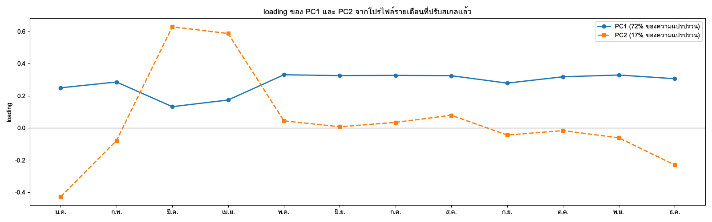
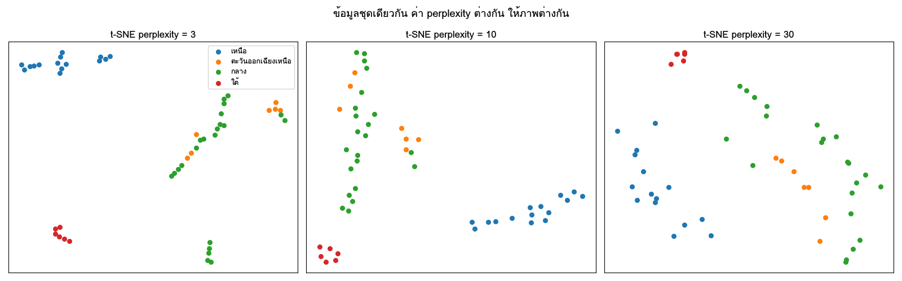
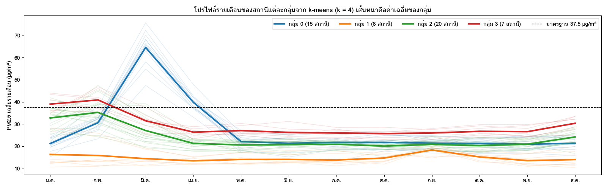

บทที่ 13 และ 14 ทำงานกับตัวแปรทีละหนึ่งหรือสองตัว เช่น PM2.5 ของสถานีเดียวตามเวลา หรือการเทียบสองภาค แต่คำถามจำนวนมากต้องดูหลายตัวแปรพร้อมกัน ตัวอย่างเช่น "สถานีใดมีรูปแบบฤดูกาลคล้ายกัน" ต้องเทียบทั้ง 12 เดือนของทุกสถานี ซึ่งเป็นข้อมูล 12 มิติ หรือ "วันใดที่สารมลพิษหลายชนิดผิดปกติพร้อมกันในแบบที่ไม่เคยเห็น" ต้องดู PM2.5, PM10, CO, NO2, O3 และ SO2 ไปพร้อมกัน ตามองเห็นได้อย่างมากสามมิติ และอ่านได้แม่นเพียงสองมิติ เครื่องมือในบทนี้จึงทำหน้าที่ย่อข้อมูลหลายมิติให้เหลือสิ่งที่คนเข้าใจได้

เครื่องมือแบ่งเป็นสามกลุ่ม กลุ่มแรกคือการลดมิติ (PCA, t-SNE, UMAP) ซึ่งหาทิศทางหรือแผนที่สองมิติที่รักษาโครงสร้างสำคัญไว้ กลุ่มที่สองคือการจัดกลุ่ม (clustering) ซึ่งหาว่าหน่วยใดคล้ายกัน กลุ่มที่สามคือการตรวจหาค่าผิดปกติ (outlier) ซึ่งหาหน่วยที่ไม่เหมือนใคร ทุกกลุ่มขึ้นกับคำถามพื้นฐานข้อเดียวกันคือ **"คล้าย" หมายความว่าอะไร** และทุกกลุ่มให้ผลลัพธ์ที่เป็น *สมมติฐาน* ไม่ใช่ข้อเท็จจริง ผลลัพธ์ของบทนี้คือตาราง `station_clusters` และ `daily_outlier_flags` ที่ใช้ต่อในบทที่ 17 และ 20

## วัตถุประสงค์การเรียนรู้ {.unnumbered}

เมื่อจบบทนี้ ผู้อ่านสามารถ

1. เลือกการวัดระยะทางและวิธีปรับสเกลให้ตรงกับคำถาม และอธิบายผลของการเลือกต่อผลลัพธ์
2. อธิบาย PCA ด้วย eigen decomposition และ SVD และคำนวณสัดส่วนความแปรปรวนที่อธิบายได้
3. ตีความ loading และ score ของ PCA กับข้อมูลรูปแบบฤดูกาลของสถานี โดยไม่ตีความเครื่องหมายเกินจริง
4. ใช้ k-means, hierarchical clustering และ DBSCAN และเปรียบเทียบสมมติฐานของแต่ละวิธี
5. ประเมินผลการจัดกลุ่มด้วย silhouette ความเสถียร และความหมายเชิงโดเมน
6. ตรวจหาค่าผิดปกติหลายมิติด้วยวิธีทางสถิติและวิธีที่อิงความหนาแน่น
7. ตัดสินว่าค่าผิดปกติเป็นความผิดพลาดหรือเหตุการณ์จริงด้วยหลักฐานหลายด้าน และบันทึกเป็นตารางธง

## ระยะทาง ความคล้าย และการปรับสเกล {#sec-ch15-distance}

### ทุกวิธีเริ่มจากระยะทาง

PCA, k-means, hierarchical clustering, DBSCAN และวิธีตรวจค่าผิดปกติส่วนใหญ่ในบทนี้ทำงานบนแนวคิดเดียวกัน คือ **ระยะทาง** ระหว่างหน่วยในปริภูมิหลายมิติ หน่วยที่ใกล้กันถือว่าคล้ายกัน ดังนั้นการเลือกว่า *วัดระยะอย่างไร* และ *แต่ละมิติมีน้ำหนักเท่าใด* จึงกำหนดผลลัพธ์มากกว่าการเลือกอัลกอริทึม

ในบทนี้ "หน่วย" มีสองแบบที่ตอบคำถามต่างกัน

| หน่วย | มิติ | ตัวอย่างคำถาม |
|---|---|---|
| สถานี | ค่าเฉลี่ย PM2.5 ของแต่ละเดือน (12 มิติ) | สถานีใดมีรูปแบบฤดูกาลคล้ายกัน |
| สถานี-วัน | ค่าเฉลี่ยรายวันของสารมลพิษหกชนิด (6 มิติ) | วันใดมีส่วนผสมของสารมลพิษผิดปกติ |

: หน่วยและมิติของข้อมูลหลายมิติในบทนี้ {#tbl-ch15-units}

### เตรียมเมทริกซ์ monthly profile

```python
import duckdb
import numpy as np
import pandas as pd
import plotly.express as px

con = duckdb.connect("data/pm25.duckdb", read_only=True)
monthly = con.execute("""
    SELECT d.station_id, s.name_th, s.region, month(d.date) AS m,
           avg(d.pm25_mean) AS pm25, count(*) AS n_days
    FROM daily_pm25_clean AS d JOIN stations AS s USING (station_id)
    WHERE d.is_complete
    GROUP BY ALL
""").df()

profile = monthly.pivot(index="station_id", columns="m", values="pm25")
meta = monthly.drop_duplicates("station_id").set_index("station_id")[["name_th", "region"]]
print(profile.shape, "ช่องว่าง:", int(profile.isna().sum().sum()))
```

เมทริกซ์ที่ได้มีหนึ่งแถวต่อสถานีและหนึ่งคอลัมน์ต่อเดือน ค่าในแต่ละช่องคือค่าเฉลี่ยของเดือนนั้นข้ามทุกปีที่มีข้อมูล การเฉลี่ยข้ามปีแบบนี้ทำให้สถานีที่มีข้อมูลเฉพาะปีที่ฝุ่นหนักดูสกปรกกว่าความจริง ถ้าสถานีมีช่วงข้อมูลต่างกันมาก ควรจำกัดให้ใช้ปีเดียวกันทุกสถานี

scikit-learn ไม่รับค่าว่าง ต้องตัดสินใจก่อน (บทที่ 10)

```python
keep = profile.isna().sum(axis=1) <= 2
P = profile[keep].apply(lambda c: c.fillna(c.mean()))
P.columns = [f"m{m:02d}" for m in P.columns]
print(f"ใช้ {len(P)} สถานี ตัดออก {(~keep).sum()} สถานี")
```

การเติมด้วยค่าเฉลี่ยของเดือนเดียวกันข้ามทุกสถานีเป็นวิธีที่ง่ายแต่ดึงสถานีที่เติมเข้าหาค่ากลาง ทางที่ดีกว่าคือเติมด้วยค่าเฉลี่ยของเดือนเดียวกันในภาคเดียวกัน ทั้งสองแบบต้องบันทึกจำนวนสถานีที่ถูกตัดและจำนวนช่องที่เติมไว้ในข้อจำกัด

### ระยะทางแบบต่าง ๆ

**ระยะทางแบบยุคลิด** (Euclidean distance) ระหว่างสองสถานี $\mathbf{a}$ และ $\mathbf{b}$ ที่มี $p$ มิติคือ

$$
d(\mathbf{a}, \mathbf{b}) = \sqrt{\sum_{j=1}^{p} (a_j - b_j)^2}
$$ {#eq-ch15-euclidean}

โดย $a_j$ และ $b_j$ คือค่าในมิติที่ $j$ ของแต่ละสถานี ตัวอย่าง (ข้อมูลสมมุติ) สถานี A มีค่าเฉลี่ยมีนาคม เมษายน และกรกฎาคมเป็น 60, 45, 20 µg/m³ สถานี B เป็น 50, 40, 25 µg/m³ ผลต่างคือ 10, 5, −5 ได้ระยะทาง $\sqrt{100 + 25 + 25} = \sqrt{150} \approx 12.2$ µg/m³

| ระยะทาง | วัดอะไร | เหมาะกับ |
|---|---|---|
| ยุคลิด | ความต่างของค่าในทุกมิติ | ตัวแปรที่ปรับสเกลแล้ว ใช้กับ k-means |
| แมนแฮตตัน | ผลรวมของความต่างสัมบูรณ์ | ทนต่อมิติที่ต่างมากเพียงมิติเดียว |
| สหสัมพันธ์ ($1 - r$) | ความต่างของ *รูปร่าง* โดยไม่สนระดับ | รูปแบบฤดูกาลที่ต้องการเทียบเฉพาะช่วงเวลาของยอด |
| Mahalanobis | ระยะที่คำนึงถึงความแปรปรวนร่วมระหว่างมิติ | ตรวจค่าผิดปกติหลายมิติ (@sec-ch15-outlier-methods) |

: การวัดระยะทางที่ใช้บ่อย {#tbl-ch15-distances}

### ทำไมต้องปรับสเกล

ระยะทางแบบยุคลิดให้น้ำหนักแต่ละมิติตามขนาดของความผันแปรในมิตินั้น ถ้าค่าเฉลี่ยเดือนมีนาคมของสถานีต่าง ๆ แกว่งอยู่ระหว่าง 20–120 µg/m³ แต่เดือนกรกฎาคมแกว่งเพียง 5–20 µg/m³ ระยะทางเกือบทั้งหมดจะมาจากเดือนมีนาคม การจัดกลุ่มที่ได้ก็เกือบเท่ากับการจัดกลุ่มตามเดือนมีนาคมเดือนเดียว ปัญหาชัดขึ้นอีกเมื่อมิติมีหน่วยต่างกัน เช่น PM2.5 (µg/m³) กับ CO (ppm) ซึ่งตัวเลขต่างกันหลายร้อยเท่า

**การทำให้เป็นมาตรฐาน** (standardization) แปลงแต่ละคอลัมน์ให้มีค่าเฉลี่ย 0 และส่วนเบี่ยงเบนมาตรฐาน 1

$$
z_{ij} = \frac{x_{ij} - \bar{x}_j}{s_j}
$$ {#eq-ch15-standardize}

โดย $x_{ij}$ คือค่าของสถานี $i$ ในมิติ $j$ และ $\bar{x}_j$, $s_j$ คือค่าเฉลี่ยและส่วนเบี่ยงเบนมาตรฐานของคอลัมน์ $j$ ตัวอย่าง (ข้อมูลสมมุติ) ถ้าค่าเฉลี่ยเดือนมีนาคมของทุกสถานีคือ 55 µg/m³ และส่วนเบี่ยงเบนมาตรฐาน 20 µg/m³ สถานีที่มีค่า 95 µg/m³ ได้ $z = (95 - 55)/20 = 2.0$

### ปรับสเกลตามคอลัมน์หรือตามแถว

การเลือกวิธีปรับสเกลคือการเลือกคำถาม

| วิธี | ทำอะไร | กลุ่มที่ได้สะท้อน |
|---|---|---|
| ปรับตามคอลัมน์ (`StandardScaler`) | ทุกเดือนมีน้ำหนักเท่ากัน | ทั้ง *ระดับ* และ *รูปร่าง* ของฤดูกาล |
| หารแต่ละแถวด้วยค่าเฉลี่ยของสถานี | ตัดผลของระดับรวมออก | *รูปร่าง* อย่างเดียว เช่น ยอดอยู่เดือนใด และสูงกว่าค่าเฉลี่ยของตนกี่เท่า |
| log แล้วลบค่าเฉลี่ยของแถว | เหมือนแบบที่สองบนสเกลอัตราส่วน | รูปร่างแบบคูณ เหมาะกับ PM2.5 |
| robust scaling (มัธยฐาน, IQR) | เหมือนแบบแรกแต่ทนต่อสถานีที่ผิดปกติ | ระดับและรูปร่าง โดยสถานีสุดขั้วไม่ครอบงำ |

: วิธีปรับสเกลกับความหมายของผลลัพธ์ {#tbl-ch15-scaling}

```python
from sklearn.preprocessing import StandardScaler, RobustScaler

X_level = StandardScaler().fit_transform(P)                         # ระดับ + รูปร่าง
logP = np.log(P)
X_shape = StandardScaler().fit_transform(logP.sub(logP.mean(axis=1), axis=0))   # รูปร่างอย่างเดียว
X_robust = RobustScaler().fit_transform(P)
```

ถ้าใช้ `X_level` สถานีที่สกปรกทั้งปีจะถูกจัดอยู่ด้วยกันแม้รูปแบบฤดูกาลต่างกัน ถ้าใช้ `X_shape` สถานีที่ยอดอยู่ในเดือนเดียวกันจะอยู่ด้วยกันแม้ระดับต่างกันหลายเท่า ไม่มีแบบใดถูกเสมอ ผู้วิเคราะห์ต้องเขียนเหตุผลที่เลือกไว้ใน notebook และควรลองทั้งสองแบบเพื่อดูว่าข้อสรุปเปลี่ยนหรือไม่

### คำสาปของมิติ

เมื่อจำนวนมิติเพิ่มขึ้น ระยะทางระหว่างจุดทุกคู่มีแนวโน้มใกล้เคียงกันมากขึ้น ความต่างระหว่าง "ใกล้" กับ "ไกล" จึงลดลง ปรากฏการณ์นี้เป็นส่วนหนึ่งของสิ่งที่เรียกว่าคำสาปของมิติ (curse of dimensionality) [@beyer1999nearest] ข้อมูล 12 เดือนยังไม่ถือว่าสูงมาก แต่ถ้าใช้ค่ารายวันทั้งปี 365 มิติเป็นเวกเตอร์ของสถานี ระยะทางแบบยุคลิดจะไม่ค่อยมีความหมาย การลดมิติด้วย PCA ก่อนจัดกลุ่ม หรือการสรุปเป็นค่ารายเดือนก่อน จึงช่วยได้ทั้งเรื่องสัญญาณรบกวนและเรื่องความหมายของระยะทาง

## PCA เชิงคณิตศาสตร์: eigen decomposition และ SVD {#sec-ch15-pca-math}

### เป้าหมายของ PCA

**การวิเคราะห์องค์ประกอบหลัก** ([principal component analysis]{.idx}, PCA) [@jolliffe2016principal] หาทิศทางใหม่ในปริภูมิข้อมูลที่ข้อมูลกระจายตัวมากที่สุด ทิศทางแรก (PC1) คือทิศทางที่ความแปรปรวนของข้อมูลเมื่อฉายลงไปมีค่ามากที่สุด ทิศทางที่สอง (PC2) คือทิศทางที่ความแปรปรวนมากที่สุดในบรรดาทิศทางที่ตั้งฉากกับ PC1 และต่อไปเรื่อย ๆ ถ้าข้อมูล 12 มิติมีโครงสร้างจริงเพียงไม่กี่แบบ เช่น "ระดับรวม" และ "เดือนของยอด" สององค์ประกอบแรกจะเก็บความแปรปรวนส่วนใหญ่ไว้ และเราวาดข้อมูลบนระนาบสองมิติได้โดยเสียข้อมูลน้อย

### ผ่าน eigen decomposition

ให้ $\mathbf{X}$ เป็นเมทริกซ์ข้อมูลขนาด $n \times p$ ที่ลบค่าเฉลี่ยของแต่ละคอลัมน์ออกแล้ว (และปรับสเกลแล้วถ้าต้องการ) เมทริกซ์ความแปรปรวนร่วม (covariance matrix) คือ

$$
\mathbf{C} = \frac{1}{n-1}\mathbf{X}^\top\mathbf{X}
$$ {#eq-ch15-covariance}

โดย $\mathbf{C}$ เป็นเมทริกซ์สมมาตรขนาด $p \times p$ ที่สมาชิกแถว $j$ คอลัมน์ $k$ คือความแปรปรวนร่วมระหว่างมิติ $j$ และ $k$ ถ้าข้อมูลถูกทำให้เป็นมาตรฐานแล้ว $\mathbf{C}$ คือเมทริกซ์สหสัมพันธ์ PCA คือการแยก $\mathbf{C}$ ด้วย eigen decomposition (ภาคผนวก จ)

$$
\mathbf{C}\mathbf{v}_k = \lambda_k \mathbf{v}_k
$$ {#eq-ch15-eigen}

โดย $\mathbf{v}_k$ คือ eigenvector ที่ $k$ ซึ่งเป็นทิศทางของ PC ที่ $k$ (ยาวหนึ่งหน่วย) และ $\lambda_k$ คือ eigenvalue ซึ่งเท่ากับความแปรปรวนของข้อมูลเมื่อฉายลงบนทิศทางนั้น เรียง $\lambda_1 \ge \lambda_2 \ge \dots \ge \lambda_p$ ส่วน **score** ของหน่วย $i$ บน PC ที่ $k$ คือผลคูณภายใน $\mathbf{x}_i^\top\mathbf{v}_k$

**ตัวอย่าง (ข้อมูลสมมุติ)** ถ้ามีเพียงสองมิติ คือ PM2.5 เดือนมีนาคมและเมษายนที่ทำให้เป็นมาตรฐานแล้ว และสหสัมพันธ์ระหว่างสองเดือนคือ 0.8 เมทริกซ์สหสัมพันธ์คือ $\begin{pmatrix}1 & 0.8\\0.8 & 1\end{pmatrix}$ eigenvalue คือ $1 + 0.8 = 1.8$ และ $1 - 0.8 = 0.2$ eigenvector คือ $(1/\sqrt{2},\ 1/\sqrt{2})$ และ $(1/\sqrt{2},\ -1/\sqrt{2})$ PC1 คือทิศทาง "สองเดือนสูงพร้อมกัน" ซึ่งอธิบายความแปรปรวน $1.8/2 = 90\%$ PC2 คือ "มีนาคมสูงกว่าเมษายน" ซึ่งอธิบาย 10% ที่เหลือ

### ผ่าน SVD

ในทางปฏิบัติ scikit-learn ไม่ได้คำนวณ $\mathbf{C}$ แต่ใช้ **singular value decomposition** (SVD) ของ $\mathbf{X}$ โดยตรง เพราะแม่นยำเชิงตัวเลขกว่า

$$
\mathbf{X} = \mathbf{U}\boldsymbol{\Sigma}\mathbf{V}^\top
$$ {#eq-ch15-svd}

โดย $\mathbf{V}$ เป็นเมทริกซ์ $p \times p$ ที่คอลัมน์คือ eigenvector ของ $\mathbf{C}$ (ทิศทางของ PC) $\boldsymbol{\Sigma}$ เป็นเมทริกซ์ทแยงที่มีค่าเอกฐาน (singular value) $\sigma_k$ และ $\mathbf{U}\boldsymbol{\Sigma}$ คือเมทริกซ์ score ความสัมพันธ์กับ eigenvalue คือ $\lambda_k = \sigma_k^2/(n-1)$ ตัวอย่าง (ข้อมูลสมมุติ) ถ้ามี 41 สถานีและ $\sigma_1 = 8.49$ จะได้ $\lambda_1 = 8.49^2/40 \approx 1.80$

```python
from sklearn.decomposition import PCA

Xc = X_level - X_level.mean(axis=0)
U, S, Vt = np.linalg.svd(Xc, full_matrices=False)
eig_from_svd = S**2 / (len(Xc) - 1)

pca = PCA().fit(X_level)
np.allclose(eig_from_svd, pca.explained_variance_)       # ควรได้ True
np.allclose(np.abs(Vt), np.abs(pca.components_))         # เท่ากันโดยไม่นับเครื่องหมาย
```

การตรวจแบบนี้ไม่จำเป็นในงานจริง แต่ช่วยให้เห็นว่า PCA ของ scikit-learn ไม่มีอะไรลึกลับ `explained_variance_` คือ eigenvalue และ `components_` คือ eigenvector ที่วางเป็นแถว การเปรียบเทียบใช้ค่าสัมบูรณ์เพราะเครื่องหมายของ eigenvector กำหนดได้ทั้งสองทาง (@sec-ch15-pca-interpret)

### PCA เป็นการประมาณด้วยเมทริกซ์อันดับต่ำ

อีกมุมหนึ่งของ PCA คือการประมาณข้อมูลเดิมด้วยองค์ประกอบ $q$ ตัวแรก $\hat{\mathbf{X}} = \mathbf{U}_q\boldsymbol{\Sigma}_q\mathbf{V}_q^\top$ ทฤษฎีบท Eckart–Young บอกว่าการประมาณนี้ทำให้ผลรวมกำลังสองของความคลาดเคลื่อนน้อยที่สุดในบรรดาเมทริกซ์อันดับ $q$ ทั้งหมด [@eckart1936approximation] มุมมองนี้มีประโยชน์สองทาง ทางแรก สถานีที่ประมาณได้ไม่ดี (ความคลาดเคลื่อนของการสร้างคืนสูง) คือสถานีที่มีรูปแบบไม่เหมือนสถานีอื่น ซึ่งเป็นวิธีตรวจค่าผิดปกติแบบหนึ่ง ทางที่สอง PCA กรองสัญญาณรบกวนออกได้ถ้าส่วนที่ตัดทิ้งเป็นสัญญาณรบกวนจริง

```python
pca2 = PCA(n_components=2).fit(X_level)
X_hat = pca2.inverse_transform(pca2.transform(X_level))
recon_error = pd.Series(((X_level - X_hat) ** 2).sum(axis=1), index=P.index)
recon_error.sort_values(ascending=False).head()
```

## การตีความ loading และ explained variance {#sec-ch15-pca-interpret}

### explained variance: ใช้กี่องค์ประกอบ

**สัดส่วนความแปรปรวนที่อธิบายได้** (explained variance ratio) ของ PC ที่ $k$ คือ $\lambda_k / \sum_j \lambda_j$ ถ้าข้อมูลถูกทำให้เป็นมาตรฐาน ผลรวมของ eigenvalue เท่ากับจำนวนมิติ $p$

```python
pca = PCA(n_components=6, random_state=42).fit(X_level)
ev = pd.DataFrame({"PC": [f"PC{i + 1}" for i in range(6)],
                   "ratio": pca.explained_variance_ratio_,
                   "cumulative": pca.explained_variance_ratio_.cumsum()})
px.bar(ev, x="PC", y="ratio", labels={"ratio": "สัดส่วนความแปรปรวน"}).add_scatter(
    x=ev["PC"], y=ev["cumulative"], mode="lines+markers", name="สะสม")
```

กราฟนี้เรียกว่า scree plot เกณฑ์ที่ใช้เลือกจำนวนองค์ประกอบมีหลายแบบ และไม่มีแบบใดถูกเสมอ

| เกณฑ์ | วิธี | ข้อสังเกต |
|---|---|---|
| สัดส่วนสะสม | ใช้จนสะสมเกิน 80% หรือ 90% | ง่าย แต่ตัวเลขเกณฑ์เป็นการเลือกตามอำเภอใจ |
| ข้อศอกของ scree plot | หยุดที่จุดที่กราฟหักลง | มักไม่ชัด |
| Kaiser | eigenvalue มากกว่า 1 (ข้อมูลที่ทำให้เป็นมาตรฐาน) | มักเลือกมากเกินไปเมื่อมีมิติมาก |
| ความหมาย | ใช้เฉพาะองค์ประกอบที่ตีความได้ | ต้องใช้ความรู้เชิงโดเมน |

: เกณฑ์เลือกจำนวนองค์ประกอบหลัก {#tbl-ch15-n-components}

สำหรับการสำรวจด้วยภาพ เรามักใช้สององค์ประกอบแรกเพราะวาดได้ แต่ต้องรายงานสัดส่วนสะสมของสององค์ประกอบนั้นในคำบรรยายภาพ ถ้าได้เพียง 50% ภาพสองมิติก็ทิ้งข้อมูลไปครึ่งหนึ่ง จุดที่ดูใกล้กันบนภาพอาจห่างกันในมิติที่ไม่ได้แสดง

### loading: แต่ละองค์ประกอบหมายถึงอะไร

**loading** คือน้ำหนักของมิติเดิมแต่ละมิติในองค์ประกอบหนึ่ง ใน scikit-learn คือ `pca.components_` (บางตำรานิยาม loading เป็น eigenvector คูณรากที่สองของ eigenvalue ซึ่งเท่ากับสหสัมพันธ์ระหว่างมิติเดิมกับ score เมื่อข้อมูลถูกทำให้เป็นมาตรฐาน ให้ระบุว่าใช้นิยามใด) การวาด loading ของข้อมูลรายเดือนเป็นเส้นตามเดือนช่วยให้ตีความได้ง่าย

```python
loadings = pd.DataFrame(pca.components_[:3].T, index=P.columns, columns=["PC1", "PC2", "PC3"])
fig = px.line(loadings, markers=True, labels={"index": "เดือน", "value": "loading"})
fig.add_hline(y=0, line_color="gray")
```

| รูปแบบ loading | การตีความที่เป็นไปได้ |
|---|---|
| ค่าเครื่องหมายเดียวกันและขนาดใกล้กันทุกเดือน | "ระดับรวม" สถานีที่ score สูงสกปรกทั้งปี |
| บวกช่วงกุมภาพันธ์–เมษายน ลบช่วงตุลาคม–ธันวาคม | "ช่วงเวลาของยอด" แยกสถานีที่ยอดอยู่ปลายฤดูแล้งออกจากสถานีที่ยอดอยู่ต้นฤดูหนาว |
| บวกเฉพาะไม่กี่เดือนติดกัน | "ความแหลมของยอด" สถานีที่มีฤดูฝุ่นสั้นและรุนแรง |

: ตัวอย่างการตีความ loading ของข้อมูลรายเดือน {#tbl-ch15-loading-patterns}

ตารางนี้เป็นรูปแบบที่ *อาจ* พบ ไม่ใช่ผลจากข้อมูลจริง การตีความต้องมาจาก loading ของข้อมูลผู้อ่านเอง

@fig-ch15-loadings เป็นตัวอย่างจากข้อมูลสังเคราะห์ที่ตรงกับสองแถวแรกของ @tbl-ch15-loading-patterns PC1 เป็นบวกใกล้กันทุกเดือน (ระดับรวม) ส่วน PC2 แยกเดือนมีนาคม–เมษายนออกจากเดือนธันวาคม–มกราคม (ช่วงเวลาของยอด)

{#fig-ch15-loadings fig-alt="เส้น PC1 เป็นบวกทุกเดือนในระดับใกล้เคียงกัน ต่ำลงเล็กน้อยในเดือนมีนาคมและเมษายน เส้น PC2 เป็นลบในเดือนมกราคมและธันวาคม และเป็นบวกสูงในเดือนมีนาคมและเมษายน"}

### ข้อควรระวังในการตีความ

1. **เครื่องหมายกำหนดได้สองทาง** ถ้า $\mathbf{v}$ เป็น eigenvector, $-\mathbf{v}$ ก็เป็นด้วย score ทั้งหมดของ PC นั้นจะกลับเครื่องหมาย เวอร์ชันของไลบรารีหรือข้อมูลที่เปลี่ยนเล็กน้อยอาจกลับเครื่องหมายได้ จึงห้ามตีความว่า "บวกคือแย่" ให้ตีความ *การตรงข้ามกัน* ระหว่างมิติ เช่น "มีนาคมกับพฤศจิกายนไปคนละทาง"
2. **ชื่อขององค์ประกอบคือการตีความของเรา** PCA ให้เพียงผลรวมเชิงเส้นทางคณิตศาสตร์ คำว่า "ระดับรวม" หรือ "ช่วงเวลาของยอด" เป็นชื่อที่เราตั้ง ต้องตรวจด้วยการดูสถานีที่ score สูงสุดและต่ำสุดว่าสอดคล้องกับชื่อนั้นจริง
3. **องค์ประกอบหลังมักตีความยาก** PC ที่สามเป็นต้นไปถูกบังคับให้ตั้งฉากกับ PC ก่อนหน้า จึงอาจเป็นส่วนผสมของหลายรูปแบบ
4. **PCA หาความสัมพันธ์เชิงเส้น** ถ้าโครงสร้างจริงไม่เป็นเชิงเส้น PCA จะต้องใช้หลายองค์ประกอบเพื่ออธิบายสิ่งที่เป็นรูปแบบเดียว
5. **ค่าผิดปกติดึงองค์ประกอบได้** สถานีเดียวที่สุดขั้วมาก ๆ อาจกลายเป็น PC1 ทั้งองค์ประกอบ ควรตรวจด้วย robust scaling หรือลองตัดสถานีนั้นออก

### biplot: score และ loading ในภาพเดียว

**biplot** วาด score ของสถานีเป็นจุด และ loading ของแต่ละมิติเป็นลูกศรบนแกนเดียวกัน [@gabriel1971biplot] สถานีที่อยู่ไปทางลูกศรของเดือนใดคือสถานีที่ค่าเดือนนั้นสูงกว่าค่าเฉลี่ย

```python
scores = pd.DataFrame(pca.transform(X_level)[:, :2], index=P.index,
                      columns=["PC1", "PC2"]).join(meta)
fig = px.scatter(scores, x="PC1", y="PC2", color="region", hover_name="name_th",
                 labels={"PC1": f"PC1 ({pca.explained_variance_ratio_[0]:.0%})",
                         "PC2": f"PC2 ({pca.explained_variance_ratio_[1]:.0%})"})
scale = np.abs(scores[["PC1", "PC2"]]).max().max()
for month, (l1, l2) in loadings[["PC1", "PC2"]].iterrows():
    fig.add_annotation(x=l1 * scale, y=l2 * scale, ax=0, ay=0, axref="x", ayref="y",
                       text=month, showarrow=True, arrowhead=2, arrowcolor="gray")
```

การใส่สัดส่วนความแปรปรวนในชื่อแกนทำให้ผู้อ่านรู้ทันทีว่าภาพนี้แทนข้อมูลเดิมได้มากน้อยเท่าใด การลงสีตามภาคเป็นการตรวจความหมาย ถ้าสถานีของภาคเดียวกันรวมกลุ่มกันบนภาพ แปลว่าโครงสร้างที่ PCA พบสัมพันธ์กับภูมิศาสตร์ ซึ่งจะตรวจต่อในบทที่ 17

## t-SNE และ UMAP: แนวคิดและกับดักการตีความ ★ {#sec-ch15-tsne-umap}

::: {.callout-note title="★ เนื้อหาเชิงลึก"}
หัวข้อนี้ไม่ได้สอนในชั้นเรียน อ่านข้ามได้โดยไม่กระทบความเข้าใจบทถัดไป
:::

### การลดมิติแบบไม่เชิงเส้น

PCA ฉายข้อมูลลงบนระนาบที่เป็นเส้นตรง ถ้าข้อมูลอยู่บนพื้นผิวโค้ง เช่น วงแหวนในสามมิติ การฉายลงระนาบจะทับจุดที่อยู่ห่างกันบนพื้นผิวไว้ด้วยกัน วิธีลดมิติแบบไม่เชิงเส้นพยายามรักษา *ความสัมพันธ์เพื่อนบ้าน* แทนระยะทางทั้งหมด จุดที่อยู่ใกล้กันในมิติสูงควรอยู่ใกล้กันในภาพสองมิติ ส่วนจุดที่อยู่ไกลกันจะอยู่ไกลแค่ไหนในภาพไม่ใช่สิ่งที่วิธีเหล่านี้พยายามรักษา

**t-SNE** [@vandermaaten2008visualizing] แปลงระยะทางในมิติสูงเป็นความน่าจะเป็นที่จุดหนึ่งจะ "เลือก" อีกจุดเป็นเพื่อนบ้าน โดยใช้การแจกแจงปกติที่ความกว้างปรับตามความหนาแน่นรอบแต่ละจุด แล้วหาตำแหน่งในสองมิติที่ความน่าจะเป็นแบบเดียวกัน (ใช้การแจกแจง t ซึ่งหางหนากว่า) ใกล้เคียงของเดิมที่สุด พารามิเตอร์สำคัญคือ **perplexity** ซึ่งเปรียบได้กับจำนวนเพื่อนบ้านที่แต่ละจุดสนใจ

**UMAP** [@mcinnes2018umap] ใช้แนวคิดจากทอพอโลยีสร้างกราฟเพื่อนบ้านในมิติสูง แล้วหาภาพสองมิติที่กราฟเพื่อนบ้านคล้ายเดิม พารามิเตอร์สำคัญคือ `n_neighbors` (ขนาดของละแวก) และ `min_dist` (ความแน่นของกลุ่มในภาพ) UMAP มักเร็วกว่า t-SNE และรักษาโครงสร้างระดับกว้างได้ดีกว่าเล็กน้อย

```python
from sklearn.manifold import TSNE
import umap                                     # แพ็กเกจ umap-learn

emb_tsne = TSNE(n_components=2, perplexity=10, random_state=42).fit_transform(X_level)
emb_umap = umap.UMAP(n_neighbors=10, min_dist=0.1, random_state=42).fit_transform(X_level)
```

### กับดักการตีความ

Wattenberg และคณะ [@wattenberg2016how] แสดงด้วยตัวอย่างเชิงโต้ตอบว่าภาพ t-SNE หลอกตาได้หลายแบบ ซึ่งใช้กับ UMAP ได้เช่นกัน

| สิ่งที่เห็นในภาพ | ความจริง |
|---|---|
| กลุ่มหนึ่งใหญ่ อีกกลุ่มเล็ก | ขนาดของกลุ่มในภาพแทบไม่มีความหมาย t-SNE ขยายกลุ่มที่แน่นและหดกลุ่มที่กระจาย |
| สองกลุ่มอยู่ห่างกันมาก | ระยะห่างระหว่างกลุ่มไม่ได้บอกว่าต่างกันมากกว่ากลุ่มอื่น |
| มีกลุ่มแยกชัด | ข้อมูลสุ่มที่ไม่มีโครงสร้างก็อาจแสดงเป็นกลุ่มได้เมื่อ perplexity ต่ำ |
| ภาพเปลี่ยนเมื่อรันใหม่ | ผลขึ้นกับ seed และพารามิเตอร์ ต้องลองหลายค่า |

: กับดักในการอ่านภาพ t-SNE และ UMAP {#tbl-ch15-tsne-traps}

@fig-ch15-tsne แสดงกับดักแถวที่สามและสี่กับข้อมูลสังเคราะห์ชุดเดียว perplexity ต่ำแตกสถานีภาคเดียวกันเป็นก้อนเล็กหลายก้อน ส่วน perplexity สูงทำให้สองภาคปนกัน ถ้าดูเพียงภาพเดียวจะสรุปจำนวนกลุ่มต่างกันโดยสิ้นเชิง

{#fig-ch15-tsne fig-alt="ภาพซ้ายที่ perplexity 3 แยกเป็นกลุ่มเล็กหลายกลุ่ม แม้สถานีในภาคเดียวกันก็แตกเป็นหลายก้อน ภาพกลางแยกสี่ก้อนตามภาคชัดเจน ภาพขวาที่ perplexity 30 จุดกระจายมากขึ้นและกลุ่มภาคกลางกับภาคตะวันออกเฉียงเหนือปนกัน"}

ข้อแนะนำสำหรับงานของเรามีสามข้อ ข้อแรก **ใช้ t-SNE และ UMAP เพื่อสำรวจเท่านั้น** ไม่ใช้เป็นหลักฐานว่ามีกลุ่ม และไม่จัดกลุ่มบนพิกัดของภาพ ข้อสอง **ลองหลายค่าของพารามิเตอร์และ seed** แล้วเชื่อเฉพาะโครงสร้างที่ปรากฏซ้ำ ข้อสาม **ข้อมูลระดับสถานีมีหน่วยน้อย** ข้อมูลหลายสิบสถานีทำให้ perplexity หรือ `n_neighbors` ต้องต่ำ และภาพไม่เสถียร ในกรณีนี้ PCA ซึ่งตีความได้และไม่สุ่มมักเหมาะกว่า t-SNE และ UMAP มีประโยชน์มากขึ้นกับข้อมูลระดับสถานี-วันซึ่งมีหลายหมื่นหน่วย

## clustering: k-means, hierarchical, ★ DBSCAN {#sec-ch15-clustering}

### การจัดกลุ่มคืออะไร และไม่ใช่อะไร

**การจัดกลุ่ม** ([clustering]{.idx}) แบ่งหน่วยเป็นกลุ่มที่สมาชิกในกลุ่มคล้ายกันและต่างจากกลุ่มอื่น โดยไม่มีป้ายคำตอบให้เรียนรู้ จึงเป็นการเรียนรู้แบบไม่มีผู้สอน (unsupervised) คุณสมบัติที่ทำให้การจัดกลุ่มทั้งมีประโยชน์และอันตรายคือ **อัลกอริทึมจะคืนกลุ่มให้เสมอ** แม้ข้อมูลไม่มีโครงสร้างกลุ่มเลย Hennig [@hennig2015what] ชี้ว่าไม่มีนิยามเดียวของ "กลุ่มที่แท้จริง" แต่ละอัลกอริทึมนิยามกลุ่มต่างกัน และการเลือกต้องตรงกับเป้าหมายของงาน

| อัลกอริทึม | นิยามของกลุ่ม | ต้องกำหนด | จุดอ่อน |
|---|---|---|---|
| k-means | จุดที่ใกล้ centroid เดียวกัน | จำนวนกลุ่ม $k$ | ชอบกลุ่มทรงกลมขนาดใกล้กัน ไวต่อค่าผิดปกติ |
| hierarchical (Ward) | การรวมกลุ่มทีละขั้นที่เพิ่มความแปรปรวนในกลุ่มน้อยที่สุด | จุดตัดของ dendrogram | ตัดสินใจรวมแล้วย้อนไม่ได้ |
| DBSCAN | บริเวณที่หนาแน่นต่อเนื่องกัน | `eps`, `min_samples` | เลือก `eps` ยากเมื่อความหนาแน่นต่างกัน |

: เปรียบเทียบอัลกอริทึมการจัดกลุ่ม {#tbl-ch15-cluster-algorithms}

### k-means

k-means [@lloyd1982least] หาการแบ่งกลุ่มที่ทำให้ผลรวมของระยะทางกำลังสองจากแต่ละจุดถึง centroid ของกลุ่มตนน้อยที่สุด

$$
\min_{C_1,\dots,C_k} \sum_{c=1}^{k} \sum_{i \in C_c} \lVert \mathbf{x}_i - \boldsymbol{\mu}_c \rVert^2
$$ {#eq-ch15-kmeans}

โดย $C_c$ คือเซตของหน่วยในกลุ่ม $c$, $\boldsymbol{\mu}_c$ คือค่าเฉลี่ย (centroid) ของกลุ่มนั้น และ $\lVert\cdot\rVert$ คือระยะทางแบบยุคลิด ผลรวมนี้เรียกว่า inertia ใน scikit-learn ตัวอย่าง (ข้อมูลสมมุติ) กลุ่มหนึ่งที่มีสามสถานีในหนึ่งมิติที่ปรับสเกลแล้ว คือ 1.0, 1.5 และ 2.0 มี centroid 1.5 และมีส่วนของ inertia เป็น $0.25 + 0 + 0.25 = 0.5$

อัลกอริทึมสลับสองขั้นซ้ำจนนิ่ง คือ กำหนดแต่ละจุดให้อยู่กับ centroid ที่ใกล้ที่สุด แล้วคำนวณ centroid ใหม่ ผลลัพธ์ขึ้นกับจุดเริ่มต้น จึงต้องรันหลายครั้งด้วยจุดเริ่มต้นต่างกัน (`n_init`) แล้วเลือกผลที่ inertia ต่ำที่สุด

```python
from sklearn.cluster import KMeans
from sklearn.metrics import silhouette_score

rows = []
for k in range(2, 8):
    km = KMeans(n_clusters=k, n_init=20, random_state=42).fit(X_shape)
    rows.append({"k": k, "inertia": km.inertia_,
                 "silhouette": silhouette_score(X_shape, km.labels_),
                 "smallest_cluster": np.bincount(km.labels_).min()})
pd.DataFrame(rows).round(3)
```

การเก็บขนาดของกลุ่มที่เล็กที่สุดไว้ด้วยช่วยกันไม่ให้เลือก $k$ ที่ได้กลุ่มที่มีเพียงหนึ่งหรือสองสถานี ซึ่งมักเป็นค่าผิดปกติมากกว่าเป็นกลุ่ม

### hierarchical clustering

**hierarchical clustering** แบบรวม (agglomerative) เริ่มจากให้แต่ละหน่วยเป็นกลุ่มของตนเอง แล้วรวมสองกลุ่มที่ใกล้กันที่สุดทีละขั้นจนเหลือกลุ่มเดียว ประวัติการรวมแสดงเป็นแผนภาพต้นไม้ที่เรียกว่า **dendrogram** ความสูงของจุดที่สองกิ่งมาบรรจบกันคือระยะระหว่างกลุ่มในขั้นที่รวม การตัด dendrogram ที่ความสูงหนึ่งได้การแบ่งกลุ่มชุดหนึ่ง

"ระยะระหว่างกลุ่ม" (linkage) มีหลายนิยาม single linkage ใช้คู่ที่ใกล้ที่สุดซึ่งทำให้เกิดกลุ่มยาวเป็นสาย complete linkage ใช้คู่ที่ไกลที่สุด average linkage ใช้ค่าเฉลี่ย และ **Ward linkage** [@ward1963hierarchical] รวมคู่ที่ทำให้ผลรวมกำลังสองภายในกลุ่มเพิ่มขึ้นน้อยที่สุด ซึ่งใกล้กับเกณฑ์ของ k-means และเป็นค่าที่แนะนำเริ่มต้น

```python
from scipy.cluster.hierarchy import linkage, dendrogram, fcluster
import matplotlib.pyplot as plt

Z = linkage(X_shape, method="ward")
fig, ax = plt.subplots(figsize=(12, 4))
dendrogram(Z, labels=meta.loc[P.index, "name_th"].tolist(), leaf_rotation=90, ax=ax)
labels_h = fcluster(Z, t=3, criterion="maxclust")      # ตัดให้ได้ 3 กลุ่ม
```

dendrogram มีข้อดีเหนือ k-means สองข้อ ข้อแรก เห็นโครงสร้างหลายระดับในภาพเดียว เช่น สองกลุ่มใหญ่ที่แต่ละกลุ่มแยกเป็นกลุ่มย่อย ข้อสอง ไม่ต้องเลือก $k$ ก่อน การดูความสูงของกิ่งช่วยตัดสินว่าควรตัดที่ใด ถ้ามีช่องว่างความสูงขนาดใหญ่ระหว่างการรวมสองขั้น การตัดในช่องว่างนั้นได้กลุ่มที่แยกกันชัด ข้อจำกัดคือใช้ได้กับหน่วยไม่มาก (หลักร้อยถึงพัน) และดูยากเมื่อหน่วยมาก

### DBSCAN ★

::: {.callout-note title="★ เนื้อหาเชิงลึก"}
ส่วนย่อยนี้ (DBSCAN) ไม่ได้สอนในชั้นเรียน อ่านข้ามได้โดยไม่กระทบความเข้าใจบทถัดไป
:::

**DBSCAN** [@ester1996density] นิยามกลุ่มว่าเป็นบริเวณที่หนาแน่นต่อเนื่องกัน จุดที่มีเพื่อนบ้านในรัศมี `eps` อย่างน้อย `min_samples` จุดเป็น **จุดแกน** (core point) จุดแกนที่อยู่ในรัศมีของกันและกันอยู่กลุ่มเดียวกัน จุดที่ไม่ใช่จุดแกนแต่อยู่ในรัศมีของจุดแกนเป็นจุดขอบ ส่วนจุดที่เหลือเป็น **สัญญาณรบกวน** (noise) ได้ป้าย −1

DBSCAN มีข้อดีสามข้อที่ k-means ไม่มี ไม่ต้องกำหนดจำนวนกลุ่ม หากลุ่มรูปร่างใดก็ได้ และ **ไม่บังคับให้ทุกหน่วยอยู่ในกลุ่ม** หน่วยที่ไม่เหมือนใครจะเป็นสัญญาณรบกวน ซึ่งตรงกับความจริงของข้อมูลหลายชุดมากกว่า

การเลือก `eps` ใช้ **กราฟระยะถึงเพื่อนบ้านที่ k** เรียงจากน้อยไปมาก แล้วมองหาจุดที่กราฟหักขึ้น

```python
from sklearn.cluster import DBSCAN
from sklearn.neighbors import NearestNeighbors

k = 4
dist, _ = NearestNeighbors(n_neighbors=k + 1).fit(X_shape).kneighbors(X_shape)
k_dist = np.sort(dist[:, k])                     # คอลัมน์ 0 คือระยะถึงตัวเอง
px.line(y=k_dist, labels={"x": "สถานี (เรียงตามระยะ)", "y": f"ระยะถึงเพื่อนบ้านที่ {k}"})

db = DBSCAN(eps=1.5, min_samples=k).fit(X_shape)  # เลือก eps จากจุดหักของกราฟ
pd.Series(db.labels_).value_counts()
```

ค่า `eps=1.5` ในตัวอย่างเป็นเพียงตัวอย่าง ต้องเลือกจากกราฟของข้อมูลตนเอง ข้อจำกัดของ DBSCAN คือใช้ `eps` ค่าเดียวทั้งปริภูมิ ถ้ากลุ่มหนึ่งหนาแน่นและอีกกลุ่มเบาบาง จะหาค่าที่เหมาะกับทั้งสองกลุ่มไม่ได้ HDBSCAN [@campello2013density] แก้ข้อนี้ด้วยการพิจารณาหลายระดับความหนาแน่นพร้อมกัน และมีใน scikit-learn ตั้งแต่เวอร์ชัน 1.3 ในชื่อ `sklearn.cluster.HDBSCAN`

## การประเมิน cluster: silhouette และความเสถียร {#sec-ch15-cluster-eval}

### silhouette

**silhouette** [@rousseeuw1987silhouettes] วัดว่าแต่ละหน่วยอยู่ในกลุ่มที่เหมาะเพียงใด สำหรับหน่วย $i$

$$
s(i) = \frac{b(i) - a(i)}{\max\{a(i),\, b(i)\}}
$$ {#eq-ch15-silhouette}

โดย $a(i)$ คือระยะเฉลี่ยจาก $i$ ถึงหน่วยอื่นในกลุ่มเดียวกัน และ $b(i)$ คือระยะเฉลี่ยจาก $i$ ถึงหน่วยในกลุ่มอื่นที่ใกล้ที่สุด ค่า $s(i)$ อยู่ระหว่าง −1 ถึง 1 ค่าใกล้ 1 แปลว่าหน่วยใกล้กลุ่มตนมากกว่ากลุ่มอื่นมาก ค่าใกล้ 0 แปลว่าอยู่ระหว่างสองกลุ่ม ค่าลบแปลว่าน่าจะอยู่ผิดกลุ่ม ตัวอย่าง (ข้อมูลสมมุติ) สถานีที่มีระยะเฉลี่ยถึงกลุ่มตน 2.0 และถึงกลุ่มที่ใกล้ที่สุดถัดไป 5.0 ได้ $s = (5 - 2)/5 = 0.6$

ค่าเฉลี่ยของ $s(i)$ ทุกหน่วยคือ silhouette score ของการจัดกลุ่มทั้งชุด แต่ค่าเฉลี่ยซ่อนรายละเอียด **silhouette plot** ที่แสดง $s(i)$ ของทุกหน่วยแยกตามกลุ่มบอกได้มากกว่า เช่น กลุ่มหนึ่งอาจมีค่าสูงทุกหน่วย อีกกลุ่มมีครึ่งหนึ่งติดลบ

```python
from sklearn.metrics import silhouette_samples

K = 3                                            # เปลี่ยนตามผลของตนเอง
km = KMeans(n_clusters=K, n_init=20, random_state=42).fit(X_shape)
sil = (pd.DataFrame({"station_id": P.index, "cluster": km.labels_.astype(str),
                     "silhouette": silhouette_samples(X_shape, km.labels_)})
       .join(meta, on="station_id").sort_values(["cluster", "silhouette"]))
px.bar(sil, x="silhouette", y="station_id", color="cluster", orientation="h", hover_name="name_th")
```

silhouette มีข้อจำกัดที่ต้องรู้ ค่านี้ชอบกลุ่มทรงกลมที่แยกกันชัด จึงให้คะแนน k-means ดีกว่า DBSCAN ที่หากลุ่มรูปร่างแปลกได้ และไม่ได้บอกว่าข้อมูลมีโครงสร้างกลุ่มจริงหรือไม่ ข้อมูลที่สุ่มแบบสม่ำเสมอโดยไม่มีกลุ่มเลยก็อาจได้ silhouette ระดับปานกลางเมื่อบังคับแบ่งเป็นสองกลุ่ม การเทียบกับ **ข้อมูลอ้างอิงที่ไม่มีโครงสร้าง** เช่น gap statistic [@tibshirani2001estimating] ช่วยตอบคำถามนี้ได้ดีกว่า

### ความเสถียร

กลุ่มที่มีความหมายจริงควร **เสถียร** คือไม่เปลี่ยนมากเมื่อข้อมูลหรือการตั้งค่าเปลี่ยนเล็กน้อย [@hennig2007cluster] การตรวจความเสถียรทำได้หลายทาง

| ทดสอบด้วย | ทำอย่างไร | สิ่งที่ต้องการเห็น |
|---|---|---|
| seed | รัน k-means ด้วย `random_state` ต่างกัน | สมาชิกแทบไม่เปลี่ยน |
| การสุ่มหน่วย | bootstrap สถานี แล้วจัดกลุ่มใหม่ | หน่วยที่อยู่ด้วยกันยังอยู่ด้วยกัน |
| วิธีปรับสเกล | `X_level` กับ `X_shape` กับ robust | ข้อสรุปหลักไม่กลับด้าน |
| อัลกอริทึม | k-means กับ Ward | กลุ่มใหญ่ตรงกัน |
| ช่วงเวลา | ใช้ปีครึ่งแรกกับครึ่งหลัง | สถานีส่วนใหญ่อยู่กลุ่มเดิม |

: วิธีตรวจความเสถียรของการจัดกลุ่ม {#tbl-ch15-stability}

การเทียบสองการจัดกลุ่มใช้ **adjusted Rand index** (ARI) [@hubert1985comparing] ซึ่งวัดสัดส่วนของคู่หน่วยที่ทั้งสองการจัดกลุ่มเห็นตรงกันว่าอยู่ด้วยกันหรือแยกกัน ปรับแล้วให้ค่าที่คาดหวังจากการสุ่มเป็น 0 และค่าที่ตรงกันสมบูรณ์เป็น 1 ARI ไม่สนใจหมายเลขของกลุ่ม จึงเทียบผลที่ป้ายสลับกันได้

```python
from sklearn.metrics import adjusted_rand_score

rng = np.random.default_rng(42)
base = km.labels_
ari = []
for _ in range(200):
    idx = rng.choice(len(X_shape), size=len(X_shape), replace=True)
    uniq = np.unique(idx)                         # สถานีที่ถูกสุ่มได้ในรอบนี้
    km_b = KMeans(n_clusters=K, n_init=10, random_state=0).fit(X_shape[idx])
    ari.append(adjusted_rand_score(base[uniq], km_b.predict(X_shape[uniq])))
np.percentile(ari, [5, 50, 95])
```

ในแต่ละรอบ โค้ดจัดกลุ่มใหม่จากตัวอย่าง bootstrap แล้วนำศูนย์กลางใหม่มาจัดสถานีที่ถูกสุ่มได้ เทียบกับผลเดิมด้วย ARI ถ้ามัธยฐานของ ARI ต่ำ เช่น ต่ำกว่า 0.6 การจัดกลุ่มไม่เสถียร ไม่ควรรายงานว่า "พบ $k$ กลุ่ม" โดยไม่มีคำเตือน

### ความหมายเชิงโดเมน

เกณฑ์สุดท้ายและสำคัญที่สุดคือ **กลุ่มอธิบายได้หรือไม่ และช่วยตอบคำถามหรือไม่** วิธีตรวจมีสามขั้น

1. วาด monthly profile เฉลี่ยของแต่ละกลุ่มด้วย *ค่าเดิม* (µg/m³) ไม่ใช่ค่าที่ปรับสเกล พร้อมเส้น 37.5 µg/m³
2. เทียบกับตัวแปรภายนอกที่ไม่ได้ใช้จัดกลุ่ม เช่น ภาค หรือประเภทสถานี ด้วย `pd.crosstab`
3. เขียนคำบรรยายของแต่ละกลุ่มเป็นภาษาคนที่ผู้อ่านเข้าใจ เช่น "กลุ่มที่ยอดอยู่มีนาคม–เมษายนและฤดูฝุ่นสั้น"

```python
avg = P.assign(cluster=km.labels_).groupby("cluster").mean().T
fig = px.line(avg, markers=True, labels={"index": "เดือน", "value": "PM2.5 (µg/m³)"})
fig.add_hline(y=37.5, line_dash="dash", annotation_text="มาตรฐานไทย 37.5")
pd.crosstab(meta.loc[P.index, "region"], km.labels_)
```

@fig-ch15-clusters เป็นตัวอย่างของขั้นที่ 1 กับข้อมูลสังเคราะห์ เส้นบางคือสถานีแต่ละแห่งและเส้นหนาคือค่าเฉลี่ยของกลุ่ม การวาดทั้งสองแบบพร้อมกันทำให้เห็นว่าสถานีในกลุ่มเดียวกันคล้ายกันจริงหรือไม่ ซึ่งค่าเฉลี่ยของกลุ่มอย่างเดียวบอกไม่ได้

{#fig-ch15-clusters fig-alt="สี่กลุ่ม กลุ่มหนึ่งมียอดสูงมากในเดือนมีนาคมเกิน 60 µg/m³ กลุ่มหนึ่งต่ำตลอดปีและสูงขึ้นเล็กน้อยในเดือนกันยายน อีกสองกลุ่มมียอดในเดือนมกราคมถึงกุมภาพันธ์ที่ระดับต่างกัน"}

การเทียบกับภาคต้องตีความอย่างระวัง ถ้ากลุ่มตรงกับภาคเกือบทั้งหมด อาจเป็นเพราะภูมิศาสตร์กำหนดรูปแบบฤดูกาลจริง หรืออาจเป็นเพียงเพราะสิ่งที่ใช้จัดกลุ่มสัมพันธ์กับภาคอยู่แล้ว การจัดกลุ่มที่ตรงกับภาคทุกสถานีไม่ได้ให้ข้อมูลใหม่ สถานีที่อยู่ "ผิดภาค" กลับน่าสนใจกว่า เช่น สถานีภาคกลางที่มีรูปแบบเหมือนภาคเหนือ ภาษาที่ใช้ต้องตรงกับหลักฐาน เขียนว่า "สถานีกลุ่ม A *มีแนวโน้ม* มียอดในเดือนมีนาคม" ไม่ใช่ "สถานีกลุ่ม A *คือ* สถานีที่ได้รับผลจากไฟป่า"

## การตรวจหา outlier: z-score, IQR, ★ Mahalanobis, ★ LOF, Isolation Forest {#sec-ch15-outlier-methods}

### outlier ในหนึ่งมิติ

**ค่าผิดปกติ** ([outlier]{.idx}) คือหน่วยที่ต่างจากหน่วยส่วนใหญ่มากจนน่าสงสัยว่าเกิดจากกลไกอื่น [@barnett1994outliers] วิธีที่ง่ายที่สุดทำงานทีละมิติ

| วิธี | เกณฑ์ | จุดแข็ง | จุดอ่อน |
|---|---|---|---|
| z-score | $\lvert x - \bar{x}\rvert / s > 3$ | เข้าใจง่าย | ค่าเฉลี่ยและ SD ถูกค่าผิดปกติดึงเอง (masking) |
| IQR (Tukey's fences) | นอก $[Q_1 - 1.5\,\text{IQR},\ Q_3 + 1.5\,\text{IQR}]$ | ทนต่อค่าผิดปกติ ใช้ใน box plot | ติดธงหางขวาของข้อมูลเบ้มากเกินไป |
| robust z (MAD) | $\lvert x - \text{มัธยฐาน}\rvert / \text{MAD}_s > 3.5$ | ทนทาน ใช้กับข้อมูลเบ้ได้ดีกว่า | ยังมองทีละมิติ |

: วิธีตรวจค่าผิดปกติแบบหนึ่งมิติ {#tbl-ch15-outlier-1d}

ปัญหา **masking** ของ z-score แบบปกติเห็นได้ชัด ถ้าข้อมูลมีค่าผิดปกติหลายค่า ส่วนเบี่ยงเบนมาตรฐานจะใหญ่ขึ้นจนค่าผิดปกติทุกค่ามี z ต่ำกว่าเกณฑ์ robust z ที่ใช้ MAD (บทที่ 13) แก้ปัญหานี้ได้ และสำหรับ PM2.5 ซึ่งเบ้ขวา ควรใช้บน log

ข้อสำคัญที่สุดจากบทที่ 14 คือต้องเทียบกับ **ค่าปกติของบริบทนั้น** ถ้าเทียบกับค่ากลางของทั้งปี ทุกวันในฤดูแล้งจะเป็นค่าผิดปกติ จึงควรคำนวณเกณฑ์แยกตามสถานีและเดือน

```python
d = con.execute("""
    SELECT d.station_id, s.province, d.date, d.pm25_mean
    FROM daily_pm25_clean AS d JOIN stations AS s USING (station_id)
    WHERE d.is_complete AND d.pm25_mean > 0
""").df()
d["month"] = pd.to_datetime(d["date"]).dt.month
d["log_pm25"] = np.log(d["pm25_mean"])

g = d.groupby(["station_id", "month"])["log_pm25"]
med = g.transform("median")
mad = g.transform(lambda s: (s - s.median()).abs().median()) * 1.4826
d["robust_z"] = (d["log_pm25"] - med) / mad
d["is_outlier"] = d["robust_z"].abs() > 3.5
```

ค่า `robust_z` นี้เท่ากับสูตร $0.6745\,(x - \text{มัธยฐาน})/\text{MAD}$ ที่ใช้ในเอกสารสัปดาห์ที่ 12 เพราะ $1/1.4826 \approx 0.6745$ ต่างกันเพียงที่บทนี้คำนวณบน log ซึ่งทำให้หางขวาไม่ถูกติดธงมากเกินไป

### ค่าผิดปกติหลายมิติ

บางค่าผิดปกติมองไม่เห็นเมื่อดูทีละมิติ ตัวอย่างคือวันที่ PM2.5 สูงแต่ PM10 ต่ำ แต่ละค่าอยู่ในช่วงปกติของตัวเอง แต่การรวมกันผิดธรรมชาติ เพราะ PM2.5 เป็นส่วนหนึ่งของ PM10 และทั้งสองมักขึ้นลงพร้อมกัน ค่าแบบนี้มักบอกถึงความผิดพลาดของเครื่องวัดตัวใดตัวหนึ่ง การตรวจจึงต้องดูหลายมิติพร้อมกัน

### ระยะทาง Mahalanobis ★

::: {.callout-note title="★ เนื้อหาเชิงลึก"}
ส่วนย่อยนี้ (Mahalanobis และ LOF) ไม่ได้สอนในชั้นเรียน อ่านข้ามได้โดยไม่กระทบความเข้าใจบทถัดไป
:::

**ระยะทาง Mahalanobis** [@mahalanobis1936generalized] วัดระยะจากจุดถึงศูนย์กลางของข้อมูลโดยคำนึงถึงความแปรปรวนร่วม

$$
D^2(\mathbf{x}) = (\mathbf{x} - \boldsymbol{\mu})^\top \boldsymbol{\Sigma}^{-1} (\mathbf{x} - \boldsymbol{\mu})
$$ {#eq-ch15-mahalanobis}

โดย $\boldsymbol{\mu}$ คือเวกเตอร์ค่าเฉลี่ย และ $\boldsymbol{\Sigma}$ คือเมทริกซ์ความแปรปรวนร่วมของข้อมูล การคูณด้วย $\boldsymbol{\Sigma}^{-1}$ ทำให้ระยะในทิศทางที่ข้อมูลกระจายมากนับว่าใกล้ และระยะในทิศทางที่ข้อมูลกระจายน้อยนับว่าไกล

**ตัวอย่าง (ข้อมูลสมมุติ)** ให้ log PM2.5 และ log PM10 ทำให้เป็นมาตรฐานแล้ว และมีสหสัมพันธ์ 0.9 ได้ $\boldsymbol{\Sigma} = \begin{pmatrix}1 & 0.9\\0.9 & 1\end{pmatrix}$ และ $\boldsymbol{\Sigma}^{-1} = \frac{1}{0.19}\begin{pmatrix}1 & -0.9\\-0.9 & 1\end{pmatrix}$ จุด (2, 2) คือวันที่ทั้งสองสูงพร้อมกัน ได้ $D^2 = (4 - 7.2 + 4)/0.19 \approx 4.2$ หรือ $D \approx 2.05$ ส่วนจุด (2, −2) คือวันที่ PM2.5 สูงแต่ PM10 ต่ำ ได้ $D^2 = (4 + 7.2 + 4)/0.19 = 80$ หรือ $D \approx 8.9$ ทั้งสองจุดมีระยะยุคลิดเท่ากันคือ $\sqrt{8} \approx 2.83$ แต่ระยะ Mahalanobis ต่างกันกว่าสี่เท่า ซึ่งตรงกับสามัญสำนึกเชิงฟิสิกส์ว่าจุดที่สองผิดธรรมชาติกว่ามาก

ถ้าข้อมูลแจกแจงปกติหลายตัวแปร $D^2$ แจกแจงแบบไคกำลังสองที่มีองศาอิสระเท่ากับจำนวนมิติ จึงใช้เปอร์เซ็นไทล์ที่ 97.5 ของการแจกแจงนั้นเป็นเกณฑ์ได้ ปัญหาคือค่าเฉลี่ยและความแปรปรวนร่วมที่คำนวณแบบปกติก็ถูกค่าผิดปกติดึงเช่นเดียวกับ z-score วิธีแก้คือใช้ค่าประมาณแบบทนทาน **minimum covariance determinant** (MCD) [@rousseeuw1999fast] ซึ่งหาเซตย่อยของข้อมูลที่มีดีเทอร์มิแนนต์ของเมทริกซ์ความแปรปรวนร่วมต่ำที่สุด แล้วใช้เซตนั้นประมาณศูนย์กลางและรูปร่าง

```python
from scipy import stats
from sklearn.covariance import MinCovDet

multi = con.execute("""
    SELECT station_id, CAST(ts AS DATE) AS date,
           avg(pm25) AS pm25, avg(pm10) AS pm10, avg(co) AS co, avg(no2) AS no2
    FROM measurements_clean
    WHERE pm25 > 0 AND pm10 > 0 AND co > 0 AND no2 > 0
    GROUP BY ALL HAVING count(*) >= 18
""").df()
Z = np.log(multi[["pm25", "pm10", "co", "no2"]])

mcd = MinCovDet(random_state=42).fit(Z)
multi["mahal_d2"] = mcd.mahalanobis(Z)
multi["mahal_flag"] = multi["mahal_d2"] > stats.chi2.ppf(0.975, df=Z.shape[1])
```

`HAVING count(*) >= 18` ใช้เกณฑ์ความครบถ้วนเดียวกับค่ารายวัน แต่นับแถวที่มีครบทั้งสี่สาร ซึ่งเข้มกว่าเกณฑ์ของ PM2.5 อย่างเดียว ตัวอย่างนี้คำนวณศูนย์กลางและรูปร่างรวมทุกสถานี สถานีที่มีระดับมลพิษต่างจากสถานีอื่นอย่างเป็นระบบ เช่น สถานีริมถนนที่ NO2 สูงทุกวัน อาจถูกติดธงทุกวัน ซึ่งไม่ใช่สิ่งที่ต้องการ ทางแก้คือคำนวณแยกตามสถานีหรือตามประเภทสถานี

### LOF ★

**Local Outlier Factor** (LOF) [@breunig2000lof] เปรียบเทียบความหนาแน่นรอบจุดหนึ่งกับความหนาแน่นรอบเพื่อนบ้านของมัน จุดที่อยู่ในบริเวณที่เบาบางกว่าเพื่อนบ้านมาก ๆ ได้ค่า LOF สูง ข้อดีคือ "ผิดปกติ" ถูกนิยามเฉพาะที่ จุดที่อยู่ใกล้กลุ่มที่เบาบางไม่ถูกติดธงเพียงเพราะกลุ่มนั้นเบาบาง ต่างจาก Mahalanobis ที่มีศูนย์กลางเดียว

```python
from sklearn.neighbors import LocalOutlierFactor

lof = LocalOutlierFactor(n_neighbors=50, contamination="auto")
multi["lof_flag"] = lof.fit_predict(Z) == -1
multi["lof_score"] = -lof.negative_outlier_factor_
```

LOF ต้องคำนวณเพื่อนบ้านของทุกจุด จึงช้าเมื่อข้อมูลมีหลายแสนแถว ควรใช้กับข้อมูลรายวันหรือข้อมูลที่สุ่มมา

### Isolation Forest

**Isolation Forest** [@liu2008isolation] ใช้ความคิดที่ต่างออกไปโดยสิ้นเชิง แทนที่จะวัดว่าจุดอยู่ไกลแค่ไหน มันวัดว่า **แยกจุดออกจากจุดอื่นได้ง่ายแค่ไหน** อัลกอริทึมสร้างต้นไม้จำนวนมาก แต่ละต้นสุ่มเลือกมิติและจุดตัดแบ่งข้อมูลซ้ำ ๆ จนแต่ละจุดอยู่โดดเดี่ยว จุดผิดปกติซึ่งอยู่ห่างจากกลุ่มจะถูกแยกออกได้ในไม่กี่ขั้น ความลึกเฉลี่ยที่ต้องใช้แยกจุดจึงเป็นคะแนนความผิดปกติ วิธีนี้เร็ว ใช้กับข้อมูลหลายมิติและหลายแสนแถวได้ และไม่สมมติรูปร่างของการแจกแจง

```python
from sklearn.ensemble import IsolationForest

iso = IsolationForest(n_estimators=300, contamination=0.005, random_state=42).fit(Z)
multi["iforest_flag"] = iso.predict(Z) == -1
multi["iforest_score"] = -iso.score_samples(Z)            # ค่าสูง = ผิดปกติมาก
```

พารามิเตอร์ `contamination` คือสัดส่วนของข้อมูลที่ *คาดว่า* ผิดปกติ ซึ่งกำหนดเกณฑ์ตัดโดยตรง การตั้งค่า 0.005 แปลว่าเราสั่งให้ติดธงครึ่งเปอร์เซ็นต์ของข้อมูลเสมอ ไม่ว่าข้อมูลจะมีค่าผิดปกติจริงกี่ค่า จึงควรดูคะแนน (`iforest_score`) ประกอบ และตรวจกรณีที่คะแนนสูงสุดด้วยตาก่อนตั้งเกณฑ์ PyOD [@zhao2019pyod] รวบรวมวิธีตรวจค่าผิดปกติหลายสิบวิธีด้วย interface เดียวกัน ซึ่งช่วยเมื่อต้องการเทียบหลายวิธี

### กฎทางกายภาพมาก่อนสถิติ

ก่อนใช้วิธีทางสถิติใด ให้ตรวจ **กฎที่ข้อมูลต้องเป็นตามธรรมชาติ** เพราะตรวจได้แน่นอนและอธิบายได้ทันที

| กฎ | เหตุผล |
|---|---|
| PM2.5 ≤ PM10 | อนุภาคที่เล็กกว่า 2.5 ไมครอนเป็นส่วนหนึ่งของอนุภาคที่เล็กกว่า 10 ไมครอน ค่าที่ฝ่าฝืนเล็กน้อยอาจเกิดจากความคลาดเคลื่อนของเครื่องที่วัดแยกกัน แต่ค่าที่ฝ่าฝืนมากคือความผิดพลาด |
| ค่าเป็นบวก | ความเข้มข้นติดลบไม่มีจริง (บทที่ 9) |
| ค่าไม่เกินช่วงการวัดของเครื่อง | ค่าที่เท่ากับขีดบนของเครื่องพอดีมักเป็นค่าอิ่มตัว |
| การเปลี่ยนแปลงรายชั่วโมงไม่เร็วเกินไป | ค่าที่กระโดดขึ้นหลายร้อยแล้วกลับลงในชั่วโมงเดียวมักเป็นสัญญาณรบกวน |

: กฎทางกายภาพสำหรับตรวจข้อมูลคุณภาพอากาศ {#tbl-ch15-physical-rules}

```python
multi["rule_pm25_gt_pm10"] = multi["pm25"] > multi["pm10"] * 1.1     # ยอมความคลาดเคลื่อน 10%
```

ค่ายอมรับ 10% ในตัวอย่างเป็นการตัดสินใจของผู้วิเคราะห์ ไม่ใช่ค่ามาตรฐาน ต้องบันทึกไว้ในพจนานุกรมข้อมูลพร้อมเหตุผล

## outlier คือความผิดพลาดหรือเหตุการณ์จริง {#sec-ch15-outlier-meaning}

### ต่างมากไม่ได้แปลว่าผิด

วิธีทั้งหมดในหัวข้อก่อนตอบเพียงว่า *ค่าใดต่างจากส่วนใหญ่* ไม่ได้ตอบว่า *ค่าใดผิด* สำหรับข้อมูลคุณภาพอากาศ ความต่างนี้มีความหมายมาก วันที่ฝุ่นหนักผิดปกติจากไฟป่าเป็นค่าผิดปกติทางสถิติ และเป็นข้อมูลที่สำคัญที่สุดต่อการปกป้องสุขภาพ คำสั่งแบบ `df = df[df["z"].abs() < 3]` จึงอันตรายมาก เพราะลบวันที่อากาศแย่ที่สุดออก ทำให้ค่าเฉลี่ยต่ำเกินจริง จำนวนวันเกินมาตรฐานลดลง และซ่อนปัญหาที่ผู้ใช้ผลวิเคราะห์ต้องรู้

| ประเภท | ตัวอย่างใน PM2.5 | ควรทำ |
|---|---|---|
| ความผิดพลาดของข้อมูล | ค่าติดลบ ค่าแทน 999 ค่าค้าง PM2.5 มากกว่า PM10 มาก ค่ากระโดดหนึ่งชั่วโมง | แก้ตามกฎที่บันทึกไว้ หรือแปลงเป็นค่าสูญหายพร้อมเหตุผล |
| เหตุการณ์จริง | ไฟป่า การเผาในที่โล่ง หมอกควันข้ามแดน ไฟไหม้ใกล้สถานี | **เก็บไว้** และรายงาน |
| ไม่แน่ใจ | สถานีเดียวสูงมาก สถานีใกล้เคียงปกติ ไม่มีข้อมูลอื่นยืนยัน | ติดธง ตรวจต่อ และรายงานผลทั้งแบบรวมและไม่รวม |

: ประเภทของค่าผิดปกติและสิ่งที่ควรทำ {#tbl-ch15-outlier-types}

### หลักฐานห้าด้าน

การตัดสินว่าค่าผิดปกติเป็นเหตุการณ์จริงหรือไม่ ทำได้ด้วยการรวบรวมหลักฐานจากหลายด้าน เหมือนงานนักสืบของ Tukey

1. **ความเป็นไปได้ทางกายภาพ** ค่าฝ่าฝืนกฎใน @tbl-ch15-physical-rules หรือไม่
2. **ความสอดคล้องเชิงพื้นที่** สถานีใกล้เคียงหรือสถานีในจังหวัดเดียวกันสูงพร้อมกันหรือไม่ เหตุการณ์ฝุ่นจริงมักกินพื้นที่กว้าง ส่วนความผิดพลาดของเครื่องเกิดที่สถานีเดียว (บทที่ 17)
3. **ความสอดคล้องเชิงเวลา** ค่าสูงขึ้นและลดลงอย่างค่อยเป็นค่อยไปหรือกระโดดชั่วโมงเดียว เหตุการณ์จริงมักกินเวลาหลายชั่วโมงถึงหลายวัน (บทที่ 14)
4. **ความสอดคล้องระหว่างสาร** การเผาชีวมวลมักทำให้ทั้ง PM2.5, PM10 และ CO สูงขึ้นพร้อมกัน อัตราส่วน PM2.5 ต่อ PM10 สูงขึ้น ถ้ามีเพียงสารเดียวสูงอย่างโดดเดี่ยว ความเป็นไปได้ที่เป็นความผิดพลาดสูงขึ้น
5. **หลักฐานภายนอก** ข้อมูลจุดความร้อนจากดาวเทียม เช่น NASA FIRMS [@nasafirms2024] ข่าว หรือบันทึกการซ่อมบำรุงสถานี

```python
ctx = d.groupby(["province", "date"]).agg(
    n_st=("station_id", "nunique"), n_flag=("is_outlier", "sum")).reset_index()
d = d.merge(ctx, on=["province", "date"], how="left")

d["outlier_reason"] = None
flag = d["is_outlier"]
d.loc[flag & (d["n_flag"] >= 2), "outlier_reason"] = "likely real: หลายสถานีในจังหวัดผิดปกติพร้อมกัน"
d.loc[flag & (d["n_st"] == 1), "outlier_reason"] = "uncertain: จังหวัดมีสถานีเดียว"
d.loc[flag & d["outlier_reason"].isna(), "outlier_reason"] = "uncertain: ตรวจต่อ"
d.loc[flag, "outlier_reason"].value_counts()
```

ลำดับของการกำหนดเหตุผลสำคัญ กฎที่เขียนทีหลังจะเขียนทับกฎก่อนหน้าเฉพาะแถวที่ยังว่างเพราะใช้เงื่อนไข `isna()` ผู้อ่านต้องคิดว่ากฎใดควรมีความสำคัญกว่าและเขียนลำดับให้ตรง จังหวัดที่มีสถานีเดียวไม่มีสถานีให้เทียบ จึงได้เหตุผลเฉพาะของตนเอง

### บันทึกเป็นตารางธง ไม่ลบแถว

ผลของการวิเคราะห์ค่าผิดปกติทั้งหมดบันทึกเป็นตาราง `daily_outlier_flags` ใน DuckDB โดยไม่แก้ตารางต้นฉบับ ทำให้ทุกการวิเคราะห์ถัดไปเลือกได้ว่าจะรวมหรือไม่รวมค่าที่ติดธง และย้อนกลับไปเปลี่ยนการตัดสินใจได้

```python
flags = d.loc[d["is_outlier"], ["station_id", "date", "pm25_mean", "robust_z", "outlier_reason"]]

con.close()
con = duckdb.connect("data/pm25.duckdb")              # เปิดแบบเขียนได้เฉพาะตอนบันทึก
con.register("flags_df", flags)
con.execute("""
    CREATE OR REPLACE TABLE daily_outlier_flags AS
    SELECT station_id, CAST(date AS DATE) AS date, pm25_mean, robust_z, outlier_reason
    FROM flags_df
""")
con.close()
con = duckdb.connect("data/pm25.duckdb", read_only=True)   # กลับไปอ่านอย่างเดียว
```

`CAST(date AS DATE)` ทำให้ชนิดของคอลัมน์ตรงกับ `daily_pm25_clean` เพราะ pandas แปลงวันที่เป็น timestamp ระหว่างทาง การเปิดฐานข้อมูลแบบเขียนได้ต้องปิด connection แบบ read-only ก่อน เพราะ DuckDB ไม่ให้เปิดไฟล์เดียวกันพร้อมกันทั้งสองแบบในกระบวนการเดียว (ภาคผนวก ฉ) โค้ดที่สร้างตารางนี้ควรอยู่ใน `src/` เพื่อรันซ้ำได้

### sensitivity analysis

เมื่อมีค่าที่ "ไม่แน่ใจ" ทางที่ซื่อตรงที่สุดคือรายงานผลทั้งสองแบบ ตัวอย่างเช่น จำนวนวันเกินมาตรฐานของแต่ละภาค ทั้งแบบรวมทุกวันและแบบตัดวันที่ติดธง "uncertain" ถ้าผลสองแบบต่างกันน้อย ข้อสรุปไม่ขึ้นกับการตัดสินใจเรื่องค่าผิดปกติ ถ้าต่างกันมาก ต้องเขียนไว้ในข้อจำกัดและรายงานทั้งสองตัวเลข

```python
exceed = con.execute("""
    SELECT s.region,
           count(*) FILTER (WHERE d.pm25_mean > 37.5) AS exceed_all,
           count(*) FILTER (WHERE d.pm25_mean > 37.5
                              AND coalesce(f.outlier_reason, '') NOT LIKE 'uncertain%') AS exceed_wo_uncertain
    FROM daily_pm25_clean AS d
    JOIN stations AS s USING (station_id)
    LEFT JOIN daily_outlier_flags AS f USING (station_id, date)
    WHERE d.is_complete
    GROUP BY s.region
""").df()
```

## กรณีศึกษา: กลุ่มของรูปแบบฤดูกาล และวันที่ส่วนผสมของมลพิษผิดปกติ {#sec-ch15-case .unnumbered}

### คำถาม

1. สถานีในเครือข่ายแบ่งตามรูปแบบฤดูกาลของ PM2.5 ได้เป็นกี่แบบ และแต่ละแบบต่างกันอย่างไร
2. กลุ่มที่ได้สอดคล้องกับภาคหรือไม่ และมีสถานีใดที่มีรูปแบบต่างจากภาคของตน
3. มีวันใดที่ส่วนผสมของ PM2.5, PM10, CO และ NO2 ผิดปกติ และวันเหล่านั้นน่าจะเป็นความผิดพลาดหรือเหตุการณ์จริง

### วิธีการ

| ขั้น | ทำอะไร | หัวข้อ |
|---|---|---|
| 1 | สร้างเมทริกซ์สถานี × เดือน จากปีเดียวกันทุกสถานี บันทึกสถานีที่ตัดและช่องที่เติม | @sec-ch15-distance |
| 2 | สร้างสองแบบ คือ `X_level` และ `X_shape` | @sec-ch15-distance |
| 3 | PCA ของทั้งสองแบบ วาด scree plot, loading และ biplot | @sec-ch15-pca-interpret |
| 4 | k-means สำหรับ $k$ = 2 ถึง 7 พร้อม silhouette และขนาดกลุ่มที่เล็กที่สุด | @sec-ch15-clustering |
| 5 | Ward linkage และ dendrogram เทียบกับ k-means ด้วย ARI | @sec-ch15-cluster-eval |
| 6 | bootstrap ความเสถียร เลือก $k$ ที่เสถียรและอธิบายได้ | @sec-ch15-cluster-eval |
| 7 | profile เฉลี่ยของแต่ละกลุ่มด้วยค่าเดิม และ crosstab กับภาค | @sec-ch15-cluster-eval |
| 8 | ค่าผิดปกติรายวันหลายสาร ด้วยกฎทางกายภาพ MCD-Mahalanobis และ Isolation Forest | @sec-ch15-outlier-methods |
| 9 | จำแนกเหตุผลของค่าผิดปกติด้วยหลักฐานห้าด้าน แล้วบันทึกตาราง | @sec-ch15-outlier-meaning |

: ขั้นตอนของกรณีศึกษา {#tbl-ch15-case-steps}

ผลการจัดกลุ่มบันทึกเป็นตาราง `station_clusters` ที่มีคอลัมน์ `station_id`, `cluster` และ `k` ตามเอกสารสัปดาห์ที่ 12 เพื่อให้บทที่ 17 นำไปวางบนแผนที่และบทที่ 20 ใช้ในแดชบอร์ด

```python
clusters = pd.DataFrame({"station_id": P.index, "cluster": km.labels_, "k": K})
con = duckdb.connect("data/pm25.duckdb")
con.register("clusters_df", clusters)
con.execute("CREATE OR REPLACE TABLE station_clusters AS SELECT * FROM clusters_df")
con.close()
```

### การตีความ

การรายงานผลการจัดกลุ่มควรมีห้าส่วน ได้แก่ วิธีปรับสเกลและเหตุผล จำนวนกลุ่มที่เลือกและเกณฑ์ที่ใช้ ความเสถียร (มัธยฐาน ARI และช่วง) คำบรรยายแต่ละกลุ่มด้วยภาษาคนพร้อมภาพ profile และสถานีที่ไม่เข้ากลุ่มหรือมี silhouette ติดลบ ถ้าผลจาก `X_level` และ `X_shape` ต่างกันมาก ให้รายงานทั้งสองแบบ เพราะตอบคำถามต่างกัน แบบแรกตอบว่า "สถานีใดมีปัญหาคล้ายกันทั้งระดับและช่วงเวลา" แบบที่สองตอบว่า "สถานีใดมีฤดูฝุ่นในช่วงเวลาเดียวกัน"

สำหรับค่าผิดปกติ ให้นับจำนวนตามเหตุผลแต่ละแบบ และเลือกกรณี "uncertain" สองถึงสามกรณีมาวาดอนุกรมรายชั่วโมงช่วง ±7 วันเทียบกับสถานีใกล้เคียง (บทที่ 12) แล้วเขียนข้อสรุปของแต่ละกรณี กรณีที่ฝ่าฝืนกฎทางกายภาพควรส่งกลับไปเป็นกฎใน `src/validate.py` (บทที่ 9) เพื่อให้ pipeline จับได้ตั้งแต่ต้น

### ข้อจำกัด

- รูปแบบฤดูกาลเฉลี่ยข้ามปีซ่อนความต่างระหว่างปี สถานีที่มีข้อมูลต่างช่วงปีกันเทียบกันได้ไม่สมบูรณ์
- การจัดกลุ่มเป็นสมมติฐานเกี่ยวกับความคล้าย ไม่ได้บอกสาเหตุของความคล้าย
- เกณฑ์ค่าผิดปกติทุกแบบมีค่าที่ผู้วิเคราะห์เลือก เช่น 3.5 หรือ 0.5% ผลขึ้นกับการเลือกนั้น
- การจัดเหตุผลด้วยสถานีในจังหวัดเดียวกันใช้ไม่ได้กับจังหวัดที่มีสถานีเดียว และสถานีต่างจังหวัดที่อยู่ใกล้กันอาจเป็นหลักฐานที่ดีกว่า ซึ่งต้องใช้ระยะทางเชิงพื้นที่ในบทที่ 17

## ข้อผิดพลาดที่พบบ่อย {#sec-ch15-pitfalls .unnumbered}

| ข้อผิดพลาด | ทำไมผิด | ทำอย่างไรแทน |
|---|---|---|
| ไม่ปรับสเกลก่อน PCA หรือ k-means | มิติที่ผันแปรมากครอบงำผล | ปรับสเกลตามคำถาม และเขียนเหตุผล |
| ไม่คิดว่าจะเทียบระดับหรือรูปร่าง | กลุ่มที่ได้ตอบคำถามที่ไม่ได้ถาม | เลือกระหว่างปรับตามคอลัมน์กับตามแถวอย่างตั้งใจ |
| ตีความเครื่องหมายของ PC ว่าดีหรือแย่ | เครื่องหมายกำหนดได้สองทาง | ตีความการตรงข้ามกันระหว่างมิติ และดูสถานีที่ score สุดขั้ว |
| วาด PC1–PC2 โดยไม่บอกสัดส่วนความแปรปรวน | ผู้อ่านไม่รู้ว่าภาพทิ้งข้อมูลไปเท่าใด | ใส่สัดส่วนในชื่อแกน |
| อ่านขนาดกลุ่มและระยะห่างระหว่างกลุ่มใน t-SNE/UMAP | สองค่านี้ไม่มีความหมาย | ใช้เพื่อสำรวจ ลองหลายพารามิเตอร์ และไม่จัดกลุ่มบนภาพ |
| รายงาน "พบ k กลุ่ม" จาก silhouette อย่างเดียว | อัลกอริทึมคืนกลุ่มเสมอ และ silhouette ไม่บอกว่ามีโครงสร้างจริง | ตรวจความเสถียร ความหมาย และเทียบกับข้อมูลภายนอก |
| ใช้ k-means กับข้อมูลที่มีกลุ่มรูปร่างแปลกหรือมีค่าผิดปกติมาก | k-means บังคับทุกจุดเข้ากลุ่มทรงกลม | ใช้ Ward, DBSCAN หรือ HDBSCAN และตรวจค่าผิดปกติก่อน |
| ใช้ z-score ปกติตรวจค่าผิดปกติ | masking จากค่าเฉลี่ยและ SD ที่ถูกดึง | ใช้ robust z หรือ MCD |
| ตรวจค่าผิดปกติเทียบกับค่ากลางทั้งปี | ทุกวันในฤดูแล้งถูกติดธง | เทียบกับบริบทเดียวกัน เช่น สถานีและเดือน |
| ลบค่าผิดปกติอัตโนมัติ | ลบเหตุการณ์จริงที่สำคัญที่สุด | ติดธง ตรวจหลักฐาน บันทึกเหตุผล และทำ sensitivity analysis |

: ข้อผิดพลาดที่พบบ่อยในบทที่ 15 {#tbl-ch15-pitfalls}

## สรุป {.unnumbered}

- ทุกวิธีในบทนี้ขึ้นกับการวัดระยะทาง การปรับสเกลตามคอลัมน์ให้ผลที่สะท้อนทั้งระดับและรูปร่าง ส่วนการปรับตามแถวสะท้อนรูปร่างอย่างเดียว ต้องเลือกให้ตรงกับคำถาม
- PCA หาทิศทางที่ข้อมูลแปรปรวนมากที่สุดด้วย eigen decomposition ของเมทริกซ์ความแปรปรวนร่วม หรือ SVD ของข้อมูล eigenvalue คือความแปรปรวนของแต่ละองค์ประกอบ
- ตีความ loading จากการตรงข้ามกันของมิติ ไม่ใช่จากเครื่องหมาย และรายงานสัดส่วนความแปรปรวนของภาพที่แสดงทุกครั้ง
- t-SNE และ UMAP รักษาความสัมพันธ์เพื่อนบ้าน แต่ขนาดและระยะห่างของกลุ่มในภาพไม่มีความหมาย ใช้เพื่อสำรวจเท่านั้น
- k-means, Ward และ DBSCAN นิยามกลุ่มต่างกัน อัลกอริทึมคืนกลุ่มเสมอ กลุ่มจึงเป็นสมมติฐานที่ต้องตรวจด้วย silhouette ความเสถียร (ARI) และความหมายเชิงโดเมน
- ค่าผิดปกติหลายมิติ เช่น PM2.5 สูงแต่ PM10 ต่ำ มองไม่เห็นเมื่อดูทีละมิติ ใช้กฎทางกายภาพก่อน แล้วจึงใช้ Mahalanobis แบบทนทาน LOF หรือ Isolation Forest
- ค่าผิดปกติไม่ได้แปลว่าผิด ตัดสินด้วยหลักฐานห้าด้าน บันทึกเป็นตารางธงโดยไม่ลบแถว และรายงานผลทั้งแบบรวมและไม่รวมเมื่อไม่แน่ใจ

## แบบฝึกหัด {#sec-ch15-exercises .unnumbered}

### ระดับพื้นฐาน

1. คำนวณระยะทางแบบยุคลิดระหว่างสถานีสมมุติ A = (80, 60, 15) และ B = (40, 30, 8) µg/m³ (มีนาคม เมษายน กรกฎาคม) แล้วคำนวณอีกครั้งหลังหารแต่ละแถวด้วยค่าเฉลี่ยของแถว อธิบายว่าผลที่ต่างกันบอกอะไร
2. เมทริกซ์สหสัมพันธ์ของสองมิติคือ $\begin{pmatrix}1 & 0.6\\0.6 & 1\end{pmatrix}$ จงหา eigenvalue สัดส่วนความแปรปรวนที่ PC1 อธิบายได้ และ eigenvector ของ PC1
3. อธิบายว่าทำไม loading ของ PC อาจกลับเครื่องหมายเมื่อรันใหม่ และควรตีความ loading อย่างไรเพื่อไม่ให้ขึ้นกับเครื่องหมาย
4. จงคำนวณ silhouette ของสถานีที่มีระยะเฉลี่ยถึงกลุ่มตน 3.0 และถึงกลุ่มที่ใกล้ที่สุดถัดไป 2.5 และอธิบายความหมาย
5. ยกตัวอย่างค่าผิดปกติที่มองเห็นเมื่อดูหลายมิติแต่มองไม่เห็นเมื่อดูทีละมิติในข้อมูลคุณภาพอากาศ และอธิบายว่าทำไมระยะ Mahalanobis จึงจับได้

### ระดับประยุกต์

6. สร้างเมทริกซ์สถานี × เดือน ทำ PCA ทั้งแบบ `X_level` และ `X_shape` วาด loading ของ PC1 และ PC2 ของทั้งสองแบบ แล้วตั้งชื่อแต่ละองค์ประกอบพร้อมเหตุผล
7. วาด biplot ที่ลงสีตามภาค แล้วระบุสถานีสามแห่งที่อยู่ห่างจากสถานีอื่นในภาคเดียวกันมากที่สุด อธิบายว่ารูปแบบฤดูกาลของสถานีเหล่านั้นต่างอย่างไร
8. เปรียบเทียบ k-means กับ Ward ที่จำนวนกลุ่มเท่ากันด้วย ARI และ crosstab แล้วอธิบายว่าสถานีใดที่สองวิธีจัดต่างกัน
9. ทำ bootstrap ความเสถียรของ k-means สำหรับ $k$ = 2 ถึง 5 แล้ววาดมัธยฐานและช่วง 5–95% ของ ARI เทียบกับ silhouette เลือก $k$ พร้อมเหตุผล
10. ใช้กฎ PM2.5 ≤ PM10 กับข้อมูลรายชั่วโมงทั้งหมด นับจำนวนชั่วโมงที่ฝ่าฝืนแยกตามสถานี แล้วอภิปรายว่าสถานีที่ฝ่าฝืนบ่อยควรได้รับการจัดการอย่างไร
11. สร้างตาราง `daily_outlier_flags` ตามหัวข้อ @sec-ch15-outlier-meaning แล้วทำ sensitivity analysis ของจำนวนวันเกินมาตรฐานแยกตามภาคแบบรวมและไม่รวมกรณี "uncertain"

### ระดับท้าทาย

12. ใช้ระยะทางแบบ dynamic time warping (DTW) กับอนุกรมรายสัปดาห์ของแต่ละสถานี จัดกลุ่มด้วย hierarchical clustering แล้วเทียบกับผลจากเมทริกซ์รายเดือน อภิปรายว่า DTW ช่วยเมื่อใดและเสี่ยงอะไร
13. ออกแบบวิธีตรวจค่าผิดปกติที่ใช้สถานีใกล้เคียงเป็นค่าคาดหวัง เช่น ถดถอยค่าของสถานีหนึ่งด้วยค่าของสามสถานีที่ใกล้ที่สุด แล้วติดธงส่วนเหลือที่ใหญ่ เทียบผลกับ Isolation Forest
14. นำข้อมูลจุดความร้อนจาก NASA FIRMS มาจับคู่กับวันที่ติดธงในภาคเหนือ แล้วประเมินว่าเหตุผล "likely real" ที่ได้จากสถานีในจังหวัดเดียวกันสอดคล้องกับจำนวนจุดความร้อนหรือไม่

แนวคำตอบระดับพื้นฐานและประยุกต์อยู่ใน[ภาคผนวก ช](../appendices/g-answers.qmd#sec-appg-ch15)

## อ่านเพิ่มเติม {.unnumbered}

- @jolliffe2016principal — บทความทบทวน PCA สั้นและชัดจากผู้เขียนตำรามาตรฐานของ PCA ครอบคลุมทั้งคณิตศาสตร์และการตีความ
- @wattenberg2016how — บทความเชิงโต้ตอบที่แสดงกับดักของ t-SNE ด้วยตัวอย่างที่ลองเปลี่ยนพารามิเตอร์ได้เอง ควรอ่านก่อนใช้ t-SNE หรือ UMAP ทุกครั้ง
- @hennig2015what — อภิปรายว่า "กลุ่มที่แท้จริง" ไม่มีนิยามเดียว และการเลือกวิธีจัดกลุ่มต้องเริ่มจากเป้าหมาย
- @rousseeuw1987silhouettes — บทความต้นฉบับของ silhouette ที่อธิบายทั้งค่าและภาพ silhouette plot
- @liu2008isolation — บทความต้นฉบับของ Isolation Forest อ่านง่ายและมีคำอธิบายว่าทำไมการแยกจุดจึงใช้ตรวจความผิดปกติได้
- @barnett1994outliers — ตำรามาตรฐานเรื่องค่าผิดปกติ มีบทเรื่องการตัดสินว่าค่าผิดปกติเกิดจากกลไกใด
