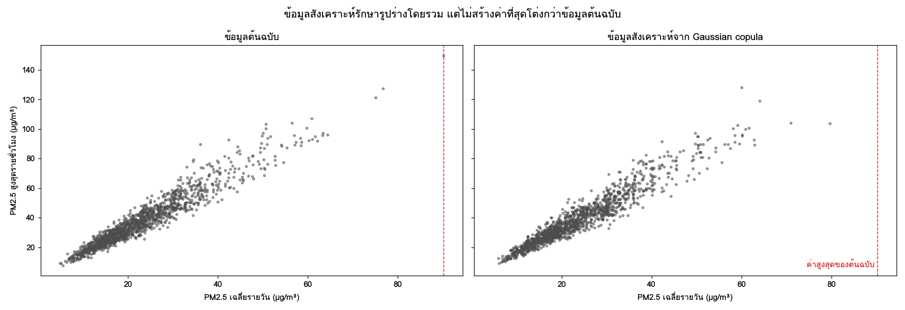

ข้อมูล PM2.5 รายสถานีที่ใช้ตลอดเล่มไม่ใช่ข้อมูลส่วนบุคคล แต่คำถามที่น่าสนใจที่สุดหลายข้อเกี่ยวกับคน เช่น "ฝุ่นที่สูงขึ้นสัมพันธ์กับจำนวนผู้ป่วยโรคทางเดินหายใจหรือไม่" หรือ "กลุ่มใดได้รับผลกระทบมากที่สุด" ทันทีที่โครงการเชื่อมข้อมูลสิ่งแวดล้อมกับข้อมูลระดับบุคคล นักวิทยาการข้อมูลก็มีหน้าที่ทั้งทางกฎหมายและทางจริยธรรมต่อคนที่อยู่ในข้อมูล คนเหล่านั้นไม่ได้อยู่ในห้องตอนที่เราวิเคราะห์ แต่ผลของการตัดสินใจของเราตกอยู่กับพวกเขา

บทนี้มีสองส่วนที่เกี่ยวข้องกัน ส่วนแรกคือ **ความเป็นส่วนตัว** ได้แก่ พระราชบัญญัติคุ้มครองข้อมูลส่วนบุคคล พ.ศ. 2562 (PDPA) ความต่างระหว่างการทำให้เป็นข้อมูลนิรนามกับการแฝงข้อมูล และเหตุผลที่การลบชื่อออกอย่างเดียวไม่พอ ส่วนที่สองคือ **ข้อมูลสังเคราะห์** ซึ่งเป็นเครื่องมือที่ทำให้พัฒนาและทดสอบระบบได้โดยไม่ต้องแตะข้อมูลจริง แต่มีขีดจำกัดที่ต้องเข้าใจ ข้อมูลสังเคราะห์ไม่ได้ปลอดภัยโดยอัตโนมัติ และไม่ได้เป็นตัวแทนของความจริงโดยอัตโนมัติ

::: {.callout-important title="ไม่ใช่คำปรึกษาทางกฎหมาย"}
เนื้อหาเกี่ยวกับกฎหมายในบทนี้เป็นการอธิบายเชิงวิชาการเพื่อให้นักวิทยาการข้อมูลเข้าใจหลักการและรู้ว่าเมื่อใดต้องขอคำปรึกษา ไม่ใช่คำปรึกษาทางกฎหมาย การใช้ข้อมูลส่วนบุคคลจริงต้องตรวจสอบกับตัวบทกฎหมายฉบับทางการ ประกาศของคณะกรรมการคุ้มครองข้อมูลส่วนบุคคล และเจ้าหน้าที่คุ้มครองข้อมูลส่วนบุคคลหรือที่ปรึกษากฎหมายขององค์กร
:::

## วัตถุประสงค์การเรียนรู้ {.unnumbered}

เมื่อจบบทนี้ ผู้อ่านสามารถ

1. อธิบายหลักการสำคัญของ PDPA ที่เกี่ยวกับงานวิทยาการข้อมูล ได้แก่ ฐานทางกฎหมาย วัตถุประสงค์ การใช้เท่าที่จำเป็น และหน้าที่ด้านความปลอดภัย
2. จำแนกข้อมูลส่วนบุคคล ข้อมูลที่ระบุตัวทางอ้อม และข้อมูลส่วนบุคคลที่มีความอ่อนไหว ในโครงการที่เชื่อมข้อมูลสิ่งแวดล้อมกับข้อมูลสุขภาพ
3. เปรียบเทียบการทำให้เป็นข้อมูลนิรนามกับการแฝงข้อมูล และเลือกเทคนิคที่เหมาะกับการใช้งาน
4. ประเมินความเสี่ยงการระบุตัวตนซ้ำด้วย k-anonymity และ l-diversity และอธิบายแนวคิดของ differential privacy
5. สร้างข้อมูลสังเคราะห์แบบกฎด้วย Faker และแบบสถิติด้วย copula และอธิบายความต่างของสองแนวทาง
6. ประเมินข้อมูลสังเคราะห์ทั้งด้านประโยชน์ใช้สอยและด้านความเป็นส่วนตัว
7. ใช้ SMOTE กับปัญหาข้อมูลไม่สมดุลอย่างถูกต้อง โดยไม่ทำให้เกิดการรั่วไหลของข้อมูล

## พ.ร.บ.คุ้มครองข้อมูลส่วนบุคคล พ.ศ. 2562 สำหรับนักวิทยาการข้อมูล {#sec-ch16-pdpa}

### ภาพรวม

**พระราชบัญญัติคุ้มครองข้อมูลส่วนบุคคล พ.ศ. 2562** ([PDPA]{.idx}) [@pdpa2019personal] ประกาศในราชกิจจานุเบกษาเมื่อเดือนพฤษภาคม พ.ศ. 2562 (ค.ศ. 2019) และมีผลใช้บังคับเต็มรูปแบบตั้งแต่วันที่ 1 มิถุนายน พ.ศ. 2565 (ค.ศ. 2022) หลังการเลื่อนบังคับใช้บางหมวด กฎหมายนี้วางกติกาว่าการเก็บรวบรวม ใช้ และเปิดเผยข้อมูลส่วนบุคคลทำได้เมื่อใด และกำหนดสิทธิของบุคคลที่เป็นเจ้าของข้อมูล หน่วยงานที่กำกับดูแลคือสำนักงานคณะกรรมการคุ้มครองข้อมูลส่วนบุคคล (สคส.) PDPA มีโครงสร้างและแนวคิดใกล้เคียงกับ General Data Protection Regulation (GDPR) ของสหภาพยุโรป [@eu2016gdpr] แต่มีรายละเอียดต่างกัน จึงไม่ควรนำคำอธิบายของ GDPR มาใช้แทนโดยตรง

### บทบาทในกฎหมาย

| บทบาท | ความหมาย | ตัวอย่างในโครงการ PM2.5 กับสุขภาพ |
|---|---|---|
| เจ้าของข้อมูลส่วนบุคคล (data subject) | บุคคลที่ข้อมูลนั้นระบุตัวได้ | ผู้ป่วยที่มารับบริการ |
| [ผู้ควบคุมข้อมูลส่วนบุคคล]{.idx} (data controller) | ผู้มีอำนาจตัดสินใจว่าจะเก็บ ใช้ หรือเปิดเผยข้อมูลเพื่ออะไรและอย่างไร | โรงพยาบาล หรือหน่วยงานที่ตั้งโครงการวิจัย |
| [ผู้ประมวลผลข้อมูลส่วนบุคคล]{.idx} (data processor) | ผู้ดำเนินการตามคำสั่งหรือในนามของผู้ควบคุม | ทีมวิเคราะห์ที่ได้รับมอบหมายตามสัญญา หรือผู้ให้บริการคลาวด์ |

: บทบาทหลักตาม PDPA {#tbl-ch16-roles}

นักวิทยาการข้อมูลในองค์กรมักไม่ได้เป็นผู้ควบคุมข้อมูลในทางกฎหมายเอง แต่การตัดสินใจทางเทคนิคของเรา เช่น เก็บคอลัมน์ใด เก็บไว้ที่ใด และใครเข้าถึงได้ คือสิ่งที่ทำให้ผู้ควบคุมทำตามกฎหมายได้หรือไม่ได้

### หลักการที่กระทบงานวิเคราะห์โดยตรง

PDPA มีหลักการหลายข้อที่แปลงเป็นการตัดสินใจทางเทคนิคได้ตรง ๆ

| หลักการ | สาระโดยสรุป | ผลต่องานวิเคราะห์ |
|---|---|---|
| ต้องมีฐานทางกฎหมาย | การเก็บรวบรวมต้องอาศัยความยินยอมหรือฐานอื่นที่กฎหมายกำหนด (มาตรา 19 และ 24) | ต้องรู้ว่าข้อมูลที่ได้รับมามีฐานใด และฐานนั้นครอบคลุมการวิเคราะห์ของเราหรือไม่ |
| ใช้ตามวัตถุประสงค์ | ใช้หรือเปิดเผยตามวัตถุประสงค์ที่แจ้งไว้ (มาตรา 21) | การนำข้อมูลที่เก็บเพื่อการรักษาไปใช้วิจัยต้องมีฐานรองรับ ไม่ใช่ใช้ได้เพราะมีอยู่แล้ว |
| เท่าที่จำเป็น | เก็บรวบรวมเท่าที่จำเป็นภายใต้วัตถุประสงค์ (มาตรา 22) | ขอเฉพาะคอลัมน์และความละเอียดที่ต้องใช้ เช่น อำเภอแทนที่อยู่ เดือนแทนวันเกิด |
| แจ้งให้ทราบ | แจ้งรายละเอียดการเก็บและใช้แก่เจ้าของข้อมูล (มาตรา 23) | กระทบการออกแบบแบบสอบถามหรือแอปที่เก็บข้อมูลเอง |
| ความปลอดภัย | ผู้ควบคุมต้องจัดให้มีมาตรการรักษาความมั่นคงปลอดภัยที่เหมาะสม และแจ้งเหตุละเมิดต่อ สคส. ภายใน 72 ชั่วโมงนับแต่ทราบเหตุเท่าที่ทำได้ (มาตรา 37) | ห้ามเก็บข้อมูลจริงใน repository แล็ปท็อปส่วนตัว หรือบริการที่ไม่ได้รับอนุญาต |

: หลักการของ PDPA ที่กระทบงานวิเคราะห์ {#tbl-ch16-principles}

มาตรา 24 กำหนดกรณีที่เก็บรวบรวมข้อมูลส่วนบุคคลได้โดยไม่ต้องขอความยินยอม ซึ่งรวมถึงการศึกษาวิจัยหรือสถิติที่มีมาตรการปกป้องที่เหมาะสม การป้องกันอันตรายต่อชีวิตหรือสุขภาพ การปฏิบัติตามสัญญา ภารกิจเพื่อประโยชน์สาธารณะ ประโยชน์อันชอบธรรม และการปฏิบัติตามกฎหมาย แต่ข้อมูลส่วนบุคคลที่มีความอ่อนไหวมีเงื่อนไขเข้มกว่าตามมาตรา 26 (@sec-ch16-personal-data) การตัดสินว่าโครงการใดเข้าฐานใดเป็นงานของผู้ควบคุมข้อมูลและที่ปรึกษากฎหมาย ไม่ใช่ของผู้วิเคราะห์

### สิทธิของเจ้าของข้อมูล

หมวด 3 ของ PDPA กำหนดสิทธิของเจ้าของข้อมูล เช่น สิทธิขอเข้าถึงและรับสำเนา สิทธิคัดค้าน สิทธิขอให้ลบ ทำลาย หรือทำให้ข้อมูลเป็นข้อมูลที่ไม่สามารถระบุตัวบุคคลได้ และสิทธิขอให้แก้ไขข้อมูลให้ถูกต้อง สิทธิเหล่านี้มีผลต่อการออกแบบระบบ ถ้าเจ้าของข้อมูลขอให้ลบ ระบบต้องหาข้อมูลของคนนั้นได้ในทุกตาราง รวมถึงสำเนาที่อยู่ใน notebook และไฟล์ส่งออก การมีสำเนาข้อมูลกระจายอยู่หลายที่จึงเป็นทั้งความเสี่ยงด้านความปลอดภัยและอุปสรรคต่อการปฏิบัติตามสิทธิ

### ผลต่อการทำงานของนักวิทยาการข้อมูล

หลักการทั้งหมดข้างต้นสรุปเป็นแนวปฏิบัติของรายวิชาและของเล่มนี้ได้ดังนี้

1. **ห้ามนำข้อมูลส่วนบุคคลจริงเข้า repository** ไม่ว่าจะเป็น public หรือ private และห้ามเก็บในเครื่องส่วนตัวโดยไม่ได้รับอนุญาต ไฟล์ `.gitignore` ต้องกันโฟลเดอร์ `data/` ไว้ (บทที่ 2)
2. **โครงการที่ต้องใช้ข้อมูลระดับบุคคลจริง** ต้องผ่านผู้สอนและคณะกรรมการจริยธรรมการวิจัยในมนุษย์ของสถาบันก่อน
3. **ระหว่างพัฒนา ใช้ข้อมูลสังเคราะห์หรือข้อมูลรวม** เช่น จำนวนผู้ป่วยต่อจังหวัดต่อสัปดาห์จากรายงานที่เผยแพร่แล้ว (@sec-ch16-synthetic)
4. **ขอเท่าที่จำเป็น** ถ้าคำถามระดับจังหวัดต่อสัปดาห์ ก็ไม่ต้องขอข้อมูลระดับบุคคลเลย
5. **บันทึก** แหล่งที่มา ฐานทางกฎหมาย เงื่อนไขการใช้ และมาตรการปกป้องไว้ใน `README.md` ของโครงการ

## ข้อมูลส่วนบุคคลและข้อมูลอ่อนไหว {#sec-ch16-personal-data}

### นิยามของข้อมูลส่วนบุคคล

PDPA มาตรา 6 นิยาม **ข้อมูลส่วนบุคคล** ([personal data]{.idx}) ว่าเป็นข้อมูลเกี่ยวกับบุคคลซึ่งทำให้สามารถระบุตัวบุคคลนั้นได้ ไม่ว่าทางตรงหรือทางอ้อม แต่ไม่รวมถึงข้อมูลของผู้ถึงแก่กรรมโดยเฉพาะ คำสำคัญคือ **ทางอ้อม** ข้อมูลไม่จำเป็นต้องมีชื่อจึงจะเป็นข้อมูลส่วนบุคคล

| ประเภท | ความหมาย | ตัวอย่าง |
|---|---|---|
| ตัวระบุตรง (direct identifier) | ระบุตัวได้ด้วยตัวเอง | ชื่อ–นามสกุล เลขประจำตัวประชาชน เบอร์โทรศัพท์ อีเมล เลขประจำตัวผู้ป่วย (HN) |
| [ตัวระบุทางอ้อม]{.idx} (quasi-identifier) | ระบุตัวได้เมื่อรวมกันหรือเชื่อมกับข้อมูลอื่น | อายุ เพศ ตำบล วันที่เข้ารับบริการ อาชีพ |
| ข้อมูลที่เป็นประเด็น (sensitive attribute) | สิ่งที่ผู้โจมตีอยากรู้ | การวินิจฉัยโรค ผลตรวจ |

: ประเภทของคอลัมน์ในข้อมูลระดับบุคคล {#tbl-ch16-identifier-types}

### ข้อมูลส่วนบุคคลที่มีความอ่อนไหว

มาตรา 26 กำหนด **ข้อมูลส่วนบุคคลที่มีความอ่อนไหว** ([sensitive data]{.idx}) ซึ่งได้แก่ เชื้อชาติ เผ่าพันธุ์ ความคิดเห็นทางการเมือง ความเชื่อในลัทธิ ศาสนาหรือปรัชญา พฤติกรรมทางเพศ ประวัติอาชญากรรม ข้อมูลสุขภาพ ความพิการ ข้อมูลสหภาพแรงงาน ข้อมูลพันธุกรรม ข้อมูลชีวภาพ และข้อมูลอื่นที่คณะกรรมการประกาศกำหนด การเก็บรวบรวมข้อมูลเหล่านี้ต้องได้รับความยินยอมโดยชัดแจ้ง เว้นแต่เข้าข้อยกเว้นที่กฎหมายกำหนด ซึ่งรวมถึงการศึกษาวิจัยทางวิทยาศาสตร์ ประวัติศาสตร์ หรือสถิติ ที่ทำเท่าที่จำเป็นและมีมาตรการคุ้มครองที่เหมาะสมตามที่คณะกรรมการประกาศกำหนด

สำหรับโครงการในเล่มนี้ ข้อสรุปที่สำคัญคือ **ข้อมูลการเข้ารับบริการทางการแพทย์รายบุคคลเป็นข้อมูลสุขภาพ จึงเป็นข้อมูลอ่อนไหว** แม้ตัดชื่อออกแล้ว ถ้ายังมีอายุ เพศ ตำบล และวันที่ ก็ยังระบุตัวได้ทางอ้อม โดยเฉพาะในชุมชนเล็ก

### ข้อมูลสิ่งแวดล้อมเป็นข้อมูลส่วนบุคคลได้หรือไม่

ข้อมูล PM2.5 จากสถานีของรัฐไม่ใช่ข้อมูลส่วนบุคคล เพราะไม่เกี่ยวกับบุคคลใด แต่ข้อมูลที่ดูเหมือนข้อมูลสิ่งแวดล้อมก็อาจกลายเป็นข้อมูลส่วนบุคคลได้ในบางบริบท

| ข้อมูล | เป็นข้อมูลส่วนบุคคลหรือไม่ | เหตุผล |
|---|---|---|
| PM2.5 รายชั่วโมงของสถานี Air4Thai | ไม่ | เกี่ยวกับพื้นที่ ไม่ได้เกี่ยวกับบุคคล |
| PM2.5 จากเครื่องวัดในบ้านที่ผูกกับบัญชีผู้ใช้ | น่าจะเป็น | ระบุเจ้าของได้ และรูปแบบค่าตามเวลาเผยพฤติกรรม เช่น เวลาที่อยู่บ้านหรือเวลาทำอาหาร |
| พิกัด GPS ของอาสาสมัครที่ถือเครื่องวัดแบบพกพา | เป็น | ข้อมูลตำแหน่งตามเวลาระบุตัวได้ง่ายมาก |
| จำนวนผู้ป่วยต่อจังหวัดต่อเดือนจากรายงานสาธารณะ | โดยทั่วไปไม่ | เป็นข้อมูลรวม ยกเว้นช่องที่มีจำนวนน้อยมากจนระบุตัวได้ |

: ข้อมูลที่เกี่ยวข้องกับโครงการและสถานะความเป็นข้อมูลส่วนบุคคล {#tbl-ch16-environmental-personal}

ข้อมูลตำแหน่งตามเวลาอันตรายเป็นพิเศษ งานของ de Montjoye และคณะ [@demontjoye2013unique] พบว่าจุดตำแหน่งและเวลาเพียงสี่จุดจากข้อมูลโทรศัพท์มือถือก็เพียงพอที่จะระบุตัวบุคคลได้ถึง 95% ของผู้ใช้ในชุดข้อมูลที่ศึกษา โครงการที่ให้อาสาสมัครพกเครื่องวัดฝุ่นแบบพกพาจึงต้องจัดการข้อมูลตำแหน่งด้วยความระวังเท่ากับข้อมูลสุขภาพ

### ทำแผนที่ของข้อมูลก่อนเริ่ม

ก่อนเชื่อมข้อมูลสุขภาพกับข้อมูล PM2.5 ควรจัดทำตารางที่ระบุทุกคอลัมน์ว่าเป็นประเภทใด จำเป็นต่อคำถามหรือไม่ และจะจัดการอย่างไร ตารางนี้เป็นส่วนหนึ่งของพจนานุกรมข้อมูลและใช้ในการประเมินผลกระทบด้านความเป็นส่วนตัว

| คอลัมน์ | ประเภท | จำเป็นหรือไม่ | การจัดการ |
|---|---|---|---|
| `patient_name` | ตัวระบุตรง | ไม่ | ไม่ขอ |
| `hn` | ตัวระบุตรง | เพื่อนับคนไม่ซ้ำเท่านั้น | แทนด้วยรหัสแฝงที่ผู้ควบคุมสร้าง |
| `birth_date` | ตัวระบุทางอ้อม | ต้องการเพียงกลุ่มอายุ | ขอเป็นกลุ่มอายุ 10 ปี |
| `subdistrict` | ตัวระบุทางอ้อม | คำถามอยู่ระดับจังหวัด | ขอเป็นจังหวัด |
| `visit_date` | ตัวระบุทางอ้อม | ต้องการรายสัปดาห์ | ขอเป็นสัปดาห์ |
| `icd10` | ข้อมูลอ่อนไหว | ใช่ | ขอเฉพาะกลุ่มรหัสโรคทางเดินหายใจที่เกี่ยวข้อง |

: ตัวอย่างแผนที่คอลัมน์ของข้อมูลการเข้ารับบริการ {#tbl-ch16-data-map}

ตารางนี้แสดงว่าคำถามระดับจังหวัดต่อสัปดาห์ไม่จำเป็นต้องใช้ข้อมูลระดับบุคคลเลย ถ้าผู้ควบคุมข้อมูลส่งจำนวนผู้ป่วยต่อจังหวัดต่อสัปดาห์ต่อกลุ่มโรคมาให้ ซึ่งเป็นการลดความเสี่ยงที่ได้ผลที่สุด เพราะข้อมูลที่ไม่ได้ขอไม่มีวันรั่วไหล

## anonymization กับ pseudonymization {#sec-ch16-anonymization}

### สองแนวคิดที่สับสนกันบ่อย

| | การแฝงข้อมูล ([pseudonymization]{.idx}) | การทำให้เป็นข้อมูลนิรนาม ([anonymization]{.idx}) |
|---|---|---|
| ทำอะไร | แทนตัวระบุด้วยรหัส โดยมีตารางจับคู่หรือกุญแจเก็บแยก | ทำให้ระบุตัวไม่ได้อีก ไม่ว่าด้วยวิธีใดที่สมเหตุสมผล |
| ย้อนกลับได้หรือไม่ | ได้ ถ้ามีกุญแจหรือตารางจับคู่ | ไม่ควรย้อนกลับได้ |
| ยังเป็นข้อมูลส่วนบุคคลหรือไม่ | **ยังเป็น** ต้องคุ้มครองตามกฎหมาย | ถ้าทำได้จริง ไม่เป็นข้อมูลส่วนบุคคลแล้ว |
| ประโยชน์ | ติดตามคนเดิมข้ามเวลาหรือข้ามตารางได้ | เผยแพร่หรือแบ่งปันได้กว้างขึ้น |
| เทคนิค | hash พร้อมกุญแจลับ รหัสสุ่ม | รวมกลุ่ม ลดความละเอียด ระงับช่องที่มีจำนวนน้อย เพิ่มสัญญาณรบกวน ข้อมูลสังเคราะห์ |

: เปรียบเทียบการแฝงข้อมูลกับการทำให้เป็นข้อมูลนิรนาม {#tbl-ch16-pseudo-anon}

GDPR นิยามการแฝงข้อมูลไว้ชัดในมาตรา 4(5) และระบุใน Recital 26 ว่าข้อมูลที่ทำให้เป็นข้อมูลนิรนามแล้วอยู่นอกขอบเขตของกฎหมาย [@eu2016gdpr] PDPA มาตรา 33 ใช้ถ้อยคำ "ทำให้ข้อมูลส่วนบุคคลเป็นข้อมูลที่ไม่สามารถระบุตัวบุคคลที่เป็นเจ้าของข้อมูลส่วนบุคคลได้" เป็นทางเลือกหนึ่งเมื่อเจ้าของข้อมูลใช้สิทธิขอให้ลบ แนวคิดตรงกัน คือ **การแฝงข้อมูลเป็นมาตรการรักษาความปลอดภัย ไม่ได้เปลี่ยนสถานะทางกฎหมายของข้อมูล** ส่วนการทำให้เป็นข้อมูลนิรนามเปลี่ยนสถานะได้ ถ้าทำได้จริง ซึ่งยากกว่าที่คิดมาก (@sec-ch16-k-anonymity)

### การแฝงข้อมูลที่ถูกวิธี

ความผิดพลาดที่พบบ่อยที่สุดคือการใช้ hash ธรรมดากับตัวระบุ เช่น SHA-256 ของเลขประจำตัวประชาชน ดูเหมือนปลอดภัยเพราะย้อนกลับทางคณิตศาสตร์ไม่ได้ แต่เลขประจำตัวประชาชนมีจำนวนจำกัดและมีโครงสร้างตายตัว ผู้โจมตีจึงคำนวณ hash ของทุกเลขที่เป็นไปได้ไว้ล่วงหน้าแล้วจับคู่ได้ วิธีที่ถูกคือใช้ **hash ที่มีกุญแจลับ** (keyed hash เช่น HMAC) ซึ่งผู้ที่ไม่มีกุญแจคำนวณไม่ได้ หรือใช้รหัสสุ่มพร้อมตารางจับคู่ที่เก็บแยก

```python
import hmac
import hashlib
import os

KEY = os.environ["PSEUDO_KEY"].encode()      # เก็บใน .env หรือระบบจัดการความลับ ห้ามเขียนในโค้ด

def pseudonymize(identifier: str) -> str:
    """รหัสแฝงที่คงที่สำหรับตัวระบุเดียวกัน แต่คำนวณไม่ได้ถ้าไม่มีกุญแจ"""
    return hmac.new(KEY, identifier.encode(), hashlib.sha256).hexdigest()[:16]
```

กุญแจต้องเก็บแยกจากข้อมูลตามวิธีจัดการความลับในบทที่ 2 ผู้ที่ได้ทั้งข้อมูลและกุญแจย้อนกลับได้ ข้อมูลที่ผ่านฟังก์ชันนี้จึงยังเป็นข้อมูลส่วนบุคคล ฟังก์ชันนี้ควรรันที่ฝั่งผู้ควบคุมข้อมูลก่อนส่งข้อมูลให้ผู้วิเคราะห์ ไม่ใช่ที่ฝั่งผู้วิเคราะห์

### เทคนิคของการทำให้เป็นข้อมูลนิรนาม

| เทคนิค | ทำอะไร | ตัวอย่าง |
|---|---|---|
| ลบ (suppression) | ตัดคอลัมน์หรือแถวออก | ตัดชื่อ ตัดแถวของกลุ่มที่มีคนน้อยเกินไป |
| ลดความละเอียด (generalization) | แทนค่าด้วยช่วงหรือระดับที่หยาบขึ้น | อายุ 37 → 30–39 ตำบล → จังหวัด วันที่ → สัปดาห์ |
| รวมกลุ่ม (aggregation) | ส่งเฉพาะสถิติของกลุ่ม | จำนวนผู้ป่วยต่อจังหวัดต่อสัปดาห์ |
| ระงับช่องเล็ก (small cell suppression) | ไม่แสดงช่องที่มีจำนวนน้อยกว่าเกณฑ์ | แสดง "<5" แทนจำนวน 1–4 |
| เพิ่มสัญญาณรบกวน | บวกค่าสุ่มที่ควบคุมได้ | differential privacy (@sec-ch16-dp) |
| สลับค่า (swapping) | สลับค่าบางคอลัมน์ระหว่างแถว | สลับจังหวัดระหว่างแถวที่มีลักษณะคล้ายกัน |

: เทคนิคของการทำให้เป็นข้อมูลนิรนาม {#tbl-ch16-anon-techniques}

ตัวอย่างการลดความละเอียดและระงับช่องเล็กด้วย DuckDB กับตารางสมมุติ `visits` (ไม่อยู่ในฐานข้อมูลมาตรฐานของเล่ม)

```python
release = con.execute("""
    SELECT province,
           date_trunc('week', visit_date) AS week,
           CASE WHEN age < 15 THEN '0-14' WHEN age < 65 THEN '15-64' ELSE '65+' END AS age_group,
           count(*) AS n_visits
    FROM visits
    WHERE icd10 LIKE 'J%'                    -- กลุ่มโรคระบบทางเดินหายใจ
    GROUP BY ALL
""").df()
release["n_visits_release"] = release["n_visits"].where(release["n_visits"] >= 5)
release["n_visits_release"] = release["n_visits_release"].astype("Int64").astype(str).replace("<NA>", "<5")
```

เกณฑ์ 5 เป็นแนวปฏิบัติที่ใช้บ่อยในการเผยแพร่สถิติ ไม่ใช่ค่าที่กฎหมายกำหนด บางหน่วยงานใช้ 10 หรือ 11 ต้องตรวจกับนโยบายของผู้ให้ข้อมูล การระงับช่องเล็กอย่างเดียวยังมีช่องโหว่ ถ้าตารางเผยแพร่ทั้งผลรวมของแถวและทุกช่องยกเว้นหนึ่งช่อง ผู้อ่านคำนวณช่องที่ระงับได้จากผลรวม (complementary disclosure) จึงต้องระงับช่องเพิ่มเติมหรือไม่เผยแพร่ผลรวม

## k-anonymity, l-diversity และการโจมตีเพื่อระบุตัวตนซ้ำ ★ {#sec-ch16-k-anonymity}

::: {.callout-note title="★ เนื้อหาเชิงลึก"}
หัวข้อนี้ไม่ได้สอนในชั้นเรียน อ่านข้ามได้โดยไม่กระทบความเข้าใจบทถัดไป
:::

### การลบชื่อไม่พอ

Latanya Sweeney [@sweeney2000simple] วิเคราะห์ข้อมูลสำมะโนของสหรัฐอเมริกาและพบว่าการรวมกันของรหัสไปรษณีย์ห้าหลัก เพศ และวันเดือนปีเกิด ระบุตัวบุคคลได้ไม่ซ้ำใครประมาณ 87% ของประชากร ก่อนหน้านั้นเธอแสดงให้เห็นว่าข้อมูลการรักษาพยาบาลของพนักงานรัฐที่ "ลบชื่อแล้ว" ซึ่งรัฐแมสซาชูเซตส์เผยแพร่เพื่อการวิจัย เมื่อเชื่อมกับทะเบียนผู้มีสิทธิเลือกตั้งที่ซื้อได้ทั่วไป ระบุตัวผู้ว่าการรัฐได้ [@sweeney2002kanonymity]

งานรุ่นหลังแสดงว่าปัญหานี้รุนแรงขึ้นเมื่อข้อมูลมีหลายคอลัมน์ Narayanan และ Shmatikov [@narayanan2008robust] ระบุตัวผู้ใช้ในชุดข้อมูลคะแนนภาพยนตร์ที่ "ทำให้นิรนามแล้ว" ของ Netflix ได้ด้วยการเทียบกับคะแนนที่ผู้ใช้โพสต์ไว้สาธารณะ Rocher และคณะ [@rocher2019estimating] ประมาณว่าคุณลักษณะทางประชากร 15 คุณลักษณะเพียงพอที่จะระบุตัวชาวอเมริกันได้ 99.98% และเสนอว่าการทำให้ข้อมูลระดับบุคคลเป็นข้อมูลนิรนามอย่างแท้จริงทำได้ยากกว่าที่แนวปฏิบัติทั่วไปสมมติไว้มาก

### การโจมตีด้วยการเชื่อมข้อมูล

```{mermaid}
flowchart LR
  A["ข้อมูลที่เผยแพร่<br/>อายุ เพศ ตำบล วันที่ การวินิจฉัย"] --> J{"เชื่อมด้วย<br/>อายุ เพศ ตำบล"}
  B["ข้อมูลภายนอก<br/>โพสต์สาธารณะ ข่าว ทะเบียน<br/>ชื่อ อายุ เพศ ตำบล"] --> J
  J --> C["รู้การวินิจฉัย<br/>ของบุคคลที่ระบุชื่อได้"]
```

การโจมตีแบบนี้ไม่ต้องใช้ความสามารถทางเทคนิคสูง ผู้โจมตีอาจเป็นเพื่อนบ้านที่รู้ว่าคนข้างบ้านอายุเท่าใดและไปโรงพยาบาลวันไหน ความเสี่ยงจึงขึ้นกับ **สิ่งที่ผู้อื่นรู้อยู่แล้ว** ซึ่งผู้เผยแพร่ข้อมูลควบคุมไม่ได้

### k-anonymity

**[k-anonymity]{.idx}** [@sweeney2002kanonymity] กำหนดว่าทุกชุดค่าของตัวระบุทางอ้อมในข้อมูลที่เผยแพร่ต้องปรากฏอย่างน้อย $k$ แถว ทำให้แต่ละคนซ่อนอยู่ในกลุ่มที่มีอย่างน้อย $k$ คนที่แยกกันไม่ได้ ชุดของแถวที่มีตัวระบุทางอ้อมเหมือนกันเรียกว่า **equivalence class** ข้อมูลมีค่า $k$ เท่ากับขนาดของ equivalence class ที่เล็กที่สุด

```python
QUASI = ["age_group", "sex", "province"]

def k_anonymity(df, quasi):
    """คืนค่า k (ขนาดของ equivalence class ที่เล็กที่สุด) และกลุ่มที่เล็กกว่า 5"""
    sizes = df.groupby(quasi, observed=True).size()
    return int(sizes.min()), sizes[sizes < 5].sort_values()

k, risky = k_anonymity(release_rows, QUASI)
print(f"k = {k}; กลุ่มที่มีน้อยกว่า 5 แถว: {len(risky)} กลุ่ม")
```

`release_rows` คือข้อมูลระดับบุคคลที่จะเผยแพร่หลังลดความละเอียดแล้ว ถ้า $k$ ต่ำกว่าเกณฑ์ ต้องลดความละเอียดเพิ่ม เช่น รวมจังหวัดเป็นภาค หรือลบแถวของกลุ่มที่เล็ก การเลือกระหว่างสองทางคือการแลกเปลี่ยนระหว่างความเป็นส่วนตัวกับประโยชน์ของข้อมูล

### l-diversity

k-anonymity ป้องกันการรู้ว่า *แถวใด* เป็นของใคร แต่ไม่ป้องกันการรู้ *ข้อมูลที่เป็นประเด็น* ถ้าทุกคนในกลุ่มมีค่าเดียวกัน ตัวอย่างเช่น equivalence class ของ "ชาย อายุ 65 ปีขึ้นไป จังหวัดหนึ่ง" มีห้าคนและทุกคนได้รับการวินิจฉัยว่าเป็นโรคปอดอุดกั้นเรื้อรัง ผู้โจมตีที่รู้ว่าเพื่อนบ้านอยู่ในกลุ่มนี้ก็รู้การวินิจฉัยทันทีโดยไม่ต้องรู้ว่าแถวใดเป็นของเขา การโจมตีแบบนี้เรียกว่า **homogeneity attack**

**[l-diversity]{.idx}** [@machanavajjhala2007ldiversity] กำหนดเพิ่มว่าแต่ละ equivalence class ต้องมีค่าที่แตกต่างกันของข้อมูลที่เป็นประเด็นอย่างน้อย $l$ ค่า แนวคิดต่อมาคือ **t-closeness** [@li2007tcloseness] ซึ่งกำหนดให้การแจกแจงของข้อมูลที่เป็นประเด็นในแต่ละกลุ่มใกล้กับการแจกแจงของทั้งชุดข้อมูล เพราะ l-diversity ยังไม่ป้องกันกรณีที่ค่าแตกต่างกันแต่ทุกค่าเป็นโรคร้ายแรง

```python
def l_diversity(df, quasi, sensitive):
    return int(df.groupby(quasi, observed=True)[sensitive].nunique().min())

print("l =", l_diversity(release_rows, QUASI, "icd10_group"))
```

### ขีดจำกัดของแนวทางนี้

k-anonymity และแนวคิดที่ต่อยอดมีข้อจำกัดพื้นฐานสองข้อ ข้อแรก ต้องรู้ล่วงหน้าว่าคอลัมน์ใดเป็นตัวระบุทางอ้อม ซึ่งขึ้นกับว่าผู้โจมตีรู้อะไร ข้อที่สอง เมื่อข้อมูลมีหลายคอลัมน์ การทำให้ทุกกลุ่มมีอย่างน้อย $k$ แถวต้องลดความละเอียดจนข้อมูลแทบไม่มีประโยชน์ งานของ Aggarwal [@aggarwal2005kanonymity] แสดงว่าในข้อมูลมิติสูง k-anonymity ทำให้สูญเสียข้อมูลมากจนใช้งานยาก ข้อจำกัดเหล่านี้นำไปสู่แนวคิดที่ไม่ต้องสมมติว่าผู้โจมตีรู้อะไร คือ differential privacy

## differential privacy เบื้องต้น ★ {#sec-ch16-dp}

::: {.callout-note title="★ เนื้อหาเชิงลึก"}
หัวข้อนี้ไม่ได้สอนในชั้นเรียน อ่านข้ามได้โดยไม่กระทบความเข้าใจบทถัดไป
:::

### ความคิดหลัก

**[differential privacy]{.idx}** [@dwork2006calibrating] เปลี่ยนคำถามจาก "ข้อมูลนี้ระบุตัวได้หรือไม่" เป็น "**ผลลัพธ์ของการวิเคราะห์เปลี่ยนไปมากแค่ไหนถ้ามีหรือไม่มีคนคนหนึ่งในข้อมูล**" ถ้าผลลัพธ์แทบไม่เปลี่ยน ผู้ที่เห็นผลลัพธ์ก็เรียนรู้เรื่องของคนคนนั้นได้น้อยมาก ไม่ว่าผู้นั้นจะรู้อะไรมาก่อน

นิยามอย่างเป็นทางการคือ กลไกสุ่ม $M$ มี $\varepsilon$-differential privacy ถ้าสำหรับทุกคู่ของชุดข้อมูล $D$ และ $D'$ ที่ต่างกันหนึ่งคน และทุกเซตของผลลัพธ์ $S$

$$
P[M(D) \in S] \le e^{\varepsilon}\, P[M(D') \in S]
$$ {#eq-ch16-dp}

โดย $\varepsilon$ คืองบประมาณความเป็นส่วนตัว (privacy budget) ค่ายิ่งเล็ก ผลลัพธ์จากสองชุดข้อมูลยิ่งแยกกันไม่ออก และความเป็นส่วนตัวยิ่งสูง ตัวอย่างเช่น $\varepsilon = 0.5$ ให้ $e^{0.5} \approx 1.65$ หมายความว่าการมีหรือไม่มีคนคนหนึ่งเปลี่ยนความน่าจะเป็นของผลลัพธ์ใด ๆ ได้ไม่เกิน 1.65 เท่า

### กลไก Laplace

วิธีที่ง่ายที่สุดในการทำให้ผลการนับมี differential privacy คือบวกสัญญาณรบกวนจากการแจกแจง Laplace ที่มีสเกลเท่ากับ **sensitivity** หารด้วย $\varepsilon$ sensitivity คือขนาดที่ผลลัพธ์เปลี่ยนได้มากที่สุดเมื่อเพิ่มหรือลบคนหนึ่งคน สำหรับการนับจำนวน คนหนึ่งคนเปลี่ยนผลได้ไม่เกิน 1 จึงมี sensitivity เท่ากับ 1

$$
\tilde{c} = c + \text{Laplace}\!\left(0,\ \frac{\Delta}{\varepsilon}\right)
$$ {#eq-ch16-laplace}

โดย $c$ คือผลการนับจริง $\Delta$ คือ sensitivity และ $\tilde{c}$ คือผลที่เผยแพร่ ตัวอย่าง (ข้อมูลสมมุติ) จำนวนผู้ป่วยโรคทางเดินหายใจของจังหวัดหนึ่งในสัปดาห์หนึ่งคือ 120 คน เมื่อใช้ $\varepsilon = 0.5$ สเกลของสัญญาณรบกวนคือ $1/0.5 = 2$ ส่วนเบี่ยงเบนมาตรฐานของการแจกแจง Laplace คือ $\sqrt{2} \times 2 \approx 2.8$ คน ผลที่เผยแพร่จึงคลาดจาก 120 ไม่กี่คน ซึ่งแทบไม่กระทบการวิเคราะห์ความสัมพันธ์กับ PM2.5 แต่สำหรับช่องที่มีจริงเพียง 2 คน สัญญาณรบกวนขนาดเดียวกันทำให้ค่าที่เผยแพร่แทบไม่มีความหมาย ซึ่งเป็นสิ่งที่ต้องการ เพราะช่องเล็กคือช่องที่เสี่ยงที่สุด

```python
import numpy as np

def laplace_count(counts, epsilon, seed=None):
    """เผยแพร่ผลการนับด้วยกลไก Laplace (sensitivity = 1) แล้วปัดเป็นจำนวนเต็มที่ไม่ติดลบ"""
    rng = np.random.default_rng(seed)
    noisy = np.asarray(counts, float) + rng.laplace(0.0, 1.0 / epsilon, size=len(counts))
    return np.clip(np.round(noisy), 0, None).astype(int)

laplace_count([120, 45, 2, 0, 18], epsilon=0.5, seed=42)       # ข้อมูลสมมุติ
```

การปัดเป็นจำนวนเต็มและตัดค่าติดลบเป็นการประมวลผลหลังกลไก ซึ่งไม่ลดความเป็นส่วนตัว (post-processing) แต่ทำให้ผลรวมเอนเอียงขึ้นเล็กน้อยสำหรับช่องที่มีค่าใกล้ศูนย์ seed ในตัวอย่างใช้เพื่อการสาธิตเท่านั้น ในการเผยแพร่จริงต้องไม่ใช้ seed ที่ผู้อื่นรู้ เพราะผู้ที่รู้ seed คำนวณสัญญาณรบกวนกลับได้

### งบประมาณสะสม

สมบัติที่สำคัญที่สุดของ differential privacy ในทางปฏิบัติคือ **การรวมกัน** (composition) ถ้าเผยแพร่ผลการวิเคราะห์ $m$ ครั้งจากข้อมูลชุดเดียวกัน แต่ละครั้งใช้ $\varepsilon_i$ ความเป็นส่วนตัวรวมจะไม่ดีกว่า $\sum_i \varepsilon_i$ [@dwork2014algorithmic] การเผยแพร่ตารางหลายชุดหรือตอบ query ซ้ำ ๆ จึงใช้งบประมาณหมดได้ หน่วยงานที่ใช้ differential privacy ต้องวางแผนว่าจะเผยแพร่อะไรบ้างก่อนเริ่ม ตัวอย่างที่ใหญ่ที่สุดคือสำนักงานสำมะโนประชากรของสหรัฐอเมริกาซึ่งใช้ differential privacy กับผลสำมะโนประชากร ค.ศ. 2020 [@abowd2018census]

### ขีดจำกัด

differential privacy ให้การรับประกันทางคณิตศาสตร์ที่แข็งแรงที่สุดในบรรดาวิธีที่มี แต่ไม่ได้ฟรี สัญญาณรบกวนทำให้ผลของกลุ่มเล็ก เช่น อำเภอที่มีประชากรน้อยหรือกลุ่มโรคหายาก มีความคลาดเคลื่อนมาก การเลือก $\varepsilon$ เป็นการตัดสินใจเชิงนโยบายที่ไม่มีค่าถูกค่าเดียว และการนำไปใช้ให้ถูกต้องต้องอาศัยไลบรารีที่ผ่านการตรวจสอบ ไม่ใช่การเขียนเอง โค้ดในหัวข้อนี้มีไว้เพื่อความเข้าใจ ไม่ใช่เพื่อเผยแพร่ข้อมูลจริง

## ข้อมูลสังเคราะห์: แบบกฎ (Faker), แบบสถิติ (copula), ★ แบบ deep learning (CTGAN) {#sec-ch16-synthetic}

### ข้อมูลสังเคราะห์ใช้ทำอะไร

**ข้อมูลสังเคราะห์** ([synthetic data]{.idx}) คือข้อมูลที่สร้างขึ้นด้วยอัลกอริทึมแทนการเก็บจากเหตุการณ์จริง [@jordon2022synthetic] เป้าหมายของการสร้างมีหลายแบบ และแต่ละแบบต้องการวิธีต่างกัน

| เป้าหมาย | ต้องการ | วิธีที่เหมาะ |
|---|---|---|
| ทดสอบโค้ดและ pipeline | schema และรูปแบบค่าที่ถูก ไม่ต้องมีสถิติเหมือนจริง | แบบกฎ (Faker) |
| สาธิตหรือสอน | ดูสมจริงพอ ไม่มีข้อมูลจริงปน | แบบกฎ หรือแบบสถิติจากข้อมูลสาธารณะ |
| แบ่งปันให้ผู้อื่นวิเคราะห์ | สถิติใกล้ข้อมูลจริง และความเป็นส่วนตัวที่ตรวจสอบได้ | แบบสถิติหรือ deep learning ร่วมกับการประเมินความเป็นส่วนตัว |
| เพิ่มตัวอย่างของกลุ่มน้อยเพื่อฝึกโมเดล | ตัวอย่างที่อยู่ในบริเวณของกลุ่มน้อย | SMOTE (@sec-ch16-smote) |

: เป้าหมายของข้อมูลสังเคราะห์และวิธีที่เหมาะ {#tbl-ch16-synthetic-goals}

```{mermaid}
flowchart LR
  R["แบบกฎ<br/>Faker"] -->|"ไม่เรียนจากข้อมูลจริง"| R1["ความเสี่ยงต่ำมาก<br/>สถิติไม่เหมือนจริง"]
  S["แบบสถิติ<br/>Gaussian copula"] -->|"เรียนการแจกแจงและสหสัมพันธ์"| S1["รักษาสถิติหลัก<br/>ความเสี่ยงปานกลาง"]
  D["แบบ deep learning<br/>CTGAN"] -->|"เรียนโครงสร้างซับซ้อน"| D1["รักษาความสัมพันธ์ซับซ้อนได้<br/>อาจจำแถวจริง"]
```

### แบบกฎด้วย Faker

[Faker]{.idx-tool} [@faker2024] สร้างค่าที่มีรูปแบบสมจริงตามกฎ เช่น ชื่อ ที่อยู่ เบอร์โทรศัพท์ วันที่ และรองรับภาษาไทยด้วย locale `th_TH` Faker ไม่ได้เรียนอะไรจากข้อมูลจริง ค่าทุกค่าสุ่มอย่างอิสระ จึงไม่มีความเสี่ยงที่จะเผยข้อมูลของคนจริง และไม่มีความสัมพันธ์ระหว่างคอลัมน์ใดเลย

การใช้งานหลักในเล่มนี้คือสร้าง **ตารางปลอมที่มี schema เดียวกับข้อมูลที่จะได้รับในอนาคต** เพื่อเขียนและทดสอบโค้ดเชื่อมกับ `daily_pm25_clean` ได้ก่อนได้รับอนุญาตให้เข้าถึงข้อมูลจริง

```python
"""src/make_fake_visits.py: ตารางผู้ป่วยปลอม (ไม่ใช่ข้อมูลจริง) สำหรับทดสอบการเชื่อม"""
from pathlib import Path
import duckdb
import pandas as pd
from faker import Faker

ROOT = Path(__file__).resolve().parents[1]
Faker.seed(42)
fake = Faker("th_TH")

con = duckdb.connect(str(ROOT / "data" / "pm25.duckdb"), read_only=True)
provinces = [r[0] for r in con.execute("SELECT DISTINCT province FROM stations").fetchall()]
dmin, dmax = con.execute("SELECT min(date), max(date) FROM daily_pm25_clean").fetchone()

rows = [{
    "visit_id": f"V{i:06d}",
    "patient_name": fake.name(),
    "age": fake.random_int(min=1, max=95),
    "sex": fake.random_element(["M", "F"]),
    "province": fake.random_element(provinces),
    "visit_date": fake.date_between(start_date=dmin, end_date=dmax),
    "icd10": fake.random_element(["J44", "J45", "J18", "I21"]),
} for i in range(5000)]
```

`Faker.seed(42)` ทำให้ได้ข้อมูลปลอมชุดเดิมทุกครั้งที่รัน ซึ่งจำเป็นสำหรับการทดสอบที่ทำซ้ำได้ ชื่อที่ได้เป็นชื่อที่สร้างขึ้นซึ่งอาจบังเอิญตรงกับชื่อคนจริงได้ แต่ไม่ได้มาจากข้อมูลของคนจริง ผลวิเคราะห์ใดที่คำนวณจากข้อมูลนี้ **ห้ามนำไปสรุป** เพราะจำนวนผู้ป่วยถูกสุ่มโดยไม่เกี่ยวกับ PM2.5 เลย ใช้ได้เพียงตรวจว่าโค้ดทำงานถูก เช่น join ได้จำนวนแถวตามที่คาดหรือไม่

### เพิ่มกฎให้สมจริงขึ้น

ข้อมูลทดสอบที่ดีควรมีกรณีที่ทำให้โค้ดพังได้ เช่น ค่าว่าง ค่าซ้ำ ชื่อจังหวัดสะกดหลายแบบ และวันที่นอกช่วง เพราะข้อมูลจริงมีปัญหาเหล่านี้เสมอ (บทที่ 9) การฉีดปัญหาที่รู้จำนวนลงในข้อมูลปลอมทำให้ตรวจได้ว่า pipeline จับปัญหาได้ครบหรือไม่

```python
df = pd.DataFrame(rows)
rng = pd.Series(range(len(df))).sample(frac=1, random_state=42).to_numpy()
df.loc[rng[:50], "age"] = None                                  # ค่าว่าง 50 แถว
df.loc[rng[50:60], "province"] = df.loc[rng[50:60], "province"] + " "   # ช่องว่างท้ายชื่อ
df = pd.concat([df, df.iloc[rng[60:70]]])                       # แถวซ้ำ 10 แถว
```

### แบบสถิติด้วย copula

ข้อมูลสังเคราะห์แบบสถิติ **เรียน** การแจกแจงจากข้อมูลจริงแล้วสุ่มจากแบบจำลองที่เรียนได้ แนวทางที่ใช้มากที่สุดกับข้อมูลตารางคือ **[Gaussian copula]{.idx}** ซึ่งตั้งอยู่บนทฤษฎีบทของ Sklar [@sklar1959fonctions] ที่ว่าการแจกแจงร่วมของหลายตัวแปรแยกได้เป็นสองส่วน คือ การแจกแจงขอบ (marginal) ของแต่ละตัวแปร กับ copula ที่บรรยายโครงสร้างความสัมพันธ์

$$
F(x_1, \dots, x_d) = C\big(F_1(x_1), \dots, F_d(x_d)\big)
$$ {#eq-ch16-sklar}

โดย $F$ คือฟังก์ชันการแจกแจงสะสมร่วม $F_j$ คือฟังก์ชันการแจกแจงสะสมของตัวแปร $j$ และ $C$ คือ copula ซึ่งเป็นการแจกแจงร่วมบนช่วง $[0, 1]^d$ ขั้นตอนของ Gaussian copula คือ (1) แปลงแต่ละคอลัมน์เป็นค่าบนช่วง 0 ถึง 1 ด้วยฟังก์ชันการแจกแจงสะสมเชิงประจักษ์ (2) แปลงต่อเป็นค่าของการแจกแจงปกติมาตรฐาน (3) ประมาณเมทริกซ์สหสัมพันธ์ (4) สุ่มจากการแจกแจงปกติหลายตัวแปรที่มีสหสัมพันธ์นั้น แล้ว (5) แปลงกลับเป็นสเกลเดิมของแต่ละคอลัมน์ ตัวอย่าง ค่า PM2.5 ที่อยู่ที่เปอร์เซ็นไทล์ที่ 84 ของข้อมูลจะถูกแปลงเป็นประมาณ +1.0 บนสเกลปกติ เพราะ $\Phi(1.0) \approx 0.84$

ตัวอย่างต่อไปนี้เขียน Gaussian copula อย่างง่ายเพื่อให้เห็นกลไก โดยใช้ข้อมูลรายวันของสถานีหนึ่งซึ่งไม่ใช่ข้อมูลส่วนบุคคล จึงใช้ฝึกได้

```python
from scipy import stats

real = con.execute("""
    SELECT pm25_mean, pm25_max, n_hours_observed FROM daily_pm25_clean
    WHERE station_id = ? AND is_complete
""", ["35t"]).df().dropna()

U = real.rank(method="average") / (len(real) + 1)        # ขั้น 1: ฟังก์ชันการแจกแจงสะสมเชิงประจักษ์
Z = stats.norm.ppf(U)                                     # ขั้น 2: สเกลปกติ
R = np.corrcoef(Z, rowvar=False)                          # ขั้น 3: สหสัมพันธ์
rng = np.random.default_rng(42)
Zs = rng.multivariate_normal(np.zeros(R.shape[0]), R, size=len(real))   # ขั้น 4
synthetic = pd.DataFrame({c: np.quantile(real[c], stats.norm.cdf(Zs[:, j]))  # ขั้น 5
                          for j, c in enumerate(real.columns)})
```

ขั้นที่ 5 ใช้ควอนไทล์ของข้อมูลจริงแปลงกลับ ข้อมูลสังเคราะห์จึงไม่มีค่าใดเกินช่วงของข้อมูลจริง ซึ่งดีในแง่ความสมจริงของการแจกแจงขอบ แต่หมายความว่า **ค่าสุดขั้วของข้อมูลจริงถูกนำมาใช้ซ้ำ** ถ้าค่าสุดขั้วเป็นของคนที่ระบุตัวได้ ข้อมูลสังเคราะห์ก็เผยค่านั้น ไลบรารีอย่าง [SDV]{.idx-tool} จึงมีตัวเลือกให้ประมาณการแจกแจงขอบด้วยแบบจำลองแทนการใช้ควอนไทล์โดยตรง

### SDV

**Synthetic Data Vault** (SDV) [@patki2016synthetic] เป็นไลบรารีที่รวมวิธีสร้างข้อมูลสังเคราะห์หลายแบบพร้อมเครื่องมือประเมิน interface ของ SDV เปลี่ยนบ่อยระหว่างเวอร์ชัน ตัวอย่างต่อไปนี้ตรงกับเอกสารสัปดาห์ที่ 12 ให้ตรวจ `sdv.__version__` และเอกสารของเวอร์ชันที่ติดตั้งเสมอ

```python
from sdv.metadata import Metadata
from sdv.single_table import GaussianCopulaSynthesizer

metadata = Metadata.detect_from_dataframe(data=real, table_name="daily")
synth = GaussianCopulaSynthesizer(metadata)
synth.fit(real)
fake_daily = synth.sample(num_rows=len(real))
```

ข้อควรรู้เรื่องสัญญาอนุญาต SDV รุ่น 1.x เผยแพร่ด้วยสัญญาอนุญาตแบบ Business Source License ซึ่งมีเงื่อนไขเรื่องการใช้งานเชิงพาณิชย์บางลักษณะ การใช้ในงานเรียนมักไม่มีปัญหา แต่ก่อนใช้ในงานขององค์กรต้องอ่านสัญญาอนุญาตฉบับที่ใช้ (บทที่ 22)

### แบบ deep learning ด้วย CTGAN ★

::: {.callout-note title="★ เนื้อหาเชิงลึก"}
ส่วนย่อยนี้ (CTGAN) ไม่ได้สอนในชั้นเรียน อ่านข้ามได้โดยไม่กระทบความเข้าใจบทถัดไป
:::

Gaussian copula รักษาเฉพาะความสัมพันธ์แบบที่สหสัมพันธ์บรรยายได้ ความสัมพันธ์ที่ซับซ้อนกว่า เช่น ความสัมพันธ์ที่ต่างกันในแต่ละฤดู หรือคอลัมน์หมวดหมู่ที่มีหลายค่าซึ่งแต่ละค่ามีการแจกแจงของคอลัมน์อื่นต่างกัน จะหายไป **[CTGAN]{.idx}** [@xu2019modeling] ใช้ generative adversarial network ที่ประกอบด้วยสองโครงข่าย ตัวสร้าง (generator) พยายามสร้างแถวที่ดูเหมือนจริง ตัวแยก (discriminator) พยายามแยกแถวจริงกับแถวสร้าง ทั้งสองฝึกแข่งกันจนตัวแยกแยกไม่ออก CTGAN ปรับจาก GAN ทั่วไปสองเรื่อง คือแปลงคอลัมน์ต่อเนื่องที่มีหลายยอดด้วย mode-specific normalization และสุ่มเงื่อนไขของคอลัมน์หมวดหมู่ระหว่างฝึกเพื่อให้ค่าหายากถูกเรียนรู้ด้วย

```python
from sdv.single_table import CTGANSynthesizer

ctgan = CTGANSynthesizer(metadata, epochs=300, verbose=True)
ctgan.fit(real)
fake_ctgan = ctgan.sample(num_rows=len(real))
```

CTGAN ต้องการข้อมูลจำนวนมากพอและเวลาในการฝึก ข้อมูลไม่กี่พันแถวมักให้ผลไม่ดีกว่า Gaussian copula และโครงข่ายที่ฝึกนานเกินไปบนข้อมูลน้อยอาจ **จำแถวจริง** ไว้แล้วสร้างซ้ำออกมา ซึ่งเป็นความเสี่ยงด้านความเป็นส่วนตัวโดยตรง ข้อมูลสังเคราะห์ทุกแบบที่เรียนจากข้อมูลจริงจึงต้องผ่านการประเมินในหัวข้อถัดไปก่อนแบ่งปัน

## การประเมินข้อมูลสังเคราะห์: utility กับ privacy {#sec-ch16-evaluation}

### สองด้านที่ดึงกันคนละทาง

ข้อมูลสังเคราะห์ที่ **เหมือนจริงที่สุด** คือการคัดลอกข้อมูลจริงทั้งชุด ซึ่งมีประโยชน์ใช้สอย (utility) สูงสุดและความเป็นส่วนตัว (privacy) ต่ำสุด ข้อมูลที่ **ปลอดภัยที่สุด** คือค่าสุ่มที่ไม่เกี่ยวกับข้อมูลจริง ซึ่งมีความเป็นส่วนตัวสูงสุดและไม่มีประโยชน์ในการวิเคราะห์เลย ข้อมูลสังเคราะห์ทุกชุดอยู่ระหว่างสองขั้วนี้ การประเมินจึงต้องวัดทั้งสองด้านเสมอ

Stadler และคณะ [@stadler2022synthetic] ทดลองโจมตีข้อมูลสังเคราะห์จากหลายวิธีและสรุปว่า ข้อมูลสังเคราะห์ที่ไม่มีกลไกอย่าง differential privacy ไม่ได้ให้การปกป้องที่คาดเดาได้ดีกว่าวิธีทำให้เป็นข้อมูลนิรนามแบบเดิม โดยเฉพาะสำหรับค่าผิดปกติ ซึ่งเป็นคนที่เสี่ยงที่สุด และข้อมูลสังเคราะห์ที่มีการปกป้องแบบ differential privacy ก็สูญเสียประโยชน์ใช้สอยของกลุ่มเล็กไปมาก

### ประโยชน์ใช้สอย

| ระดับ | วัดอะไร | วิธี |
|---|---|---|
| การแจกแจงขอบ | แต่ละคอลัมน์มีการแจกแจงเหมือนจริงหรือไม่ | สถิติ Kolmogorov–Smirnov, เทียบ histogram และเปอร์เซ็นไทล์ |
| ความสัมพันธ์ | สหสัมพันธ์ระหว่างคอลัมน์ใกล้เคียงหรือไม่ | ผลต่างของเมทริกซ์สหสัมพันธ์ |
| หาง | ค่าสุดขั้วและเหตุการณ์หายากยังอยู่หรือไม่ | เทียบเปอร์เซ็นไทล์ที่ 95–99 และสัดส่วนวันที่เกินมาตรฐาน |
| งานปลายทาง | วิเคราะห์ด้วยข้อมูลสังเคราะห์แล้วได้ข้อสรุปเดียวกันหรือไม่ | train on synthetic, test on real (TSTR) |

: ระดับของการประเมินประโยชน์ใช้สอย {#tbl-ch16-utility}

```python
def utility_report(real, syn):
    rows = []
    for c in real.columns:
        ks = stats.ks_2samp(real[c], syn[c])
        rows.append({"column": c, "ks_stat": round(ks.statistic, 3),
                     "p95_real": real[c].quantile(0.95), "p95_syn": syn[c].quantile(0.95)})
    corr_gap = np.abs(real.corr(method="spearman") - syn.corr(method="spearman")).to_numpy().max()
    return pd.DataFrame(rows), round(float(corr_gap), 3)

table, max_corr_gap = utility_report(real, synthetic)
print("ผลต่างสหสัมพันธ์สูงสุด:", max_corr_gap)
print("สัดส่วนวันเกินมาตรฐาน จริง/สังเคราะห์:",
      (real["pm25_mean"] > 37.5).mean().round(3), (synthetic["pm25_mean"] > 37.5).mean().round(3))
```

สถิติ KS วัดระยะห่างมากที่สุดระหว่างฟังก์ชันการแจกแจงสะสมเชิงประจักษ์ของสองชุด ค่า 0 คือเหมือนกัน ในบริบทนี้ใช้ขนาดของสถิติเป็นตัวชี้วัด ไม่ใช่ p-value เพราะ p-value ขึ้นกับจำนวนแถวที่เราเลือกสร้าง ตัวชี้วัดที่ผูกกับคำถามของโครงการโดยตรง เช่น สัดส่วนวันเกินมาตรฐาน มักบอกได้มากกว่าสถิติทั่วไป SDV มี `evaluate_quality` ที่รวมตัวชี้วัดด้านการแจกแจงขอบและความสัมพันธ์ไว้ให้

การเทียบแถว "หาง" สำคัญเป็นพิเศษ เพราะวิธีแบบสถิติมักเก็บส่วนกลางของการแจกแจงได้ดีแต่ตัดหางทิ้ง @fig-ch16-synthetic แสดงตัวอย่างกับข้อมูลสังเคราะห์ ภาพรวมของสองชุดคล้ายกัน แต่ไม่มีวันใดในข้อมูลจาก Gaussian copula ที่สูงถึงค่าสูงสุดของต้นฉบับ ถ้าใช้ข้อมูลชุดนี้ศึกษาวันฝุ่นหนัก จะได้ข้อสรุปที่ต่ำกว่าความจริง

{#fig-ch16-synthetic fig-alt="scatter plot สองภาพที่มีรูปร่างคล้ายกัน ภาพซ้ายมีจุดที่อยู่ห่างออกไปถึงเส้นประสีแดงที่ประมาณ 90 µg/m³ ภาพขวาไม่มีจุดใดเกินเส้นประ และจุดที่อยู่ห่างที่สุดอยู่ที่ประมาณ 80 µg/m³"}

### ความเป็นส่วนตัว

| การตรวจ | ถามว่า | วิธี |
|---|---|---|
| สำเนาตรง | มีแถวสังเคราะห์ที่ตรงกับแถวจริงทุกคอลัมน์หรือไม่ | join ทุกคอลัมน์ |
| ระยะถึงแถวจริงที่ใกล้ที่สุด (DCR) | แถวสังเคราะห์อยู่ใกล้แถวจริงเกินไปหรือไม่ | nearest neighbor บนข้อมูลที่ปรับสเกล เทียบกับระยะระหว่างแถวจริงด้วยกัน |
| ค่าผิดปกติ | แถวที่หายากในข้อมูลจริงถูกสร้างซ้ำหรือไม่ | ตรวจ DCR เฉพาะแถวจริงที่เป็นค่าผิดปกติ |
| membership inference | ผู้โจมตีบอกได้หรือไม่ว่าคนหนึ่งอยู่ในข้อมูลที่ใช้ฝึก | ทดลองโจมตีด้วยข้อมูลที่ใช้ฝึกกับข้อมูลที่ไม่ได้ใช้ฝึก |

: การตรวจความเป็นส่วนตัวของข้อมูลสังเคราะห์ {#tbl-ch16-privacy-checks}

```python
from sklearn.neighbors import NearestNeighbors
from sklearn.preprocessing import StandardScaler

scaler = StandardScaler().fit(real)
R, S = scaler.transform(real), scaler.transform(synthetic)

nn_real = NearestNeighbors(n_neighbors=2).fit(R)
d_real_real = nn_real.kneighbors(R)[0][:, 1]              # ระยะถึงแถวจริงอื่นที่ใกล้ที่สุด
d_syn_real = nn_real.kneighbors(S, n_neighbors=1)[0][:, 0]  # DCR ของแถวสังเคราะห์

print("สำเนาตรง:", int((d_syn_real == 0).sum()))
print("DCR มัธยฐาน สังเคราะห์→จริง:", np.median(d_syn_real).round(3),
      "| จริง→จริง:", np.median(d_real_real).round(3))
```

ถ้า DCR ของแถวสังเคราะห์ต่ำกว่าระยะระหว่างแถวจริงด้วยกันอย่างชัดเจน แปลว่าแบบจำลองสร้างแถวที่ใกล้แถวจริงเกินกว่าที่คาดจากความหนาแน่นของข้อมูล ซึ่งเป็นสัญญาณของการจำ ข้อมูลรายวันของสถานีมีความเสี่ยงต่ำเพราะไม่ใช่ข้อมูลส่วนบุคคล ตัวอย่างนี้จึงเป็นการฝึกวิธีตรวจ ส่วนข้อมูลส่วนบุคคลจริงต้องใช้การตรวจที่เข้มกว่านี้และควรผ่านผู้เชี่ยวชาญ

### ข้อมูลสังเคราะห์ใช้สรุปไม่ได้

แม้ข้อมูลสังเคราะห์ผ่านการประเมินประโยชน์ใช้สอยแล้ว **ข้อค้นพบใหม่ที่ได้จากข้อมูลสังเคราะห์ต้องยืนยันกับข้อมูลจริงเสมอ** แบบจำลองที่สร้างข้อมูลรักษาได้เฉพาะโครงสร้างที่มันออกแบบมาให้รักษา ความสัมพันธ์ที่ซับซ้อนหรือหายาก เช่น ผลของฝุ่นต่อผู้สูงอายุในสัปดาห์ที่ฝุ่นหนักผิดปกติ อาจหายไปหรือถูกสร้างขึ้นเอง ข้อมูลสังเคราะห์จึงเหมาะกับการพัฒนาโค้ด การสอน และการสำรวจเบื้องต้น ไม่ใช่การสรุปผล

## class imbalance และ SMOTE ★ {#sec-ch16-smote}

::: {.callout-note title="★ เนื้อหาเชิงลึก"}
หัวข้อนี้ไม่ได้สอนในชั้นเรียน อ่านข้ามได้โดยไม่กระทบความเข้าใจบทถัดไป
:::

### ปัญหาข้อมูลไม่สมดุล

ถ้าโครงการต่อยอดไปสร้างแบบจำลองทำนาย "พรุ่งนี้ค่าเฉลี่ยรายวันจะเกิน 37.5 µg/m³ หรือไม่" ในสถานีที่วันเกินมาตรฐานมีเพียงส่วนน้อย ข้อมูลฝึกจะ **ไม่สมดุล** ([class imbalance]{.idx}) แบบจำลองที่ทำนายว่า "ไม่เกิน" ทุกวันจะได้ความแม่นยำ (accuracy) สูงโดยไม่มีประโยชน์เลย เพราะพลาดทุกวันที่สำคัญ

ทางแก้มีหลายระดับ และ **การสร้างข้อมูลเพิ่มไม่ใช่ทางแรกเสมอไป**

| ระดับ | วิธี | หมายเหตุ |
|---|---|---|
| ตัวชี้วัด | ใช้ recall, precision, F1 หรือพื้นที่ใต้กราฟ precision–recall แทน accuracy | ทำเสมอ |
| เกณฑ์ตัดสิน | ปรับเกณฑ์ความน่าจะเป็นที่ใช้ตัดสินว่า "เกิน" | ง่าย ได้ผลดี |
| น้ำหนัก | ให้น้ำหนักกลุ่มน้อยมากขึ้นในการฝึก (`class_weight="balanced"`) | ไม่ต้องสร้างข้อมูล |
| สุ่มตัวอย่าง | สุ่มกลุ่มใหญ่ลง หรือสร้างกลุ่มน้อยเพิ่มด้วย SMOTE | ใช้กับชุดฝึกเท่านั้น |

: วิธีรับมือข้อมูลไม่สมดุล {#tbl-ch16-imbalance}

### SMOTE

**[SMOTE]{.idx}** (Synthetic Minority Over-sampling Technique) [@chawla2002smote] สร้างตัวอย่างใหม่ของกลุ่มน้อยด้วยการประมาณค่าในช่วงระหว่างตัวอย่างกลุ่มน้อยกับเพื่อนบ้านกลุ่มน้อยที่ใกล้ที่สุด

$$
\mathbf{x}_{\text{new}} = \mathbf{x}_i + u\,(\mathbf{x}_{nn} - \mathbf{x}_i), \qquad u \sim \text{Uniform}(0, 1)
$$ {#eq-ch16-smote}

โดย $\mathbf{x}_i$ คือตัวอย่างของกลุ่มน้อย $\mathbf{x}_{nn}$ คือเพื่อนบ้านกลุ่มน้อยตัวหนึ่งใน $k$ ตัวที่ใกล้ที่สุด และ $u$ คือค่าสุ่มระหว่าง 0 ถึง 1 ตัวอย่าง (ข้อมูลสมมุติ) ถ้าวันเกินมาตรฐานสองวันมีค่าเฉลี่ย PM2.5 ของวันก่อนหน้า 45 และ 55 µg/m³ และสุ่มได้ $u = 0.3$ ตัวอย่างใหม่มีค่า $45 + 0.3 \times (55 - 45) = 48$ µg/m³ ตัวอย่างใหม่จึงอยู่บนเส้นตรงระหว่างตัวอย่างจริงสองตัวเสมอ

### ใช้กับชุดฝึกเท่านั้น

ข้อผิดพลาดร้ายแรงที่พบบ่อยคือการใช้ SMOTE กับข้อมูลทั้งหมดก่อนแบ่งชุดฝึกและชุดทดสอบ ตัวอย่างสังเคราะห์ในชุดทดสอบจะถูกสร้างจากตัวอย่างที่อยู่ในชุดฝึก แบบจำลองจึงทำผลงานได้ดีเกินจริงบนชุดทดสอบ ซึ่งเป็นการรั่วไหลของข้อมูล (data leakage) วิธีที่ถูกคือใส่ SMOTE ไว้ใน pipeline ของ imbalanced-learn [@lemaitre2017imbalanced] ซึ่งทำ SMOTE เฉพาะตอนฝึกในแต่ละรอบของ cross-validation

สำหรับอนุกรมเวลา ต้องแบ่งชุดฝึกและทดสอบตามเวลา ไม่ใช่แบบสุ่ม เพราะการทำนายวันพรุ่งนี้ด้วยข้อมูลที่ฝึกจากอนาคตเป็นการรั่วไหลอีกแบบหนึ่ง

```python
from imblearn.over_sampling import SMOTE
from imblearn.pipeline import Pipeline
from sklearn.linear_model import LogisticRegression
from sklearn.model_selection import TimeSeriesSplit, cross_val_score
from sklearn.preprocessing import StandardScaler

# features: ตารางที่สร้างจาก daily_pm25_clean ของสถานีหนึ่ง เรียงตามวัน
# เช่น ค่าเฉลี่ยของวันนี้และเมื่อวาน เดือน และป้าย y = พรุ่งนี้เกิน 37.5 หรือไม่
X, y = features.drop(columns="y"), features["y"]

pipe = Pipeline([("scale", StandardScaler()),
                 ("smote", SMOTE(k_neighbors=5, random_state=42)),
                 ("clf", LogisticRegression(max_iter=1000))])
scores = cross_val_score(pipe, X, y, cv=TimeSeriesSplit(n_splits=5), scoring="average_precision")
```

`TimeSeriesSplit` ทำให้ชุดทดสอบของทุกรอบอยู่หลังชุดฝึกเสมอ `scoring="average_precision"` คือพื้นที่ใต้กราฟ precision–recall ซึ่งเหมาะกับข้อมูลไม่สมดุลกว่า accuracy ควรเทียบผลกับ pipeline ที่ไม่มี SMOTE แต่ใช้ `class_weight="balanced"` ด้วย เพราะในหลายงาน วิธีที่ง่ายกว่าให้ผลไม่ต่างกัน [@vandengoorbergh2022harm]

### SMOTE ไม่ใช่เครื่องมือความเป็นส่วนตัว

SMOTE สร้าง "ข้อมูลสังเคราะห์" ในความหมายทางเทคนิค แต่ตัวอย่างใหม่อยู่บนเส้นตรงระหว่างตัวอย่างจริงสองตัว จึงใกล้ข้อมูลจริงมาก และตัวอย่างที่อยู่ระหว่างสองคนก็เผยข้อมูลของทั้งสองคนได้บางส่วน SMOTE จึงใช้เพื่อการฝึกแบบจำลองเท่านั้น ไม่ใช่เพื่อแบ่งปันข้อมูล

## กรณีศึกษา: เตรียมเชื่อม PM2.5 กับข้อมูลผู้ป่วยโดยไม่แตะข้อมูลจริง {#sec-ch16-case .unnumbered}

### สถานการณ์

ทีมโครงการต้องการตอบคำถาม "ในสัปดาห์ที่ค่าเฉลี่ย PM2.5 ของจังหวัดสูง จำนวนผู้ป่วยโรคระบบทางเดินหายใจเพิ่มขึ้นหรือไม่" โรงพยาบาลแห่งหนึ่งยินดีพิจารณาให้ข้อมูล แต่ต้องผ่านกระบวนการอนุมัติซึ่งใช้เวลาหลายเดือน ทีมต้องการพัฒนาและทดสอบระบบให้พร้อมก่อนได้ข้อมูล และต้องออกแบบคำขอข้อมูลให้ขอเท่าที่จำเป็น

### ขั้นตอน

1. **ออกแบบคำขอข้อมูลจากคำถาม** คำถามอยู่ระดับจังหวัดต่อสัปดาห์ จึงขอข้อมูลรวม ได้แก่ จำนวนผู้ป่วยต่อจังหวัดต่อสัปดาห์ต่อกลุ่มอายุสามกลุ่มต่อกลุ่มโรค ไม่ขอข้อมูลระดับบุคคล (@tbl-ch16-data-map)
2. **เขียนแผนที่ข้อมูลและหัวข้อ PDPA ใน README** ระบุว่าข้อมูลใดเป็นข้อมูลส่วนบุคคล ข้อมูลใดเป็นข้อมูลรวม และใช้เกณฑ์ระงับช่องเล็กเท่าใด
3. **สร้างข้อมูลปลอมระดับบุคคลด้วย Faker** ที่มี schema ตามที่โรงพยาบาลน่าจะมี และฉีดปัญหาที่รู้จำนวน (@sec-ch16-synthetic)
4. **เขียนโค้ดสรุปเป็นข้อมูลรวม** พร้อมระงับช่องเล็ก แล้วตรวจ $k$ ของตารางผลลัพธ์ (@sec-ch16-anonymization)
5. **ทดสอบการเชื่อมกับ PM2.5** ตรวจว่าจำนวนแถวหลัง join ถูกต้อง ไม่ซ้ำและไม่หาย
6. **เขียนการทดสอบอัตโนมัติ** ที่ยืนยันว่าโค้ดไม่เคยส่งออกช่องที่มีค่าน้อยกว่าเกณฑ์

```python
test = con.execute("""
    WITH v AS (
        SELECT trim(province) AS province, date_trunc('week', CAST(visit_date AS DATE)) AS week,
               count(*) AS n_visits
        FROM 'data/synthetic/fake_visits.csv'
        WHERE icd10 LIKE 'J%'
        GROUP BY ALL
    ),
    p AS (
        SELECT s.province, date_trunc('week', d.date) AS week, avg(d.pm25_mean) AS pm25
        FROM daily_pm25_clean AS d JOIN stations AS s USING (station_id)
        WHERE d.is_complete
        GROUP BY ALL
    )
    SELECT v.*, p.pm25 FROM v LEFT JOIN p USING (province, week)
""").df()

assert test.duplicated(["province", "week"]).sum() == 0, "join ทำให้แถวซ้ำ"
print("สัปดาห์ที่ไม่มีค่า PM2.5:", int(test["pm25"].isna().sum()))
```

`trim(province)` แก้ปัญหาช่องว่างท้ายชื่อที่ฉีดไว้ในข้อมูลปลอม ถ้าไม่มีบรรทัดนี้ จังหวัดที่สะกดมีช่องว่างจะ join ไม่ติดและได้ PM2.5 เป็นค่าว่าง ซึ่งเป็นปัญหาที่ข้อมูลจริงมีได้เช่นกัน การฉีดปัญหาไว้ในข้อมูลปลอมจึงช่วยให้พบจุดอ่อนของโค้ดก่อนได้ข้อมูลจริง

### สิ่งที่ห้ามทำในกรณีศึกษานี้

- ห้ามตีความความสัมพันธ์ระหว่าง PM2.5 กับจำนวนผู้ป่วยในข้อมูลปลอม เพราะจำนวนผู้ป่วยถูกสุ่มอย่างอิสระ
- ห้าม commit ไฟล์ใน `data/` รวมถึง `data/synthetic/` เพื่อรักษาวินัยเดียวกับข้อมูลจริง
- เมื่อได้ข้อมูลรวมจริงแล้ว ข้อสรุปยังเป็นความสัมพันธ์ระดับจังหวัด ซึ่งสรุปเป็นความเสี่ยงระดับบุคคลไม่ได้ (ecological fallacy บทที่ 13)

### ข้อจำกัด

- การขอข้อมูลรวมแลกกับการวิเคราะห์ที่ทำได้น้อยลง เช่น ควบคุมปัจจัยระดับบุคคลไม่ได้ ถ้าคำถามต้องการระดับบุคคลจริง ต้องผ่านคณะกรรมการจริยธรรมและใช้สภาพแวดล้อมที่ปลอดภัยของผู้ควบคุมข้อมูล
- เกณฑ์ระงับช่องเล็กลดความเสี่ยงแต่ไม่ได้รับประกันความเป็นส่วนตัว โดยเฉพาะเมื่อเผยแพร่หลายตารางที่ซ้อนกัน

## ข้อผิดพลาดที่พบบ่อย {#sec-ch16-pitfalls .unnumbered}

| ข้อผิดพลาด | ทำไมผิด | ทำอย่างไรแทน |
|---|---|---|
| คิดว่าลบชื่อแล้วเป็นข้อมูลนิรนาม | ตัวระบุทางอ้อมรวมกันระบุตัวได้ | ประเมินตัวระบุทางอ้อม ลดความละเอียด และตรวจ $k$ |
| คิดว่าข้อมูลที่แฝงแล้วไม่ใช่ข้อมูลส่วนบุคคล | ย้อนกลับได้ด้วยกุญแจหรือตารางจับคู่ | คุ้มครองเหมือนข้อมูลส่วนบุคคล และเก็บกุญแจแยก |
| ใช้ hash ธรรมดากับเลขประจำตัวประชาชน | คำนวณ hash ของทุกเลขที่เป็นไปได้แล้วจับคู่ได้ | ใช้ keyed hash เช่น HMAC หรือรหัสสุ่มพร้อมตารางจับคู่ |
| ขอข้อมูลระดับบุคคลทั้งที่คำถามอยู่ระดับจังหวัด | ขัดหลักการเก็บเท่าที่จำเป็นและเพิ่มความเสี่ยงโดยไม่จำเป็น | ออกแบบคำขอจากคำถาม ขอข้อมูลรวมเมื่อพอ |
| เก็บข้อมูลส่วนบุคคลใน repository หรือแล็ปท็อป | ละเมิดมาตรการความปลอดภัย ลบออกจากประวัติ Git ได้ยาก | เก็บในสภาพแวดล้อมที่ได้รับอนุญาต กัน `data/` ด้วย `.gitignore` |
| ระงับช่องเล็กแต่เผยแพร่ผลรวม | คำนวณช่องที่ระงับกลับได้ | ระงับช่องเพิ่มเติม หรือไม่เผยแพร่ผลรวมที่ทำให้คำนวณกลับได้ |
| สรุปผลจากข้อมูล Faker | ค่าถูกสุ่มอย่างอิสระ ความสัมพันธ์ไม่มีความหมาย | ใช้ทดสอบโค้ดเท่านั้น |
| คิดว่าข้อมูลสังเคราะห์ปลอดภัยโดยอัตโนมัติ | แบบจำลองอาจจำและสร้างแถวจริงซ้ำ โดยเฉพาะค่าผิดปกติ | ประเมินความเป็นส่วนตัวด้วยสำเนาตรง DCR และ membership inference |
| ใช้ SMOTE ก่อนแบ่งชุดฝึกและทดสอบ | ข้อมูลรั่วไหล ผลดีเกินจริง | ใส่ SMOTE ใน pipeline และแบ่งตามเวลาสำหรับอนุกรมเวลา |
| วัดผลแบบจำลองข้อมูลไม่สมดุลด้วย accuracy | ทำนายกลุ่มใหญ่ทั้งหมดก็ได้ค่าสูง | ใช้ recall, precision และ average precision |

: ข้อผิดพลาดที่พบบ่อยในบทที่ 16 {#tbl-ch16-pitfalls}

## สรุป {.unnumbered}

- PDPA กำหนดให้การเก็บ ใช้ และเปิดเผยข้อมูลส่วนบุคคลต้องมีฐานทางกฎหมาย ใช้ตามวัตถุประสงค์ เก็บเท่าที่จำเป็น และมีมาตรการความปลอดภัย การตัดสินใจทางเทคนิคของนักวิทยาการข้อมูลเป็นส่วนสำคัญของการปฏิบัติตาม
- ข้อมูลส่วนบุคคลรวมถึงข้อมูลที่ระบุตัวได้ทางอ้อม ข้อมูลสุขภาพเป็นข้อมูลอ่อนไหวตามมาตรา 26 และข้อมูลตำแหน่งตามเวลาระบุตัวได้ง่ายมาก
- การแฝงข้อมูลเป็นมาตรการความปลอดภัยที่ไม่เปลี่ยนสถานะทางกฎหมาย การทำให้เป็นข้อมูลนิรนามเปลี่ยนสถานะได้ถ้าทำได้จริง ซึ่งยากกว่าที่คิด
- k-anonymity และ l-diversity วัดความเสี่ยงจากการเชื่อมข้อมูลและจากความเหมือนกันของข้อมูลที่เป็นประเด็น แต่ต้องสมมติว่าผู้โจมตีรู้อะไร และใช้ได้ยากกับข้อมูลหลายมิติ
- differential privacy จำกัดผลของคนหนึ่งคนต่อผลลัพธ์ด้วยงบประมาณ $\varepsilon$ ที่สะสมเมื่อเผยแพร่หลายครั้ง แลกกับความคลาดเคลื่อนของกลุ่มเล็ก
- Faker ใช้ทดสอบ pipeline โดยไม่มีความเสี่ยงแต่ไม่มีสถิติที่เหมือนจริง copula และ CTGAN เรียนจากข้อมูลจริง จึงต้องประเมินทั้งประโยชน์ใช้สอยและความเป็นส่วนตัวก่อนแบ่งปัน และข้อค้นพบต้องยืนยันกับข้อมูลจริง
- ข้อมูลไม่สมดุลแก้ด้วยตัวชี้วัด เกณฑ์ และน้ำหนักก่อน SMOTE ใช้กับชุดฝึกเท่านั้นและไม่ใช่เครื่องมือความเป็นส่วนตัว

## แบบฝึกหัด {#sec-ch16-exercises .unnumbered}

### ระดับพื้นฐาน

1. จำแนกคอลัมน์ต่อไปนี้เป็นตัวระบุตรง ตัวระบุทางอ้อม ข้อมูลที่เป็นประเด็น หรือไม่ใช่ข้อมูลส่วนบุคคล: เลขประจำตัวประชาชน อายุ อำเภอ ผลตรวจสมรรถภาพปอด ค่าเฉลี่ย PM2.5 ของจังหวัด วันที่เข้ารับบริการ
2. อธิบายความต่างระหว่างการแฝงข้อมูลกับการทำให้เป็นข้อมูลนิรนาม และบอกว่าข้อมูลที่แทน HN ด้วย HMAC แต่ยังมีอายุ เพศ ตำบล และวันที่ เป็นแบบใด
3. ตารางสมมุติมี equivalence class ขนาด 12, 7, 3, 25 และ 9 แถว ข้อมูลนี้มีค่า $k$ เท่าใด และต้องทำอย่างไรถ้าต้องการ $k \ge 5$
4. ถ้าใช้กลไก Laplace กับการนับด้วย $\varepsilon = 0.1$ สเกลและส่วนเบี่ยงเบนมาตรฐานของสัญญาณรบกวนเป็นเท่าใด และเทียบกับ $\varepsilon = 1$ อย่างไร
5. อธิบายว่าทำไมการใช้ SMOTE ก่อนแบ่งชุดฝึกและชุดทดสอบจึงทำให้ผลประเมินดีเกินจริง

### ระดับประยุกต์

6. เขียนแผนที่ข้อมูล (แบบ @tbl-ch16-data-map) สำหรับโครงการ "PM2.5 กับการขาดเรียนของนักเรียนประถม" และออกแบบคำขอข้อมูลที่ขอเท่าที่จำเป็น
7. เขียน `src/make_fake_visits.py` ให้สมบูรณ์ตาม @sec-ch16-synthetic โดยฉีดปัญหาอย่างน้อยสี่ชนิดที่รู้จำนวน แล้วเขียนการทดสอบที่ยืนยันว่า pipeline ตรวจพบครบ
8. จากข้อมูลปลอมในข้อ 16.7 สร้างตารางรวมระดับจังหวัด × สัปดาห์ × กลุ่มอายุ ระงับช่องที่น้อยกว่า 5 แล้วตรวจว่ามีช่องที่คำนวณกลับได้จากผลรวมหรือไม่
9. สร้างข้อมูลสังเคราะห์ของ `daily_pm25_clean` ของสถานีหนึ่งด้วย Gaussian copula ที่เขียนเอง และด้วย `GaussianCopulaSynthesizer` ของ SDV แล้วเทียบด้วย `utility_report` และสัดส่วนวันเกินมาตรฐาน
10. คำนวณ DCR ของข้อมูลสังเคราะห์จากข้อ 16.9 เทียบกับระยะระหว่างแถวจริงด้วยกัน และตรวจว่าวันที่ค่า PM2.5 สูงที่สุดห้าวันของข้อมูลจริงมีแถวสังเคราะห์ที่ใกล้มากหรือไม่
11. สร้างแบบจำลองทำนายว่าพรุ่งนี้ค่าเฉลี่ยรายวันจะเกิน 37.5 µg/m³ หรือไม่ ด้วย pipeline สามแบบ (ไม่ปรับ, `class_weight="balanced"`, SMOTE) ประเมินด้วย `TimeSeriesSplit` และ average precision แล้วสรุปว่าแบบใดดีที่สุด

### ระดับท้าทาย

12. ค้นคว้าว่า สคส. ออกประกาศหรือแนวปฏิบัติใดที่เกี่ยวกับการศึกษาวิจัยหรือการทำข้อมูลนิรนาม (ตรวจสอบ ณ เวลาที่ทำแบบฝึกหัด) แล้วสรุปผลต่อการออกแบบโครงการ PM2.5 กับสุขภาพ
13. ทดลองโจมตีแบบ membership inference อย่างง่ายกับข้อมูลสังเคราะห์จาก CTGAN โดยแบ่งข้อมูลจริงเป็นส่วนที่ใช้ฝึกและไม่ใช้ฝึก แล้วดูว่า DCR แยกสองส่วนได้หรือไม่ อภิปรายผลต่อการตัดสินใจแบ่งปันข้อมูล
14. ออกแบบการเผยแพร่จำนวนผู้ป่วยรายจังหวัดรายสัปดาห์ตลอดหนึ่งปีด้วย differential privacy โดยกำหนดงบประมาณรวม แล้ววิเคราะห์ว่าความคลาดเคลื่อนมีผลต่อการวิเคราะห์ความสัมพันธ์กับ PM2.5 ของจังหวัดเล็กอย่างไร

แนวคำตอบระดับพื้นฐานและประยุกต์อยู่ใน[ภาคผนวก ช](../appendices/g-answers.qmd#sec-appg-ch16)

## อ่านเพิ่มเติม {.unnumbered}

- @pdpa2019personal — ตัวบทกฎหมายฉบับทางการ ควรอ่านมาตรา 6, 19, 21–24, 26, 33 และ 37 ด้วยตนเองแทนการอ่านจากสรุป
- @sweeney2002kanonymity — บทความต้นฉบับของ k-anonymity พร้อมตัวอย่างการโจมตีด้วยการเชื่อมข้อมูลที่เปลี่ยนวิธีคิดเรื่องข้อมูลนิรนาม
- @rocher2019estimating — แสดงด้วยแบบจำลองว่าข้อมูลระดับบุคคลที่ "ทำให้นิรนาม" ระบุตัวได้ง่ายเพียงใด มีเครื่องมือออนไลน์ให้ทดลอง
- @dwork2014algorithmic — ตำรามาตรฐานของ differential privacy บทแรก ๆ อ่านได้โดยไม่ต้องมีพื้นทฤษฎีมาก
- @jordon2022synthetic — รายงานภาพรวมของข้อมูลสังเคราะห์ ทั้งประโยชน์ ความเสี่ยง และการประเมิน
- @stadler2022synthetic — งานทดลองโจมตีข้อมูลสังเคราะห์ที่ช่วยปรับความคาดหวังเรื่องความเป็นส่วนตัวให้ตรงความจริง
- @chawla2002smote — บทความต้นฉบับของ SMOTE อธิบายแนวคิดและข้อจำกัดชัดเจน
