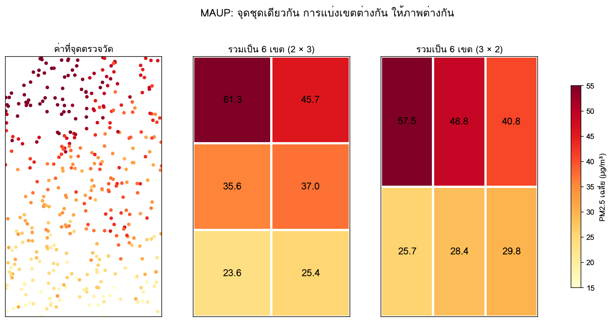
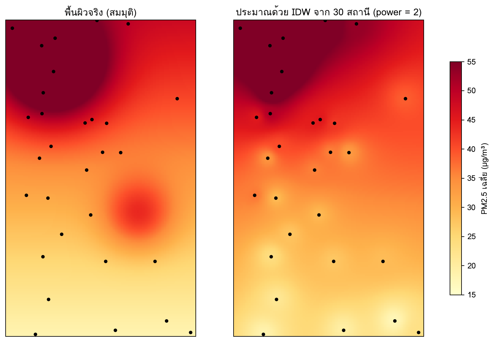

ทุกสถานีในตาราง `stations` มีพิกัดละติจูดและลองจิจูด แต่บทก่อนหน้าใช้พิกัดเพียงเพื่อติดป้ายภาคหรือจังหวัด บทนี้ใช้ตำแหน่งเป็นข้อมูลโดยตรง สถานีใดอยู่ใกล้กัน สถานีใดอยู่ในจังหวัดใด จังหวัดใดไม่มีสถานีเลย และค่าฝุ่นในพื้นที่ที่ไม่มีสถานีน่าจะเป็นเท่าใด คำถามเหล่านี้ต้องใช้เครื่องมือเฉพาะของข้อมูลเชิงพื้นที่ และมีกับดักที่ไม่มีในข้อมูลตารางทั่วไป ที่สำคัญที่สุดคือระบบพิกัด ซึ่งถ้าเลือกผิด ระยะทางและพื้นที่ที่คำนวณได้จะผิดทั้งหมดโดยไม่มีข้อความเตือน

บทนี้เริ่มจากพื้นฐานทางภูมิมาตรศาสตร์ที่จำเป็นต่อการเข้าใจระบบพิกัด ต่อด้วยระบบพิกัดที่เหมาะกับประเทศไทย แบบจำลองข้อมูลเวกเตอร์และการดำเนินการเชิงพื้นที่ด้วย GeoPandas แผนที่ choropleth และปัญหา MAUP จากนั้นเป็นหัวข้อเชิงลึกเรื่อง spatial autocorrelation และการประมาณค่าเชิงพื้นที่ และจบด้วยแผนที่บนเว็บด้วย Folium ตัวอย่างในบทนี้ทดสอบกับฐานข้อมูลสังเคราะห์ 50 สถานีและขอบเขตจังหวัดสังเคราะห์ ซึ่งไม่ใช่ขอบเขตจริง

## วัตถุประสงค์การเรียนรู้ {.unnumbered}

เมื่อจบบทนี้ ผู้อ่านสามารถ

1. อธิบายความสัมพันธ์ระหว่าง ellipsoid, datum, พิกัดภูมิศาสตร์ และเส้นโครงแผนที่
2. เลือกระบบพิกัดที่เหมาะกับงานในประเทศไทย และแปลงระบบพิกัดด้วย GeoPandas
3. สร้างและดำเนินการกับข้อมูลเวกเตอร์ ได้แก่ spatial join, ระยะทาง และ buffer
4. สร้างแผนที่ choropleth ที่ซื่อตรง และอธิบายผลของ MAUP ต่อการตีความ
5. ประเมินข้อจำกัดของการอนุมานค่าในพื้นที่ที่ไม่มีสถานีตรวจวัด
6. สร้างแผนที่บนเว็บด้วย Folium สำหรับการสำรวจและการสื่อสาร

## ภูมิมาตรศาสตร์เบื้องต้น: ellipsoid, datum, พิกัดภูมิศาสตร์ {#sec-ch17-geodesy}

### โลกไม่ใช่ทรงกลม

การระบุตำแหน่งบนโลกต้องมีแบบจำลองรูปร่างของโลก โลกไม่ได้เป็นทรงกลมสมบูรณ์ แต่ป่องที่เส้นศูนย์สูตรและแบนที่ขั้วโลก แบบจำลองทางคณิตศาสตร์ที่ใช้คือ **[ellipsoid]{.idx}** (ทรงรีที่ได้จากการหมุนวงรีรอบแกนสั้น) ซึ่งกำหนดด้วยรัศมีที่เส้นศูนย์สูตร $a$ และความแบน $f$ ellipsoid ที่ใช้มากที่สุดในปัจจุบันคือ WGS 84 ซึ่งมี $a = 6{,}378{,}137$ เมตร และ $f = 1/298.257223563$ [@nga2014wgs84] รัศมีที่ขั้วจึงสั้นกว่าที่เส้นศูนย์สูตรประมาณ 21 กิโลเมตร

### datum

**[datum]{.idx}** คือการผูก ellipsoid เข้ากับโลกจริง กำหนดว่าจุดศูนย์กลางและการวางแนวของ ellipsoid อยู่ที่ใด datum ที่ต่างกันทำให้จุดเดียวกันบนพื้นดินมีพิกัดต่างกัน ประเทศไทยเคยใช้ datum Indian 1975 ในแผนที่ยุคก่อน ซึ่งใช้ ellipsoid Everest ที่ fit กับพื้นที่เอเชียใต้ ส่วนแผนที่และ GPS ในปัจจุบันใช้ WGS 84 พิกัดของจุดเดียวกันใน datum ทั้งสองอาจต่างกันหลายร้อยเมตร ซึ่งมากพอที่จะทำให้สถานีตรวจวัดดูเหมือนอยู่ผิดฝั่งถนนหรือผิดอำเภอ ถ้านำข้อมูลจากสอง datum มารวมกันโดยไม่แปลง

### พิกัดภูมิศาสตร์

**พิกัดภูมิศาสตร์** (geographic coordinates) ระบุตำแหน่งด้วยมุมสองค่าบน ellipsoid คือ **ละติจูด** (latitude) มุมเหนือหรือใต้ของเส้นศูนย์สูตร ตั้งแต่ −90° ถึง 90° และ **ลองจิจูด** (longitude) มุมตะวันออกหรือตะวันตกของเส้นเมริเดียนแรก ตั้งแต่ −180° ถึง 180° ประเทศไทยอยู่ที่ละติจูดประมาณ 5.6° ถึง 20.5° เหนือ และลองจิจูดประมาณ 97.3° ถึง 105.6° ตะวันออก

ข้อควรระวังที่สำคัญที่สุดของพิกัดภูมิศาสตร์คือ **องศาไม่ใช่หน่วยระยะทาง** ระยะของหนึ่งองศาละติจูดประมาณ 111 กิโลเมตรเสมอ แต่ระยะของหนึ่งองศาลองจิจูดเท่ากับประมาณ $111 \times \cos(\text{ละติจูด})$ กิโลเมตร ที่เชียงใหม่ (ประมาณ 18.8° เหนือ) หนึ่งองศาลองจิจูดยาวประมาณ 105 กิโลเมตร ส่วนที่นราธิวาส (ประมาณ 6.4° เหนือ) ยาวประมาณ 110 กิโลเมตร การคำนวณระยะทางด้วยสูตรยุคลิดบนพิกัดองศาโดยตรงจึงผิดทั้งหน่วยและสัดส่วน

### ระยะทางบนผิวโลก

ระยะทางที่ถูกต้องระหว่างสองจุดบน ellipsoid เรียกว่า **[ระยะทาง geodesic]{.idx}** คำนวณได้ด้วยไลบรารี `pyproj` ซึ่งใช้อัลกอริทึมของ Karney [@karney2013algorithms]

```python
from pyproj import Geod

geod = Geod(ellps="WGS84")
_, _, dist_m = geod.inv(98.98, 18.79, 100.50, 13.75)       # (lon1, lat1, lon2, lat2)
print(round(dist_m / 1000, 1))
```

```text
# ผลลัพธ์
580.9
```

ระยะทางตรงจากใจกลางเชียงใหม่ถึงใจกลางกรุงเทพมหานครประมาณ 581 กิโลเมตร ข้อสังเกตเรื่องลำดับของพิกัด ไลบรารีเชิงพื้นที่ส่วนใหญ่ใน Python รวมถึง Shapely, GeoPandas และ GeoJSON ใช้ลำดับ (ลองจิจูด, ละติจูด) ซึ่งตรงกับ (x, y) แต่ภาษาพูดและแผนที่บนเว็บหลายตัว เช่น Folium ใช้ (ละติจูด, ลองจิจูด) การสลับลำดับเป็นข้อผิดพลาดที่พบบ่อยที่สุดของข้อมูลเชิงพื้นที่ และทำให้สถานีในประเทศไทยไปอยู่กลางมหาสมุทรอินเดีย

## ระบบพิกัดและเส้นโครงแผนที่สำหรับประเทศไทย (WGS 84, UTM 47N/48N) {#sec-ch17-crs}

### CRS และรหัส EPSG

**[ระบบพิกัดอ้างอิง]{.idx}** (coordinate reference system, CRS) คือข้อกำหนดครบชุดที่บอกว่าตัวเลขพิกัดหมายถึงตำแหน่งใด ประกอบด้วย datum ชนิดของพิกัด (ภูมิศาสตร์หรือฉาก) และหน่วย ในทางปฏิบัติ CRS ระบุด้วย **[รหัส EPSG]{.idx}** ซึ่งเป็นทะเบียนมาตรฐานที่ดูแลโดย IOGP [@iogp2026epsg]

| รหัส EPSG | ชื่อ | ชนิด | หน่วย | ใช้เมื่อ |
|---|---|---|---|---|
| 4326 | WGS 84 | ภูมิศาสตร์ | องศา | เก็บและแลกเปลี่ยนข้อมูล GPS, GeoJSON |
| 32647 | WGS 84 / UTM zone 47N | ฉาก (projected) | เมตร | คำนวณระยะทางและพื้นที่ ทางตะวันตกของ 102° ตะวันออก |
| 32648 | WGS 84 / UTM zone 48N | ฉาก | เมตร | คำนวณระยะทางและพื้นที่ ทางตะวันออกของ 102° ตะวันออก |
| 3857 | WGS 84 / Pseudo-Mercator | ฉาก | เมตร (บิดเบือน) | แสดงผลบนแผนที่เว็บเท่านั้น |
| 24047 | Indian 1975 / UTM zone 47N | ฉาก | เมตร | อ่านแผนที่และข้อมูลยุคเก่าของไทย |

: CRS ที่พบบ่อยในงานข้อมูลเชิงพื้นที่ของประเทศไทย {#tbl-ch17-crs}

### เส้นโครงแผนที่

**[เส้นโครงแผนที่]{.idx}** (map projection) แปลงพิกัดบนผิวโค้งของ ellipsoid เป็นพิกัดบนระนาบ การแปลงนี้ต้องบิดเบือนบางอย่างเสมอ เพราะผิวโค้งแผ่เป็นระนาบโดยไม่ยืดหรือฉีกไม่ได้ เส้นโครงแต่ละแบบเลือกรักษาคุณสมบัติต่างกัน เช่น รักษามุม (conformal) รักษาพื้นที่ (equal-area) หรือรักษาระยะทางจากจุดหนึ่ง (equidistant) [@snyder1987map]

**[UTM]{.idx}** (Universal Transverse Mercator) แบ่งโลกเป็น 60 โซน โซนละ 6° ลองจิจูด แต่ละโซนใช้เส้นโครง transverse Mercator ที่มีเส้นเมริเดียนกลางของตนเอง ภายในโซน ความบิดเบือนของระยะทางไม่เกินประมาณ 0.1% ประเทศไทยคร่อมสองโซน โซน 47N ครอบคลุมลองจิจูด 96° ถึง 102° ตะวันออก (ภาคเหนือ ภาคกลาง และภาคใต้ส่วนใหญ่) ส่วนโซน 48N ครอบคลุม 102° ถึง 108° ตะวันออก (ภาคตะวันออกเฉียงเหนือส่วนใหญ่และภาคตะวันออกบางส่วน)

### แปลง CRS ด้วย GeoPandas

```python
import duckdb
import geopandas as gpd

con = duckdb.connect("data/pm25.duckdb", read_only=True)
st = con.execute("SELECT * FROM stations").df()
stations = gpd.GeoDataFrame(st, geometry=gpd.points_from_xy(st["lon"], st["lat"]), crs="EPSG:4326")
print(stations.crs.to_string(), stations.total_bounds.round(2))
stations_m = stations.to_crs(epsg=32647)            # แปลงเป็น UTM 47N หน่วยเมตร
```

```text
# ผลลัพธ์ (ตัวอย่าง)
# ข้อมูลสังเคราะห์ 50 สถานี ไม่ใช่ข้อมูล Air4Thai จริง
EPSG:4326 [ 97.96   6.33 104.85  19.94]
```

`points_from_xy` รับลองจิจูดก่อนละติจูด และ `total_bounds` คืนค่า [minx, miny, maxx, maxy] ซึ่งควรอยู่ในช่วงประมาณ [97, 5, 106, 21] สำหรับประเทศไทย ถ้าได้ค่าที่ต่างไปมาก ให้ตรวจว่าสลับลำดับหรือไม่ และแก้ที่ script นำเข้าข้อมูลใน `src/` ไม่ใช่ใน notebook

ความต่างระหว่าง `set_crs` กับ `to_crs` สำคัญมาก `set_crs` *ประกาศ* ว่าตัวเลขพิกัดที่มีอยู่อยู่ในระบบใด โดยไม่เปลี่ยนตัวเลข ส่วน `to_crs` *แปลง* ตัวเลขเป็นระบบใหม่ การใช้ `set_crs` เพื่อ "เปลี่ยน" ระบบพิกัดเป็นข้อผิดพลาดที่ทำให้ข้อมูลกระโดดไปอยู่ผิดที่โดยไม่มีข้อความเตือน

### เลือกระบบพิกัดสำหรับงานระดับประเทศ

ข้อมูลที่ครอบคลุมทั้งประเทศคร่อมสองโซน UTM การใช้โซน 47N กับจุดในภาคตะวันออกเฉียงเหนือยังคำนวณได้ แต่ความบิดเบือนเพิ่มขึ้นตามระยะห่างจากเส้นเมริเดียนกลาง ตัวอย่างเช่น อุบลราชธานี (ประมาณ 104.85° ตะวันออก) มีพิกัด x ในโซน 47N ประมาณ 1,129,000 เมตร ซึ่งเกินช่วงปกติของโซน (ประมาณ 166,000 ถึง 834,000 เมตร) แนวทางปฏิบัติมีดังนี้

| งาน | ระบบพิกัดที่แนะนำ |
|---|---|
| ระยะทางระหว่างสถานีทั่วประเทศ | ระยะทาง geodesic (`pyproj.Geod`) หรือ UTM 47N ถ้ายอมรับความคลาดเคลื่อนเล็กน้อย |
| buffer และระยะทางในพื้นที่จำกัด | โซน UTM ของพื้นที่นั้น |
| พื้นที่ของจังหวัดทั่วประเทศ | เส้นโครงแบบรักษาพื้นที่ เช่น Albers equal-area ที่ตั้งค่าสำหรับประเทศไทย หรือคำนวณแยกตามโซน |
| แสดงผลบนแผนที่เว็บ | ให้ไลบรารีแปลงเป็น 3857 เอง เก็บข้อมูลเป็น 4326 |

: แนวทางเลือกระบบพิกัดตามงาน {#tbl-ch17-crs-choice}

สำหรับระยะทางระหว่างเชียงใหม่กับกรุงเทพมหานคร UTM 47N ให้ 580.7 กิโลเมตร เทียบกับระยะทาง geodesic 580.9 กิโลเมตร คลาดเพียงประมาณ 0.03% ซึ่งยอมรับได้สำหรับงานส่วนใหญ่ ส่วนการคำนวณ "ระยะทาง" ด้วยพิกัดองศาโดยตรงให้ 5.26 ซึ่งไม่มีหน่วยที่มีความหมาย GeoPandas จะเตือนเมื่อเรียก `distance` หรือ `buffer` กับข้อมูลที่ใช้ระบบพิกัดภูมิศาสตร์ คำเตือนนี้ต้องไม่ถูกเพิกเฉย

## vector data model: point, line, polygon {#sec-ch17-vector}

### สองแบบจำลองของข้อมูลเชิงพื้นที่

ข้อมูลเชิงพื้นที่แบ่งเป็นสองแบบจำลองหลัก **[raster]{.idx}** แบ่งพื้นที่เป็นตารางช่อง (pixel) แต่ละช่องมีค่า เช่น ภาพถ่ายดาวเทียม ค่าความลึกของละอองลอย (aerosol optical depth) จากดาวเทียม หรือผลการประมาณค่าเชิงพื้นที่ในหัวข้อ [-@sec-ch17-interpolation] ส่วน **[vector]{.idx}** แทนวัตถุด้วยรูปทรงเรขาคณิต ซึ่งเป็นแบบจำลองที่ใช้กับข้อมูลสถานีและขอบเขตการปกครอง บทนี้เน้นแบบ vector

### รูปทรงพื้นฐาน

มาตรฐาน Simple Features ของ OGC กำหนดรูปทรงพื้นฐานที่ไลบรารีส่วนใหญ่ใช้ร่วมกัน [@ogc2011simple]

| รูปทรง | ใช้แทน | ตัวอย่างในโครงการ |
|---|---|---|
| Point | ตำแหน่งเดียว | สถานีตรวจวัด จุดความร้อนจากดาวเทียม |
| LineString | เส้นทาง | ถนน แม่น้ำ เส้นทางเดินของเซนเซอร์เคลื่อนที่ |
| Polygon | พื้นที่ปิด | ขอบเขตจังหวัด เขตอุทยาน |
| Multi* | หลายชิ้นเป็นวัตถุเดียว | จังหวัดที่มีเกาะ เช่น ภูเก็ต (MultiPolygon) |

: รูปทรงพื้นฐานของข้อมูล vector {#tbl-ch17-geometry}

### GeoDataFrame

**[GeoPandas]{.idx-tool}** ขยาย pandas ด้วย GeoDataFrame ซึ่งเป็น DataFrame ที่มีคอลัมน์ geometry พิเศษหนึ่งคอลัมน์ พร้อม CRS กำกับ การดำเนินการเชิงพื้นที่ทำผ่าน Shapely ซึ่งเป็นไลบรารีเรขาคณิตภายใต้ [@jordahl2020geopandas]

```python
prov = gpd.read_file("data/geo/thailand_provinces.geojson")
print(prov.crs, len(prov), list(prov.columns))
```

```text
# ผลลัพธ์ (ตัวอย่าง)
# ขอบเขตจังหวัดสังเคราะห์ 37 จังหวัด ไม่ใช่ขอบเขตจริง
EPSG:4326 37 ['ADM1_TH', 'geometry']
```

ไฟล์ขอบเขตจังหวัดจริงหาได้จากแหล่งเปิด เช่น geoBoundaries, Humanitarian Data Exchange (HDX) หรือ GADM แต่ละแหล่งมีสัญญาอนุญาตต่างกัน บางแหล่งห้ามใช้เชิงพาณิชย์หรือกำหนดให้ระบุที่มา จึงต้องอ่านและบันทึกสัญญาอนุญาตไว้ใน README ทุกครั้ง (บทที่ 22) ชื่อคอลัมน์และการสะกดชื่อจังหวัดก็ต่างกันตามแหล่ง ควรเปลี่ยนชื่อให้เป็นมาตรฐานของโครงการในฟังก์ชันเดียว

```python
"""src/geo_utils.py: ฟังก์ชันช่วยงานเชิงพื้นที่ ใช้ร่วมกันใน notebook, report และ app"""
from pathlib import Path

import geopandas as gpd

ROOT = Path(__file__).resolve().parents[1]
PROV_FILE = ROOT / "data" / "geo" / "thailand_provinces.geojson"
NAME_FIX = {"กรุงเทพฯ": "กรุงเทพมหานคร"}           # เติมตามที่พบจริงในไฟล์ที่ใช้


def load_provinces(name_col: str) -> gpd.GeoDataFrame:
    """อ่านขอบเขตจังหวัด เปลี่ยนชื่อคอลัมน์เป็น prov_name และแก้การสะกดให้ตรงกับตาราง stations"""
    prov = gpd.read_file(PROV_FILE).rename(columns={name_col: "prov_name"})
    prov["prov_name"] = prov["prov_name"].replace(NAME_FIX)
    return prov[["prov_name", "geometry"]].to_crs("EPSG:4326")
```

### ความถูกต้องของรูปทรง

ไฟล์ขอบเขตจากแหล่งต่าง ๆ อาจมีรูปทรงที่ไม่ถูกต้อง (invalid) เช่น polygon ที่ขอบตัดกันเอง ซึ่งทำให้การดำเนินการเชิงพื้นที่ล้มเหลวหรือให้ผลผิด ตรวจได้ด้วย `prov.is_valid` และซ่อมด้วย `prov.make_valid()` นอกจากนี้ ไฟล์ที่ทำให้ง่ายขึ้น (simplified) เพื่อลดขนาด จะมีขอบที่หยาบกว่าความจริง สถานีที่อยู่ใกล้รอยต่อระหว่างจังหวัดอาจตกไปอยู่ผิดจังหวัด ซึ่งหัวข้อถัดไปจะพบ

## spatial operation และ spatial join {#sec-ch17-operations}

### ความสัมพันธ์เชิงพื้นที่

การดำเนินการเชิงพื้นที่ที่ใช้บ่อยแบ่งเป็นสามกลุ่ม

| กลุ่ม | ตัวอย่าง | ใน GeoPandas |
|---|---|---|
| ความสัมพันธ์ (predicate) | จุดอยู่ในพื้นที่ พื้นที่สองพื้นที่ตัดกัน | `within`, `contains`, `intersects`, `touches` |
| การวัด | ระยะทาง พื้นที่ ความยาว | `distance`, `area`, `length` |
| การสร้างรูปทรงใหม่ | พื้นที่รอบจุด รวมพื้นที่ ส่วนที่ซ้อนกัน | `buffer`, `dissolve`, `overlay`, `centroid` |

: การดำเนินการเชิงพื้นที่ที่ใช้บ่อย {#tbl-ch17-operations}

### spatial join

**[spatial join]{.idx}** เชื่อมสองตารางด้วยความสัมพันธ์เชิงพื้นที่แทนคีย์ ตัวอย่างที่มีประโยชน์ที่สุดในโครงการคือ ตรวจว่าคอลัมน์ `province` ในตาราง `stations` ตรงกับจังหวัดที่พิกัดของสถานีตกอยู่จริงหรือไม่ ซึ่งเป็นการตรวจคุณภาพข้อมูล (บทที่ 9) ด้วยหลักฐานเชิงพื้นที่

```python
prov = load_provinces("ADM1_TH")
joined = gpd.sjoin(stations, prov, how="left", predicate="within")
print("อยู่นอกทุกจังหวัด:", joined["prov_name"].isna().sum())
mismatch = joined[joined["province"] != joined["prov_name"]]
print(mismatch[["station_id", "province", "prov_name"]])
```

```text
# ผลลัพธ์ (ตัวอย่าง)
# ข้อมูลและขอบเขตสังเคราะห์
อยู่นอกทุกจังหวัด: 0
   station_id       province prov_name
22        s23  กรุงเทพมหานคร   นนทบุรี
29        s30  กรุงเทพมหานคร   นนทบุรี
```

ก่อนแก้การสะกดด้วย `NAME_FIX` มีแปดสถานีที่ไม่ตรงกัน ส่วนใหญ่เพราะไฟล์ขอบเขตสะกดว่า "กรุงเทพฯ" หลังแก้เหลือสองสถานีในกรุงเทพมหานครที่พิกัดตกอยู่ในนนทบุรี ซึ่งเป็นสถานีที่อยู่ใกล้รอยต่อระหว่างสองจังหวัด สาเหตุที่เป็นไปได้มีสามอย่าง ได้แก่ ขอบเขตในไฟล์หยาบเกินไป พิกัดของสถานีคลาดเคลื่อน หรือข้อมูลจังหวัดในตาราง `stations` ผิด การตัดสินต้องตรวจกับแหล่งข้อมูลต้นทาง เช่น เว็บไซต์ Air4Thai แล้วบันทึกผลไว้ ไม่ใช่แก้ให้ตรงโดยอัตโนมัติ (ในตัวอย่างนี้ สาเหตุคือขอบเขตสังเคราะห์ที่สร้างอย่างหยาบ)

### ระยะทางและเพื่อนบ้านใกล้สุด

การหาสถานีที่ใกล้ที่สุดของแต่ละสถานีใช้ `sjoin_nearest` ในระบบพิกัดที่มีหน่วยเมตร ผลนี้ใช้ได้หลายอย่าง เช่น หาสถานีอ้างอิงสำหรับตรวจค่าผิดปกติตามบริบท (บทที่ 15) และระบุสถานีที่อยู่โดดเดี่ยว

```python
s_m = stations.to_crs(epsg=32647)[["station_id", "geometry"]]
near = gpd.sjoin_nearest(s_m, s_m.rename(columns={"station_id": "nb_id"}),
                         distance_col="dist_m", exclusive=True)     # exclusive: ไม่จับคู่กับตัวเอง
near["dist_km"] = (near["dist_m"] / 1000).round(1)
print(near.sort_values("dist_km", ascending=False).head(3)[["station_id", "nb_id", "dist_km"]])
print("มัธยฐาน", near["dist_km"].median(), "กม.")
```

```text
# ผลลัพธ์ (ตัวอย่าง)
# ข้อมูลสังเคราะห์ 50 สถานี
   station_id nb_id  dist_km
20        s21   s16    250.7
46        s47   s48    173.5
47        s48   s47    173.5
มัธยฐาน 8.0 กม.
```

มัธยฐานของระยะถึงสถานีที่ใกล้ที่สุดเพียง 8 กิโลเมตร แต่บางสถานีห่างจากสถานีอื่นถึง 250 กิโลเมตร การกระจายตัวที่ไม่สม่ำเสมอนี้เป็นลักษณะของเครือข่ายตรวจวัดจริง สถานีกระจุกในเมืองใหญ่และเบาบางในชนบท สถานีที่อยู่โดดเดี่ยวคือสถานีที่ "เป็นตัวแทน" ของพื้นที่กว้าง ซึ่งต้องระวังเมื่อตีความแผนที่ในหัวข้อถัดไป

### buffer และ dissolve

`buffer` สร้างพื้นที่รอบรูปทรงในระยะที่กำหนด เช่น พื้นที่ในรัศมี 50 กิโลเมตรรอบสถานี ใช้ตอบคำถามว่า "สถานีแต่ละแห่งมีสถานีอื่นในรัศมี 50 กิโลเมตรกี่แห่ง" หรือ "จุดความร้อนกี่จุดอยู่ในรัศมี 50 กิโลเมตรของสถานี" ส่วน `dissolve` รวมรูปทรงตามค่าของคอลัมน์ เช่น รวมจังหวัดเป็นภาค

```python
buffers = s_m.assign(geometry=s_m.buffer(50_000))                  # รัศมี 50 กม. ในหน่วยเมตร
n_within = gpd.sjoin(s_m, buffers, predicate="within").groupby("station_id_right").size() - 1
regions = prov.merge(st[["province", "region"]].drop_duplicates(), left_on="prov_name",
                     right_on="province").dissolve(by="region")
```

## แผนที่ choropleth และปัญหา MAUP {#sec-ch17-choropleth}

### choropleth

**[แผนที่ choropleth]{.idx}** ระบายสีแต่ละพื้นที่ตามค่าของตัวแปร เป็นแผนที่ที่คุ้นตาที่สุด แต่ก็ชวนให้เข้าใจผิดได้ง่ายที่สุดชนิดหนึ่ง การสร้าง choropleth ระดับจังหวัดจากข้อมูลสถานีต้องตัดสินใจเรื่องการรวมข้อมูลก่อน

```python
agg = con.execute("""
    WITH per_station AS (
        SELECT station_id, AVG(pm25_mean) AS pm25, AVG((pm25_mean > 37.5)::INT) AS share_over
        FROM daily_pm25_clean
        WHERE is_complete AND date < DATE '2024-01-01'
        GROUP BY station_id
    )
    SELECT s.province, COUNT(*) AS n_stations, AVG(p.pm25) AS pm25_mean, AVG(p.share_over) AS share_over
    FROM per_station AS p JOIN stations AS s USING (station_id)
    GROUP BY s.province
""").df()
m = prov.merge(agg, left_on="prov_name", right_on="province", how="left")
print("จังหวัดที่ไม่มีสถานี:", int(m["n_stations"].isna().sum()), "จาก", len(m))
m.plot(column="share_over", cmap="YlOrRd", legend=True, edgecolor="white",
       missing_kwds={"color": "lightgrey", "hatch": "///", "label": "ไม่มีสถานี"})
```

```text
# ผลลัพธ์ (ตัวอย่าง)
# ข้อมูลและขอบเขตสังเคราะห์
จังหวัดที่ไม่มีสถานี: 10 จาก 37
```

query นี้รวมข้อมูลสองขั้น ขั้นแรกคำนวณสัดส่วนวันเกินมาตรฐานของแต่ละสถานี ขั้นที่สองเฉลี่ยค่าของสถานีในจังหวัดเดียวกัน วิธีนี้ให้น้ำหนักแต่ละสถานีเท่ากัน ไม่ว่าจะมีข้อมูลกี่วัน ซึ่งต่างจากการคำนวณจากสถานี-วันทั้งหมดของจังหวัดโดยตรง บทที่ 18 อธิบายความต่างของการรวมสองแบบนี้

### หลักการของ choropleth ที่ซื่อตรง

| หลักการ | เหตุผล |
|---|---|
| แสดงพื้นที่ที่ไม่มีข้อมูลด้วยสีหรือลวดลายที่แยกชัด | ถ้าใช้สีอ่อนที่สุดของชุดสี ผู้อ่านจะเข้าใจว่าค่าต่ำ |
| แสดงจำนวนสถานีต่อพื้นที่ | ค่าของจังหวัดที่มีสถานีเดียวไม่แน่นอนกว่าจังหวัดที่มีแปดสถานีมาก |
| ใช้ชุดสี sequential ที่ perceptually uniform | ตามหลักในบทที่ 11 |
| ใช้อัตราหรือค่าเฉลี่ย ไม่ใช่ผลรวม | ผลรวมขึ้นกับขนาดพื้นที่และจำนวนสถานี |
| ระวังพื้นที่ขนาดใหญ่ครอบงำสายตา | จังหวัดใหญ่ดูสำคัญกว่าจังหวัดเล็กที่มีประชากรมาก |

: หลักการของ choropleth ที่ซื่อตรง {#tbl-ch17-choropleth}

ข้อสุดท้ายเป็นปัญหาโดยธรรมชาติของ choropleth กรุงเทพมหานครมีพื้นที่ประมาณ 1,570 ตารางกิโลเมตร เล็กกว่าเชียงใหม่ประมาณ 13 เท่า แต่มีประชากรมากกว่าหลายเท่า ถ้าคำถามเกี่ยวกับการสัมผัสฝุ่นของประชากร แผนที่ choropleth จะให้น้ำหนักทางสายตาผิดทาง ทางเลือกได้แก่ แผนที่จุดที่ขนาดแปรตามประชากร หรือ cartogram ที่ปรับขนาดพื้นที่ตามประชากร

ในข้อมูลสังเคราะห์ของหนังสือ จังหวัดที่มีสัดส่วนวันเกินมาตรฐานสูงที่สุดในภาคกลางคือจังหวัดที่มีเพียงสถานีเดียว ซึ่งเป็นรูปแบบที่พบบ่อยในข้อมูลจริงเช่นกัน หน่วยที่มีข้อมูลน้อยมักมีค่าสุดโต่งทั้งสูงสุดและต่ำสุด เพราะความแปรปรวนของค่าเฉลี่ยจากตัวอย่างเล็กสูงกว่า [@wainer2007most] ผู้อ่านที่เห็นจังหวัดนั้นเป็นสีแดงเข้มที่สุดอาจสรุปผิดว่าเป็นจังหวัดที่อากาศแย่ที่สุด

### MAUP

**[MAUP]{.idx}** (modifiable areal unit problem) คือปรากฏการณ์ที่ผลการวิเคราะห์ข้อมูลที่รวมเป็นพื้นที่ เปลี่ยนไปตามวิธีแบ่งพื้นที่ [@openshaw1984modifiable] MAUP มีสองด้าน **ผลของขนาด** (scale effect) ผลเปลี่ยนเมื่อรวมเป็นพื้นที่ใหญ่ขึ้นหรือเล็กลง เช่น ระดับอำเภอ จังหวัด หรือภาค และ **ผลของการแบ่งเขต** (zoning effect) ผลเปลี่ยนเมื่อแบ่งเขตต่างกันแม้จำนวนเขตเท่าเดิม

{#fig-ch17-maup fig-alt="ภาพซ้ายเป็นจุดที่สีเข้มทางด้านบนและอ่อนทางด้านล่าง ภาพกลางแบ่งเป็นสองคอลัมน์สามแถว ค่าสูงสุด 61.3 อยู่มุมซ้ายบน ภาพขวาแบ่งเป็นสามคอลัมน์สองแถว ค่าสูงสุดลดเหลือ 57.5 และแถวล่างทั้งแถวดูต่ำเท่ากันหมด"}

@fig-ch17-maup แสดงผลของการแบ่งเขต ข้อมูลจุดชุดเดียวกัน แบ่งเป็นหกเขตเท่ากัน แบบ 2 × 3 แสดงการไล่ระดับจากเหนือลงใต้สามระดับ ส่วนแบบ 3 × 2 ซ่อนระดับกลางไว้ และค่าสูงสุดของเขตลดจาก 61.3 เป็น 57.5 µg/m³ ทั้งสองแผนที่ "ถูกต้อง" ในแง่การคำนวณ แต่ให้ข้อสรุปต่างกัน ขอบเขตการปกครองไม่ได้ถูกออกแบบมาเพื่อการวิเคราะห์คุณภาพอากาศ ฝุ่นไม่รู้จักเส้นแบ่งจังหวัด MAUP จึงเกิดขึ้นเสมอเมื่อใช้ choropleth ตามขอบเขตการปกครอง

แนวปฏิบัติเมื่อเผชิญ MAUP ได้แก่ ทดลองหลายระดับการรวมแล้วรายงานว่าข้อสรุปเปลี่ยนหรือไม่ แสดงข้อมูลระดับสถานีควบคู่กับ choropleth และระมัดระวังการอนุมานข้ามระดับ (ecological fallacy ในบทที่ 13)

## spatial autocorrelation: Moran's I ★ {#sec-ch17-moran}

::: {.callout-note title="★ เนื้อหาเชิงลึก"}
หัวข้อนี้ไม่ได้สอนในชั้นเรียน อ่านข้ามได้โดยไม่กระทบความเข้าใจบทถัดไป
:::

### กฎข้อแรกของภูมิศาสตร์

Waldo Tobler กล่าวไว้ว่า "ทุกสิ่งเกี่ยวข้องกับทุกสิ่ง แต่สิ่งที่อยู่ใกล้กันเกี่ยวข้องกันมากกว่าสิ่งที่อยู่ไกล" [@tobler1970computer] ข้อความนี้เป็นที่รู้จักในชื่อกฎข้อแรกของภูมิศาสตร์ และเป็นพื้นฐานของ **[spatial autocorrelation]{.idx}** คือความสัมพันธ์ระหว่างค่าของตัวแปรเดียวกันในตำแหน่งที่ใกล้กัน ซึ่งเป็นคู่ขนานเชิงพื้นที่ของ autocorrelation ตามเวลาในบทที่ 14 และมีผลแบบเดียวกัน คือทำให้ข้อมูลไม่เป็นอิสระ ขนาดตัวอย่างที่มีประสิทธิผลต่ำกว่าจำนวนสถานี

### Moran's I

ตัววัด spatial autocorrelation ที่ใช้มากที่สุดคือ **[Moran's I]{.idx}** [@moran1950notes]

$$
I = \frac{n}{\sum_i \sum_j w_{ij}} \cdot \frac{\sum_i \sum_j w_{ij}(x_i - \bar{x})(x_j - \bar{x})}{\sum_i (x_i - \bar{x})^2}
$$ {#eq-ch17-moran}

โดยที่ $n$ คือจำนวนหน่วย $x_i$ คือค่าของหน่วย $i$ $\bar{x}$ คือค่าเฉลี่ย และ $w_{ij}$ คือน้ำหนักเชิงพื้นที่ระหว่างหน่วย $i$ กับ $j$ ซึ่งมีค่ามากเมื่อสองหน่วยเป็นเพื่อนบ้านกัน ค่า $I$ ที่เป็นบวกแปลว่าหน่วยที่อยู่ใกล้กันมีค่าคล้ายกัน (ค่าสูงอยู่ใกล้ค่าสูง) ค่าใกล้ค่าคาดหวัง $E[I] = -1/(n-1)$ แปลว่าไม่มีรูปแบบเชิงพื้นที่ และค่าลบแปลว่าหน่วยที่ใกล้กันมีค่าต่างกัน

การกำหนดน้ำหนัก $w_{ij}$ คือการตัดสินใจว่าใครเป็นเพื่อนบ้านของใคร สำหรับสถานี (จุด) ทางเลือกที่ใช้บ่อยคือ k เพื่อนบ้านที่ใกล้ที่สุด หรือทุกสถานีในระยะที่กำหนด สำหรับจังหวัด (พื้นที่) ทางเลือกที่ใช้บ่อยคือพื้นที่ที่มีขอบติดกัน (contiguity)

```python
import numpy as np
from esda.moran import Moran
from libpysal.weights import KNN

v = con.execute("""
    SELECT s.station_id, s.lat, s.lon, AVG(d.pm25_mean) AS pm25_dry
    FROM daily_pm25_clean AS d JOIN stations AS s USING (station_id)
    WHERE d.is_complete AND d.date < DATE '2024-01-01' AND MONTH(d.date) IN (2, 3, 4)
    GROUP BY s.station_id, s.lat, s.lon
""").df()
pts = gpd.GeoDataFrame(v, geometry=gpd.points_from_xy(v["lon"], v["lat"]), crs=4326).to_crs(32647)
w = KNN.from_dataframe(pts, k=5)
w.transform = "r"                                     # ทำให้ผลรวมน้ำหนักของแต่ละแถวเป็น 1
np.random.seed(42)
mi = Moran(pts["pm25_dry"], w, permutations=999)
print(round(mi.I, 3), round(mi.EI, 3), mi.p_sim)
```

```text
# ผลลัพธ์ (ตัวอย่าง)
# ข้อมูลสังเคราะห์ 50 สถานี
0.883 -0.02 0.001
```

Moran's I ของค่าเฉลี่ยฤดูแล้งเท่ากับ 0.883 สูงกว่าค่าคาดหวัง −0.02 มาก p-value จาก permutation test (บทที่ 13) เท่ากับ 0.001 ซึ่งเป็นค่าต่ำสุดที่ 999 permutations ให้ได้ สถานีที่อยู่ใกล้กันมีค่าคล้ายกันอย่างชัดเจน เมื่อสลับค่าระหว่างสถานีแบบสุ่มเพื่อทำลายรูปแบบเชิงพื้นที่ Moran's I ลดเหลือ −0.079 และ p-value เท่ากับ 0.241 ซึ่งยืนยันว่าค่า 0.883 มาจากโครงสร้างเชิงพื้นที่จริง

### นัยต่อการวิเคราะห์

spatial autocorrelation ที่สูงมีสองนัย ข้อแรกเป็นข่าวร้าย สถานี 50 แห่งไม่ได้ให้ข้อมูลอิสระ 50 หน่วย การทดสอบเปรียบเทียบภาคในบทที่ 13 ที่ถือว่าแต่ละสถานีเป็นอิสระจะมั่นใจเกินจริง ข้อสองเป็นข่าวดี ค่าของพื้นที่ที่ไม่มีสถานีน่าจะคล้ายกับสถานีที่อยู่ใกล้ ซึ่งเป็นพื้นฐานของการประมาณค่าเชิงพื้นที่ในหัวข้อถัดไป นอกจาก Moran's I แบบรวมทั้งพื้นที่แล้ว ยังมีตัววัดเฉพาะที่ (local indicators of spatial association, LISA) ที่บอกว่าบริเวณใดเป็นกลุ่มค่าสูงหรือกลุ่มค่าต่ำ [@anselin1995local]

## การประมาณค่าเชิงพื้นที่จากเครือข่ายสถานี: IDW และ kriging เบื้องต้น ★ {#sec-ch17-interpolation}

::: {.callout-note title="★ เนื้อหาเชิงลึก"}
หัวข้อนี้ไม่ได้สอนในชั้นเรียน อ่านข้ามได้โดยไม่กระทบความเข้าใจบทถัดไป
:::

### ปัญหา

สถานีตรวจวัดให้ค่าเฉพาะที่ตำแหน่งของสถานี แต่ผู้ใช้มักถามถึงพื้นที่ที่ไม่มีสถานี เช่น อำเภอหรือหมู่บ้านของตน การประมาณค่าเชิงพื้นที่ (spatial interpolation) สร้างพื้นผิวต่อเนื่องจากค่าที่จุด ซึ่งอาศัยสมมติฐานว่าค่าเปลี่ยนอย่างต่อเนื่องในพื้นที่ (spatial autocorrelation)

### IDW

**[IDW]{.idx}** (inverse distance weighting) ประมาณค่าที่ตำแหน่งใหม่ด้วยค่าเฉลี่ยถ่วงน้ำหนักของสถานี โดยน้ำหนักแปรผกผันกับระยะทางยกกำลัง $p$ [@shepard1968two]

$$
\hat{z}(s_0) = \frac{\sum_{i=1}^{n} w_i z(s_i)}{\sum_{i=1}^{n} w_i}, \qquad w_i = \frac{1}{d(s_0, s_i)^p}
$$ {#eq-ch17-idw}

โดยที่ $\hat{z}(s_0)$ คือค่าประมาณที่ตำแหน่ง $s_0$ $z(s_i)$ คือค่าที่สถานี $i$ $d$ คือระยะทาง และ $p$ (มักใช้ 2) ควบคุมว่าสถานีที่ใกล้มีอิทธิพลมากกว่าสถานีที่ไกลเพียงใด ตัวอย่าง ถ้ามีสองสถานีห่าง 10 และ 20 กิโลเมตร ค่า 40 และ 25 µg/m³ น้ำหนักที่ $p = 2$ คือ $1/100$ และ $1/400$ ค่าประมาณคือ $(40/100 + 25/400)/(1/100 + 1/400) = 37$ µg/m³

```python
def idw(xy_known: np.ndarray, values: np.ndarray, xy_target: np.ndarray, power: float = 2.0) -> np.ndarray:
    """ประมาณค่าที่ xy_target ด้วย IDW จากค่าที่ xy_known (พิกัดหน่วยเมตร)"""
    d = np.sqrt(((xy_target[:, None, :] - xy_known[None, :, :]) ** 2).sum(axis=2))
    w = 1 / np.maximum(d, 1e-9) ** power
    return (w * values).sum(axis=1) / w.sum(axis=1)
```

### ประเมินด้วย leave-one-out

การประเมินความแม่นยำของการประมาณค่าเชิงพื้นที่ใช้ **[leave-one-out cross-validation]{.idx}** ตัดสถานีออกทีละแห่ง ประมาณค่าที่ตำแหน่งนั้นจากสถานีที่เหลือ แล้วเทียบกับค่าจริง

```python
xy = np.column_stack([pts.geometry.x, pts.geometry.y])
vals = pts["pm25_dry"].to_numpy()
errors = [idw(np.delete(xy, i, 0), np.delete(vals, i), xy[i:i + 1])[0] - vals[i] for i in range(len(vals))]
print(round(np.sqrt(np.mean(np.square(errors))), 2), round(vals.std(), 2))
```

```text
# ผลลัพธ์ (ตัวอย่าง)
# ข้อมูลสังเคราะห์ 50 สถานี
4.96 11.14
```

RMSE ของ IDW เท่ากับ 4.96 µg/m³ เทียบกับ 11.37 µg/m³ ถ้าใช้ค่าเฉลี่ยของทุกสถานีเป็นค่าประมาณ (และส่วนเบี่ยงเบนมาตรฐานของค่าสถานี 11.14) IDW จึงดีกว่าการไม่ใช้ข้อมูลตำแหน่งมาก แต่ความคลาดเคลื่อนประมาณ 5 µg/m³ ยังสำคัญเมื่อเทียบกับมาตรฐาน 37.5 µg/m³

{#fig-ch17-idw fig-alt="ภาพซ้ายมีบริเวณค่าสูงสองแห่ง แห่งใหญ่ทางตะวันตกเฉียงเหนือและแห่งเล็กกลางพื้นที่ทางขวา ภาพขวาจับบริเวณทางตะวันตกเฉียงเหนือได้ แต่ไม่เห็นบริเวณกลางพื้นที่ซึ่งไม่มีสถานี และมีวงสีอ่อนเล็ก ๆ รอบสถานีหลายแห่ง"}

@fig-ch17-idw แสดงข้อจำกัดของ IDW สองข้อ ข้อแรก บริเวณค่าสูงกลางพื้นที่ทางขวาหายไปทั้งหมด เพราะไม่มีสถานีอยู่ในบริเวณนั้น *ไม่มีวิธีประมาณค่าใดสร้างข้อมูลที่ไม่ได้วัด* ข้อสอง มีวงรูปเป้า (bullseye) รอบสถานีหลายแห่ง เพราะ IDW บังคับให้พื้นผิวผ่านค่าที่สถานีพอดี แม้ค่านั้นจะมีความผันผวนเฉพาะที่

### kriging

**[kriging]{.idx}** เป็นวิธีทางสถิติที่เลือกน้ำหนักจากโครงสร้าง spatial autocorrelation ของข้อมูลเอง แทนการกำหนดด้วยระยะทางยกกำลังตายตัว [@cressie1993statistics] ขั้นแรกประมาณ **[variogram]{.idx}** ซึ่งบรรยายว่าความต่างระหว่างค่าของสองจุดเพิ่มขึ้นอย่างไรเมื่อระยะห่างเพิ่มขึ้น พารามิเตอร์หลักได้แก่ nugget (ความต่างที่ระยะเกือบศูนย์ สะท้อนความคลาดเคลื่อนของการวัดและความผันผวนเฉพาะที่) sill (ระดับที่ความต่างคงที่) และ range (ระยะที่สองจุดไม่สัมพันธ์กันอีกต่อไป) ขั้นที่สองใช้ variogram คำนวณน้ำหนักที่ทำให้ความแปรปรวนของความคลาดเคลื่อนต่ำที่สุด

```python
from pykrige.ok import OrdinaryKriging

xk, yk = xy[:, 0] / 1000, xy[:, 1] / 1000                 # หน่วยกิโลเมตร
ok = OrdinaryKriging(xk, yk, vals, variogram_model="spherical")
grid_x = np.linspace(xk.min(), xk.max(), 60)
grid_y = np.linspace(yk.min(), yk.max(), 80)
z_hat, variance = ok.execute("grid", grid_x, grid_y)      # ค่าประมาณและความแปรปรวนของการประมาณ
```

ข้อได้เปรียบสำคัญของ kriging คือให้ **ความแปรปรวนของการประมาณ** ทุกจุด ซึ่งบอกว่าค่าประมาณที่ตำแหน่งใดไม่แน่นอนเพียงใด ในข้อมูลสังเคราะห์ ส่วนเบี่ยงเบนมาตรฐานของการประมาณมีตั้งแต่ประมาณ 0.6 µg/m³ ใกล้สถานี ไปจนถึงประมาณ 12.7 µg/m³ ในพื้นที่ที่ห่างจากสถานี แผนที่ความไม่แน่นอนนี้ควรแสดงคู่กับแผนที่ค่าประมาณเสมอ RMSE แบบ leave-one-out ของ kriging เท่ากับ 4.91 µg/m³ ใกล้เคียง IDW ซึ่งเป็นเรื่องปกติเมื่อสถานีมีไม่มาก

### ข้อจำกัดในบริบทคุณภาพอากาศ

การประมาณค่าเชิงพื้นที่จากสถานีเพียงอย่างเดียวมีข้อจำกัดที่ต้องสื่อสาร ได้แก่ ค่าฝุ่นเปลี่ยนเร็วในระยะสั้นใกล้แหล่งกำเนิด เช่น ริมถนนใหญ่หรือใกล้จุดเผา ซึ่งเครือข่ายสถานีที่ห่างกันหลายสิบกิโลเมตรจับไม่ได้ ภูมิประเทศอย่างแอ่งภูเขาในภาคเหนือทำให้ค่าเปลี่ยนแบบไม่ต่อเนื่อง และสถานีส่วนใหญ่อยู่ในเมือง ค่าประมาณในชนบทจึงอาศัยการอนุมานจากเมือง งานวิจัยด้านนี้จึงมักรวมข้อมูลเสริม เช่น ค่าความลึกของละอองลอยจากดาวเทียม การใช้ที่ดิน และข้อมูลอุตุนิยมวิทยา เข้าในแบบจำลอง

## แผนที่บนเว็บด้วย Folium {#sec-ch17-folium}

### Folium

**[Folium]{.idx-tool}** เป็นไลบรารี Python ที่สร้างแผนที่บนเว็บแบบโต้ตอบด้วย Leaflet ซึ่งเป็นไลบรารี JavaScript สำหรับแผนที่ [@folium2026docs] ผลลัพธ์เป็นไฟล์ HTML ที่ซูม เลื่อน และคลิกได้ บนพื้นหลังแผนที่ (tile) จากผู้ให้บริการต่าง ๆ เหมาะกับการสำรวจข้อมูลสถานี และการสื่อสารกับผู้ที่คุ้นกับแผนที่ออนไลน์

```python
import folium
import pandas as pd

st = con.execute("""
    SELECT s.*, AVG(d.pm25_mean) AS pm25
    FROM stations AS s LEFT JOIN daily_pm25_clean AS d
      ON d.station_id = s.station_id AND d.is_complete AND d.date < DATE '2024-01-01'
    GROUP BY ALL
""").df()


def pm25_color(value: float) -> str:
    """สีตามเกณฑ์ WHO 15 และมาตรฐานไทย 37.5 µg/m³ (ค่าเฉลี่ยของวันที่ข้อมูลครบ)"""
    if pd.isna(value):
        return "gray"
    return "green" if value <= 15 else "orange" if value <= 37.5 else "red"


fmap = folium.Map(location=[13.5, 101.0], zoom_start=6, tiles="CartoDB positron")
for r in st.itertuples():
    popup = folium.Popup(f"<b>{r.name_th}</b><br>{r.province}<br>PM2.5 เฉลี่ย {r.pm25:.1f} µg/m³",
                         max_width=250)
    folium.CircleMarker([r.lat, r.lon], radius=6, color=pm25_color(r.pm25), fill=True,
                        fill_opacity=0.8, tooltip=r.name_th, popup=popup).add_to(fmap)
fmap.save("outputs/stations_map.html")
```

ข้อสังเกตสามข้อ ข้อแรก Folium รับพิกัดเป็น [ละติจูด, ลองจิจูด] ซึ่งกลับลำดับจาก GeoPandas ข้อสอง `LEFT JOIN` ที่ใส่เงื่อนไขกรองไว้ใน `ON` แทน `WHERE` ทำให้สถานีที่ไม่มีข้อมูลในช่วงสำรวจยังอยู่ในแผนที่เป็นสีเทา ถ้าย้ายเงื่อนไขไปไว้ใน `WHERE` สถานีเหล่านั้นจะหายไปโดยไม่รู้ตัว (บทที่ 7) ข้อสาม ค่าเฉลี่ยทั้งช่วงเทียบกับเกณฑ์ 37.5 µg/m³ ซึ่งนิยามบนค่าเฉลี่ย 24 ชั่วโมงไม่ได้โดยตรง สีจึงเป็นเพียงการจัดกลุ่มคร่าว ๆ ต้องระบุในคำอธิบายแผนที่

### choropleth ใน Folium

```python
folium.Choropleth(
    geo_data=m.to_json(), data=m, columns=["prov_name", "pm25_mean"],
    key_on="feature.properties.prov_name", fill_color="YlOrRd",
    nan_fill_color="lightgrey", legend_name="PM2.5 เฉลี่ย (µg/m³)",
).add_to(fmap)
```

GeoPandas ยังมีเมธอด `explore()` ซึ่งสร้างแผนที่ Folium จาก GeoDataFrame ได้ในบรรทัดเดียว เช่น `stations.explore(column="cluster")` สะดวกมากสำหรับการสำรวจ เช่น ดูว่ากลุ่มสถานีจากบทที่ 15 กระจุกตามภูมิศาสตร์หรือไม่

### ข้อควรระวังของแผนที่บนเว็บ

- **ขนาดไฟล์** ข้อมูลทั้งหมดฝังอยู่ใน HTML ขอบเขตจังหวัดที่ละเอียดมากทำให้ไฟล์ใหญ่หลายสิบเมกะไบต์ ควรใช้ไฟล์ที่ simplify แล้วสำหรับแสดงผล
- **ไม่ commit ไฟล์ HTML ขนาดใหญ่** เก็บไว้ใน `outputs/` ซึ่งอยู่ใน `.gitignore`
- **การระบุที่มา** พื้นหลังแผนที่จากผู้ให้บริการต่าง ๆ มีเงื่อนไขการระบุที่มา ซึ่ง Folium ใส่ให้อัตโนมัติ อย่าลบออก
- **การเข้าถึงได้** แผนที่โต้ตอบเข้าถึงได้ยากสำหรับผู้ใช้โปรแกรมอ่านหน้าจอ ควรมีตารางข้อมูลประกอบ (บทที่ 12)

## กรณีศึกษา: จังหวัดใดมีความเสี่ยงฝุ่นสูงและมีข้อมูลน้อยที่สุด {#sec-ch17-case .unnumbered}

**คำถาม** หน่วยงานที่วางแผนขยายเครือข่ายสถานีต้องการรู้ว่า จังหวัดใดที่น่าจะมีค่าฝุ่นสูง แต่มีข้อมูลน้อยหรือไม่มีสถานีเลย เพื่อจัดลำดับความสำคัญของการติดตั้งสถานีใหม่

**ขั้นตอน**

1. *ตรวจคุณภาพตำแหน่ง* spatial join สถานีกับขอบเขตจังหวัด ตรวจและบันทึกสถานีที่จังหวัดไม่ตรงกัน (หัวข้อ [-@sec-ch17-operations])
2. *สรุปความครอบคลุม* นับจำนวนสถานีต่อจังหวัด และคำนวณระยะจากจุดศูนย์กลางของแต่ละจังหวัดถึงสถานีที่ใกล้ที่สุดในระบบพิกัดเมตร
3. *ประมาณความเสี่ยง* ใช้ IDW หรือ kriging ของค่าเฉลี่ยฤดูแล้งประมาณค่าที่จุดศูนย์กลางของจังหวัดที่ไม่มีสถานี พร้อมความแปรปรวนของการประมาณจาก kriging
4. *จัดลำดับ* จังหวัดที่ค่าประมาณสูงและความไม่แน่นอนสูง คือจังหวัดที่การติดตั้งสถานีใหม่ให้ข้อมูลเพิ่มมากที่สุด

**ผลในข้อมูลสังเคราะห์** มี 10 จาก 37 จังหวัดที่ไม่มีสถานี จังหวัดที่อยู่ห่างจากสถานีที่ใกล้ที่สุดมากกว่า 100 กิโลเมตรมีความแปรปรวนของการประมาณสูงที่สุด และจังหวัดที่อยู่ระหว่างสถานีภาคเหนือที่ค่าสูงได้ค่าประมาณสูง

**การตีความ** จังหวัดที่ควรติดตั้งสถานีก่อนคือจังหวัดที่ทั้งค่าประมาณสูงและความไม่แน่นอนสูง ไม่ใช่จังหวัดที่ค่าประมาณสูงเพียงอย่างเดียว เพราะจังหวัดที่ค่าประมาณสูงแต่อยู่ใกล้สถานีหลายแห่ง ได้ข้อมูลเพิ่มจากสถานีใหม่น้อย

**ข้อจำกัด** ค่าประมาณที่จุดศูนย์กลางไม่แทนทั้งจังหวัด โดยเฉพาะจังหวัดใหญ่ที่มีภูมิประเทศหลากหลาย การจัดลำดับควรพิจารณาประชากรที่สัมผัสฝุ่นด้วย ซึ่งต้องใช้ข้อมูลประชากรรายพื้นที่ และผลทั้งหมดขึ้นกับการเลือกขอบเขตการปกครองเป็นหน่วย (MAUP)

## ข้อผิดพลาดที่พบบ่อย {#sec-ch17-pitfalls .unnumbered}

| ข้อผิดพลาด | ทำไมผิด | ทำอย่างไรแทน |
|---|---|---|
| สลับลำดับละติจูดกับลองจิจูด | สถานีไปอยู่ผิดทวีป | `points_from_xy(lon, lat)` ตรวจ `total_bounds` ทุกครั้ง |
| คำนวณระยะทางหรือ buffer ในพิกัดองศา | องศาไม่ใช่หน่วยระยะทาง และระยะของลองจิจูดแปรตามละติจูด | แปลงเป็น UTM ด้วย `to_crs` หรือใช้ระยะทาง geodesic |
| ใช้ `set_crs` เพื่อแปลงระบบพิกัด | `set_crs` แค่ประกาศ ไม่แปลงตัวเลข | ใช้ `to_crs` เพื่อแปลง |
| spatial join ข้อมูลที่ CRS ไม่ตรงกัน | ผลว่างทั้งหมดหรือผิดตำแหน่ง | ตรวจ `.crs` ของทั้งสองชุดก่อน join |
| แก้จังหวัดที่ไม่ตรงกันโดยอัตโนมัติ | อาจเป็นความผิดพลาดของขอบเขตหรือพิกัด ไม่ใช่ของตาราง | ตรวจกับแหล่งต้นทาง แล้วบันทึกการตัดสินใจ |
| ระบายจังหวัดที่ไม่มีสถานีด้วยสีอ่อนที่สุด | ผู้อ่านเข้าใจว่าค่าต่ำ | ใช้สีเทาหรือลวดลายแยกสำหรับไม่มีข้อมูล |
| ไม่แสดงจำนวนสถานีต่อพื้นที่ | ค่าจากสถานีเดียวไม่แน่นอนสูง และมักเป็นค่าสุดโต่ง | ใส่จำนวนสถานีใน tooltip หรือคำบรรยาย |
| สรุปจาก choropleth ระดับเดียว | MAUP ผลเปลี่ยนตามการแบ่งพื้นที่ | ทดลองหลายระดับ และแสดงข้อมูลระดับสถานีควบคู่ |
| นำเสนอพื้นผิวจากการประมาณค่าเป็นค่าจริง | ไม่มีวิธีใดสร้างข้อมูลในพื้นที่ที่ไม่ได้วัด | แสดงตำแหน่งสถานีและแผนที่ความไม่แน่นอนคู่กัน |
| ไม่บันทึกสัญญาอนุญาตของไฟล์ขอบเขต | อาจละเมิดเงื่อนไขการใช้ | บันทึกแหล่งที่มาและสัญญาอนุญาตใน README |

: ข้อผิดพลาดที่พบบ่อยในบทที่ 17 {#tbl-ch17-pitfalls}

## สรุป {.unnumbered}

- ellipsoid เป็นแบบจำลองรูปร่างโลก datum ผูก ellipsoid กับโลกจริง และพิกัดภูมิศาสตร์เป็นมุม ไม่ใช่ระยะทาง ระยะทางที่ถูกต้องบนผิวโลกคือระยะทาง geodesic
- CRS ระบุด้วยรหัส EPSG เก็บข้อมูลเป็น EPSG:4326 และแปลงเป็น UTM 47N (EPSG:32647) หรือ 48N (EPSG:32648) เมื่อต้องคำนวณระยะทางหรือพื้นที่ `set_crs` ประกาศ ส่วน `to_crs` แปลง
- ข้อมูล vector ประกอบด้วย point, line และ polygon GeoDataFrame เพิ่มคอลัมน์ geometry และ CRS ให้ pandas ไฟล์ขอบเขตต้องตรวจความถูกต้อง การสะกดชื่อ และสัญญาอนุญาต
- spatial join เชื่อมตารางด้วยความสัมพันธ์เชิงพื้นที่ ใช้ตรวจคุณภาพคอลัมน์จังหวัดได้ `sjoin_nearest` และ `buffer` ตอบคำถามเรื่องความใกล้
- choropleth ที่ซื่อตรงต้องแยกพื้นที่ไม่มีข้อมูล แสดงจำนวนสถานี และระวังพื้นที่ใหญ่ครอบงำสายตา MAUP ทำให้ผลเปลี่ยนตามการแบ่งพื้นที่
- Moran's I วัด spatial autocorrelation ซึ่งในข้อมูล PM2.5 มักสูง ทำให้สถานีไม่เป็นอิสระต่อกัน แต่ก็เป็นพื้นฐานของการประมาณค่าเชิงพื้นที่
- IDW และ kriging ประมาณค่าในพื้นที่ที่ไม่มีสถานี kriging ให้ความแปรปรวนของการประมาณ แต่ไม่มีวิธีใดสร้างข้อมูลที่ไม่ได้วัด
- Folium สร้างแผนที่บนเว็บแบบโต้ตอบ รับพิกัดเป็น [ละติจูด, ลองจิจูด] และต้องระวังขนาดไฟล์และการระบุที่มา

## แบบฝึกหัด {#sec-ch17-exercises .unnumbered}

### ระดับพื้นฐาน

1. อธิบายความต่างระหว่าง ellipsoid กับ datum และยกตัวอย่างปัญหาที่เกิดเมื่อรวมข้อมูลจากสอง datum โดยไม่แปลง
2. หนึ่งองศาลองจิจูดที่ละติจูด 15° เหนือยาวประมาณกี่กิโลเมตร และทำไมจึงต่างจากหนึ่งองศาละติจูด
3. ควรใช้ EPSG ใดสำหรับงานต่อไปนี้: (ก) เก็บพิกัดสถานีในไฟล์ GeoJSON (ข) หาสถานีทั้งหมดในรัศมี 30 กิโลเมตรของเมืองเชียงใหม่ (ค) คำนวณระยะทางระหว่างสถานีในอุดรธานีกับขอนแก่น
4. อธิบาย MAUP ทั้งผลของขนาดและผลของการแบ่งเขต พร้อมตัวอย่างในข้อมูล PM2.5
5. คำนวณค่า IDW ($p = 2$) ที่ตำแหน่งหนึ่ง จากสามสถานีที่ห่าง 5, 10 และ 20 กิโลเมตร ค่า 50, 30 และ 20 µg/m³ ตามลำดับ

### ระดับประยุกต์

6. สร้าง GeoDataFrame ของสถานีจากฐานข้อมูลของทีม ตรวจ `total_bounds` แล้ว spatial join กับขอบเขตจังหวัด รายงานสถานีที่จังหวัดไม่ตรงกันพร้อมสาเหตุที่เป็นไปได้ของแต่ละกรณี
7. คำนวณระยะทางระหว่างทุกคู่สถานีด้วยสามวิธี คือ พิกัดองศาโดยตรง UTM 47N และ geodesic เปรียบเทียบความคลาดเคลื่อนของ UTM 47N เทียบกับ geodesic ของคู่สถานีที่อยู่ในภาคตะวันออกเฉียงเหนือ
8. สร้าง choropleth ระดับจังหวัดของสัดส่วนวันเกินมาตรฐาน ที่แสดงจังหวัดไม่มีสถานีแยกสี และมีจำนวนสถานีใน tooltip (Plotly หรือ Folium) แล้วสร้างแบบระดับภาคด้วย `dissolve` เปรียบเทียบข้อสรุปของสองระดับ
9. สร้างแผนที่ Folium ของสถานีที่ระบายสีตามกลุ่มจากบทที่ 15 และอภิปรายว่ากลุ่มกระจุกตามภูมิศาสตร์หรือไม่
10. นับจำนวนสถานีอื่นในรัศมี 25, 50 และ 100 กิโลเมตรของแต่ละสถานี ระบุสถานีที่โดดเดี่ยวที่สุดห้าแห่ง และอภิปรายผลต่อการตรวจค่าผิดปกติตามบริบทในบทที่ 15

### ระดับท้าทาย

11. คำนวณ Moran's I ของค่าเฉลี่ยฤดูแล้งด้วยน้ำหนักหลายแบบ (k = 3, 5, 8 และ distance band 50, 100 กิโลเมตร) อภิปรายว่าการเลือกน้ำหนักมีผลต่อข้อสรุปอย่างไร
12. เปรียบเทียบ IDW ที่ power 1, 2 และ 3 กับ ordinary kriging ด้วย leave-one-out cross-validation แล้วสร้างแผนที่ความแปรปรวนของการประมาณจาก kriging ซ้อนกับตำแหน่งสถานี อภิปรายว่าควรสื่อสารผลกับประชาชนอย่างไร
13. ค้นคว้าการใช้ข้อมูลความลึกของละอองลอย (AOD) จากดาวเทียมร่วมกับข้อมูลสถานีภาคพื้นดินเพื่อประมาณ PM2.5 ในพื้นที่ที่ไม่มีสถานี แล้วเสนอการออกแบบที่ใช้ได้กับประเทศไทย รวมถึงปัญหาการจัดแนวเวลาและพื้นที่ (บทที่ 14) และแหล่งข้อมูลที่มีให้ใช้

แนวคำตอบระดับพื้นฐานและประยุกต์อยู่ใน[ภาคผนวก ช](../appendices/g-answers.qmd#sec-appg-ch17)

## อ่านเพิ่มเติม {.unnumbered}

- @snyder1987map — คู่มือคลาสสิกของเส้นโครงแผนที่จาก USGS อธิบายคุณสมบัติและสูตรของเส้นโครงแต่ละแบบ
- @jordahl2020geopandas — เอกสารอ้างอิงของ GeoPandas ซึ่งเป็นเครื่องมือหลักของบทนี้
- @openshaw1984modifiable — งานต้นฉบับที่อธิบาย MAUP อย่างเป็นระบบ
- @anselin1995local — บทความที่เสนอ LISA ตัววัด spatial autocorrelation เฉพาะที่ ต่อยอดจาก Moran's I
- @cressie1993statistics — ตำรามาตรฐานของสถิติเชิงพื้นที่ รวมถึงทฤษฎีของ kriging สำหรับผู้ต้องการพื้นฐานเชิงลึก
- @wainer2007most — บทความสั้นที่อธิบายว่าทำไมหน่วยที่มีข้อมูลน้อยจึงมักมีค่าสุดโต่งบนแผนที่ ซึ่งเป็นกับดักสำคัญของ choropleth
