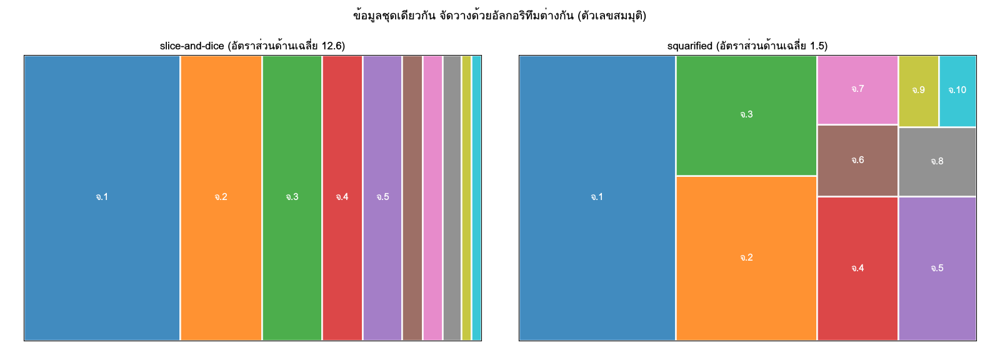

ข้อมูล PM2.5 มีโครงสร้างลำดับชั้นตามธรรมชาติ สถานีอยู่ในจังหวัด จังหวัดอยู่ในภาค และภาครวมกันเป็นประเทศ เวลาก็เป็นลำดับชั้นเช่นกัน ชั่วโมงรวมเป็นวัน วันรวมเป็นเดือน และเดือนรวมเป็นปี ผู้ใช้ข้อมูลแต่ละกลุ่มสนใจระดับต่างกัน ผู้กำหนดนโยบายระดับชาติดูภาพรวมรายภาค ผู้ว่าราชการจังหวัดดูจังหวัดของตน ส่วนประชาชนอยากรู้ว่าสถานีใกล้บ้านเป็นอย่างไร การ **drill-down** คือการพาผู้ใช้เดินจากภาพรวมลงไปหารายละเอียดตามลำดับชั้นนี้ ซึ่งเป็นโครงของแดชบอร์ดในบทที่ 20

บทนี้สั้นกว่าบทอื่น แต่มีประเด็นที่ทำให้ตัวเลขผิดได้โดยไม่รู้ตัว คือ **ค่าที่รวมขึ้นไปแต่ละระดับต้องสอดคล้องกัน** ค่าเฉลี่ยของภาคที่คำนวณจากค่าเฉลี่ยของจังหวัดไม่เท่ากับค่าเฉลี่ยของภาคที่คำนวณจากสถานีทั้งหมด และมัธยฐานรวมขึ้นไปไม่ได้เลย ถ้าแดชบอร์ดแสดงตัวเลขที่ไม่สอดคล้องกันระหว่างระดับ ผู้ใช้จะเสียความเชื่อมั่นในทุกตัวเลข เนื้อหาเรียงจากโครงสร้างลำดับชั้น ความสอดคล้องของการรวม การแสดงด้วย treemap และ sunburst จนถึงการดำเนินการแบบ OLAP ที่เป็นภาษาของการ drill-down

## วัตถุประสงค์การเรียนรู้ {.unnumbered}

เมื่อจบบทนี้ ผู้อ่านสามารถ

1. อธิบายโครงสร้างลำดับชั้นของข้อมูล PM2.5 ทั้งด้านพื้นที่และเวลา และตรวจความถูกต้องของลำดับชั้นด้วย SQL
2. จำแนกตัวชี้วัดที่รวมขึ้นได้ รวมขึ้นได้บางส่วน และรวมขึ้นไม่ได้ และออกแบบตารางสรุปที่ให้ตัวเลขสอดคล้องทุกระดับ
3. เลือกวิธีถ่วงน้ำหนักเมื่อรวมข้อมูลข้ามระดับให้ตรงกับคำถาม
4. สร้าง treemap, sunburst และ icicle ที่ใช้ขนาดและสีอย่างถูกต้อง และอธิบายอัลกอริทึมการจัดวางของ treemap
5. ใช้การดำเนินการ roll-up, drill-down, slice และ dice กับข้อมูล PM2.5 ด้วย SQL และออกแบบ drill-down หลายระดับ

## โครงสร้างลำดับชั้น: ภาค → จังหวัด → สถานี {#sec-ch18-hierarchy}

### ศัพท์ของลำดับชั้น

**ลำดับชั้น** ([hierarchy]{.idx}) คือโครงสร้างต้นไม้ที่แต่ละโหนดมีพ่อแม่ได้หนึ่งโหนด ยกเว้นราก (root) ซึ่งไม่มีพ่อแม่

```{mermaid}
flowchart TD
  TH["ประเทศไทย (ราก)"] --> N["ภาคเหนือ"]
  TH --> C["ภาคกลาง"]
  TH --> O["ภาคอื่น ๆ"]
  N --> CM["เชียงใหม่"]
  N --> CR["เชียงราย"]
  CM --> S1["สถานี A (ใบ)"]
  CM --> S2["สถานี B (ใบ)"]
  CR --> S3["สถานี C (ใบ)"]
```

| ศัพท์ | ความหมาย | ตัวอย่าง |
|---|---|---|
| ระดับ (level) | ชั้นของต้นไม้ | ประเทศ ภาค จังหวัด สถานี |
| โหนด (node) | สมาชิกหนึ่งตัวในระดับหนึ่ง | ภาคเหนือ |
| ใบ (leaf) | โหนดที่ไม่มีลูก | สถานี |
| เส้นทาง (path) | ลำดับของโหนดจากรากถึงโหนดหนึ่ง | ประเทศไทย → ภาคเหนือ → เชียงใหม่ → สถานี A |
| ความลึก (depth) | จำนวนระดับของเส้นทาง | สถานีอยู่ที่ความลึก 3 |

: ศัพท์ของโครงสร้างลำดับชั้น {#tbl-ch18-terms}

### ลำดับชั้นของข้อมูล PM2.5

ข้อมูลของเรามีลำดับชั้นอย่างน้อยสองมิติที่ตั้งฉากกัน

| มิติ | ระดับ | คอลัมน์ที่ใช้ |
|---|---|---|
| พื้นที่ | ประเทศ → ภาค → จังหวัด → สถานี | `stations.region`, `stations.province`, `station_id` |
| เวลา | ปี → เดือน → วัน → ชั่วโมง | `year(date)`, `month(date)`, `date`, `ts` |
| (ทางเลือก) ประเภทสถานี | ทั้งหมด → ประเภท → สถานี | `stations.station_type` |

: มิติที่มีลำดับชั้นในข้อมูล PM2.5 {#tbl-ch18-dimensions}

**ลำดับชั้นของภาคเป็นการตัดสินใจของผู้วิเคราะห์** Air4Thai ไม่ได้ส่งภาคมาให้ ภาคในตาราง `stations` มาจากไฟล์ `src/province_region.csv` ที่โครงการเขียนเองในบทที่ 6 การแบ่งภาคในประเทศไทยมีมากกว่าหนึ่งแบบ เช่น การแบ่งหกภาคตามภูมิศาสตร์ที่ใช้ในการศึกษา และการแบ่งสี่ภาคที่ใช้ในงานสถิติบางประเภท การเลือกแบบใดเปลี่ยนค่าระดับภาคทั้งหมด จึงต้องเขียนไว้ใน README ว่าใช้การแบ่งแบบใดและเพราะอะไร

### ลำดับชั้นที่สม่ำเสมอและไม่สม่ำเสมอ

ลำดับชั้นที่ **สม่ำเสมอ** (balanced) มีใบทุกใบอยู่ที่ความลึกเดียวกัน ลำดับชั้นภาค → จังหวัด → สถานีของเราสม่ำเสมอ ถ้าทุกสถานีมีจังหวัดและทุกจังหวัดมีภาค ลำดับชั้นที่ **ไม่สม่ำเสมอ** (ragged) มีบางเส้นทางสั้นกว่า เช่น ถ้าเพิ่มระดับอำเภอ กรุงเทพมหานครแบ่งเป็นเขตแทนอำเภอ หรือสถานีที่ไม่มีข้อมูลอำเภอ เครื่องมือบางอย่าง เช่น treemap ของ Plotly ต้องการให้ทุกเส้นทางมีความยาวเท่ากัน จึงต้องเติมระดับที่ขาดด้วยค่าที่ชัดเจน เช่น "ไม่ระบุ" ก่อนส่งเข้า

### การเก็บลำดับชั้นในตาราง

ลำดับชั้นเก็บได้สองแบบ

| แบบ | โครงสร้าง | ข้อดี | ข้อเสีย |
|---|---|---|---|
| แบบแบน (flattened) | หนึ่งแถวต่อใบ มีคอลัมน์ของทุกระดับ | query ง่าย ใช้กับ `GROUP BY` และ treemap ได้ตรง | ข้อมูลระดับบนซ้ำในทุกแถว เปลี่ยนชื่อภาคต้องแก้หลายแถว |
| adjacency list | หนึ่งแถวต่อโหนด มีคอลัมน์ `parent_id` | เก็บลำดับชั้นที่ลึกไม่เท่ากันได้ เพิ่มระดับได้ง่าย | ต้องใช้ recursive CTE เพื่อเดินต้นไม้ |

: วิธีเก็บลำดับชั้นในตาราง {#tbl-ch18-storage}

ตาราง `stations` ของเราเป็นแบบแบน ซึ่งเหมาะกับลำดับชั้นตื้นที่สม่ำเสมอ ถ้าต้องการแบบ adjacency list เพื่อใช้กับเครื่องมือบางอย่าง สร้างได้จากแบบแบนด้วย SQL และเดินกลับด้วย recursive CTE ซึ่งเป็นเนื้อหาเชิงลึกในบทที่ 7

```python
import duckdb
import pandas as pd

con = duckdb.connect("data/pm25.duckdb", read_only=True)
nodes = con.execute("""
    SELECT 'TH' AS node_id, NULL AS parent_id, 'ประเทศไทย' AS label, 0 AS depth
    UNION ALL
    SELECT DISTINCT 'R:' || region, 'TH', region, 1 FROM stations
    UNION ALL
    SELECT DISTINCT 'P:' || province, 'R:' || region, province, 2 FROM stations
    UNION ALL
    SELECT 'S:' || station_id, 'P:' || province, name_th, 3 FROM stations
""").df()
```

การเติมคำนำหน้า `R:`, `P:` และ `S:` ทำให้รหัสโหนดไม่ซ้ำข้ามระดับ ป้องกันกรณีที่ชื่อจังหวัดบังเอิญตรงกับชื่อภาคหรือรหัสสถานี

### ตรวจความถูกต้องของลำดับชั้น

ลำดับชั้นที่ผิดทำให้ทุกตัวเลขของระดับบนผิด และทำให้ treemap error หรือแสดงผลแปลก การตรวจต่อไปนี้ควรอยู่ใน `src/validate.py` (บทที่ 9)

```python
checks = {
    "จังหวัดที่อยู่หลายภาค": """
        SELECT province, count(DISTINCT region) AS n FROM stations
        GROUP BY province HAVING count(DISTINCT region) > 1""",
    "สถานีที่ไม่มีจังหวัดหรือภาค": """
        SELECT station_id FROM stations WHERE province IS NULL OR region IS NULL""",
    "สถานีที่มีรหัสซ้ำ": """
        SELECT station_id, count(*) FROM stations GROUP BY station_id HAVING count(*) > 1""",
    "สถานีใน daily_pm25_clean ที่ไม่มีใน stations": """
        SELECT DISTINCT d.station_id FROM daily_pm25_clean AS d
        ANTI JOIN stations AS s USING (station_id)""",
}
for name, sql in checks.items():
    n = len(con.execute(sql).df())
    print(f"{name}: {n}")
```

ทุกการตรวจควรได้ 0 การตรวจข้อสุดท้ายใช้ anti join (บทที่ 7) หาสถานีที่มีข้อมูลการวัดแต่ไม่มีในตารางสถานี ถ้าไม่ตรวจ การ join แบบ inner จะทำให้ข้อมูลของสถานีเหล่านั้นหายไปจากทุกระดับโดยไม่มีคำเตือน

## ความสอดคล้องของการรวมข้อมูลข้ามระดับ {#sec-ch18-consistency}

### ตัวชี้วัดสามชนิด

ความสอดคล้องของตัวเลขข้ามระดับขึ้นกับชนิดของตัวชี้วัด แนวคิดนี้มาจากงานด้านคลังข้อมูล [@kimball2013data] และงานของ Gray และคณะ ที่เสนอ data cube [@gray1997data]

| ชนิด | นิยาม | ตัวอย่าง | วิธีรวมขึ้นระดับบน |
|---|---|---|---|
| รวมขึ้นได้ (additive) | ค่าของระดับบนเท่ากับผลรวมของระดับล่าง | จำนวนสถานี-วัน จำนวนวันเกินมาตรฐาน ผลรวมของค่า PM2.5 | บวกกัน |
| รวมขึ้นได้บางส่วน (semi-additive) | บวกได้ในบางมิติแต่ไม่ได้ในมิติอื่น | จำนวนสถานีที่มีข้อมูล (บวกข้ามพื้นที่ได้ แต่บวกข้ามวันไม่ได้) | บวกเฉพาะมิติที่ได้ |
| รวมขึ้นไม่ได้ (non-additive) | ต้องคำนวณใหม่จากข้อมูลระดับล่างสุด | ค่าเฉลี่ย มัธยฐาน เปอร์เซ็นไทล์ สัดส่วน | เก็บตัวตั้งกับตัวหาร หรือคำนวณจากใบ |

: ชนิดของตัวชี้วัดตามความสามารถในการรวม {#tbl-ch18-measure-types}

ค่าเฉลี่ยและสัดส่วนรวมขึ้นไปตรง ๆ ไม่ได้ แต่ **ทำให้รวมได้** ถ้าเก็บตัวตั้งและตัวหารไว้แยกกัน ค่าเฉลี่ยคือผลรวมหารด้วยจำนวน ทั้งสองส่วนรวมขึ้นได้ ค่าเฉลี่ยของระดับบนจึงคำนวณได้ถูกต้องเสมอจากผลรวมของผลรวมหารด้วยผลรวมของจำนวน ส่วนมัธยฐานและเปอร์เซ็นไทล์ไม่มีตัวตั้งตัวหารให้เก็บ ต้องคำนวณใหม่จากข้อมูลระดับล่างสุดทุกครั้ง หรือใช้โครงสร้างข้อมูลแบบประมาณ เช่น t-digest [@dunning2019computing] ซึ่ง DuckDB ใช้ใน `approx_quantile`

### ค่าเฉลี่ยของค่าเฉลี่ย

ตัวอย่าง (ข้อมูลสมมุติ) ภาคหนึ่งมีสองจังหวัด จังหวัด ก มีสองสถานี ค่าเฉลี่ย 40 และ 60 µg/m³ จากข้อมูล 300 และ 100 วัน จังหวัด ข มีสถานีเดียว ค่าเฉลี่ย 20 µg/m³ จากข้อมูล 365 วัน

| วิธีรวม | การคำนวณ | ค่าระดับภาค |
|---|---|---|
| เฉลี่ยทุกสถานีเท่ากัน | (40 + 60 + 20) / 3 | 40.0 |
| เฉลี่ยจังหวัดก่อน แล้วเฉลี่ยจังหวัดเท่ากัน | ((40 + 60)/2 + 20) / 2 | 35.0 |
| ถ่วงน้ำหนักด้วยจำนวนสถานี-วัน | (40·300 + 60·100 + 20·365) / 765 | 33.1 |

: ค่าระดับภาคจากวิธีรวมต่างกัน (ข้อมูลสมมุติ, µg/m³) {#tbl-ch18-average-of-averages}

สามวิธีให้สามคำตอบ และ **ไม่มีวิธีใดผิด** แต่ละวิธีตอบคำถามต่างกัน วิธีแรกตอบว่า "สถานีทั่วไปในภาคนี้วัดได้เท่าใด" วิธีที่สองตอบว่า "จังหวัดทั่วไปในภาคนี้เป็นอย่างไร" วิธีที่สามตอบว่า "การวัดทั้งหมดในภาคนี้เฉลี่ยได้เท่าใด" ซึ่งให้น้ำหนักแก่สถานีที่มีข้อมูลมาก สิ่งที่ผิดคือ **การใช้หลายวิธีปนกันในแดชบอร์ดเดียว** หรือไม่บอกผู้อ่านว่าใช้วิธีใด

ยังมีวิธีที่สี่ที่ใกล้กับผลกระทบต่อคนที่สุด คือ **การถ่วงน้ำหนักด้วยประชากร** (population-weighted) ซึ่งให้น้ำหนักแก่พื้นที่ที่มีคนอาศัยมาก วิธีนี้ใช้ในการประเมินการได้รับสัมผัสของประชากร [@who2021global] แต่ต้องมีข้อมูลประชากรในพื้นที่ที่แต่ละสถานีเป็นตัวแทน (บทที่ 17) ซึ่งเกินขอบเขตของโครงการพื้นฐาน

### ออกแบบตารางสรุปที่สอดคล้องทุกระดับ

หลักการคือ **เก็บเฉพาะตัวชี้วัดที่รวมขึ้นได้ในตารางสรุป แล้วคำนวณค่าเฉลี่ยและสัดส่วนตอนแสดงผล**

```python
summary = con.execute("""
    SELECT s.region, s.province, d.station_id,
           date_trunc('month', d.date)                 AS month,
           count(*)                                    AS station_days,
           sum(d.pm25_mean)                            AS sum_pm25,
           count(*) FILTER (WHERE d.pm25_mean > 37.5)  AS exceed_days,
           max(d.pm25_max)                             AS peak_hourly
    FROM daily_pm25_clean AS d JOIN stations AS s USING (station_id)
    WHERE d.is_complete
    GROUP BY ALL
""").df()
```

ตารางนี้อยู่ที่ระดับล่างสุดของทั้งสองมิติที่แดชบอร์ดต้องการ (สถานี × เดือน) คอลัมน์ `station_days`, `sum_pm25` และ `exceed_days` รวมขึ้นได้ ส่วน `peak_hourly` รวมขึ้นได้ด้วยฟังก์ชัน `max` ซึ่งเป็นตัวชี้วัดอีกกลุ่มที่รวมได้ด้วยการดำเนินการที่ไม่ใช่การบวก ค่าเฉลี่ยและสัดส่วนของระดับใดก็ตามคำนวณได้จากการรวมคอลัมน์เหล่านี้

```python
def roll_up(df, by):
    g = df.groupby(by, as_index=False).agg(
        station_days=("station_days", "sum"), sum_pm25=("sum_pm25", "sum"),
        exceed_days=("exceed_days", "sum"), peak_hourly=("peak_hourly", "max"),
        n_stations=("station_id", "nunique"))
    g["pm25_mean"] = g["sum_pm25"] / g["station_days"]
    g["share_over_std"] = g["exceed_days"] / g["station_days"]
    return g

by_region = roll_up(summary, ["region"])
by_province = roll_up(summary, ["region", "province"])
```

ค่าเฉลี่ยที่ได้เป็นแบบถ่วงน้ำหนักด้วยสถานี-วัน (วิธีที่สามใน @tbl-ch18-average-of-averages) อย่างสม่ำเสมอทุกระดับ `n_stations` ใช้ `nunique` ไม่ใช่ `sum` เพราะจำนวนสถานีเป็นตัวชี้วัดที่รวมขึ้นได้บางส่วน บวกข้ามเดือนไม่ได้ สถานีเดียวที่มีข้อมูลสิบสองเดือนต้องนับเป็นหนึ่งสถานี

### ทดสอบความสอดคล้อง

ความสอดคล้องควรเป็นการทดสอบอัตโนมัติ ไม่ใช่สิ่งที่ตรวจด้วยตาครั้งเดียว

```python
direct = con.execute("""
    SELECT s.region, avg(d.pm25_mean) AS pm25_mean,
           avg(CAST(d.pm25_mean > 37.5 AS DOUBLE)) AS share_over_std
    FROM daily_pm25_clean AS d JOIN stations AS s USING (station_id)
    WHERE d.is_complete GROUP BY s.region
""").df().set_index("region").sort_index()

rolled = by_region.set_index("region").sort_index()[["pm25_mean", "share_over_std"]]
pd.testing.assert_frame_equal(direct, rolled, check_exact=False, rtol=1e-9)
```

การทดสอบนี้ยืนยันว่าค่าระดับภาคที่ได้จากการรวมตารางสรุป เท่ากับค่าที่คำนวณตรงจากข้อมูลรายวัน (ซึ่งถ่วงน้ำหนักด้วยสถานี-วันโดยธรรมชาติ) ถ้าวันหนึ่งมีคนแก้ตารางสรุปหรือแก้ query ของแดชบอร์ดผิด การทดสอบนี้จะจับได้ทันที

### GROUPING SETS และ ROLLUP

SQL มีไวยากรณ์ที่คำนวณหลายระดับพร้อมกันใน query เดียว คือ `GROUPING SETS`, `ROLLUP` และ `CUBE` (บทที่ 7) `ROLLUP (region, province)` คำนวณสามระดับพร้อมกัน คือ ภาค × จังหวัด ภาค และรวมทั้งประเทศ

```python
levels = con.execute("""
    SELECT s.region, s.province,
           grouping(s.region, s.province)               AS level_id,
           count(*)                                    AS station_days,
           avg(d.pm25_mean)                            AS pm25_mean,
           avg(CAST(d.pm25_mean > 37.5 AS DOUBLE))     AS share_over_std
    FROM daily_pm25_clean AS d JOIN stations AS s USING (station_id)
    WHERE d.is_complete
    GROUP BY ROLLUP (s.region, s.province)
    ORDER BY level_id DESC, s.region, s.province
""").df()
```

`grouping()` คืนค่าบิตที่บอกว่าคอลัมน์ใดถูกรวมไปแล้วในแถวนั้น ค่า 0 คือระดับจังหวัด 1 คือระดับภาค (จังหวัดถูกรวม) และ 3 คือระดับประเทศ (ทั้งสองคอลัมน์ถูกรวม) ใช้แยกแถวรวมออกจากแถวที่มีค่า NULL จริงในข้อมูล ค่าเฉลี่ยใน query นี้คำนวณจากข้อมูลรายวันโดยตรงทุกระดับ จึงสอดคล้องกันเอง

## treemap และ sunburst: ★ อัลกอริทึมการจัดวาง {#sec-ch18-treemap}

### การแสดงลำดับชั้นด้วยการเติมพื้นที่

**[treemap]{.idx}** [@shneiderman1992tree] แสดงลำดับชั้นด้วยสี่เหลี่ยมซ้อนกัน แต่ละโหนดเป็นสี่เหลี่ยมที่มีพื้นที่แปรตามค่าของมัน และสี่เหลี่ยมของลูกอยู่ภายในสี่เหลี่ยมของพ่อแม่ **[sunburst]{.idx}** แสดงลำดับชั้นเดียวกันด้วยวงแหวนซ้อนกันจากศูนย์กลาง วงในคือระดับบน และมุมของแต่ละส่วนแปรตามค่า **icicle** คือ sunburst ที่คลี่ออกเป็นแนวตรง แต่ละระดับเป็นแถบหนึ่งแถบ

| | treemap | sunburst | icicle |
|---|---|---|---|
| การเข้ารหัสขนาด | พื้นที่ของสี่เหลี่ยม | มุม (และพื้นที่ที่โตขึ้นในวงนอก) | ความยาวบนแกนร่วม |
| อ่านขนาดเปรียบเทียบ | ปานกลาง | ยาก | ง่ายที่สุด |
| เห็นโครงสร้างลำดับชั้น | ไม่ค่อยชัดเมื่อลึก | ชัด | ชัด |
| ใช้พื้นที่จอ | มีประสิทธิภาพมาก | เสียพื้นที่มุมจอ | ปานกลาง |

: เปรียบเทียบ treemap, sunburst และ icicle {#tbl-ch18-hierarchy-charts}

ตามลำดับความแม่นยำของการเข้ารหัสภาพในบทที่ 11 ความยาวบนแกนร่วมอ่านได้แม่นกว่าพื้นที่ และพื้นที่อ่านได้แม่นกว่ามุม icicle จึงเหมาะที่สุดเมื่อต้องเทียบขนาด treemap เหมาะเมื่อมีใบจำนวนมากและต้องการเห็นส่วนประกอบของทั้งหมด sunburst ดึงดูดสายตาและเห็นโครงสร้างชัด แต่ไม่ควรใช้เมื่อต้องการให้ผู้อ่านเทียบขนาดแม่นยำ

### ขนาดต้องรวมกันได้ สีคือตัวชี้วัด

กฎที่สำคัญที่สุดของกราฟทั้งสามแบบคือ **ขนาดต้องเป็นตัวชี้วัดที่รวมขึ้นได้** เพราะพื้นที่ของพ่อแม่ต้องเท่ากับผลรวมของพื้นที่ของลูก จำนวนสถานี-วันหรือจำนวนสถานีใช้เป็นขนาดได้ ค่าเฉลี่ย PM2.5 ใช้เป็นขนาดไม่ได้ เพราะค่าเฉลี่ยของภาคไม่เท่ากับผลรวมของค่าเฉลี่ยของจังหวัด ตัวชี้วัดที่รวมไม่ได้จึงควรเป็น **สี**

```python
import plotly.express as px

h = (roll_up(summary, ["region", "province", "station_id"])
     .merge(con.execute("SELECT station_id, name_th FROM stations").df(), on="station_id"))
path = [px.Constant("ประเทศไทย"), "region", "province", "name_th"]

fig = px.treemap(h, path=path, values="station_days", color="pm25_mean",
                 color_continuous_scale="YlOrRd", color_continuous_midpoint=37.5,
                 hover_data={"share_over_std": ":.0%", "n_stations": True})
fig.update_traces(root_color="lightgrey", branchvalues="total")
fig.update_layout(margin=dict(t=30, l=0, r=0, b=0))
```

Plotly คำนวณสีของโหนดระดับบนเป็น **ค่าเฉลี่ยถ่วงน้ำหนักด้วย `values`** ของลูกโดยอัตโนมัติ [@plotly2024python] เมื่อ `values` คือสถานี-วันและสีคือค่าเฉลี่ยของสถานี สีของจังหวัดและภาคจึงเท่ากับค่าเฉลี่ยถ่วงน้ำหนักด้วยสถานี-วัน ซึ่งตรงกับตัวเลขใน `roll_up` พอดี ความสอดคล้องนี้ไม่ได้เกิดขึ้นเอง ถ้าเลือก `values` เป็นจำนวนสถานี สีของระดับบนจะกลายเป็นค่าเฉลี่ยถ่วงน้ำหนักด้วยจำนวนสถานี ซึ่งต่างจากตัวเลขในตาราง ต้องเลือกให้ตรงกัน

`branchvalues="total"` บอก Plotly ว่าค่าของพ่อแม่คือผลรวมของลูก ซึ่งเป็นค่าเริ่มต้นของ px เมื่อใช้ `path` `color_continuous_midpoint=37.5` ทำให้สีกึ่งกลางของชุดสีอยู่ที่มาตรฐาน ผู้อ่านจึงแยกพื้นที่ที่เกินและไม่เกินมาตรฐานได้ด้วยสี แต่ชุดสี YlOrRd เป็นแบบ sequential การกำหนดจุดกึ่งกลางจึงเพียงเลื่อนช่วงสี ถ้าต้องการเน้นสองฝั่งของเกณฑ์อย่างชัดเจน ควรใช้ชุดสีแบบ diverging (บทที่ 11)

```python
px.sunburst(h, path=path, values="station_days", color="pm25_mean",
            color_continuous_scale="YlOrRd", color_continuous_midpoint=37.5)
px.icicle(h, path=path, values="station_days", color="pm25_mean",
          color_continuous_scale="YlOrRd", color_continuous_midpoint=37.5)
```

ถ้าข้อมูลมีแถวที่ `region` หรือ `province` เป็นค่าว่าง Plotly จะ error เรื่อง non-leaf rows ซึ่งเป็นสัญญาณที่ดีว่าลำดับชั้นไม่สมบูรณ์ ให้กลับไปแก้ด้วยการตรวจใน @sec-ch18-hierarchy แทนการเติมค่าเพื่อให้กราฟวาดได้

### คลิกเพื่อ drill-down

treemap, sunburst และ icicle ของ Plotly มีการ drill-down ในตัว คลิกที่โหนดใดกราฟจะซูมเข้าไปให้โหนดนั้นเป็นรากใหม่ และคลิกที่แถบด้านบนเพื่อย้อนกลับ ซึ่งสะดวกสำหรับการสำรวจ แต่การ drill-down ในกราฟเดียวนี้ไม่ได้เปลี่ยนกราฟอื่น ถ้าต้องการให้ทั้งแดชบอร์ดตามการเลือก ต้องจัดการสถานะด้วย `session_state` ในบทที่ 20

### อัลกอริทึมการจัดวาง ★

::: {.callout-note title="★ เนื้อหาเชิงลึก"}
ส่วนย่อยนี้ (อัลกอริทึมการจัดวาง) ไม่ได้สอนในชั้นเรียน อ่านข้ามได้โดยไม่กระทบความเข้าใจบทถัดไป
:::

การแบ่งสี่เหลี่ยมหนึ่งรูปเป็นสี่เหลี่ยมย่อยที่มีพื้นที่ตามค่าที่กำหนดทำได้หลายวิธี แต่ละวิธีแลกเปลี่ยนระหว่างสามคุณสมบัติ คือ **อัตราส่วนกว้างต่อยาว** (สี่เหลี่ยมที่ใกล้จัตุรัสเทียบพื้นที่ได้ง่ายกว่าแถบยาว) **ลำดับ** (ลูกเรียงตามลำดับเดิมหรือไม่) และ **ความเสถียร** (เมื่อค่าเปลี่ยนเล็กน้อย การจัดวางเปลี่ยนน้อยหรือไม่)

**[slice-and-dice]{.idx}** [@shneiderman1992tree] เป็นวิธีดั้งเดิม แบ่งสี่เหลี่ยมเป็นแถบตามแนวนอนในระดับหนึ่ง แล้วแบ่งตามแนวตั้งในระดับถัดไป สลับกันไปเรื่อย ๆ ตัวอย่าง (ข้อมูลสมมุติ) สี่เหลี่ยมขนาด 100 × 60 แบ่งให้สามโหนดที่มีค่า 50, 30 และ 20 ได้แถบกว้าง 50, 30 และ 20 สูง 60 ทุกแถบ อัตราส่วนยาวต่อสั้นคือ 1.2, 2.0 และ 3.0 ถ้ามีโหนดเล็กจำนวนมาก แถบจะบางจนมองไม่เห็นและเทียบกันไม่ได้

**[squarified]{.idx}** [@bruls2000squarified] เพิ่มโหนดลงในแถบทีละโหนด และเริ่มแถบใหม่เมื่อการเพิ่มทำให้อัตราส่วนที่แย่ที่สุดในแถบแย่ลง ผลคือสี่เหลี่ยมใกล้จัตุรัส กับตัวอย่างเดิม วิธีนี้วางโหนด 50 เป็นแถบกว้าง 50 สูง 60 (อัตราส่วน 1.2) แล้ววางโหนด 30 และ 20 ซ้อนกันในพื้นที่ 50 × 60 ที่เหลือ ได้สี่เหลี่ยม 50 × 36 และ 50 × 24 (อัตราส่วน 1.39 และ 2.08) อัตราส่วนที่แย่ที่สุดลดจาก 3.0 เหลือ 2.08 ข้อเสียคือลำดับของโหนดไม่คงที่ และเมื่อค่าเปลี่ยน การจัดวางอาจกระโดด ซึ่งทำให้เทียบ treemap ข้ามเดือนยาก

**ordered และ strip treemap** [@bederson2002ordered] รักษาลำดับของโหนดไว้ โดยยอมให้อัตราส่วนแย่กว่า squarified เล็กน้อย เหมาะเมื่อลำดับมีความหมาย เช่น เรียงจังหวัดตามรหัส หรือเมื่อต้องเทียบหลาย treemap ข้ามเวลา

@fig-ch18-layouts เทียบสองวิธีกับข้อมูลสมมุติ 10 จังหวัด slice-and-dice ได้แถบผอมจนติดป้ายไม่ได้ ส่วน squarified ได้สี่เหลี่ยมใกล้จัตุรัสทุกช่อง

{#fig-ch18-layouts fig-alt="ภาพซ้ายเป็นแถบแนวตั้งเรียงจากใหญ่ไปเล็ก แถบท้ายผอมมากจนติดป้ายไม่ได้ อัตราส่วนด้านเฉลี่ย 12.6 ภาพขวาเป็นสี่เหลี่ยมใกล้จัตุรัส ติดป้ายได้ทุกช่อง อัตราส่วนด้านเฉลี่ย 1.5"}

| อัลกอริทึม | อัตราส่วน | รักษาลำดับ | ความเสถียร |
|---|---|---|---|
| slice-and-dice | แย่ | ใช่ | ดี |
| squarified | ดีที่สุด | ไม่ | แย่ |
| ordered / strip | ดี | ใช่ | ปานกลาง |

: การแลกเปลี่ยนของอัลกอริทึมจัดวาง treemap {#tbl-ch18-layout-algorithms}

Plotly ใช้ squarified เป็นค่าเริ่มต้น และเปลี่ยนได้ด้วย `fig.update_traces(tiling_packing="slice-dice")` หรือค่าอื่น เช่น `"binary"`, `"dice"`, `"slice"` เมื่อทำ treemap ของหลายเดือนเพื่อเทียบกัน การใช้วิธีที่รักษาลำดับช่วยให้ผู้อ่านหาจังหวัดเดิมเจอที่ตำแหน่งเดิม

## การดำเนินการแบบ OLAP: roll-up, drill-down, slice, dice {#sec-ch18-olap}

### data cube

**OLAP** (online analytical processing) มองข้อมูลเป็น **[data cube]{.idx}** ที่มีหลายมิติ (dimension) และตัวชี้วัด (measure) อยู่ในแต่ละช่อง [@gray1997data] ข้อมูล PM2.5 ของเรามองเป็นลูกบาศก์สามมิติได้ คือ พื้นที่ (ประเทศ → ภาค → จังหวัด → สถานี) เวลา (ปี → เดือน → วัน) และสารมลพิษ (PM2.5, PM10, O3, ...) ตัวชี้วัดคือคอลัมน์ที่รวมขึ้นได้ในตารางสรุป แนวคิดนี้ใกล้กับ star schema ในบทที่ 6 ซึ่งมีตาราง fact ตรงกลางและตารางมิติล้อมรอบ

### การดำเนินการห้าแบบ

| การดำเนินการ | ทำอะไร | ตัวอย่างกับ PM2.5 | SQL |
|---|---|---|---|
| [roll-up]{.idx} | รวมขึ้นไปยังระดับที่หยาบกว่า | จากจังหวัดเป็นภาค จากวันเป็นเดือน | `GROUP BY` คอลัมน์ระดับบน |
| [drill-down]{.idx} | ลงไปยังระดับที่ละเอียดกว่า | จากภาคเหนือลงไปดูแต่ละจังหวัด | เพิ่มคอลัมน์ระดับล่างใน `GROUP BY` พร้อม `WHERE` |
| slice | ตัดหนึ่งค่าของมิติหนึ่ง | เฉพาะเดือนมีนาคม | `WHERE month = 3` |
| dice | ตัดลูกบาศก์ย่อยด้วยหลายเงื่อนไข | ภาคเหนือและภาคกลาง ฤดูแล้ง ปี 2565–2566 | `WHERE` หลายเงื่อนไข |
| pivot | หมุนมิติไปเป็นแถวหรือคอลัมน์ | ภาคเป็นแถว เดือนเป็นคอลัมน์ | `PIVOT` หรือ `pivot_table` |

: การดำเนินการแบบ OLAP {#tbl-ch18-olap-ops}

```python
def cube(con, group_cols, where="TRUE", params=()):
    """roll-up / drill-down / slice / dice ด้วยฟังก์ชันเดียว (where ต้องเป็นข้อความที่เราเขียนเอง)"""
    cols = ", ".join(group_cols)
    return con.execute(f"""
        SELECT {cols},
               count(DISTINCT d.station_id)                 AS n_stations,
               count(*)                                    AS station_days,
               avg(d.pm25_mean)                            AS pm25_mean,
               avg(CAST(d.pm25_mean > 37.5 AS DOUBLE))     AS share_over_std
        FROM daily_pm25_clean AS d JOIN stations AS s USING (station_id)
        WHERE d.is_complete AND {where}
        GROUP BY {cols} ORDER BY {cols}
    """, list(params)).df()

country_by_month = cube(con, ["month(d.date) AS month"])                         # roll-up
north_drill = cube(con, ["s.province"], "s.region = ?", ["เหนือ"])                # drill-down
march = cube(con, ["s.region"], "month(d.date) = ?", [3])                         # slice
dry_two = cube(con, ["s.region", "year(d.date) AS year"],                         # dice
               "s.region IN (?, ?) AND month(d.date) BETWEEN 1 AND 4",
               ["เหนือ", "กลาง"])
```

ฟังก์ชัน `cube` ประกอบ SQL ด้วย f-string สำหรับชื่อคอลัมน์และโครงของเงื่อนไข ซึ่ง **ต้องเป็นข้อความที่ผู้เขียนโค้ดกำหนดเท่านั้น** ส่วนค่าที่มาจากผู้ใช้ เช่น ชื่อภาคที่เลือกในแดชบอร์ด ต้องส่งผ่าน `?` parameter เสมอ เพื่อป้องกัน SQL injection (บทที่ 20)

### pivot

```python
pivot = con.execute("""
    PIVOT (
        SELECT s.region, month(d.date) AS month, d.pm25_mean
        FROM daily_pm25_clean AS d JOIN stations AS s USING (station_id)
        WHERE d.is_complete
    ) ON month USING avg(pm25_mean) GROUP BY region ORDER BY region
""").df()
```

`PIVOT` ของ DuckDB หมุนค่าของ `month` เป็นคอลัมน์ ได้ตารางภาค × เดือนที่วาดเป็น heatmap ได้ทันที ผลเดียวกันได้จาก `pandas.pivot_table` แต่การ pivot ใน DuckDB ทำให้ส่งข้อมูลเข้า Python น้อยลง

### ออกแบบการ drill-down หลายระดับ

การดำเนินการ OLAP เป็นภาษาที่ใช้ออกแบบแดชบอร์ด drill-down ในบทที่ 20 หลักการออกแบบมาจาก mantra ของ Shneiderman ในบทที่ 12 คือ overview first ที่ระดับประเทศ zoom and filter ด้วยการ drill-down และ details on demand ที่ระดับสถานี

| ระดับ | สถานะ | คำถามหลัก | สิ่งที่แสดง |
|---|---|---|---|
| ประเทศ | ยังไม่เลือก | ภาคใดมีปัญหามากที่สุด และเมื่อใด | KPI รวม แท่งรายภาค แผนที่สถานี heatmap ภาค × เดือน |
| ภาค | เลือกภาคแล้ว | จังหวัดใดในภาคนี้แย่ที่สุด | แท่งรายจังหวัด เส้นรายเดือนของภาค |
| จังหวัด | เลือกจังหวัดแล้ว | สถานีในจังหวัดนี้ต่างกันหรือไม่ | แท่งหรือเส้นเทียบสถานี |
| สถานี | เลือกสถานีแล้ว | สถานีนี้เป็นอย่างไรในรายละเอียด | อนุกรมรายวัน วันเกินมาตรฐาน วันที่ติดธงค่าผิดปกติ กลุ่มของรูปแบบฤดูกาล |

: การออกแบบ drill-down สี่ระดับ {#tbl-ch18-drilldown-design}

ตารางนี้ตรงกับเอกสารสัปดาห์ที่ 14 หลักการออกแบบเพิ่มเติมสามข้อ

1. **รักษาบริบท** ผู้ใช้ต้องรู้เสมอว่าอยู่ที่ระดับใด ด้วยแถบเส้นทาง (breadcrumb) เช่น "ประเทศไทย › ภาคเหนือ › เชียงใหม่" ที่คลิกย้อนกลับได้
2. **ตัวกรองต้องไปด้วย** ช่วงวันที่ที่เลือกไว้ต้องใช้กับทุกระดับ ผู้ใช้ไม่ควรต้องเลือกซ้ำเมื่อ drill-down
3. **ตัวเลขต้องสอดคล้อง** ค่าเฉลี่ยของภาคที่แสดงในระดับประเทศต้องเท่ากับ KPI ที่แสดงเมื่อ drill-down เข้าไปในภาคนั้น ซึ่งเป็นผลโดยตรงของการใช้วิธีรวมเดียวกัน (@sec-ch18-consistency)

### ตารางสรุปสำหรับแดชบอร์ด

แดชบอร์ดที่ query ข้อมูลรายวันทุกครั้งที่ผู้ใช้คลิกทำงานได้กับข้อมูลขนาดของรายวิชา เพราะ DuckDB เร็วมาก แต่ถ้าข้อมูลใหญ่ขึ้นหรือมีผู้ใช้พร้อมกันมาก การเตรียม **ตารางสรุปล่วงหน้า** ที่ระดับล่างสุดที่แดชบอร์ดต้องการ (เช่น `summary` ข้างต้น) แล้วให้แดชบอร์ด roll-up จากตารางนั้น ช่วยให้เร็วขึ้นมาก ข้อแลกเปลี่ยนคือตารางสรุปต้องสร้างใหม่ทุกครั้งที่ข้อมูลเปลี่ยน และต้องเก็บเฉพาะตัวชี้วัดที่รวมขึ้นได้ ตัวชี้วัดอย่างมัธยฐานยังต้อง query จากข้อมูลรายวัน

## กรณีศึกษา: โครงข้อมูลลำดับชั้นสำหรับแดชบอร์ด drill-down {#sec-ch18-case .unnumbered}

### เป้าหมาย

เตรียมข้อมูลและฟังก์ชันที่แดชบอร์ดในบทที่ 20 จะใช้ โดยมีเงื่อนไขสามข้อ ลำดับชั้นต้องถูกต้อง ตัวเลขทุกระดับต้องสอดคล้องกัน และผู้ใช้ต้องเห็นภาพรวมของลำดับชั้นทั้งหมดในภาพเดียว

### ขั้นตอน

1. **ตรวจลำดับชั้น** รันการตรวจทั้งสี่ข้อใน @sec-ch18-hierarchy แก้ `src/province_region.csv` จนได้ 0 ทุกข้อ และย้ายการตรวจเข้า `src/validate.py`
2. **บันทึกการแบ่งภาค** ใน README ระบุว่าใช้การแบ่งภาคแบบใด จำนวนภาค และเหตุผล
3. **สร้างตารางสรุประดับสถานี × เดือน** ที่มีเฉพาะตัวชี้วัดที่รวมขึ้นได้ (`summary`)
4. **เขียนฟังก์ชัน `roll_up` และ `cube`** ไว้ใน `src/queries.py` ตามคำแนะนำของเอกสารสัปดาห์ที่ 14 เพื่อให้รายงานและแดชบอร์ดใช้ตัวเลขชุดเดียวกัน
5. **ทดสอบความสอดคล้อง** ด้วย `assert_frame_equal` ทั้งระดับภาคและระดับจังหวัด
6. **วาด treemap และ icicle** ที่ใช้สถานี-วันเป็นขนาดและค่าเฉลี่ยเป็นสี พร้อมจำนวนสถานีใน hover
7. **ออกแบบ drill-down** เขียนตาราง @tbl-ch18-drilldown-design ฉบับของโครงการ โดยระบุว่าแต่ละระดับเรียกฟังก์ชันใดด้วยพารามิเตอร์ใด

### การตีความ

treemap ระดับประเทศที่ใช้สถานี-วันเป็นขนาดบอกสองเรื่องพร้อมกัน ขนาดบอกว่าข้อมูลกระจุกอยู่ที่ใด ซึ่งมักเป็นกรุงเทพมหานครและภาคกลางที่มีสถานีหนาแน่น สีบอกว่าพื้นที่ใดมีฝุ่นสูง ซึ่งอาจเป็นพื้นที่ที่มีข้อมูลน้อย ผู้อ่านต้องรู้ว่าสี่เหลี่ยมใหญ่ไม่ได้แปลว่าปัญหาใหญ่ แต่แปลว่ามีการวัดมาก ข้อความกำกับกราฟควรบอกเรื่องนี้

### ข้อจำกัด

- การถ่วงน้ำหนักด้วยสถานี-วันให้น้ำหนักแก่พื้นที่ที่มีสถานีหนาแน่น ซึ่งมักเป็นเมืองใหญ่ ค่าระดับภาคจึงไม่ใช่ค่าเฉลี่ยของพื้นที่หรือของประชากร
- การแบ่งภาคเป็นการตัดสินใจของโครงการ ผลระดับภาคเปลี่ยนได้ถ้าใช้การแบ่งแบบอื่น
- มัธยฐานและเปอร์เซ็นไทล์ไม่อยู่ในตารางสรุป แดชบอร์ดที่ต้องแสดงค่าเหล่านี้ต้อง query จากข้อมูลรายวัน หรือใช้ค่าประมาณที่ระบุว่าเป็นค่าประมาณ

## ข้อผิดพลาดที่พบบ่อย {#sec-ch18-pitfalls .unnumbered}

| ข้อผิดพลาด | ทำไมผิด | ทำอย่างไรแทน |
|---|---|---|
| เฉลี่ยค่าเฉลี่ยของระดับล่างเพื่อได้ระดับบน | ได้ค่าที่ถ่วงน้ำหนักต่างจากที่ตั้งใจ และไม่สอดคล้องกับการคำนวณตรง | เก็บผลรวมกับจำนวนแล้วหารตอนแสดงผล |
| ใช้หลายวิธีรวมปนกันในแดชบอร์ดเดียว | ตัวเลขระดับเดียวกันไม่ตรงกันระหว่างหน้า | กำหนดวิธีรวมเดียวใน `src/queries.py` และใช้ทุกที่ |
| รวมมัธยฐานของระดับล่างขึ้นไป | มัธยฐานรวมขึ้นไม่ได้ | คำนวณใหม่จากข้อมูลระดับล่างสุด |
| บวกจำนวนสถานีข้ามเดือน | นับสถานีเดียวซ้ำหลายครั้ง | ใช้ `count(DISTINCT ...)` หรือ `nunique` |
| ใช้ค่าเฉลี่ยเป็นขนาดของ treemap | พื้นที่ของพ่อแม่ไม่เท่ากับผลรวมของลูก | ใช้ตัวชี้วัดที่รวมขึ้นได้เป็นขนาด และค่าเฉลี่ยเป็นสี |
| เลือก `values` ของ treemap โดยไม่คิดถึงสีของระดับบน | Plotly ถ่วงน้ำหนักสีด้วย `values` ซึ่งอาจไม่ตรงกับตัวเลขในตาราง | เลือก `values` ให้ตรงกับวิธีรวมที่ใช้ |
| เติม "ไม่ระบุ" เพื่อให้ treemap วาดได้โดยไม่ตรวจสาเหตุ | ซ่อนปัญหาลำดับชั้นที่ผิด | ตรวจและแก้ลำดับชั้นก่อน |
| ใช้ inner join กับตารางสถานีโดยไม่ตรวจ | ข้อมูลของสถานีที่ไม่มีในตารางสถานีหายไปทุกระดับ | ตรวจด้วย anti join |
| ต่อค่าจากผู้ใช้เข้า SQL ด้วย f-string | SQL injection | ใช้ `?` parameter |
| drill-down แล้วตัวกรองหาย | ผู้ใช้ต้องเลือกซ้ำ และอาจเทียบตัวเลขต่างช่วงเวลาโดยไม่รู้ | เก็บตัวกรองใน `session_state` และใช้ทุกระดับ |

: ข้อผิดพลาดที่พบบ่อยในบทที่ 18 {#tbl-ch18-pitfalls}

## สรุป {.unnumbered}

- ข้อมูล PM2.5 มีลำดับชั้นทั้งด้านพื้นที่และเวลา ลำดับชั้นของภาคเป็นการตัดสินใจของโครงการที่ต้องบันทึก และต้องตรวจความถูกต้องด้วย SQL ก่อนใช้
- ตัวชี้วัดแบ่งเป็นรวมขึ้นได้ รวมขึ้นได้บางส่วน และรวมขึ้นไม่ได้ ค่าเฉลี่ยและสัดส่วนทำให้รวมได้ด้วยการเก็บตัวตั้งกับตัวหาร ส่วนมัธยฐานต้องคำนวณจากข้อมูลระดับล่างสุด
- วิธีถ่วงน้ำหนักต่างกันให้ค่าระดับบนต่างกัน แต่ละวิธีตอบคำถามต่างกัน สิ่งที่ผิดคือการใช้ปนกันหรือไม่บอกผู้อ่าน
- ตารางสรุปที่มีเฉพาะตัวชี้วัดที่รวมขึ้นได้ ร่วมกับการทดสอบความสอดคล้องอัตโนมัติ ทำให้ทุกระดับของแดชบอร์ดให้ตัวเลขตรงกัน
- treemap, sunburst และ icicle ใช้ขนาดกับตัวชี้วัดที่รวมขึ้นได้และสีกับตัวชี้วัดอื่น icicle อ่านขนาดได้แม่นที่สุด อัลกอริทึมจัดวางแลกเปลี่ยนระหว่างอัตราส่วน ลำดับ และความเสถียร
- roll-up, drill-down, slice, dice และ pivot เป็นภาษาของการสำรวจข้อมูลหลายมิติและการออกแบบแดชบอร์ด drill-down ที่รักษาบริบท ตัวกรอง และความสอดคล้องของตัวเลข

## แบบฝึกหัด {#sec-ch18-exercises .unnumbered}

### ระดับพื้นฐาน

1. จำแนกตัวชี้วัดต่อไปนี้ว่ารวมขึ้นได้ รวมขึ้นได้บางส่วน หรือรวมขึ้นไม่ได้: จำนวนชั่วโมงที่วัดได้ ค่าสูงสุดรายชั่วโมง ค่าเฉลี่ยรายวัน เปอร์เซ็นไทล์ที่ 95 จำนวนสถานีที่ทำงานในวันหนึ่ง สัดส่วนวันเกินมาตรฐาน
2. ภาคหนึ่งมีสามจังหวัด จังหวัดละหนึ่งสถานี ค่าเฉลี่ย 30, 45 และ 60 µg/m³ จากข้อมูล 360, 180 และ 90 วัน จงคำนวณค่าระดับภาคด้วยการเฉลี่ยสถานีเท่ากัน และด้วยการถ่วงน้ำหนักด้วยสถานี-วัน แล้วอธิบายว่าแต่ละค่าตอบคำถามใด
3. อธิบายว่าทำไมไม่ควรใช้ค่าเฉลี่ย PM2.5 เป็น `values` ของ treemap และถ้าใช้จะเกิดอะไรกับพื้นที่ของระดับบน
4. ยกตัวอย่าง roll-up, drill-down, slice และ dice อย่างละหนึ่งตัวอย่างที่ตอบคำถามจาก `questions.md` ของโครงการตนเอง
5. ใช้ slice-and-dice แบ่งสี่เหลี่ยม 120 × 40 ให้สี่โหนดที่มีค่า 40, 30, 20, 10 ตามแนวยาว แล้วคำนวณอัตราส่วนยาวต่อสั้นของแต่ละสี่เหลี่ยม

### ระดับประยุกต์

6. รันการตรวจลำดับชั้นทั้งสี่ข้อกับฐานข้อมูลของตน แก้ข้อมูลจนผ่าน แล้วย้ายการตรวจเข้า `src/validate.py` ในรูปของฟังก์ชันที่คืนรายการปัญหา
7. สร้างตาราง `summary` และฟังก์ชัน `roll_up` แล้วเขียนการทดสอบความสอดคล้องสำหรับทั้งระดับภาคและระดับจังหวัด ทดลองแก้ `roll_up` ให้ผิด (เช่น เฉลี่ย `pm25_mean` ของระดับล่าง) แล้วดูว่าการทดสอบจับได้หรือไม่
8. ใช้ `GROUP BY ROLLUP (s.region, s.province)` สร้างตารางสามระดับในหนึ่ง query แล้วตรวจว่าค่าระดับประเทศเท่ากับค่าที่คำนวณด้วย query แยก
9. วาด treemap, sunburst และ icicle ของลำดับชั้นเดียวกัน แล้วให้เพื่อนสองคนตอบคำถาม "ภาคใดมีสถานี-วันมากเป็นอันดับสอง" จากแต่ละกราฟ บันทึกเวลาและความถูกต้อง
10. ใช้ฟังก์ชัน `cube` ตอบคำถาม "ในฤดูแล้งปีล่าสุด จังหวัดใดของแต่ละภาคมีสัดส่วนวันเกินมาตรฐานสูงสุด" โดยระบุว่าใช้การดำเนินการ OLAP แบบใดในแต่ละขั้น

### ระดับท้าทาย

11. เพิ่มระดับอำเภอในลำดับชั้นด้วย spatial join กับขอบเขตอำเภอ (บทที่ 17) แล้วจัดการกับลำดับชั้นที่ไม่สม่ำเสมอ เช่น กรุงเทพมหานครที่ใช้เขตแทนอำเภอ อภิปรายผลต่อ treemap และการ drill-down
12. ใช้ `approx_quantile` ของ DuckDB คำนวณมัธยฐานระดับภาค เทียบกับ `median` ที่คำนวณตรง และวัดความต่างกับเวลาที่ใช้ อภิปรายว่าเมื่อใดค่าประมาณเพียงพอสำหรับแดชบอร์ด
13. คำนวณค่าเฉลี่ย PM2.5 ระดับจังหวัดแบบถ่วงน้ำหนักด้วยประชากร โดยใช้ข้อมูลประชากรรายอำเภอจากแหล่งเปิดและ Voronoi polygon ของสถานี (บทที่ 17) เทียบกับการถ่วงน้ำหนักด้วยสถานี-วัน และอภิปรายว่าแบบใดเหมาะกับการสื่อสารความเสี่ยงต่อสุขภาพ

แนวคำตอบระดับพื้นฐานและประยุกต์อยู่ใน[ภาคผนวก ช](../appendices/g-answers.qmd#sec-appg-ch18)

## อ่านเพิ่มเติม {.unnumbered}

- @gray1997data — บทความที่เสนอ data cube และตัวดำเนินการ ROLLUP และ CUBE ซึ่งเป็นพื้นฐานของ OLAP และไวยากรณ์ SQL ที่ใช้ในบทนี้
- @kimball2013data — ตำรามาตรฐานของการออกแบบคลังข้อมูล อธิบายชนิดของตัวชี้วัดและการออกแบบตารางสรุปได้ละเอียด
- @shneiderman1992tree — บทความต้นฉบับของ treemap เล่าที่มาของแนวคิดจากปัญหาการดูพื้นที่ใช้งานของดิสก์
- @bruls2000squarified — อธิบายอัลกอริทึม squarified ที่เป็นค่าเริ่มต้นของเครื่องมือส่วนใหญ่ในปัจจุบัน
- @bederson2002ordered — เปรียบเทียบอัลกอริทึมจัดวาง treemap หลายแบบ ทั้งด้านอัตราส่วน ลำดับ และความเสถียร
